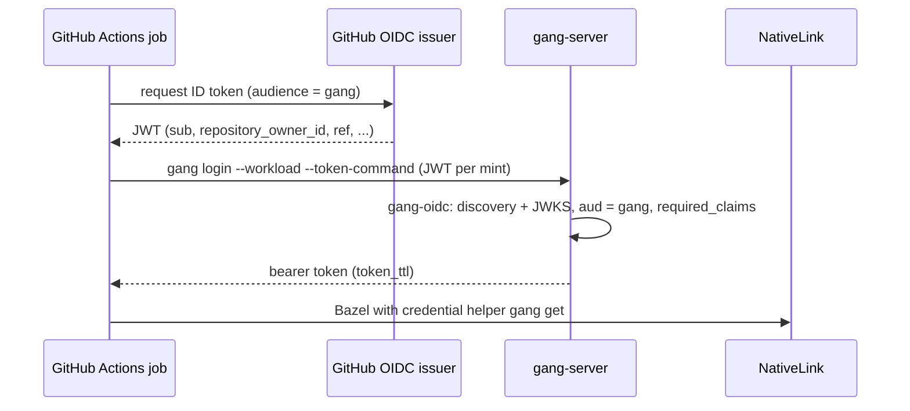

# Gang Technical Specification

---

## 1. Configuration (`gang.toml`, `crates/gang-config`)

One file, `gang.toml`, configures every `gang` command. Users never write `[selection]` or `[plugins.*]`: configurable backends are chosen by writing their sections (`[provisioner.aws]`, `[sandbox.bwrap]`, `[identity.providers.google.oidc]`), and each section is the backend's strongly typed configuration. An unknown or missing backend is a parse error that names the accepted keys. Gang's scheduler is fixed and built in; it has no backend selection.

Durations are human-readable strings (`"500ms"`, `"10m"`, `"7d"`) parsed into `std::time::Duration`; sizes are strings (`"29GiB"`) parsed into `gang_types::Bytes`. A non-zero duration is a whole number of milliseconds; a value with finer precision is rejected rather than rounded, so every configured duration prints back exactly as written.

Every behavioural tunable (timeouts, intervals, budgets, headroom, retry and refetch limits, grace periods, size caps, feature toggles) is a typed field of the configuration section of the component that owns it, with a documented default. Toggles are enums, not bools. No tunable value is hard-coded; named constants exist only for the default itself and for protocol facts.

Every bound in the plugin tables is enforced when `gang.toml` is parsed, including the minimums, ranges and cross-field rules of their `client` and `tuning` tables (for example, `retry_max_backoff` at least `retry_initial_backoff`). A value that parses is valid: a bad value fails `gang server` and `gang worker` before any plugin is built.

### 1.1 Plugin Domains

| Domain | Section | Cardinality | Plugins | Ports provided |
|---|---|---|---|---|
| Provisioner | `[provisioner.<plugin>]` | exactly one | `aws` (`gang-aws`), `local` (`gang-local`) | `ProvisionerPort`, `NodeLifecyclePort`, `ControllerHostPort`, `ScratchVolumePort`, `WorkloadCredentialPort` |
| Cache | `[cache.<plugin>]` | exactly one | `s3` (`gang-aws`), `filesystem` (`gang-local`) | `CacheStorePort` |
| Signer | `[signer.<plugin>]` | exactly one | `kms` (`gang-aws`), `file` (`gang-local`) | `CertificateSignerPort` |
| Database | `[database.<plugin>]` | exactly one | `sqlite` (`gang-sqlite`), `postgres` (`gang-postgres`), `dynamodb` (`gang-dynamodb`) | `StateRepositoryPort`, `LeaderLeasePort`, `ExpiringRecordPort` |
| Sandbox | `[sandbox.<plugin>]` | one or more; each fleet's `sandbox` key picks one (typed: an unknown key is rejected with the accepted keys) | `noop` (`gang-noop`), `bwrap` (`gang-bwrap`) | `ActionIsolationPort` |
| Identity provider | `[identity.providers.<name>.<plugin>]` | one plugin per entry; any number of entries, operator-named (`none` is reserved) | `oidc` (`gang-oidc`) | `ProofVerifierPort`, `LoginPort` |
| Client authentication | `[authentication.clients.<plugin>]` | exactly one | `token` (`gang-authn`), `none` (`gang-authn`) | `AuthenticationPort`, `CredentialLifecyclePort` |
| Worker authentication | `[authentication.workers.<plugin>]` | exactly one | `mtls` (`gang-authn`), `none` (`gang-authn`) | `AuthenticationPort`, `CredentialLifecyclePort` |
| Action limits | `[limits.<plugin>]` | zero or one (optional) | `cgroup` (`gang-cgroup`) | `ActionLimitsPort` |

Compute, lifecycle, scratch, workload credentials, and worker lifetime (`ProvisionerPort::worker_lifetime`) always come from the same environment, so they are one provisioner choice. The cache and the signer are separate domains, so a deployment can mix them with any provisioner (an S3 cache with a `kubernetes` provisioner). The client and worker authentication domains are separate, so the public listener and the worker listener can use different plugins; the transport is set by `[server] transport`, not by a plugin (§3.9). A crate may provide plugins in several domains: `gang-aws` provides `aws`, `s3`, and `kms`; `gang-local` provides `local`, `filesystem`, and `file`; `gang-authn` provides `token`, `mtls`, and `none`. The certificate authority (§3.6) and the TLS transport (§3.9) are not plugins: they are fixed adapters.

### 1.2 `crates/gang-config/src`

`gang-config` owns the configuration that is the same for every plugin set. The plugin sections are typed by the enums `gang_spi::compose!` generates (§2.4), so `GangConfig` is generic over the composed `PluginSet`. `GangConfig<P>` implements `FromStr` (`ConfigError`); the TOML text is parsed strictly and validated in one step. A parsed configuration can also be edited and written back as a `Document` (§1.2).

The configuration types live in `crates/gang-config/src`, one module per concern; their doc comments own every field's meaning, unit and bound:

- `plugin_set.rs`: `PluginSet`, the trait `compose!` implements for the composed plugin set (one associated type per domain plus `FleetOptions`), and `SandboxSelection`.
- `gang_config.rs`: `GangConfig<P>` with `parse` (also `FromStr`), `pinned` and `insecure`, and `Document<P>` with `to_toml`.
- `fleets.rs` and `fleet_policy.rs`: `Fleets`, `FleetConfig` and `FleetPolicy`.
- `scheduled_minimum.rs`: `ScheduledMinimum`, the `[[fleets.scheduled_minimum]]` windows (`instances`, `days`, `start`, `end`, `time_zone`), resolved against the tz database bundled in the binary (`jiff`), never the host's zoneinfo.
- `server_config.rs`, `endpoint.rs`, `ca_pin_setting.rs`, `rate_limit_config.rs` and `role_config.rs`: `[server]`, the endpoint, `ca_pin`, `endpoint_trust` (`ca` by default or `system`; §3.9), `[server.rate_limit]` and `[[server.roles]]`.
- `worker_config.rs`, `execution_config.rs`, `dashboard_config.rs`, `client_secret.rs`, `identity_config.rs` and `authentication_config.rs`: `[worker]`, `[execution]`, `[dashboard]`, the dashboard client secret, `[identity]` and `[authentication]`.
- `actions.rs` and `action_resources.rs`: `[actions]` and its resource settings; `http2_config.rs` and `open_file_limit.rs`: `[server.http2]` and server and worker open-file limits.
- `scaling.rs`: the optional `[scaling]` rate-based purchase and N−1 scale-in policy (ADR-60).
- `sandbox_file.rs`: `SandboxFile` (below).
- `errors.rs`: `ConfigError`, one variant per rejected configuration, each with its operator fix.

Callers that rewrite a configuration (`gang local up`, the end-to-end harness) parse a `Document`, change typed fields and call `to_toml`; they never edit a `toml::Table`. The TOML keys `min_instances` and `max_instances` become `InstanceBounds`, whose minimum is a `u32` and maximum a `NonZeroU32`; `max_instances = 0` is rejected while parsing.

`[actions] history_window` is a nonzero `HistoryWindow` expressed as an integral number of days, default `7d`, covering resource measurements, action durations and source activity profiles. `history_keys` is a `NonZeroUsize`, default 65536, bounding the combined target-and-mnemonic and mnemonic duration history keys. `history_memory_budget` is a `NonZeroBytes` resource-history cache byte cap, default `512MiB`. `history_flush_interval` is a `NonZeroDuration`, default `30s`.

**`[scaling]` (v0.3.4).** The section and every key are optional; unknown keys are rejected. Durations below use whole milliseconds. The waterline also controls the completion-refill tolerance: lowering it makes scale-in more conservative but makes the refill test easier to satisfy (§5.1).

| Key | Default | Bounds / meaning |
|---|---|---|
| `payback_percent` | `50` | Integer `1..=1000`. `H = payback_percent / 100 × (B + idle_timeout)`, using the fleet's measured or effective prior readiness `B`, not `boot_grace`. |
| `load_half_life` | `"60s"` | `1ms..=1h`. Half-life of event-time completion rates and sampled in-flight load. |
| `source_idle` | `"60s"` | `1ms..=1h`. Continuous observed quiet that closes an activity period. |
| `max_sources` | `1024` | Integer `1..=65536` distinct retained sources, each with per-fleet state; unattributed work has separate reserved state. |
| `unknown_action_duration` | `"10s"` | Positive duration. Last fallback after learned action duration and the source's current known-action mean. |
| `readiness_prior` | `"90s"` | Positive duration. Before a readiness measurement, each fleet uses `min(readiness_prior, boot_grace)`; a larger configured prior is not a parse error. |
| `scale_in_waterline_percent` | `70` | Integer `1..=99`. Maximum per-resource load at N−1 and completion-refill tolerance. |
| `scale_in_dwell` | `"5m"` | Positive duration, at least `load_half_life`. Required continuous N−1 feasibility. |
| `max_cordons` | `1` | Integer `0..=65535`. Per-fleet concurrent physical-instance cordon budget; `0` disables rate-based cordons, not idle-timeout drains. |

The readiness clamp does not change `boot_grace` or a measured median, which can be zero. The helper accepts `boot_grace = 0s` and returns zero, but this does not make a whole configuration with zero boot grace valid: the separate existing `shutdown_grace < boot_grace` rule still applies. If measured readiness and `idle_timeout` are both zero, `H = 0` is handled analytically (§5.1), without an extra tunable.

`FromStr` rejects, beyond TOML and schema errors, every cross-section rule that a `ConfigError` variant (`crates/gang-config/src/errors.rs`) names: a `default_isa` that no fleet has, two fleets with one name, more fleets than `MAX_FLEETS`, fleet bounds that do not hold, a scheduled minimum whose `instances` is not above `min_instances` or exceeds `max_instances` (`ConfigError::ScheduledMinimumBounds`), a fleet whose `sandbox` has no section, a reserved provider name, an authentication plugin that names an unconfigured identity provider, a missing `endpoint` when `listen` is not loopback, an authentication plugin that needs TLS under `server.transport = "plaintext"`, an `endpoint` that does not match the transport, a missing `worker_endpoint` when `worker_listen` is not loopback (`ConfigError::WorkerEndpointRequired`), a `worker_endpoint` without a host, without `grpcs` under TLS (`ConfigError::WorkerEndpointNotGrpcs`) or without `grpc` or `grpcs` under plaintext (`ConfigError::WorkerEndpointNotGrpc`), a `[[server.roles]]` principal whose provider names no `[identity.providers.<name>]` section (and is not the reserved `none`), two roles with one name, a role with no permissions or no principals, a permission name that is not in the table, and an `ipv6_prefix_length` outside 1 to 128. Fields typed as `NonZeroDuration`, `Percent` or `NonZeroBytes` reject zero duration, percentages outside 1 to 100 or zero bytes respectively (`ConfigError::Gang`, with the TOML line and column); the scaling-specific ranges are in the table above. TLS without a trust domain is likewise rejected by `Transport`. An unknown time zone, a time that is not `HH:MM` from `00:00` to `24:00`, a `start` not before `end`, and an empty or repeated `days` list are rejected while the table is parsed.
`FromStr` also rejects `endpoint_trust = "system"` under `tls` with a `ca_pin` and a worker plugin that does not enroll (`ConfigError::PinnedWorkersNeedAdvertisedCa`), and `[worker] connect_timeout` that is not strictly below twice `[server] worker_timeout` (`ConfigError::WorkerConnectTimeoutTooLong`).

Cache, execution, API and dashboard traffic share `listen` and the advertised `endpoint`. Configuration rejects unknown fields. Every fleet's `boot_grace` must exceed the scheduler's `shutdown_grace`; shared-database deployments (`postgres` and `dynamodb`) check this at plan time.
The optional top-level `health_listen` is a socket address for the controller's plaintext HTTP health listener, serving `/ready`; when unset, no health listener is bound. `[server] health_max_connections` is a nonzero connection limit (default `64`), and `health_max_header_size` is a byte size (default `8KiB`) that must be at least `8KiB` and fit `usize`. The whole health HTTP exchange uses the fixed `health_check().timeout()` of `2s`.
`[server.proxy_protocol]` controls PROXY v2 framing and trusted socket peers (§8.3).

`[server.leadership]` sets `ttl` (default `10s`), `renew_interval` (`3s`), `call_timeout` (`2s`) and `clock_skew` (`2s`); all but `clock_skew` are nonzero and `renew_interval + call_timeout + clock_skew` must be less than `ttl`. `[server] revocation_refresh_interval` defaults to `5s` and must be nonzero.
`[server] standby_routability_delay` defaults to `0s` for deployments without a load balancer. The shared-database deployment renders it from the health-check healthy window (§8.1).
At parse time, `LeadershipOutlastsKeepalive` rejects `ttl + clock_skew + renew_interval` plus the load balancer's healthy window (`threshold × interval` of the health check defined in `gang_types::health`) unless it is strictly below the client keepalive timeout of 30 s.
Every provisioner method that changes a fleet (`converge`, `set_desired_capacity`, `terminate`, `acknowledge_exit`) takes a `Held` permission that only `Fence::run` lends, borrowed for one call. A lease fence admits the call only while the lease outlasts the nonzero `call_timeout` from the call's start, including preliminary reads. Returning or cancelling the call invalidates every copied `Deadline`; revoking the lease invalidates all of its calls permanently. Blocking work registers through `Deadline::begin_work`, retains that registration until it finishes, and checks authority immediately before each change. Before releasing leadership in the repository, the controller revokes authority and waits for registered work to finish. Cancellation does not interrupt an already-entered filesystem operation. `supply` only reads and takes no permission. `attach` changes no fleet and takes none, so a leader whose lease lapsed can still re-attach its sidecar.
If dashboard history reload fails at promotion, the leader keeps its previous history and continues; a later promotion retries the reload.

`[database.dynamodb]` requires `table` (3–255 ASCII letters, digits, `_`, `.` or `-`) and `region`; `endpoint` is optional and defaults to the AWS endpoint, and `client` defaults to the shared AWS timeout and retry settings. `[cache.s3] endpoint` is an optional HTTP(S) URL and `force_path_style` defaults to `false` for S3-compatible services. `[provisioner.aws] retirement_poll_interval` defaults to `5s` and is nonzero.

`[database.postgres]` requires `host` (host name, IP address or absolute Unix-socket directory), `database` and `user`. `port` defaults to 5432, `pool_size` to 8, and `connect_timeout` and `statement_timeout` to `5s`. The optional `password_file`, resolved relative to the configuration file, has its trailing line ending stripped and must not be empty. `tls` defaults to `verify-full`, which checks the certificate chain against `ca_file` or the system trust store and checks the host name; `disable` is allowed only for a loopback IP or Unix socket, and a socket requires it. `ca_file` is allowed only with `verify-full`. Unusable values are configuration errors at startup.
Cancelled DynamoDB transactions caused by item conflicts or throttling are retried with bounded jittered backoff within the configured request timeout and attempt limit.
The shared AWS client requires `connect_timeout` not to exceed an attempt: the full `request_timeout` with one attempt, or half of it with multiple attempts.

For the dashboard, `FromStr` also rejects a `[dashboard]` `heartbeat`, `detail_interval` or `login_ttl` of zero (`ConfigError::Gang`), an explicit `actions_stale_after` that is not above `detail_interval` (`ConfigError::StaleThresholdNotAboveRefresh`), a `history_window` that is not 1 to 1440 whole `history_step`s of whole seconds (`ConfigError::HistoryWindowNotWholeSteps`), a `[dashboard.login]` `provider` that names no `[identity.providers.<name>]` section or is the reserved `none` (`ConfigError::DashboardLoginProviderNotConfigured`), and a blank `[dashboard.login]` `client_id` (`ConfigError::Gang`, with `client_id must not be blank`). A relative `client_secret_file` is also rejected while the table is parsed. Whether the provider has an interactive login is not checked at parse: the server mounts the login routes only when it has one (§4, Browser sessions).

`crates/gang-config/src/dashboard_config.rs` owns the `[dashboard]` keys; each field's doc comment states its default and meaning.

`[dashboard] session_max_age` sets the absolute browser session lifetime, default `12h` and bounded from `1m` to `30d`. `renewal_reuse` sets how long renewals of the same token share a refresh grant, defaults to `1m`, and must be non-zero.

The sessions E2E fixture alone uses a `25s` token TTL and `60s` absolute session age, preserving real expiry and renewal checks without changing production defaults.

`[dashboard.device]` controls device login (ADR-37): `enabled` defaults to `true` and mounts it only when dashboard sign-in is mounted; `ttl` defaults to `10m` and is bounded from `1m` to `30m`; `poll_interval` defaults to `5s`, is bounded from `1s` to `1h`, and must be shorter than `ttl`. Set `enabled = false` to disable device login.

`[builds]` bounds the in-memory build observations (ADR-42). Every value is non-zero.

| Key | Default | Meaning |
|---|---|---|
| `max_live` | 256 | Builds held; at the cap, drop the least recently active. |
| `idle_after` | `5m` | Time without an observation before a build is idle. |
| `queue` | 65536 | Observations waiting for the recorder; excess is counted as unrecorded. |
| `mnemonics` | 32 | Mnemonic rows per build; the remainder folds into `otherMnemonics`. |
| `targets` | 20 | Most-missed targets per build. |
| `slowest_actions` | 20 | Slowest actions per build. |
| `timeline_buckets` | 120 | Timeline buckets per build. |

Worker lifetime is not a fleet setting. A provisioner plugin that offers both modes exposes it as its `worker_lifetime` setting (`long_lived` or `single_use`); `kubernetes` defaults to `single_use` and `slurm` to `long_lived`. `aws` and `local` have no setting and report `LongLived` from `ProvisionerPort::worker_lifetime`.

`SandboxFile` is the file `gang worker` writes beside the `gang-exec` entrypoint, under the fixed name `SANDBOX_FILE_NAME` (`sandbox.toml`); `SandboxFile::beside(entrypoint)` is `entrypoint.with_file_name("sandbox.toml")`. It holds `work_directory` (the worker's work directory root, from `WorkerSpec::work_directory`), `selected` (the sandbox key of the worker's fleet), the `[sandbox.<plugin>]` sections, `[execution]`, and the `[limits.<plugin>]` section when there is one, as TOML. The programs of the selected sandbox (`selected`) only are pinned in it as absolute canonical paths, resolved by `gang worker` against its `PATH`; the programs of configured sections that are not selected are written unchanged. `gang exec` finds it from its own argv0, the entrypoint path the worker executes, which an action cannot change; the entrypoint must be absolute, else `ExecError::EntrypointNotAbsolute`. `gang exec` reads only this file, never `gang.toml`; it builds `Sandbox::build(file.selected, file.sandbox, &PluginContext { config_path: <sandbox file> })` and, when `file.limits` is present, `Limits::build(..)` likewise, and runs the action (§3.7). No environment variable names it.
The trusted sandbox file also records the selected fleet's action policy, including its grants and resource ceilings. Its validation rejects an unsupported grant or incoherent egress configuration; configuration of another fleet cannot confer a grant.

`SandboxFile`'s `FromStr` rejects a `selected` key with no `[sandbox.<plugin>]` section (`SandboxFileError::SelectedNotConfigured`).

Every plugin `Config` is `Serialize` and `Deserialize`. Identity provider sections are sent to clients as login parameters, so they hold no confidential data.

### 1.3 Production Example

`configs/gang.aws.toml` is the production example; every deployment value in it (regions, names, domains, identifiers) is a placeholder. The example Terraform root renders it and its test asserts that the render equals the file (§8.5); the rendered file is the SSM parameter the controller and workers read (§8.3). Like every checked-in configuration it holds only the values a deployment chooses: every other key takes the default the code owns. Core configuration includes the top-level endpoints, `[[fleets]]`, `[server]`, `[server.http2]`, `[worker]`, `[actions]`, `[execution]`, `[dashboard]`, `[identity]` and `[authentication]` (§1.2); backend sections are owned by their respective plugins. `crates/gang-main/src/checked_in_configs.rs` loads every `configs/*.toml` through the plugins the `gang` binary composes.
The production example shows the load-balanced, publicly trusted layout.

**Dashboard sign-in.** The dashboard signs viewers in with its own confidential OAuth client, not the native-app client of `oidc.login`, whose secret is not confidential and is sent to every CLI. Register a Web-application client at the identity provider with the redirect URI `{endpoint}/ui/callback` (here `https://gang.example.com/ui/callback`), put its id in `[dashboard.login]` as `client_id`, and list that id in `additional_audiences` of the provider so that its ID tokens are accepted. Put its secret in exactly one of two keys: `client_secret`, inline, or `client_secret_file`, an absolute path to a file that holds only the secret as UTF-8 text. Config with neither key, both keys, or a relative `client_secret_file` is rejected. An inline `client_secret` that is empty or only whitespace is rejected at parse time, like an empty file. Surrounding whitespace such as a trailing newline is trimmed; a file that is empty after trimming is an error that names the path, and so is one that cannot be read as UTF-8. `gang server` reads the file once, when it starts; `gang worker`, the CLI and every other reader of `gang.toml` see only the path and never open it, so the file is needed on the controller host only. On AWS the secret lives in a SecureString parameter, and the controller's boot writes it to that file with mode 0600; it is never in the String parameter that holds `gang.toml`. The secret's type is redacted in Debug output. The provider's `oidc.login` section still supplies the scopes and authorization parameters. A viewer sees data only when a `[[server.roles]]` role grants it `state.read` (the `administrator` role in `configs/gang.aws.toml` grants every permission). Browsers must trust the server certificate. With `endpoint_trust = "ca"` under TLS that is Gang's own CA; a publicly trusted terminator can instead re-encrypt to Gang with `endpoint_trust = "system"`, or forward plaintext with the worker surface set to `none`, because `mtls` requires `tls`. An `https` endpoint keeps the `__Host-` cookie names.

### 1.4 Local Mode (`configs/gang.local.toml`)

The file `configs/gang.local.toml` runs actions under `bwrap` on Linux; on macOS it runs with the fleet's `sandbox = "noop"`, because bubblewrap is Linux-only. `[limits.cgroup]` is Linux-only too: macOS leaves the section out and no limits apply. The file serves TLS on loopback with Gang's own CA. Clients authenticate with `token` (`clients.token`, the `local-workers` identity provider), and workers authenticate with `mtls`. `gang local up --insecure` runs the plaintext variant at the end of this section. `checked_in_configs` loads it through the composed plugins.

The plaintext variant is `configs/gang.local.plaintext.toml`: `[server] transport = "plaintext"`, an `http://` endpoint, a `grpc://` worker endpoint, and the `none` plugins on both surfaces, so no listener has TLS and both surfaces are anonymous. The checked-in file binds no role: a dashboard on it shows no data until a `[[server.roles]]` entry grants `state.read`. `gang local up --insecure` runs it and replaces any `[[server.roles]]` with one role, `administrator` with permissions `["*"]`, bound to the anonymous caller `none:anonymous`, so the dashboard shows its data. It writes that configuration to `<state_dir>/server/gang.toml` (§6.2), starts the server from it and prints the dashboard URL as the `ui` field (for example `http://127.0.0.1:8080/ui/`) unless `[dashboard] enabled = false`. The session cookies are the plain `gang_session` and `gang_login`, because the endpoint is `http`.

---

## 2. Compile-Time Plugins & Ports (`crates/gang-spi`, `crates/gang-macros`)

### 2.1 Pure-Facade `crates/gang-spi/src/lib.rs`

`crates/gang-spi/src/lib.rs` is a pure facade: it declares the private modules and re-exports the ports and their value types (§2.3), `Plugin`, `PluginContext`, `SandboxPrograms`, the error types, and the `port`, `compose!`, `FleetOptions` and `PortFailure` macros. Nothing else is public.

The lint policy (deny unsafe code, which only `crates/gang-os/src/sys.rs` expects with a reason; deny missing docs and the clippy set) is declared once in `[workspace.lints]` of `Cargo.toml`, and every member inherits it with `[lints] workspace = true` (checked by `bazel/architecture`). Bazel reads it from each crate's manifest through rules_rust's `extract_cargo_lints`, which the workspace Rust macros declare per package and attach to every Rust rule they declare, unit tests included (a test of a crate does not inherit the crate's lint config); Cargo reads it for the darwin check (§7 item 5).

Values shared across crates live in `gang-types` and `gang-clock`, not here: `Principal`, `Proof`, `RefreshToken`, `CertSerial`, `InstanceId`, `WorkerId`, `Isa`, `Bytes`, `Resources`, `Fleet`, `FleetName`, `FleetCatalog`, `FleetProperties`, `FleetSet`, `WorkerLifetime`, `Permission`, `PermissionSet`, `ScalingCause`, `ClientSecret`, `Identity`, `MachineClass`, `AuthenticationSettings`, the `gang_types::property` constants (`gang-types`); `Timestamp` (`gang-clock`). The `gang-spi` tests also depend on `gang-config` (below `gang-spi` in the crate graph, docs/PLAN.md §2.2) because `compose!` implements `gang_config::PluginSet`.

### 2.2 The `Plugin` Contract (`src/plugin.rs`)

`Plugin` and `PluginContext` (`crates/gang-spi/src/plugin.rs`) own the contract: a plugin names its `Config` section type and builds itself from it and the context. The crate-level doctest in `crates/gang-spi/src/lib.rs` implements a minimal plugin, so the contract is compiled on every test run.

`build` validates configuration only. Resources used by one role (controller or worker) are opened on first use by that role's ports, so a plugin builds on every node that runs `gang`. `gang worker` never builds `signer`; it builds `cache`, which does no I/O in `build`, and asks it for store specs only when `worker_access()` is `Direct`. A filesystem cache is only ever opened by the controller.

`SandboxPrograms` is implemented by a sandbox section that names programs; the host rewrites those paths to absolute paths before writing the sandbox file. `AuthenticationSettings` is implemented by each authentication section so the host can read `requires_tls()` and every identity provider the section names (`for_each_provider`) before it builds the plugin. The trait is defined in `gang_types` and reached from `gang_spi::__private` by generated code. Both settings traits carry `#[gang_macros::settings]`, which records their methods in a hidden delegate macro; `compose!` calls it, so the configuration enum forwards every method that borrows `self` to the selected plugin's settings, including one added later with a default body.


Every port trait carries `#[gang_spi::port]`, is `Send + Sync`, and is implemented directly by the plugin type (`gang_aws::Aws` implements the four provisioner ports, and `gang_aws::S3Cache` and `gang_aws::KmsSigner` implement the cache and signer ports). Ports are written with native `async fn`; `#[port]` rewrites each `async fn` into `fn .. -> impl Future<Output = ..> + Send` (so implementations may keep writing `async fn` and callers may spawn the futures), and records the methods in a hidden `macro_rules!` that `compose!` expands into the delegating impls. The types in port signatures must be nameable from the `gang-spi` root or from `gang-types`/`gang-clock` (the macro resolves them through `gang_spi::__private`). A port method may carry a default body, and a method marked `#[optional]` has no body, returns `Result<_, PortError>` and defaults to `PortError::Unsupported { operation: "<method name>" }`; the declaring module has `PortError` in scope.

The two error derives complete the port contract. `#[derive(Fix)]` (`gang_types::Fix`) gives an error enum one operator-facing action per variant, written as `#[fix("...")]` on the variant (`#[fix(source)]` delegates to the source error, the field marked `#[source]` or `#[from]`, named `source`, or the transparent one), and `None` where a variant has none. `#[derive(PortFailure)]` implements `From<E> for PortError` for a plugin's error enum, classifying variants with `#[failure(config)]`, `#[failure(unavailable)]`, `#[failure(backend)]` (the default), `#[failure(rejected(<Rejection variant>))]`, `#[failure(not_found(<Subject variant>))]`, `#[failure(unsupported("<operation>"))]`, or `#[failure(transparent)]`. Config, unavailable, backend and rejected variants retain the whole error as their source. Not-found and transparent variants require one field; not-found wraps it in the named subject and transparent converts it into a `PortError`. `#[fix]` and `#[failure]` go on variants only; on the enum or a field they are compile errors.

`PortError` tells the caller what to do: `Config(BoxedError)`, `NotFound(Subject)`, `Rejected { reason: Rejection, source: Option<BoxedError> }`, `Unsupported { operation }`, `Unavailable(BoxedError)` (retry on the next pass), `Backend(BoxedError)` (retrying will not fix it). `Subject` and `Rejection` are typed; rejection sources are logged and never sent to clients. A `Subject` names an instance, a worker, a certificate, a provider or a principal; a `Rejection` is an invalid proof, a policy denial, a revoked principal or a malformed request (`crates/gang-spi/src/errors.rs`).

### 2.3 Ports

The ports and their value types are declared in `crates/gang-spi/src`, one module per port; each trait's doc comments own its methods' contracts, and `lib.rs` re-exports them:

| Module | Port and its main value types |
|---|---|
| `provisioner_port.rs` | `ProvisionerPort` (`FleetSupply`, `FleetInstance`, `ServerEndpoints`, `Sidecar`) |
| `lifecycle_port.rs` | `NodeLifecyclePort` (`InstanceIdentity`, `PreemptionNotice`) |
| `host_port.rs` | `ControllerHostPort` (`HostMilestone`: `Serving`, `HandedOff`) |
| `scratch_port.rs` | `ScratchVolumePort` (`MountedScratchVolume`) |
| `credential_port.rs` | `WorkloadCredentialPort` |
| `cache_port.rs` | `CacheStorePort` (`RenderedStoreSpec`) |
| `signer_port.rs` | `CertificateSignerPort` (`SignatureAlgorithm`) |
| `scheduler_port.rs` | `SchedulerPort` (`ControllerSpec`, `WorkerSpec`, `SchedulerSnapshot`, `ControllerConnections`, `ApiService`, `RequestGate`, `Slots`, `StoreAccess`) |
| `observation_port.rs` | `ObservationSink`, `Observations`, `Observation`, `Call`, `Executed`, `Origin`, `Rpc`, `CallOutcome`, `ExecutionTimes` |
| `authentication_port.rs` | `AuthenticationPort`, `CredentialLifecyclePort`, `AuthenticationHost` |
| `repository_port.rs` | `StateRepositoryPort` (`PrincipalRecord`, `IssuedCertRecord`, `ScalingAuditEvent`) |
| `lease_port.rs` | `LeaderLeasePort` (`Lease`, `LeaseCandidate`, `CandidateGeneration`, `CandidatePriority`, `CandidatePriorityRef`, `Takeover`, `Acquisition`, `Renewal`) |
| `expiring_port.rs` | `ExpiringRecordPort` (`RecordKey`, `Record`, `RecordVersion`, `Insert`, `Replace`, `Remove`) |
| `isolation_port.rs` | `ActionIsolationPort` (`ActionExecutionSpec`, `SandboxedAction`) |
| `limits_port.rs` | `ActionLimitsPort` (`ActionLimits`, `ActionScope`, `ActionUsage`) |
| `identity_port.rs` | `ProofVerifierPort`, `LoginPort` (`LoginSupport`, `LoginRequest`, `LoginGrant`) |
| `fleet_options.rs` | `FleetOptions`, `OptionSpec` |
| `errors.rs` | `PortError`, `BuildError`, `Rejection`, `Subject` |

`LeaderLeasePort` acquires a free or stale lease with an incremented epoch, renews only the matching holder and epoch, and releases only that lease. Expiry alone does not prevent renewal until another holder acquires it. `ExpiringRecordPort` provides atomic all-or-none insertion and version-checked replacement and removal; expired records are invisible. `StateRepositoryPort` also pages all certificates and exposes a revocation epoch, incremented atomically on each certificate or principal revocation and principal restoration. `ControllerHostPort` signals retirement and reports serving and hand-off milestones. `ControllerConnections` carries public and worker streams and supports the hand-off described in §6.3.

After the embedded controller is prepared, each process obtains its host identity and registers a candidate, retaining that candidate across leadership terms. Its fresh process holder identity is distinct from its restart-stable host priority. AWS orders hosts by the immutable instance launch time from IMDS `pendingTime`, breaking ties by instance ID. Other hosts receive a durable monotonic generation at their first registration; later registrations of the same host retain that generation. SQLite's exclusive lock permits a constant generation. Identity errors do not fall back to a clock, hostname or process rank.

A higher-priority candidate may request a cooperative yield, never steal a live lease; host priority orders contenders, while the lease epoch and fence remain the authority. A missing owner priority or one not bound to the current lease epoch is treated as the minimum. A request is scoped to the current epoch and expires; the highest live priority wins, and a released or stale lease is reserved for that candidate until the reservation expires. A higher request can replace a reservation. Acquisition increments the epoch and clears the request; stale-epoch requests have no effect. Renew still extends the matching lease even when it reports a yield request, and release remains conditional on holder and epoch. Equal-priority processes on the same host cannot request a yield from each other, but may acquire a free or stale lease normally.

`ControllerSpec.observations` supplies the bounded, non-blocking observation sink. `Observation` is a `Call` or `Executed`, each with an `Origin` (build key and optional correlated invocation, tool, target and mnemonic). `Observations` receives records and drains per-build losses; losses beyond its bounded distinct-build accounting are unattributed. The observation sink owns monotonic traffic totals for lookups, hits and transferred bytes, including unattributable calls. Each controller holds these as one mutex-protected coherent tuple; updates use allocation-free integer additions. `ActionInfo.build` is the first submitter's build id, or absent when unattributable.

### 2.4 `compose!` (`crates/gang-macros`)

The composition root lists the plugins per domain; adding a backend is a new crate plus one line here. The domains `provisioner`, `cache`, `signer`, `database`, `sandbox`, `identity_provider`, `client_authentication`, and `worker_authentication` are required, each with at least one plugin. `limits` is optional: it lists its plugins like any domain, and at most one plugin is active. The invocation may omit the `limits` domain or write `limits: Limits {}`; either way `Limits` is uninhabited, `[limits.*]` is rejected, and `GangConfig::limits` is always `None`. The invocation is `crates/gang-main/src/plugins.rs`. The scheduler is not a composition domain or a `PluginSet` associated type: its fixed adapter is constructed separately with its inherent `try_new`, behind `SchedulerPort`.

For each configurable exactly-one domain (`provisioner`, `cache`, `signer`, `database`, `identity_provider`, `client_authentication`, `worker_authentication`) the key is the section name users write. Composition generates a configuration enum, externally tagged by the plugin key and holding each plugin's `Plugin::Config` (`ProvisionerConfig` with `aws` and `local`), a dispatch enum of the plugins (`Provisioner`) with `build(config, context) -> Result<Self, PortError>`, the provisioner's `ProvisionerFleetOptions` dispatch enum, and one delegating impl per port of the domain, each method a `match` that forwards to the selected plugin.

Each provisioner's option struct is its `FleetOptions` type: `#[derive(FleetOptions)]` (`gang-macros`) on a `#[serde(deny_unknown_fields)]` struct whose fields are the option keys. The derive generates `OPTIONS: &[OptionSpec]` (`key`, `doc`, `required`, `launch`) and `properties()`. A field marked `#[option(launch)]` only shapes how instances are launched: it is listed in `OPTIONS` with `launch: true`, `properties()` skips it, so it registers no worker property, actions cannot request it, and its type needs `Deserialize` alone, no `Display`. A struct may name `#[fleet_options(validate = <path>)]`, a `fn(&Self) -> Result<(), String>` that the generated `FleetOptions::validate` calls to check the rules that span fields. The derive rejects, at compile time, a field named like a reserved property key (`gang_types::property::RESERVED`), an unknown `#[option(..)]` or `#[fleet_options(..)]` argument, and any container `serde` attribute other than `deny_unknown_fields`. `compose!` generates `ProvisionerFleetOptions` above, the dispatch enum of those types, selected by the one `[provisioner.<key>]` section.
`#[fleet_options(validate_fleets = <path>)]` names a function that checks rules spanning the provisioner's fleets.

A crate may appear in several domains, as `gang_aws` does here. The enum is externally tagged, so serde rejects an unknown key (listing the accepted ones) and zero or several sub-tables. `identity_provider` generates the same enum, which `IdentityConfig` (§1.2) holds once per `[identity.providers.<name>]` entry. The optional `limits` domain generates the same enum and dispatch type (`LimitsConfig`, `Limits`); `GangConfig::limits` is `None` when no `[limits.<plugin>]` section is written. The `sandbox` domain activates any selection of plugins instead.

`SandboxKey` is a `Copy` enum of the sandbox keys whose `Display` prints the section key (`noop`, `bwrap`); `SandboxConfig` has one optional field per sandbox plugin, rejects unknown keys and implements `gang_config::SandboxSelection`; `Sandbox::build` builds exactly the plugin a key selects, and an absent section is `PortError::Config`. The expansion also defines `Plugins`, which implements `gang_config::PluginSet` with one associated type per domain plus `FleetOptions`. `PluginSet::fleet_options` deserializes each fleet's `[fleets.options]` table strictly into `FleetOptions` (through `gang_config::validated_fleet_options`, which calls `FleetOptions::validate` on the parsed value; a rule that fails is a `FleetOptionsError` naming the rule), and `PluginSet::option_properties` returns the `FleetProperties` of the selected provisioner's option struct, so the option vocabulary has one source (§3.2). `Plugins::provisioner_options()` lists the `OptionSpec`s of every provisioner, or of the one named (`gang options [<provisioner>]`). The caller of `compose!` depends on `gang-spi` and `gang-config` only: the expansion reaches `serde` and the `gang-types` values through `gang_spi::__private`. The expansion is in `crates/gang-macros/src/compose.rs`; `crates/gang-spi/tests/compose.rs` and `compose_without_limits.rs` compile it against test plugins.

The result: typed configuration end to end, unknown backends rejected at parse time with the list of accepted keys, and static dispatch with no boxing or allocation on the reconcile path.

---

## 3. Plugins & Fixed Adapters (`crates/gang-*`)

### 3.1 Provisioners, Caches, and Signers (`gang-aws`, `gang-local`)
A crate may provide plugins in several domains: each plugin below is selected by its own section.
- **`gang-aws`**:
  - **`[provisioner.aws]`**:
    - `ProvisionerPort` (`type FleetOptions = AwsFleetOptions`) over `Fleet<'_, AwsFleetOptions>`: one EC2 Spot or On-demand Auto Scaling group per fleet, named by `Fleet::name`; there is no separate group-name setting. A spot fleet that opts into `fallback` (below) also owns an on-demand twin group named `<Fleet::name>-on-demand`, and both groups must protect new instances from scale-in. `supply` reads every group of the fleet in one `DescribeAutoScalingGroups` call, the instance launch times (`DescribeInstances`) and, for an opted-in fleet, whether a Spot launch failed within `retry_spot_after` (`DescribeScalingActivities`, only when the Spot group wants more instances than it has). The reported `desired` is, per group, `max(desired capacity, live members)`, where live members are `Pending` or `InService`; instances the group is removing, and instances in the warm pool, are not capacity. For an opted-in fleet the ADR-23 spot rule applies on top: an unmet Spot request counts as booting capacity unless Spot is down (a failed Spot launch within `retry_spot_after`), in which case only the live Spot members count, plus the twin's reported capacity, and `supply` reports the unmet Spot request as abandoned. The reconciler plans a `Withdraw`, and `set_desired_capacity` sets the down Spot group to its live count; a failed write affects only that step. For each group whose request is unmet after that rule, `supply` reads its newest scaling activity (`DescribeScalingActivities`, `MaxRecords = 1`, no status filter); a failed activity supplies the fleet's launch failure with the provider's status message, preferring Spot to the twin. `set_desired_capacity` raises the reported capacity to `desired` (`SetDesiredCapacity`), and lowers a request only as far as its live members, never removing an instance. An opted-in fleet raises its Spot group first; while Spot is down it withdraws the unmet Spot request (desired := live Spot members) and then raises the on-demand twin. It lowers the twin first, then Spot, each no lower than its live members. It attempts every ordered group write even if an earlier one fails, and returns the first error, so a rejected Spot withdrawal does not block a twin raise. `terminate` is idempotent: an instance that no group lists, or that is already ending, returns `Ok` without a write. A `Pending` member, and any member of a group without warm-pool reuse, is terminated atomically with the group's desired capacity decremented (`TerminateInstanceInAutoScalingGroup`, in the instance's own group). An `InService` member of a group whose warm pool reuses instances on scale-in (`reuse_on_scale_in`) is released instead (ADR-22): its scale-in protection is lifted (`SetInstanceProtection`) and the group's desired capacity is lowered to the instances that stay (the `Pending` members, the protected `InService` members and the launches still in flight), so the group's own scale-in returns that instance to the pool. The target is computed first from the snapshot, so a repeat call writes nothing more. The release is refused with a configuration error when the group reuses instances without protecting new ones, and when another `InService` member is unprotected while the group is not already lowering (it launched before protection was enabled and must be replaced first). Every desired-capacity write (raise, withdrawal, release) honours `set_capacity_cooldown`. For an opted-in fleet `supply` marks the on-demand twin's instances `release_first` when `drain_on_demand_first` is set. A group that does not exist is a configuration error. `worker_lifetime` is `long_lived`.
    - **AWS observations.** `supply` also reports the requested marker: the sum of ASG desired capacities less abandoned requests. It is distinct from the planner's `desired` capacity above, which still counts live excess during rebalance; the marker does not change reconciliation. Other provisioners without a separate request use their reported `desired`.
    - With `events_queue_url`, `converge` receives EventBridge messages from SQS without waiting, under the leadership fence. A bounded pending batch is acknowledged only after the observation is durably inserted or found already present; storage failures leave it for retry. Receipt handles are transport state, not identities. Expired receipts leave the pending batch for redelivery. EC2 notices are admitted only after `DescribeInstances` verifies the instance's Auto Scaling group tag against configured fleet groups, including on-demand twins. Foreign notices are counted and deleted under the fence without rendering; malformed messages are counted without logging their bodies and left for the dead-letter queue.
    - While leadership remains valid, queue polling, optional activity-history observation and operational-status storage failures are logged and retried without pausing normal supply or capacity reconciliation; unpersisted notices remain unacknowledged, and worker-registration audit waits for canonical status readiness to avoid mislabeling a replacement as a join. A failed canonical status read clears unconfirmed operational statuses and phases rather than republishing stale risk beyond its TTL; the next successful read restores only live records.
    - Without a queue, paginated ASG activity history supplies historical replacement, termination and capacity-failure observations, identified by AWS ActivityId. It does **not** provide real rebalance recommendations or Spot interruption warnings. With a queue, EventBridge observations replace the activity event stream; activity reads may still enrich classification. A rebalance replacement requires the documented ASG cause and a known launched instance; overlap alone never creates a recommendation or interruption notice. EventBridge interruption warnings carry an action, not an exact deadline: stop and terminate are best-effort two-minute warnings, while hibernation begins immediately.
    - For queue-less history, bounded, expiring provider transport metadata remembers activity IDs only after successful canonical insertion or a known duplicate, so acknowledged activities are not repeatedly enriched or inserted. Unacknowledged activities remain retryable; replay after restart is deduplicated by the canonical conditional insert. This metadata does not replace or mutate the canonical observation.
    - `[provisioner.aws]` observation settings: `events_queue_url` is optional; `event_batch_limit` defaults to 10 (1–10), `event_visibility_timeout` to `30s` (greater than zero and at most `12h`), `activity_history_window` to `15m`, and `activity_limit` to 100 (1–1000). SQS uses the shared AWS client timeouts and retry settings.
    - Fleet options (`[fleets.options]`, §3.2):

      | Key | Required | Values | Meaning |
      |---|---|---|---|
      | `capacity` | yes | `spot`, `on-demand` | purchase option of the group; selects the allocation strategy |
      | `machine_class` | no | a class name such as `gpu`: 1 to 40 characters of `a-z`, `0-9` and `-`, as a fleet name | names the class an action may request through the `machine_class` property; the instance types come from the launch template; absent declares no class |
      | `fallback` | no | a table: `retry_spot_after` (default `5m`, `1m` to `24h`) and `drain_on_demand_first` (default `true`); an empty table takes both defaults | opts a spot fleet into on-demand fallback (ADR-23); spot fleets only |

      `capacity` and `machine_class` are exact properties (`machine_class` only when set). `fallback` is launch-only (`#[option(launch)]`): it shapes how instances are launched, registers no worker property and cannot be requested by an action. A fleet without `capacity` is rejected at parse, and so is a `fallback` on a fleet whose `capacity` is not `spot` or whose `retry_spot_after` lies outside `1m` to `24h` (`ConfigError::FleetOptions`, §3.2). An on-demand fleet's `instance_types` list order is its launch priority (`prioritized`); spot fleets use `price-capacity-optimized`. After the latest failed Spot launch, new capacity is bought on-demand for `retry_spot_after`, then Spot is tried again; `drain_on_demand_first = false` reports every instance with `release_first = false`.

    - `NodeLifecyclePort`: IMDSv2 instance identity document (instance id; `architecture` mapped to the ISA), Spot interruption notice (`spot/instance-action`), and `parked`: the IMDS item `autoscaling/target-lifecycle-state`, where any `Warmed:*` state is parked and `InService`, any other value, or a missing item (404) is not.
    - `ScratchVolumePort`: adopts the instance-store NVMe volume (RAID0 when several devices, XFS with reflink, mounted at `scratch_mount_point`) that a root `gang-scratch.service` oneshot unit on the machine image prepares before the worker starts. Scratch is empty at every worker start: instance store is erased when an instance stops, and an EBS data volume is re-created at every boot, so a worker that returns from a warm pool starts with no warm cache. The plugin never formats or mounts, because the worker runs unprivileged. It checks that the mount point is a mount, that the filesystem is XFS, and that reflink works (probe), and it reports the capacity (`statvfs` through `rustix`, so the crate needs no `unsafe`). `gang worker` places the fast CAS and the work directories on this volume and derives `fast_cas_budget` from its capacity, so with `input_links = "break"` a hard-linked input is replaced by a reflink (§3.7) and the cache cannot fill the volume.
    - `WorkloadCredentialPort`: STS `GetWebIdentityToken` through the worker's instance role (audience `workload_token.audience`, signing algorithm `workload_token_algorithm`, lifetime `workload_token.ttl`), on the regional STS endpoint, fresh on every call, presented to the `aws-workers` identity provider.
    - `ControllerHostPort`: polls instance metadata for retirement. At `Serving`, it completes the matching Auto Scaling launch lifecycle hook only if `DescribeAutoScalingGroups` reports this instance in `Pending:Wait` ([AWS lifecycle hook wait-state semantics](https://docs.aws.amazon.com/autoscaling/ec2/userguide/lifecycle-hooks-overview.html)); an ordinary process restart after the instance reaches `InService` does not complete launch again. At `HandedOff`, it completes the matching termination lifecycle hook while retiring. Outside an Auto Scaling group it has no hook to complete. Failed authoritative reads and lifecycle hook completion errors propagate, including unrelated `ValidationError`s.
    - Controller host identity requires the IMDS identity document's instance ID and valid `pendingTime`; missing or malformed launch time is a permanent error, not a reason to substitute a local clock.
  - **`[provisioner.aws]` tunables** (defaults: `crates/gang-aws/src/config.rs`, `client_settings.rs`): `[provisioner.aws.workload_token]` `audience` (1 to 1000 characters) and `ttl` (whole seconds from `1m` to `1h`, default `15m`, preserving the STS `GetWebIdentityToken` proof-lifetime bounds); `workload_token_algorithm` (`rs256` or `es384`); `[provisioner.aws.client]` (all durations greater than zero, `retry_max_backoff` at least `retry_initial_backoff`); `imds_request_timeout` (greater than zero); and `fleet_tag_key`, a tag key of 1 to 128 characters from `a-z A-Z 0-9 _ . : = + - @ ,` that is not `.`, `..` or `_index` and does not start with `aws:` in any case. `[provisioner.local.workload_token]` takes the same `audience` bounds and `15m` TTL default, but accepts whole-second TTLs from `20s` to `1h`; Gang-issued client tokens likewise accept `20s` (§4.1). The AWS proof minimum and IAM duration floor remain `60s`.
  - **`[cache.s3]`** (`region`, `bucket`): `CacheStorePort` renders NativeLink S3 store specs for `bucket`, with CAS objects under `<key_prefix>cas/` and action-cache objects under the environment-dependent prefix (§8.4); workers open the stores themselves (`StoreAccess::Direct`) with their own instance role. In `[cache.s3.tuning]`, `retry_jitter_percent` is 1 to 100: jitter cannot be turned off. `usage_interval` defaults to `1h` and must be at least `1h`; `[cache.s3.client]` uses the shared AWS client timeout and retry settings. The leader queries CloudWatch daily storage metrics outside the control pass at most once per interval, including failed attempts. The measurement covers the whole bucket, ignoring `key_prefix`, and can lag by more than a day; expiry follows the bucket lifecycle and is not observed. A custom S3 endpoint yields no bucket measurement and makes no CloudWatch request. Failed or unavailable measurements leave the last successful measurement in place.
  - **`[signer.kms]`** (`region`, `key_id`): `CertificateSignerPort` signs certificate bodies with ECDSA P-256 through KMS `Sign` (raw message, `ECDSA_SHA_256`; the DER signature is returned as is). The public key comes from `GetPublicKey`. The key ARN is resolved once on first use and pinned for every later signature; keys that are not `ECC_NIST_P256` signing keys are rejected. The CA private key never leaves KMS.
  - **HTTP client and credentials**: the AWS SDK uses one explicit rustls client with the `ring` crypto provider (no aws-lc). Credentials come from the SDK default chain (the instance role) and are never configured.
  - **AWS request bounds**: the configured request timeout bounds the whole operation, including retries; each attempt is bounded to half that timeout.
  - **Lazy clients**: all AWS clients are opened on first use, so building a plugin makes no AWS call.
  - **`gang-aws-sdk`** shares region and client settings, SDK loading, the HTTP client and error classification between `gang-aws` and `gang-dynamodb`.
  - **To be confirmed against real AWS at Gate 3** (pending, PLAN §3; named steps in the ADRs):
    - ADR-22 I1: a `SetDesiredCapacity` decrease returns the unprotected instance to the warm pool.
    - ADR-22 I2: `DescribeAutoScalingGroups` `Instances` excludes warm instances.
    - ADR-22 I3: IMDS `target-lifecycle-state` shows `Warmed:Stopped` before the stop and flips to `InService` promptly after a start.
    - ADR-22 I4: a `Pending` instance is not chosen as the scale-in victim.
    - ADR-22 I5: an instance entering service from the pool inherits the group's protection.
    - ADR-23 I6: a deterministic failed Spot launch (`SpotMaxPrice = 0.001`); measure the latency to the `Failed` activity and the retry cadence to set the `retry_spot_after` default.
    - ADR-23 I7: `DescribeScalingActivities` with the `Status` and `StartTimeLowerBound` filters and `MaxRecords = 1` returns the expected row.
    - ADR-23 I8: `SetDesiredCapacity` below the group size, with every `InService` instance protected, leaves them running and lowers the desired capacity.
    - ADR-23 I9: `TerminateInstanceInAutoScalingGroup` with decrement on a protected instance succeeds.
- **`gang-local`**:
  - **`[provisioner.local]`**:
    - `state_dir` (`[provisioner.local]`): the directory that holds the local provisioner's records and keys. A missing directory is created with mode `0700`; an existing one is refused when it is not private (mode other than `0700`) or is not owned by the running user. The path is walked from `/` using `openat` with `O_NOFOLLOW`. Every entered directory or link must be owned by the running user or the owner of `/`; every parent must also be so owned and not writable by group or others, unless it is sticky and the entered entry is owned by the user or the owner of `/`. The owner of `/` is normally root, but may appear as another uid in a user namespace. Checks precede creation and link traversal. `..` is resolved relative to the opened directory, not lexically. Secret files are written through the verified directory descriptor, even if its path is renamed. macOS's root-owned `/tmp` and `/var` links are accepted. gang never changes the mode of a configured directory. Directories gang creates beneath it (`server/`, instance and fleet records, the log, and each worker's scratch directory) are created or tightened to `0700`.
    - Controller host identity is a random 128-bit identifier persisted on first use in the private `state_dir/controller-hosts` directory. Its filename is the SHA-256 of the absolute lexical configuration path, without resolving symlinks. A restart using the same configuration path and state directory retains its identity; different configuration paths sharing a state directory have distinct identities, as do independent state directories. Corrupt identity data is an error, not regenerated. This is identity metadata, not fleet state.
    - `ProvisionerPort`: copies of the running `gang` binary started as detached `gang worker` processes with the same `gang.toml` (`PluginContext::config_path`), recorded under `state_dir` so they survive a `gang server` restart exactly as EC2 instances do. `supply` only reads the records; `converge` retires dead workers, kills terminating ones past `terminate_grace`, and launches workers up to the stored desired capacity. A failed spawn is remembered as the fleet's launch failure while its request is unmet, not returned as a `converge` or `set_desired_capacity` error; the next successful spawn or a met request clears it. Lowering desired capacity withdraws only unserved requests, never stops a worker. It has no `worker_lifetime` setting and reports `LongLived`. Its fleet options are none: `[fleets.options]` is absent or empty for every fleet, and `gang options local` prints no keys.

      `set_desired_capacity` commits only the requested count, clamped to live, non-terminating instances; it does not bootstrap or retire workers. `converge` alone realizes that request, so worker startup cannot turn an accepted capacity change into a failed request with no scaling audit event.

      Before signalling or retiring a newly terminating worker, Local Mode persists a release intent containing the terminating record and decremented desired capacity. It applies both values before removing the intent; an interrupted release is replayed before the next mutation of that fleet, so restart cannot decrement capacity twice or replace the released worker.

      Controller mutations share a nonblocking filesystem lock under `state_dir`, retained with their registered work; contention is returned rather than waited out. The child bootstrap inherits that mutation lock, acquires its worker lifetime lock, and durably commits its own PID while holding both. Before acknowledging readiness it replaces standard input with the lifetime lock, releasing its mutation-lock copy; the final worker inherits only the lifetime lock. The parent waits for both the readiness byte and completion of a retained close-on-exec receipt pipe; reported launcher exec errors remain launch failures rather than early worker exits. Until readiness is accepted, the parent owns cancellation cleanup: it kills and reaps the bootstrap before releasing its mutation guard.
    - `worker_launcher` (optional argv prefix, default empty): prepended to the `gang worker` argv when `local` starts a worker. Otherwise every worker shares `gang server`'s cgroup, and cgroup v2's no-internal-processes rule stops per-action `[limits.cgroup]` from enabling controllers. Local Mode on Linux with `[limits.cgroup]` sets a launcher such as `["systemd-run", "--user", "--scope", "-p", "Delegate=yes", "--"]`. A nonempty launcher must place the worker in a new private cgroup or scope owned exclusively by that worker, never joining an existing or shared scope, and must `exec` the command in place, so the pid, the process group and the inherited standard input (the lifetime lock) survive; a launcher that forks the worker away is not supported. The launcher's user scope is delegated, but systemd's user manager sets no `user.delegate` marker on it (verified on systemd 262), so Local Mode with `[limits.cgroup]` sets `delegation = "trusted"`.
      The original launch process's cgroup is persisted with the instance before bootstrap. A worker records the cgroup it runs in once the mock IMDS has served its identity document, before `prepare` (§3.8) moves it into its own leaf, so the record names the whole scope its launcher created; reading it at spawn would race the launcher, which joins its scope only after it starts. A dead worker's recorded cgroup is killed and removed before the worker is replaced only when durable launch cgroup evidence exists and the recorded cgroup neither is nor contains the original launch cgroup or the current caller's cgroup. Missing or legacy launch ownership evidence is logged and the kill is skipped rather than guessed; the legacy record can still be retired. A worker that recorded none died before it was identified: actions start only after registration, which follows the recording, so it ran none; it is logged and replaced without a reap. On a host without cgroup v2 the server has no cgroup and no worker records one, so a dead worker is replaced without a reap and without that log line.
      The server log records each early exit with the worker's own failure: the end of its log from its last `fail` record, or its last line. An early exit whose log has a `fail` record is also reported in the fleet's supply and recorded as an `exitedEarly` event. Before retiring the instance, the local provisioner persists the first observed exit time and failure. It reoffers the failure after restart until the controller durably records the audit event and then acknowledges it. If acknowledgement fails, the event may be recorded again: delivery is at least once, not exactly once.
    - `NodeLifecyclePort`: a mock instance metadata service on `mock_imds_listen`, which must be a loopback address (a config error at parse time, not at plugin build), that serves instance identity, with the fleet from the worker's process record, and simulated Spot interruptions. `parked` is always `false`: this provisioner has no warm pool. As identity federation it mints JWTs signed with a key generated under `state_dir`, and serves OIDC discovery and JWKS for them. Each worker authenticates with a per-instance secret generated when the fleet launches it, handed to the worker in `GANG_LOCAL_INSTANCE_SECRET` and stored only in its instance record; the service answers 401 to any request whose instance and secret do not match a record, so a local process cannot mint a workload token for another instance. The record is written before the worker starts, without a pid until the process has started, so the worker's first request is always authorized.
    - `ScratchVolumePort`: per-worker directories under `state_dir`.
    - `WorkloadCredentialPort`: returns such a JWT as the `Proof` for the `local-workers` identity provider, the same issuance path as `aws-workers`.
  - **`[cache.filesystem]`** (`path`, `content_store_percent` (`25`), `action_store_percent` (`2`)): `CacheStorePort` renders NativeLink filesystem CAS and AC stores under `path`; the two percentages are each 1 to 100 and sum to at most 100. A missing `path` is created with mode `0700`; an existing one that is not private (mode other than `0700`), is reached through an unsafe symbolic link (§3.1 `state_dir`), or is owned by another user is refused, never tightened. The store subdirectories gang creates beneath `path` are created or tightened to `0700`. Only the controller opens them, so workers reach them through the worker listener (`StoreAccess::ViaController`).
  - **`[signer.file]`** (`key_file`): `CertificateSignerPort` signs with the CA key file at `key_file`, generated on first start (Local Mode only). `FileSigner` opens the key's directory and key on first use of the signer port (§2.2 build rule); the directory must be `0700` and owned by the running user. A missing directory is created with mode `0700`; an existing one that is not private (mode other than `0700`), is reached through an unsafe symbolic link (§3.1 `state_dir`), or is owned by another user is refused, never tightened. A site without KMS has only this signer, which keeps the key on disk, until a `pkcs11` or `vault` signer exists.
  - Key files (the CA key and the IMDS JWT key) are written atomically (temp file, fsync, hard link) with mode `0600`.

### 3.2 Scheduler (`gang-nativelink`)
- **Fixed scheduler port**: `SchedulerPort::{snapshot, actions, set_draining, endpoints, run_controller, run_worker}`. NativeLink v1.8.3 is embedded: its crates (`nativelink-config`, `-scheduler`, `-store`, `-service`, `-worker`, `-util`, `-error`, `-proto`) are linked into the `gang` binary from Cargo git dependencies pinned to a revision of Gang's carried fork `leadingterm/nativelink`: upstream tag `v1.8.3` plus the commits below, and `gang-nativelink` reimplements only the glue of upstream `src/bin/nativelink.rs`. There is no `nativelink` binary, process, configuration file, or admin HTTP API. The scheduler bridge uses `WorkerScheduler::worker_snapshot` and walks operations via `ClientStateManager::filter_operations` for `snapshot`, and calls `WorkerScheduler::set_drain_worker` for `set_draining` (an unknown worker is `PortError::NotFound(Subject::Worker)`). The snapshot's managed workers have unique ids and are sorted by `WorkerId` ascending. The scheduler name is an internal constant; endpoints and tunables live in core configuration (§1.2).
- **Carried NativeLink commits.** Each fix is a separate commit on the branch so it can be sent upstream unchanged.
  - `fix(worker): rebase absolute internal output symlinks from their parent` — upload of an output directory whose symlink has an absolute target inside the action work directory failed with `Could not convert path contains non-relative component to RelativePath` (`running_actions_manager.rs` `upload_symlink` at v1.8.3, unchanged in v1.8.6). The newly created action directory is canonicalized once, so work and output paths derived from it are consistent even through aliases such as symlinked temporary directories, without resolving symlink targets. The target is now relative to the symlink's containing directory; it is not read, and dangling targets are allowed. The embedded `absolute_internal_output_symlinks_are_rebased_from_their_parent` and `absolute_internal_output_symlinks_are_rebased_through_a_symlinked_work_root` tests cover the direct and aliased roots. Upstream issue/PR: not yet filed. Remove the fix when pinning an upstream release containing equivalent handling, return to the upstream git tag, and keep the embedded test.
  - `fix(worker): report a killed action's outcome whatever happens to its uploads` — NativeLink v1.8.3 (unchanged in v1.8.6) published an action's execution result and resource usage only after every output upload succeeded, so an action the worker killed for memory, disk or time and whose upload (or cleanup) then failed reached the scheduler as an internal error without its usage: nothing was escalated and the generic retry ran under the same reservation. The result and usage are recorded when execution ends, and the worker returns that result, with its original error, when a worker-classified kill is followed by an upload or cleanup error; the failures of actions that were not killed stay failures. Covered by the embedded `a_memory_kill_survives_an_output_upload_error` and `an_output_upload_error_is_not_a_successful_action` tests and NativeLink's own `local_worker_test` and `running_actions_manager_test` cases. Upstream issue/PR: not yet filed (draft in the maintainers' notes). Remove the fix when pinning an upstream release with equivalent handling and keep the tests.
  - `feat(scheduler): requeue an action killed for disk with a larger disk reservation` — adds disk-kill escalation. Remove when an upstream release escalates disk kills.
  - `feat(worker): kill for disk only under sustained worker disk pressure` — adds disk pressure enforcement. Remove when an upstream release provides equivalent disk pressure enforcement.
  - `c41a9690` — An entrypoint side-channel memory failure is recorded as `KILLED_MEMORY` with `enforced = true` before resource usage classification, unless the worker already classified a kill. Kernel cgroup OOM kills therefore enter memory escalation and requeue. Remove when an upstream release includes the side-channel memory report.
  - the pressure-based resource enforcement commit — adds pressure-based memory enforcement, exact cgroup usage, and capacity-bounded resource requeues and learning. Remove when an upstream release includes it.
  - `feat(scheduler): allow ignoring platform keys in escalation capacity` (`c86940ed`) — adds `capacity_ignored_properties`, empty by default, for escalation capacity calculations. Remove when an upstream release provides equivalent behavior, and keep the regression test.
  - `d7292de4` (`gang-action-egress`) — adds `action_ceilings` to `ConnectWorkerRequest` and per-fleet action ceilings to the scheduler; `enforced_environment` replaces the client environment, protects reserved `GANG_*` variables, and creates the side-channel root. An authoritative `Some(empty)` platform replaces rather than preserves client properties. Remove when an upstream release provides equivalent action-policy enforcement.
- **Controller (`gang server`, `run_controller`)**: builds the content and action stores and the scheduler in process, and serves the gRPC services over each connection it is handed (`ControllerConnections`). Public connections speak HTTP/1.1 or HTTP/2, detected per connection; worker connections speak HTTP/2 only. It listens for nothing and does no TLS. The stores, scheduler, and services are built from typed `nativelink-config` values, deserialized in memory from `serde_json` documents so that NativeLink's own defaults apply. Gang never reads a value back from those documents, and builds a `nativelink-config` struct in Rust only where NativeLink owns no defaults to bypass: most of its structs have no `Default`, and a derived `Default` would not equal their serde defaults. Client connections are served `cas`, `ac`, `bytestream`, `capabilities`, and `execution`; worker connections are served `worker_api`, `cas`, `ac`, and `bytestream`. The controller is built from `ControllerSpec`, applies its `client_action_timeout`, and runs until both streams have ended or its future is dropped, which stops serving and closes every connection it serves. `client_action_timeout` must be a whole number of seconds and strictly greater than NativeLink's `CLIENT_KEEPALIVE_DURATION`. It checks the configuration (the cold start against the fleets, the memory and disk `min_reservation` against every fleet, the services) before it builds any store, and signals `ControllerReady` once everything is built, before it serves.
- **Introspection.** `snapshot` also reports `SchedulerSnapshot.completed` and `WorkerState.paused` (`WorkerSummary.is_paused`). `completed` comes from a forwarding decorator around the `WorkerScheduler` that the worker API serves: it counts a successful `update_action` that carries a `Completed` stage; errors, keep-alives, declined dispatches, worker losses and cache hits do not count: NativeLink v1.8.3 keeps no readable completion counter, and the decorator's `WorkerScheduler` impl is lint-guarded (`clippy::missing_trait_methods`) so that a method added by an upgrade cannot go unforwarded. `actions` reads NativeLink's `ClientStateManager` with `filter_operations`: one `worker_id`-filtered listing of the `Executing` stage per worker that runs actions (each operation is attributed to the worker it was listed under, and an operation no worker claims is never seen), and one listing of the `Queued` stage in descending priority. Digest, start time and the Bazel `target_id` and `action_mnemonic` come from each operation's state and origin metadata, and the queued rows' `candidates` from `FleetCatalog::accepting`. Rows past `ListingLimits` are counted in the `truncated_*` fields. The cost is `1 + busy workers + 1` listings per call (§5.2).
- **Work estimates.** `QueuedDemand.expected` is the optional learned mean slot duration for the action's target and mnemonic, falling back to its mnemonic. `SchedulerSnapshot.executing` contains `ExecutingDemand { worker, started, expected }`: the worker index, execution start and optional learned duration. The worker-scheduler wrapper records verified completed executions' worker-start to worker-completion slot time; missing metadata or timestamps provide no sample. Snapshot walks skip operations that disappear or cannot be decoded.
- **Build observation (ADR-42, amended by ADR-55).** `BuildObserver` runs inside NativeLink's `OtlpLayer` on the public router. It counts request and response body bytes for ActionCache, ContentAddressableStorage and ByteStream calls, including partial streams, compressed payloads and every attempt, excluding HTTP/2 and TLS framing. It records each cache call once at response-body EOF or drop; a drop before EOF is an error. A call cancelled or failing before the response head is recorded once as Error with the request bytes already read. A trailer `grpc-status` overrides the head classification; otherwise, an HTTP 200 head with absent or zero status is OK, status `5` is NotFound, and other statuses or a non-200 HTTP head are Error. `Execute` is recorded at the response head with zero transferred bytes. The observer reads the authenticated principal and Bazel request metadata; an absent invocation, absent principal or invalid over-cap field makes a call unattributable, but its traffic still counts farm-wide. The inner call runs with `enduser.id` baggage overridden by the authenticated principal, so NativeLink's operation origin cannot inherit a client-asserted identity. `ObservingWorkerScheduler` reads the operation origin before forwarding a `Completed` update, then on successful forwarding increments the completion counter and records the worker result and execution timings for the first submitter.
- **Worker (`gang worker`, `run_worker`)**: names the worker with `InstanceId::worker_name`, registers its `Slots`, uses `work_directory`, and keeps its fast content cache under `fast_cas_directory` (a filesystem store bounded by `fast_cas_budget`, which `gang worker` derives from the mounted scratch volume's capacity and `[worker] fast_cas_percent`). It runs NativeLink's local worker in process against the worker listener. `WorkerSpec::store_access` sets how it reaches the stores: `Direct` opens them itself (shared stores such as S3); `ViaController` reaches the controller's `cas` and `ac` stores through `grpc` stores on the worker listener, over TLS for `WorkerTls::ServerOnly` (using its CA file, or system roots when none) and `WorkerTls::Mutual`. Actions still run through the `gang-exec` argv0 link to the `gang` binary (the worker `entrypoint`), which reads the sandbox file beside it (§1.2). Persistent-worker pooling is disabled; actions declaring `supports-workers` execute one-shot through `gang-exec` to preserve the per-action contract. `gang-nativelink` assembles the worker with its actions manager and connection: `stop` declines new actions, kills every running action's process group and removes its directory before `run_worker` returns. It attempts to make the process the child subreaper once and starts one zombie reaper for the process's lifetime. `Slots::SingleUse` runs NativeLink's worker with `single_use`: it advertises one slot and takes exactly one action, and `run_worker` returns `Ok` once that action has finished and its outputs are uploaded. `gang worker` keeps one `WorkerSpec` for all generations and passes the TLS files of the current generation to each `run_worker` call.
- **Scheduler properties.** The controller uses `historical_resource` over `simple` (`learn_from_workers`). Workers register their fleet's physical `FleetProperties::worker_properties()`: exact `fleet`, `ISA`, `sandbox` and provisioner properties; physical minimum-resource capacity in `cpu_count`, `cpu_millicores`, `memory_kb` and `disk_kb`; and `network = requested` only on fleets granting network. Physical totals are distinct from per-action request ceilings. After admission, positive `cpu_count` becomes `cpu_millicores = max(cpu_count * 1000, existing cpu_millicores)`, the consumed CPU ledger; `cpu_count` remains in the dispatched environment. Physical `disk_kb` is the fleet's `disk_per_instance`.
  `FittedActions` raises nonzero learned or requested memory and disk reservations to their configured minima. Historical reservations above the largest eligible admitted action ceiling are clamped rather than rejected; when memory is clamped to a fleet's full physical capacity, its whole CPU in millicores is reserved, bounded by the CPU action ceiling. Killed memory and disk peaks each establish an expiring historical floor of measured peak plus reservation headroom, even when p95 is smaller; without a measured peak the killed reservation is the floor. Cold actions use `[actions.cold_start]`.
  Memory kills and pressure disk kills requeue independently of generic `max_job_retries`, with separate memory and disk step budgets. Soft disk kills fail the action instead of requeueing. For the killed resource, `next = min(cap, max(ceil(peak * (100 + reservation_headroom_percent) / 100), ceil(reservation * escalation_percent / 100), reservation + 1))`. The cap is the largest configured eligible fleet's effective action ceiling, not the largest connected worker. Eligibility preserves exact selectors and capability grants and requires every other requested minimum to fit that fleet's effective ceiling. A measured peak above cap, a further kill at a lower policy cap, a further kill while holding a physical-capacity reservation and the permitted whole-worker CPU, or exhaustion of that resource's `max_steps` terminates the current operation once, naming the action, measured peak, capacity and reason. Headroom or multiplier overshoot alone is not impossible demand.
- **Match rule and action policy.** Each fleet's optional `[fleets.actions]` defaults to no grants (`grants = []`); `network` is the first supported capability. Optional `[fleets.actions.resources]` keys `cpu_count`, `memory` and `disk` set nonzero per-action request ceilings, defaulting individually to the fleet's physical capacity. Memory and disk use size strings and must be whole KiB; no ceiling may exceed physical capacity. These are not total-worker capacity limits: concurrent admitted actions can use the physical total. Global minimum reservations must fit every fleet's effective limits, and an enabled cold start must fit at least one fleet.

  Admission checks the original client properties before learning. Exact selectors must match a declared value; numeric minimums must be valid and no greater than the fleet's effective request ceiling. `network = requested` requires that fleet's grant; absent, empty or `not-requested` is baseline. Other network values are invalid. Unknown property names, ungranted capabilities and original over-ceiling requests are rejected with `INVALID_ARGUMENT`, identifying the property and relevant fleet names. The explicit harmless metadata allowlist contains `supports-workers`, a persistent-worker marker whose actions execute one-shot through `gang-exec`. Dynamically declared provisioner properties remain exact selectors, and launch-only options remain unrequestable.

  Requests do not carry an action environment identity. The legacy `gang_action_environment` label is ignored; admission, placement and scaling do not depend on it or the worker image digest.

  Learning and retries cannot expand the originally admitted fleet set, relax a grant, or exceed an effective ceiling. Fitting lowers learned reservations only within that set; retry tables and native action ceilings are internal, not NativeLink user configuration knobs. Retries reserve whole-worker CPU only when the constrained resource's effective limit equals its physical capacity, bounded by the CPU ceiling; a lower policy cap clamps that resource alone, and a further kill at the cap is terminal.

  `FleetCatalog::fit` preserves fleet preference: a fleet accepting the learned values wins in declaration order; otherwise the fleet lowering the fewest keys wins, then the smallest sum of relative shortfalls, then declaration order. Each term is rounded down to units of 2^-64, distinguishing different limits on one key; equal rounded sums retain preference order. A lowered non-numeric value contributes one. Decision and rejected alternatives: ADR-14.
- **Capacity and rollouts.** Eligible work can run on any compatible worker in the fleet, including old workers during an image rollout. Running builds continue on old workers; image digests do not affect capacity or wait simulations.
- **Property vocabulary.**

  | Key | Owner | Rule | Worker value |
  |---|---|---|---|
  | `fleet` | Gang | exact | fleet `name` (explicit pin) |
  | `ISA` | Gang | exact | `isa` |
  | `sandbox` | Gang | exact | `sandbox` (placement only; §3.4) |
  | `cpu_count`, `memory_kb`, `disk_kb` | Gang | minimum, bounded by action ceiling | physical instance size (`disk_kb`: `disk_per_instance`) |
  | `cpu_millicores` | Gang | minimum, bounded by action ceiling | physical `vcpus` × 1000 |
  | `network` | Gang | capability | `requested` only on fleets granting network |
  | `supports-workers` | Gang | ignored (harmless marker) | not registered |
  | `gang_action_environment` | Gang | ignored (cache label) | not registered |
  | declared provisioner property | provisioner | exact | its `[fleets.options]` entry |

- **Fleet options.** A provisioner's `[fleets.options]` table is deserialized strictly and validated when the configuration loads (`gang_config::validated_fleet_options`, §2.3): an unknown key, a wrong type, or a rule that spans fields (`#[fleet_options(validate = ..)]`) is `ConfigError::FleetOptions` naming the fleet, before any server starts. `FleetOptions::validate_fleets` checks rules that span the provisioner's fleets. An option marked `#[option(launch)]` shapes only how instances are launched: `gang options` lists it as launch-only, it registers no worker property, so it adds no row to the vocabulary above, and an action cannot request it. The `aws` provisioner's `fallback` is such an option (§3.1); `fallback` on a fleet whose `capacity` is not `spot`, or a `retry_spot_after` outside `1m` to `24h`, fails the parse, and an empty `[fleets.options.fallback]` table opts in with both defaults.

- **Client defaults.** `gang setup` and `gang bazelrc` render `--remote_default_exec_properties=ISA=<default_isa>`; they render no action-environment property or repository environment.
- **Listeners are not here.** `gang-nativelink` serves the public and worker connection streams handed to it by `gang-server`; it does not bind addresses or terminate TLS (§6.1). Revocation closes established connections (§3.9, §4.4).
- **Endpoints.** The advertised executor and cache both use `endpoint`. The top-level `worker_endpoint` is the URL workers dial and the host name used for the worker server certificate. Its scheme must match `WorkerTls::scheme()` (`grpc` for `Plain`, `grpcs` otherwise); a mismatch is `PortError::Config`.
- **Tunables.** `[server]` holds `max_open_files` and `worker_timeout`; `[worker]` holds `max_open_files`, `upload_timeout`, `download_timeout`, `connect_timeout`, `cleanup_wait` and `keepalive_interval`; `[server.http2]` holds connection, stream, request-head and shutdown limits. Action policy belongs to `[actions]`. All action keys are optional, with defaults below (`crates/gang-config/src/actions.rs` and `action_resources.rs`). Unknown keys are rejected; durations are human-readable and sizes use size strings.

  | Section and key | Default | Meaning |
  |---|---|---|
  | `[actions] environment` | `default/1` | Typed versioned safe name for the server-owned action-cache namespace (§8.4). |
  | `[actions] reservation_headroom_percent` | 20 | Margin on learned and killed peaks. |
  | `history_window` | `7d` | History retention, positive whole days. |
  | `history_keys` | 65536 | Maximum duration-cache keys, nonzero. |
  | `history_memory_budget` | `512MiB` | Resource sketch byte budget, nonzero. |
  | `history_flush_interval` | `30s` | Nonzero flush interval. |
  | `retain_completed_for` | `60s` | Completed-job retention, positive whole seconds. |
  | `max_job_retries` | 3 | Generic failure retry budget, nonzero. |
  | `max_worker_loss_retries` | 10 | Worker-loss retry budget, nonzero. |
  | `timeout` | `20m` | Action timeout, positive whole seconds. |
  | `kill_grace` | `5s` | Nonzero termination grace. |
  | `[actions.memory] enforcement` | `pressure` | `pressure`, `soft`, or `none`. |
  | `min_reservation` | `64MiB` | Whole KiB, at least 4 MiB; fits every fleet. |
  | `reserve` | `1GiB` | Nonzero memory outside the pool and pool shortage watermark; less than every fleet's memory. |
  | `pressure_stall_percent` | 10 | PSI stall percentage, 1–100. |
  | `pressure_poll_interval` | `250ms` | Nonzero pressure polling interval. |
  | `pressure_kill_after` | `5s` | Nonzero sustained pressure interval. |
  | `sample_interval` | `250ms` | Nonzero usage sampling interval. |
  | `escalation_percent` | 200 | Resource reservation multiplier, greater than 100. |
  | `max_steps` | 8 | Memory requeue budget, nonzero. |
  | `headroom_percent` | 20 | Soft ceiling margin. |
  | `soft_samples` | 2 | Consecutive soft ceiling breaches, nonzero. |
  | `soft_spike_percent` | 200 | Immediate-kill percentage of soft ceiling, greater than 100. |
  | `[actions.disk] enforcement` | `pressure` | `pressure`, `soft`, `guard`, or `none`. |
  | `min_reservation` | `1GiB` | Whole KiB, at least 1 MiB; fits every fleet. |
  | `pressure_free_percent` | 5 | Free-space threshold, 1–100. |
  | `pressure_poll_interval` | `2s` | Nonzero pressure polling interval. |
  | `pressure_kill_after` | `5s` | Nonzero sustained pressure interval. |
  | `sample_interval` | `10s` | Nonzero usage sampling interval. |
  | `escalation_percent` | 200 | Resource reservation multiplier, greater than 100. |
  | `max_steps` | 8 | Disk requeue budget, nonzero. |
  | `headroom_percent` | 20 | Soft ceiling margin. |
  | `soft_samples` | 1 | Consecutive soft ceiling breaches, nonzero. |
  | `[actions.cold_start] enabled` | `true` | Reserve unmeasured actions. |
  | `cpu_count` | 1 | Whole CPUs, nonzero. |
  | `memory` | `4GiB` | Memory reservation, nonzero whole KiB. |
  | `disk` | `4GiB` | Disk reservation, nonzero whole KiB. |

  Nonzero durations have millisecond precision. Enabled cold-start dimensions must fit an eligible fleet. Memory reserve must also be smaller than effective worker memory at prepare; declared fleet memory must fit the resulting pool before enrollment.
  Client-facing listeners serve at most `max_connections` connections each (default 128); the worker listener allows two generations of every connection of every worker the fleets can run (the sum of their `max_instances`). A worker dials for its worker API and, under `ViaController`, its content and action stores; stopping and replacing workers can overlap during certificate renewal and termination. A connection earns its place once `RequestGate::admit` returns `Admitted::Authenticated`. At the limit a new connection replaces the oldest unproven connection, one without a request in flight first; it is closed at once only when every connection has earned its place. An unproven client-facing connection is closed after `unproven_idle_timeout` without a request in flight, before its first request included. Each listener logs refusals at most once per `refusal_log_interval`, with the count since its previous line and in all.
  One HTTP/2 connection runs at most `max_concurrent_streams` requests at once, and its client queues the rest. `receive_window` bounds bytes a client may send on a connection and on any one stream before the controller reads them, on public and worker listeners, so a connection uploads at most one window per round trip. An HTTP/2 connection holds at most its window in unread bytes and an HTTP/1.1 connection at most hyper's 408 KiB read buffer. Handlers have their own bounds: a gRPC request decodes one message of at most `max_message_size` plus one 16 KiB HTTP/2 frame at a time; the Gang API reads at most `[server] max_request_size`. Keep each listener's connection limit × its window within the controller's memory budget: unauthenticated clients can make it hold that much. The default 128 × 16 MiB = 2 GiB fits the 4 GiB reference controller.
  At parse time, `max_open_files` must be between 8 and 1073741824 inclusive; `max_message_size`, `max_connections`, `max_concurrent_streams`, `refusal_log_interval` and `unproven_idle_timeout` must be nonzero; `receive_window` must be between 65535 and 2147483647 bytes; and half of `connect_timeout` must be less than `worker_timeout`.
- **Memory pressure.** The default `pressure` mode has no per-action ceiling. It reads the action pool's `memory.pressure` `some total` (falling back to `full total`) in microseconds and counts an interval as pressured when `delta_stall * 100 >= pressure_stall_percent * elapsed_microseconds` and pool available bytes are below `actions.memory.reserve`. Available bytes are the pool-local minimum of finite `memory.high` and `memory.max`, less `memory.current`, saturating at zero; at least one limit must be finite. The existing reserve is reused as this shortage watermark, not a new configuration knob. The first PSI read establishes a baseline; counter decreases, missing or malformed required samples, read errors and non-monotonic time reset the baseline and window. Sustained shortage and stalls for `pressure_kill_after` select the running action with greatest positive current usage minus reservation, or the greatest current usage if none is over; finished or already-killing actions are excluded. After any memory or disk pressure kill, neither monitor accumulates a window until the killed action has completed cleanup and left the running-action manager; each then re-reads available memory or free disk space and requires a fresh continuous window before another kill. Without explicit pool metadata, usage falls back to PSS but there is no ancestor pressure fallback and no userspace memory pressure kill. Opt-in `soft` enforces reservation plus headroom with the configured sample and spike thresholds; `none` disables userspace memory enforcement.
- **Disk limits.** `[actions.disk]` is rendered into the worker's NativeLink disk settings. `pressure`, `guard` and `soft` refuse an action before inputs are fetched when free space under the work directory, less admitted reservations, is below its `disk_kb` reservation. The scheduler requeues this `ResourceExhausted` refusal without spending a retry and holds that worker off until its next keepalive. A worker whose scratch volume leaves actions less than its fleet's `disk_per_instance` (free space at mount plus its own fast CAS, less the fast CAS budget) exits with `FleetDiskUnavailable` before enrollment. The scratch filesystem must be dedicated to that worker, with its fast CAS bounded by its budget. Sharing it with unrelated tenants voids the no-ambient-kill guarantee: free-space shortage cannot then be attributed to the worker.
  Before measuring free-space capacity at worker start, stale work is removed; the fast CAS is preserved and accounted for in the capacity calculation. The same cleanup is used when Local Mode retires a worker. It traverses by directory file descriptor without following symlinks and repairs permissions on owned read-only directories. Linux can pin sealed directories such as mode `0000` or `0200` with `O_PATH`; macOS cannot safely pin them and fails closed with a permission error rather than using a racy `chmodat`. On macOS the owner may need to restore read and search permissions before startup or retirement.
  - Default `pressure` admits like `guard` and imposes no per-action ceiling on a healthy worker. Sustained free space at or below `pressure_free_percent` selects the action furthest over its reservation, or the largest when none is over. The last completed directory walk supplies the killed peak.
  - `guard` is admission only. Opt-in `soft` kills after the configured number of samples above reservation plus headroom; that disk kill fails the action. Directory walks are Linux-only; on macOS `soft` acts as `guard`.
  - Pressure protection cannot stop a fast writer before the filesystem fills; sufficient scratch reserve remains necessary, and simultaneous writers can still cause ENOSPC. Under `soft`, reserve at least `disk_per_instance × headroom_percent / 100 + write_rate × (sample_interval + one directory walk)` in addition to the declared disk and fast CAS budget.

### 3.3 Database (`gang-sqlite`, `gang-postgres`, `gang-dynamodb`)
- **`[database.sqlite]`**: embedded SQLite (`rusqlite`, bundled, driven through `tokio-rusqlite`) in WAL mode by default. `busy_timeout` defaults to `5s` (nonzero); `synchronous` defaults to `normal`, with `full` also available. A relative database path is resolved against the configuration file's directory; existing paths and parent directories are canonicalized before taking the lock. An exclusive lock on `<path>.lock`, taken when the plugin is built and held for the life of the store, prevents a second controller opening the same database through a symbolic link. That lock is the leader lease: acquiring, renewing and releasing it never touch the database, so a busy database cannot lapse the lease and fence the only controller.
- **`[database.postgres]`**: a `tokio-postgres` and `deadpool-postgres` pool with rustls through `gang-tls`. Connections open lazily; schema initialization uses a transaction-scoped advisory lock. Every statement is an unnamed, typed statement sent in one round trip; there are no named prepared statements. There is no session state (no `LISTEN`, session advisory locks or session `SET`); no transaction-mode pooler is exercised. The leader lease is one conditionally updated `leases` row with an epoch (ADR-52). Writes that advance the `audit` or `revocation` counter lock its row in their transaction, ordering counter values by commit; audit writes lock it first. Expiring records are filtered by `expires_at` on read and deleted by the purge pass. Pool acquisition is bounded by `connect_timeout` and work by `statement_timeout`; a connection is discarded after a transient failure or a cancelled call. Every write is one transaction; a call cancelled before its `COMMIT` is sent leaves a transaction the server rolls back when it sees the connection close, and after `COMMIT` is sent cancellation guarantees nothing (the outcome is unknown, as after a cut link). Transactions carry `SET LOCAL statement_timeout` and `idle_in_transaction_session_timeout`. SQLSTATE class 08, codes 57P01–03, 53300, 40001, 40P01, 55P03, 57014, 25P03 and 25006 are transient and reported as unavailable; other SQLSTATE errors are backend errors. Errors without SQLSTATE are transient only when the connection closed or I/O failed; a refused certificate is permanent. Audit detail is UTF-8 `bytea`, preserving embedded NUL characters.
- **`[database.dynamodb]`**: one shared table with string `pk` and `sk` keys. It holds schema metadata, certificates and identity/revocation indexes, principals, audit events and counters, the leader lease, and expiring records. The latter have a TTL attribute, but reads enforce expiry independently of TTL deletion. Conditional and transactional writes implement the same port contracts as SQLite; the schema shape is checked on first use.
- **Shared schema rule.** Initialize or open exactly SQLite schema 3, PostgreSQL schema 4, or DynamoDB schema 1; other versions are rejected. Metadata retains `oldest_compatible` values 1, 2 and 1 respectively. SQLite stores metadata in `user_version` and the `schema_compatibility` table, PostgreSQL in `schema_version`, and DynamoDB in the `meta/schema` item. Scaling-event storage names are owned by `gang-spi`'s `StoredScalingKind`.
- **Expiry cleanup.** Every controller asks the database to purge expired records on each revocation refresh interval; DynamoDB may leave physical deletion to TTL.
- **Expiring record versions.** Every insert chooses an OS-random 53-bit starting version (plus one); conditional replacements advance it by one. Learned-history batch puts likewise use a fresh record version, independent of the per-epoch batch sequence. A delayed write using a previous incarnation's version cannot normally modify a reinserted record; random collisions remain possible.
- **Learned history.** Resource reservations and action durations use expiring per-key records in the state database. Only the leader writes them; shared databases fence batches by lease epoch and an increasing per-epoch batch sequence, so a delayed or cancelled older write cannot undo a newer flush. The sequence is stored in the existing lease row; SQLite's exclusive store lock and ordered database thread supply its authority and ordering. Large payloads are staged in bounded chunks before their head is committed, so an interrupted replacement does not expose an incomplete new value. Records retain their original observation age: expiry uses `history_window`, duration keys use a shared LRU cap, and resource history uses its byte budget and LRU eviction. Incompatible format, configured window or sampler generation is discarded rather than interpreted; malformed or incomplete history is discarded too.
- **Contract suite.** `gang-testkit`'s `database_contract!` exercises all three backends, including schema cases. DynamoDB uses `FakeDynamoDb`; PostgreSQL runs the full suite against the server pinned in the build graph. SQLite excludes shared-lease cases and tests its lease in `gang-sqlite`.
- **Audit log and registry queries.** `record_scaling_event` returns the sequence number of the row it appends (its autoincrement id, never reused). `scaling_events` reads the newest `limit + 1` rows with `since < seq < before` and returns them oldest first; the extra row only tells `more`. `principals` pages the registry by `(provider, principal)`. The audit log carries nine event kinds, including `exitedEarly` (§4.4), `launchFailed` and `withdrawn`, and an optional `cause`, which is `NULL` for worker joins and leaves, early exits, launch failures, and rows written before causes existed. `exitedEarly` (`instance`, `failure`): a worker failed soon after its launch, before it could serve; `failure` is its own failure record. Local Mode reports it for a worker whose log has a `fail` record within `relaunch_backoff` of its launch. `launchFailed` (`from`, `to`, `reason`) records the live instances, requested instances and provider's reason once per reason while the request stays unmet; a temporarily absent failure does not reset it, but a met request does. `withdrawn` (`from`, `to`) records a lowered request with cause `demand`.

### 3.4 Sandboxes (`gang-noop`, `gang-bwrap`)
- **Selection.** Each `[[fleets]]` entry names one sandbox with its `sandbox` key (a key of a `[sandbox.<plugin>]` section). That single sandbox is the fleet's for every action it runs; an action cannot choose another. The controller writes the choice into the sandbox file as `SandboxFile.selected` (§1.2), and `gang exec` runs that sandbox. A fleet that must serve two sandboxes is two fleets.
- **`gang-noop` (`[sandbox.noop]`)**: runs the action directly with an isolated `TMPDIR` and no other isolation, in its working directory (it ignores the action directory). It is for environments where the pod, job or host already isolates the worker (macOS Local Mode, Kubernetes pods, HPC jobs); `input_links = "break"` is pointless for single-use workers. `scratch_dir` (default: the system temporary directory) is the directory under which each action's `TMPDIR` is created.
  `scratch_dir`, when present, must be absolute; relative paths are rejected when the section is parsed.
- **`gang-bwrap` (`[sandbox.bwrap]`)**: requires an absolute rootfs envelope path in `root`. At worker preparation the root is canonicalized and pinned; its content digest is validated at startup, and the same pinned root is serialized for action execution. The sandbox mounts each top-level root directory read-only and reproduces relative symlinks, then mounts `/proc`, `/dev`, a tmpfs at `/tmp`, the action directory read-write and `/gang-reset`. It rejects collisions with reserved mounts and immutable entries, including action-directory ancestor or equality overlap; `/tmp/action` is permitted, `/tmp` itself is not. The final mount operation remounts `/` read-only without recursively making the action directory read-only. The command starts in its working directory inside the action directory, preserving relative input links and writable per-action `TMPDIR`. `/gang-reset` clears the inherited signal mask before exec. Bwrap starts with an empty environment and passes the action environment through `--setenv`; an unshared network namespace prevents reaching IMDS or the controller.
  - `program` (default `"bwrap"`): the `bwrap` executable. A name that is not absolute is resolved by `gang worker` through the worker's `PATH` when it renders the sandbox file, and only when `bwrap` is the selected sandbox: start fails when it is not found as an executable file, and the file records the absolute canonical path. The program is pinned by canonical path at worker start (on NixOS that is a store path), so workers are restarted after a system switch followed by a garbage collection. `gang exec` never consults `PATH`, because the action controls its environment. `Bwrap::build` rejects a relative program (`BwrapError::RelativeProgram`).
  - **Identity.** Bwrap uses a user namespace and maps the action to `builder` UID/GID 1000:1000. Static passwd, group, NSS and hosts files come from the rootfs; `HOME` and `TMPDIR` remain action-controlled. When the store files are root-owned outside the namespace their unmapped owner appears as 65534; immutability comes from the read-only mounts, not that ownership. Noop makes no isolation claim.
  - `[sandbox.bwrap.egress]`: enables the helper configuration required for a network grant. Its `slirp4netns`, `nft`, `nsenter` and `ip` program keys default to those bare names when the section is present, including an empty section. The selected sandbox's programs are resolved and pinned as absolute canonical executable paths at worker startup, as for `program`; missing helpers fail startup. Offline fleets need no egress section.
- **Start and wait.** Both sandboxes spawn the action in `start` and wait for it in the returned `SandboxedAction`, so `gang exec` can leave the limits scope between the two (§3.7). Dropping the `SandboxedAction` kills the action: for `gang-noop`, a `SIGKILL` to the action's process (kill-on-drop); for `gang-bwrap`, kill-on-drop of `bwrap`, whose `--die-with-parent` takes the sandbox with it.
- **Termination.** NativeLink v1.8.3's `nativelink-worker/src/running_actions_manager.rs` `action_membership_live` and `signal_action` signal the action's original process group P and every group reached through its member processes, excluding the worker's own group: `SIGTERM`, then `SIGKILL` after `[actions] kill_grace` on Linux, and only `SIGKILL` on other platforms. Once the action's first process exists, `gang exec` moves into the worker's group when the action shares P (`gang-noop`), so the group kill at the end of the grace spares it; an action in its own process group (`gang-bwrap`) keeps `gang exec` in P, where it receives each termination and relays it, including one sent while the sandbox is still being set up. NativeLink's `hard_kill` also SIGKILLs `gang exec` by PID after the grace. When limits are configured, `gang exec` starts a `gang-guard` guardian in the worker's process group before entering the scope, with an empty environment and no standard streams, so it neither reads the action's environment nor holds the action's captured output open. The guardian is the child of `gang exec` and waits for its exit through a pidfd, which the kernel makes readable only once `gang exec` is a zombie or reaped, never while its descriptors are still being closed; it then calls `reap_abandoned` for its creator PID, killing remaining processes and removing its abandoned scopes. It installs no termination handlers, so it dies with the worker's group. A termination request that reaches `gang exec` before the action starts prevents it from starting; one that arrives later is passed on through `SandboxedAction::relay`, which for `gang-bwrap` signals the action's group once the action exists and kills `bwrap` before. `gang exec` handles `SIGTERM` and `SIGINT` with handlers, not ignored dispositions; exec resets handlers to default. The outer `bwrap` stays in P with `SIGTERM` and `SIGINT` blocked so it survives the grace; the `gang-reset` trampoline empties the mask before executing the sandboxed command. `--die-with-parent` and the PID namespace end the sandbox if `bwrap` dies.
- **Network.** `network = requested` asks for public egress, not host networking; an absent, empty or `not-requested` property is offline. Only an enforcing `bwrap` fleet may grant it: `noop` is not a security sandbox and cannot grant network. A requested grant also requires `[execution.egress]` with nonempty `protected_networks` (IP CIDRs), nonempty `dns_servers` (literal public IP addresses), and nonzero `setup_timeout` (default `10s`). Resolvers must be globally routable and disjoint from protected networks; invalid or special-use addresses are rejected. There is no host DNS fallback.

  The runtime `protected_networks` must cover complete VPC, controller, public NLB and worker address assignment spaces, including assigned IPv6 ranges; a snapshot of DNS answers is not sufficient. The deployment module always derives the VPC IPv4 CIDR and assigned IPv6 CIDRs, the controller public IP when present, and public load-balancer static IPs. Its operator-supplied `execution_egress.protected_networks` list adds any other relevant address spaces and defaults to none. Gang reads the selected fleet's grants, request ceilings and protected policy at worker startup, not as live revocation. Changes to grants or request ceilings require a coordinated restart of all affected workers. For protected address changes, drain or stop affected network-capable workers before exposing new protected addresses, and make the updated policy effective before restarting workers or reenabling grants. Static NLB Elastic IPs avoid ordinary DNS rotation but do not make concurrent address-space migration safe.

  Each granted action gets a new rootless network namespace, with slirp4netns and nft rules permitting public TCP and UDP, namespace-local loopback IPC, and only minimal IPv6 neighbor discovery/link control. Before payload release, the guest gets the static IPv6 address `fd00::100/64` and default route via `fd00::2`. IMDS, private, special-use, host and protected destinations are blocked; there is no host network namespace or host DNS access. Slirp readiness requires the ASCII '1' byte on its readiness pipe.

  Trusted `gang-reset` waits behind a positive execution gate. The parent releases it only after namespace, firewall and slirp setup succeed; EOF, error or an incorrect gate response aborts rather than running the payload. Setup and helper failures fail closed, and owned processes are cleaned up.

  Bazel clients must explicitly transmit `network = requested` using standard `exec_properties`, for example `exec_properties = {"network": "requested"}` on the action's rule or execution platform. A `requires-network` tag alone is execution information for Bazel's local sandbox, not a remote platform property. Likewise `test.network` applies to test execution properties; it does not request network for arbitrary build actions. In Bazel 8.7, [platform property construction](https://github.com/bazelbuild/bazel/blob/8.7.0/src/main/java/com/google/devtools/build/lib/analysis/platform/PlatformUtils.java#L71-L141), [tag execution information](https://github.com/bazelbuild/bazel/blob/8.7.0/src/main/java/com/google/devtools/build/lib/packages/TargetUtils.java#L243-L253), [local network requirement](https://github.com/bazelbuild/bazel/blob/8.7.0/src/main/java/com/google/devtools/build/lib/actions/Spawns.java#L78-L85), and [remote action construction](https://github.com/bazelbuild/bazel/blob/8.7.0/src/main/java/com/google/devtools/build/lib/remote/RemoteExecutionService.java#L648-L678) are distinct paths.

  Bazel's remote default execution properties are not an unconditional overlay: when combined execution properties are nonempty and the selected execution platform has its own `exec_properties`, Bazel uses the combined properties rather than adding remote defaults. Preserve the desired `ISA` in the selected platform or explicit properties; a network-only example must not be assumed to retain the `gang bazelrc` defaults.
- **Proof scope.** The rootfs VM check probes the shipped environment. The real Bazel `//:rootfs_sh_test` additionally verifies the declared marker, documented runtime paths and admitted memory, and the absence of unrequested reserved keys while exercising the shipped environment alongside existing sandbox and worker suites. These are proof surfaces, not a claim that a broad external workload or cross-ISA VM matrix ran.

### 3.5 Identity Providers (`gang-oidc`)
- **`[identity.providers.<name>.oidc]`**: provider-agnostic OpenID Connect, used for developers, CI jobs, and build workers alike.
  - `ProofVerifierPort` (server): discovery document, and JWKS-verified ID tokens. Every proof is a JWT verified against the issuer's keys: `iss` against the discovery `issuer`, `aud` (equal to `audience` or to one of `additional_audiences`), `exp`, and `nonce` for logins. Then the configured `principal_claim` and exact-match `required_claims`. A renewal whose refresh grant returns no ID token fails, and the user runs `gang login`.
  - `additional_audiences` (`[]`, omitted when empty): further `aud` values an ID token may carry, accepted alongside `audience`; an empty entry is a configuration error. Parsing `gang.toml` validates the provider configuration: `issuer_url` (`IssuerUrl`) must use HTTPS or loopback HTTP and have no query or fragment; `audience` and each additional audience (`Audience`) and `principal_claim` must be non-empty; login scopes must contain `openid`, and authorization parameters must not use names reserved by the login flow. `login.offline` (`scopes`, `authorization_params`; empty by default and omitted when empty) is added to the authorization request only when the login must yield a refresh token (ADR-38): the CLI loopback login, every device approval (ADR-37), and a dashboard sign-in without an openable renewal cookie (ADR-39). Its names and scopes must not repeat the login's own. The login `client_secret` is an `Option<ClientSecret>`.
  - `LoginPort` (client, only for providers whose `login()` is `LoginSupport::Interactive`): `begin_login`, `complete_login`, and `renew` (refresh-token renewal), the browser login of §4.1. `complete_login` and `renew` return the provider-verified principal with the proof. Login parameters are the serialized identity-provider plugin section.
  - Tunables: the optional `cache`, `http` and `tokens` tables under the `oidc` section; `crates/gang-oidc/src/config.rs` owns each key's default. A zero value is rejected when the configuration is parsed, except `tokens.clock_skew`, where `0s` is exact.
    - `cache`: `key_ttl` is how long a fetched key set is trusted; `key_refresh_interval` is the minimum time between key refetches triggered by an unknown key id, and the pause after a failed key fetch; `discovery_ttl` is how long the issuer's discovery document is trusted before it is refetched; `discovery_retry_interval`: after a failed discovery fetch the issuer is not asked again for this long. Calls meanwhile use the stale document when one is cached and otherwise fail as unavailable; while one caller refreshes a stale document, every caller is served that stale document, since the refresh runs off any lock, and only a provider with no cached document makes callers wait for the single fetch.
    - `http`: `timeout` bounds every request to the issuer and `max_response_size` caps any issuer response.
    - `tokens`: `clock_skew` is the allowance for `exp` and `nbf`.
  - **Issuer transport.** The issuer is contacted over TLS 1.3 only, through `gang_tls::HttpClient` with `ServerTrust::Bundled` (the bundled web roots, §3.9): an issuer that only speaks TLS 1.2 is not supported. Plain `http` is accepted only for a loopback issuer.
- A deferred `gang-saml` is a second identity provider plugin; nothing else changes.

### 3.6 Certificate Authority (`gang-mtls`, fixed)

The certificate authority is not a plugin; `gang-main` wires `gang-mtls` unconditionally. It issues the worker certificates that `mtls` workers present (§4.3): it verifies CSRs, builds X.509 certificates (SPIFFE ID `spiffe://{trust_domain}/{provider}/{principal}` in the SAN, lifetime from the `mtls` plugin's `certificate_ttl`), sets `notBefore` `certificate_backdate` before issuance for client and server certificates alike (a parameter of `CertificateAuthority::establish`), and issues the controller's and workers' server certificates at startup, naming them after the host names of `ControllerEndpoints` (the top-level `endpoint` and `worker_endpoint`). Every signature goes through the signer's `CertificateSignerPort`. `gang-mtls` is the certificate authority only: it keeps no revocation list (§3.9).

### 3.7 Action Execution (`gang-exec`, `gang exec`)

`gang exec` is the NativeLink worker's `entrypoint`, reached by argv0 multicall through the `gang-exec` link that `gang worker` creates to the `gang` binary. It lives in the Ring 4 library crate `gang-exec`; `gang-main` only maps the `gang-exec` argv0 to `gang_exec::run::<Plugins, _, _>(argv, Sandbox::build, Limits::build)`, so the crate stays generic over the composition (the two builders are the `build` functions `compose!` generates, §2.4). It runs on a current-thread tokio runtime with every driver enabled, which keeps per-action startup minimal.
- **Inputs.** The command line is the action's command and the environment is its complete environment. The working directory is `std::env::current_dir()`. The sandbox file (§1.2) is the only configuration `gang exec` reads. It sits beside the `gang-exec` entrypoint under the fixed name `SANDBOX_FILE_NAME`; `gang exec` finds it from its own argv0, which an action cannot change, and the directory is the worker's, never writable by actions. The action directory is not exported: `gang exec` derives it (`gang_exec::ActionDirectory`) as the canonical work directory recorded in the sandbox file (`work_directory`) plus the first component of the canonical working directory, with layout `<root>/<id>/work/<command working directory>`. The `work` subdirectory holds the hard-linked inputs. A working directory outside the work directory is `ExecError::OutsideWorkDirectory`, whatever `input_links` says. The sandbox receives the canonical action directory and the canonical working directory inside it (`ActionExecutionSpec::action_directory`, `working_directory`): one derived fact is both what `gang-bwrap` exposes and what `input_links = break` walks. The action's environment is untrusted except for the reserved values enforced by the worker below; worker configuration comes from the trusted sandbox file.
- **Per-action properties.** `GANG_NETWORK`, `GANG_CPU_COUNT`, and `GANG_MEMORY_KB` mirror the admitted action platform properties; the worker enforces them after client environment variables, removing a reserved value when its property is absent. `GANG_SIDE_CHANNEL_FILE` is likewise authoritative and cannot be supplied by the action. The scheduler sends a complete authoritative platform even when empty; the worker replaces rather than merges fetched properties. `gang exec` checks requested network against the trusted selected fleet's grant before starting a sandbox (§3.4). Unset or empty is not requested; a `memory_kb` or `cpu_count` of `0` also means not requested. Memory reservations guide packing and userspace enforcement, not a per-action kernel ceiling.
- **Order.** Read the sandbox file and build the plugins; when limits are configured, start `gang-guard` in the worker's process group, passing the creator PID; derive the action directory; apply `input_links`; create and limit the scope (`enter`, §3.8) when a `[limits.<plugin>]` section is present; start the action through the scope's launcher (`ActionScope::launcher`, §3.8), or directly when there is none; move `gang exec` into the worker's process group when the action shares its group; wait for the action and relay its termination; leave the scope (also after a failed start, group move, or wait); exit. `leave` reports `ActionUsage`, which `gang exec` records as a `tracing` event. After `gang exec` exits, including by PID-targeted SIGKILL, the kernel reports the exit to `gang-guard`, which calls `reap_abandoned` for that creator; after a normal leave its scope is already gone. If the guardian dies with the worker, Local Mode's provisioner removes the dead worker's whole scope before it replaces the worker (§3.1), and a worker restarted in the same subtree removes it in `prepare` (§3.8).
  The worker supplies `GANG_SIDE_CHANNEL_FILE` as `<work_root>/.side_channels/<action_uuid>/report`, outside the action directory and withheld from the sandbox. The private per-action directory is mode `0700` and removed only after result and usage are consumed. `gang exec` validates the absolute path against the canonical work root and current action id, and creates files exclusively without following symlinks. Before launch it publishes immutable `report.cgroup` containing the absolute scope path. On completion it writes `peak_memory_kb` rounded up to KiB when kernel peak is available, and `failure: memory` only when the scope's hierarchical `oom_kill` count is nonzero. NativeLink classifies that failure as an enforced memory kill unless it already classified a kill.
  NativeLink validates metadata as a normalized absolute child of the configured pool, with scope name `<pid>-<starttime>-<serial>` matching its spawned wrapper identity. It samples the scope's `memory.current` and `memory.peak`; the final report is authoritative, followed by the last kernel peak before kill, with PSS used only if no kernel peak was available. A resource kill with valid metadata writes `1` only to the scope's `cgroup.kill`, leaving the wrapper alive to report; `kill_grace` bounds completion with a hard wrapper-PID fallback. Without metadata NativeLink uses its process-group kill path.
- **Exit status.** `ActionExecutionOutcome::Exited(c)` exits `c` and `Signaled(n)` exits `128 + n`, so both sandboxes look identical to NativeLink (`bwrap` already reports the action's signal deaths as `Exited(128 + n)`, and `Signaled(9)` only when a termination before the action exists killed `bwrap`). The status is truncated to its low 8 bits, as the operating system does.
- **Input integrity.** NativeLink hard-links each input file from the worker's fast CAS into the action's writable work directory, so an action running as the worker's user could `chmod u+w` a linked input, rewrite the shared inode, and poison later actions on that worker. `[execution] input_links` (§1.2) chooses: `keep` (the default) leaves NativeLink's hard links; `break` closes the hole at the boundary Gang owns, before the sandbox runs: for every regular file under the action directory with a link count greater than one, `gang exec` replaces it by a private copy with the same mode. The action directory is derived from the work directory recorded in the sandbox file, not from the environment (§3.7 Inputs), so every hard-linked input is covered even when the command runs in a subdirectory, and the directory walked is exactly the one `gang-bwrap` exposes. Each directory is listed completely before any of its links are replaced. The copy is built as `.gang-exec-<pid>` (the process id) in the directory of the link and renamed over it: on Linux an unnamed `O_TMPFILE` file filled by `FICLONE` (a copy into the same file where the filesystem cannot reflink, through `copy_file_range`) and named with `linkat` through `/proc/self/fd`, or an exclusively created named file where the unnamed file cannot be linked in (no `O_TMPFILE`, or no `/proc`); on macOS `clonefile`, or an exclusively created copy. An entry already occupying the temporary name is never removed (the step fails instead); only entries this call created are removed on failure. The action then only sees private inodes. Names are processed one at a time, so once all but one name of a shared inode have been replaced the last name keeps the original inode; every name that shares an inode with a file outside the action directory (the fast CAS) is replaced. Directories are walked without following symbolic links. On the worker's XFS scratch volume with reflink (§3.1), where the fast CAS and the work directories live, the replacement is a reflink. The step is sandbox-agnostic (`gang-bwrap` and `gang-noop` alike), works on Linux and macOS, and needs no upstream change. The example production configuration (§1.3) sets `break`, and Gate 1 (§7) runs with `break` and asserts that an action cannot modify a cached input that a later action on the same worker sees. Bwrap's namespace UID is not a separate privileged host UID. Alternatives: read-only inputs through a bwrap overlay (Linux-only, version-dependent, merge-back cost), and detect-and-evict (detects only afterwards; concurrent actions can read the poisoned blob first).
- **Loader environment.** NativeLink starts `gang exec` with the action's environment, so a dynamic loader would run an action's `LD_PRELOAD`/`LD_LIBRARY_PATH`/`LD_AUDIT` library as the worker user (worker key, content store, instance metadata credentials) before `main`; scrubbing the environment inside `gang exec` would come too late. The Linux `gang` binary is therefore fully static (`x86_64`/`aarch64-unknown-linux-musl`: no ELF interpreter, no `DT_NEEDED`), so no loader exists to read those variables (§8.4). Two integration tests of the built binary guard it: it has no `PT_INTERP` and no `DT_NEEDED` entry, and `gang-exec` run with an `LD_PRELOAD` library that creates a marker file creates none, while a dynamic control process does. macOS cannot link statically, and `dyld` honours `DYLD_INSERT_LIBRARIES` for the unhardened `gang`; macOS runs only local mode, whose `noop` sandbox is no security boundary and whose actions already run as the developer's own user, so there is nothing to protect there.

### 3.8 Action Limits (`gang-cgroup`)
- **`[limits.cgroup]`** (optional, Linux only): `ActionLimitsPort` uses the worker's delegated cgroup v2 subtree. `prepare` moves controls to the sibling `worker/` leaf, enables the CPU, memory and pids controllers, verifies delegation and `cgroup.kill` support, and clears abandoned action scopes. Effective memory is the minimum of `/proc/meminfo` MemTotal and all visible finite ancestor `memory.max` values. It rejects a reserve at least that large, sets `actions/memory.max` to effective memory less reserve, sets pool `memory.oom.group=0` and `memory.swap.max` to `swap_max` when supported, then reads back the page-rounded pool limit as capacity. The worker refuses enrollment if declared fleet memory exceeds this capacity. `memory.peak` is optional.
- **Limits.** Each fresh `actions/<pid>-<starttime>-<serial>` scope has `memory.oom.group=1` and no per-action `memory.max`; the pool is the shared kernel backstop. `cpu.max` is `cpu_count` times `cpu_period` when requested, and `pids.max` is `max_pids`. `gang exec` stays outside the scope and launches the sandbox via `gang-join`, which joins the scope before executing the sandbox. A failed join runs no action. The wrapper and guardian remain outside the pool.
  `enter` requires the caller to be in `worker/`; it rejects an existing scope name. The scope identity combines the wrapper PID, its `/proc/<pid>/stat` field 22 start time, and a process-wide serial. `gang-join` writes its own PID to `cgroup.procs` and execs in place, preserving process identity, environment, working directory and descriptors. Both `bwrap` and its descendants enter the scope. Scope cleanup detects a vanished or reused creator PID and rechecks before killing abandoned siblings; concurrent removals tolerate a scope already removed.
- **Exit.** `leave` reads optional `memory.peak`, `cpu.stat`, and hierarchical `memory.events` `oom_kill` before killing the scope; a missing events file or key counts as zero, while malformed values fail usage collection. It writes `cgroup.kill`, waits for `populated 0` up to `removal_timeout` at `removal_poll_interval`, then removes nested cgroups and the scope. A guardian reaps abandoned scopes when their creator exits.
- **Tunables.** Fields of `[limits.cgroup]`: `delegation` (`systemd_marker` or `trusted`), `swap_max` (`0B`, zero disables swap), `max_pids` (4096), `cpu_period` (`100ms`, 1 ms to 1 s), `removal_timeout` (`10s`), `removal_poll_interval` (`10ms`, nonzero), and `cgroup_root` (`/sys/fs/cgroup`, absolute). `systemd_marker` requires the delegate marker; `trusted` skips that check for other delegating supervisors.

### 3.9 TLS Transport (`gang-tls`, fixed)

The TLS transport is not a plugin: `gang-server` and `gang-main` import `gang-tls` directly, as they do `gang-mtls`. It is the only place Gang does TLS and enforces revocation, so no scheduler, provisioner, or sandbox plugin sees a certificate.

Transport is a separate axis from authentication. `[server] transport` (§1.2) selects it: `tls`, the default, makes Gang terminate TLS with listener certificates from its own CA, and `plaintext` serves without TLS behind a tunnel or proxy that terminates it. Transport is never implied by an authentication plugin. `mtls` requires `tls`. `token` and `none` work over either transport. `none` over TLS gives server authentication only. `[server] endpoint_trust` says what clients see at `endpoint`: `ca` (default), Gang's own listener certificate, which `GET /v1/server` advertises the CA for; or `system`, a publicly trusted TLS terminator that re-encrypts to Gang (such as the deployment module's load balancer, §8.2), so `GET /v1/server` advertises no CA and clients use `ServerTrust::System`. Gang still terminates TLS on both listeners. Under `plaintext` no CA is advertised either way (ADR-36).

- **`RevocationSet`.** Each controller loads revoked certificate serials from the ledger at startup. It applies local revocations immediately and polls the durable revocation epoch (§1.2); on a change it reloads certificate and principal revocations. Failed reads leave the last applied sets in place and are retried; the refresh interval is not a propagation bound during database failures. A serial is the CA-issued big-endian integer rendered as lowercase hex without leading zero bytes (`CertSerial::from_be_bytes`); clones share one set.
  Principal writes and snapshot application are serialized on each controller. Each certificate is cut off as soon as its ledger revocation succeeds, even if a later certificate revocation fails.
  The API starts revocation and restoration handlers only while the promoted controller's lease is locally valid; read-only leader routes remain available fail-static after a lapse.
  Applying a remote certificate revocation also evicts that serial from the worker authentication cache.
- **Principal admission.** Every authenticated request checks the local revoked-principal set. Unpromoted controllers also check the durable principal record for shared requests. All proof verification for issuance also checks the durable principal record, including on promoted leaders; a failed durable lookup fails admission closed. Before admitting as leader, a controller reloads certificate and principal revocations from durable storage. All revocation mutations are leader-only, so a promoted leader uses its local set for requests and remains fail-static during a database outage, including after lease expiry. Restorations and existing dashboard streams and certificate revocation sets propagate to other controllers through periodic refresh.
- **Server acceptor.** TLS 1.3 only. ALPN is set per listener: the public listener offers `h2` then `http/1.1` and serves both protocols on one connection, detected automatically; the worker listener offers `h2` only and serves HTTP/2 only. Session resumption is disabled so that every connection runs the verifier again. The acceptor presents the chain `[leaf, CA]`. Each listener's client-certificate mode comes from its surface's plugin: `mtls` worker listeners use `ClientAuth::Required`, so a client certificate is mandatory and verified against the CA. Public listeners use `ClientAuth::None`: no certificate is requested, so none is verified or checked for revocation, and every client is accepted with no peer identity. Client authentication for those listeners is the request gate (§4.4), not the transport.
- **Worker admission.** `gang-tls` authenticates against the CA and the revocation set only. Which provider a certificate was issued through is decided by `gang-server`: it looks the connection's serial up in the certificate ledger, which records the provider of every certificate the server issued, and admits the connection only when that provider is the `provider` of the `mtls` worker plugin (§4.3). No SPIFFE parsing is involved.
- **Revocable connection.** An accepted connection carries its peer's serial and closes when that serial reaches the local revocation set, including after propagation from another controller. `gang-server` boxes it as a `BoxedConnection` for the controller (§6).
- **Client configurations.** `client_config` builds the rustls client configurations `gang` uses to dial servers. `ServerTrust::System` (the default) verifies the server against the operating system's roots, which is what a publicly trusted endpoint needs. The roots are read with `rustls-native-certs`: the macOS Keychain, or certificate files on Linux (including `SSL_CERT_FILE` and `SSL_CERT_DIR`); when no roots are available the configuration is refused with `NoSystemRoots`. `ServerTrust::Pin` (`--ca-pin` on `gang login`, §4.5) trusts the `sha256:<hex>` of the CA's `SubjectPublicKeyInfo`, so first contact needs no CA file: the server's chain must carry the pinned CA, and the leaf must chain to it. A certificate presented only as the leaf never satisfies a pin. `ServerTrust::Bundled` trusts the Mozilla root programme compiled into the binary through `webpki-roots`, for hosts with no platform trust store; it never reads the platform store. A build worker presents its worker certificate (§4.3); `gang` clients present none.
- **HTTP client.** `HttpClient` (`HttpSettings`) is the one HTTP client of the product crates: `gang-oidc` and `gang-client` reach servers through it. `transport` is `Plain` (no TLS) or `Tls { trust, clock }` (TLS 1.3 only, with a `ServerTrust` as above). Each transport serves one `HttpScheme` (`Plain` serves `http`, `Tls` serves `https`); a request to any other scheme fails with `UnsupportedScheme` before any I/O. `protocol` is `Http2` (HTTP/2 only: `h2` over TLS, or prior knowledge over plain TCP) or `Negotiated` (`h2` then `http/1.1` over TLS, HTTP/1.1 over plain TCP). `timeout` bounds a request and `max_body` bounds a response body in bytes. A body over `max_body` fails with `BodyTooLarge { status, limit }`. Redirects are not followed.
- **Dialer.** `Dialer` opens the client connections of the product crates: TCP, then TLS through `TlsConnector` when it has one; the caller, not the URI scheme, chooses the transport. `HttpClient` dials through it, and so does the embedded worker's channel to the controller. Every dialed TLS stream is watched: a read that fails with the server's `certificate_revoked` alert raises the dialer's `RevokedAlert`, whatever the protocol above does with that error (hyper reports it only on its connection task, so a request queued on that connection fails as `connection closed`).
- **No revocation list.** There is no CRL file and no restart: `gang-mtls` is the certificate authority only.
- **Listener stream.** `TlsAcceptor::incoming` turns a `Listener` (a `TcpListener`, or any source of `AsyncRead + AsyncWrite` connections) into a stream of established connections. A failed handshake (missing or untrusted certificate, revoked serial, timeout, protocol error) is reported to a callback and skipped; it never ends the stream. When the TLS engine refuses a handshake, the listener then lets the client read the alert the engine sent: it shuts its write side and reads and discards what the client still sends until the client closes or `refusal_linger` elapses, holding the connection's handshake slot meanwhile. The drain reads into a fixed buffer and discards what it reads, and the connection is dropped when `refusal_linger` elapses even if the client keeps sending, so a refused connection holds one handshake slot (counted against `max_pending_handshakes`) for at most `refusal_linger` and costs no memory beyond that buffer. Closing at once would leave the client's bytes unread, which the kernel answers with a reset, and a client that writes before it reads (an HTTP/2 client sends its preface right after its TLS 1.3 handshake) would fail on the reset without learning why it was refused. `TlsAcceptor::accept` runs the handshake alone and closes a refused connection at once. At most `max_pending_handshakes` handshakes run at once; further connections wait in the OS backlog. A failed `accept` is reported, the listener pauses for `accept_error_backoff`, and accepting continues. Dropping the stream closes the listener and aborts pending handshakes. Each established connection is `Send + Unpin` when its transport is, so `gang-server` boxes it. A `Listener` may report the peer's IP through `peer_ip`, and each established connection exposes it as `address()`.
- **Revocation closes connections.** A revoked serial makes every read, write and flush of its established connections fail with `ConnectionAborted`, including a read already pending. The read and write directions wait on independent revocation wakers, so each is woken on its own. The connection never reconnects.
- **Tunables.** `gang-tls` holds no defaults: callers pass every value explicitly, and the defaults live in `[server]` (§1.2) with the default shown. Each must be non-zero (zero is rejected at parse): `handshake_timeout` (`10s`, the longest a TLS handshake may take), `max_pending_handshakes` (`256`, how many handshakes the listener runs at once), `accept_error_backoff` (`100ms`, the pause after a failed `accept`), `refusal_linger` (`2s`, how long a refused connection stays open for its client to read the TLS alert).

---

## 4. Identity: Authentication and Credentials

NativeLink has no user accounts and checks no tokens, and it never reads a certificate subject. Authentication therefore runs in front of it, in a per-request gate that `gang-server` builds for each surface (§6.1). Each surface selects one plugin in `[authentication]` (§1.2): clients use `token`, build workers use `mtls`, and `none` serves trusted networks. Identity is `(provider, principal)` for every plugin. Transport is a separate switch, `[server] transport` (§3.9), so a tunnel may terminate TLS in front of Gang; `token` works over either transport.

Only the way a caller obtains its proof differs:

| Caller | Surface plugin | Proof | Credential | Where that code lives |
|---|---|---|---|---|
| Developer | `token` | Browser login, then refresh-token renewal | Bearer token (`POST /v1/session:authenticate`) | `gang-oidc` `LoginPort`, called by `gang login` and `gang get` |
| GitHub Actions job | `token` | GitHub mints a job token | Bearer token (`POST /v1/session:authenticate`) | The composite action `<owner>/gang/.github/actions/login`, piped to `gang login --workload --token-command` |
| Build worker | `mtls` | STS `GetWebIdentityToken` with the instance role | Client certificate (`POST /v1/certificates`) | `gang-aws` `WorkloadCredentialPort`, called by `gang worker` |

No client stores a long-lived secret: developers hold their own login, and CI jobs and workers use credentials their provisioner mints per job or per instance. The token signing key and the certificate authority key stay in the signer (`[signer.kms]` in AWS) and never exist on disk.

### Browser sessions

A browser session is a cookie that carries a `use: "session"` token. The `token` plugin issues it only when its capabilities include `sessions`. It is accepted only from the cookie, and no state-changing route accepts it.

The session JWT expires no later than the absolute `session_max_age` renewal deadline, floored to whole seconds; verification does not extend its expiry by clock skew. A renewal delayed past that deadline issues no session. Routes use the provider-verified principal from a fresh login or renewal grant. A grant reloaded from shared renewal storage is verified again before use. Final session issuance still revalidates the proof and applies current provider and principal-revocation policy, so intervening expiry or revocation fails closed.

- **Cookies.** Under an `https` endpoint the cookies are `__Host-gang_session`, `__Host-gang_login` and `__Host-gang_renewal`, all `Secure`. Otherwise they are `gang_session`, `gang_login` and `gang_renewal` without `Secure`, and the server logs a warning at startup when the login routes are mounted.
  - Session: `HttpOnly; SameSite=Strict; Path=/; Max-Age=<token_ttl>`.
  - Login attempt: `HttpOnly; SameSite=Lax; Path=/; Max-Age=<login_ttl>`. `Lax` is needed because the callback is a cross-site navigation. The `__Host-` prefix forbids any other `Path`.
  - Renewal: `HttpOnly; SameSite=Strict; Path=/; Max-Age=34560000` (400 days, the RFC 6265bis browser cap). Its sealed `expireTime` alone bounds renewal; the cookie persists past that deadline so the next sign-in can re-check the token without consent. Its value is sealed with AES-256-GCM under HKDF-SHA256 of the web client secret, with the endpoint origin as salt and associated data. Values over 4000 bytes are not set. Only `GET /ui/login` and `POST /ui/renew` read it; the callback uses the renewal carried by its sign-in attempt. It is never a bearer proof.
- **Routes.** `GET /v1/session` always answers 200 with the caller's `Session` (anonymous when no credential is presented; [docs/API.md](API.md)). `GET /ui/login?next=`, `GET /ui/callback` and `POST /ui/renew` are mounted only when `[dashboard.login]` is set, the client plugin has `sessions`, and the login's provider has an interactive login. `POST /ui/logout` clears the session and renewal cookies and answers `303 See Other` with `Location: /ui/`, replacing the authenticated document, when `Sec-Fetch-Site` is `same-origin` or `Origin` equals the endpoint's origin; otherwise it answers 403.
- **Login.** A pending attempt is an expiring database record, single use and never sent to the browser; another controller can complete it. The login cookie holds the attempt's `state`, and the login uses the web client as its `LoginRequest.client` (§2.3). It requests offline access only without an openable renewal cookie for the sign-in provider, regardless of its deadline.
- **Callback.** `GET /ui/callback` requires its `state` query value to equal the login cookie. It rebuilds the callback URL from `endpoint`, never from `Host`, and completes the login with the web client. An offline sign-in sets a renewal cookie with a new `session_max_age` deadline if a refresh token was returned; otherwise it clears the renewal cookie and logs a warning naming the offline settings. A non-offline callback re-checks the sealed token with one refresh grant and requires the grant, sign-in and sealed principals to match; it reseals the token with a new deadline, or clears the cookie and restarts the sign-in offline if the grant fails or a principal differs. It then calls `issue_session`, sets the session cookie, clears the login cookie, and redirects to `next` (default `/ui`). Other failures redirect to `/ui/error?reason=denied|failed|unavailable`.
- **Device approval.** `GET /ui/device` serves the code-entry page, which displays the request's server-observed address and age and asks the user to approve only a login they initiated. `POST /ui/device` accepts JSON `{"userCode":"BCDF-GHJK"}` and rejects unknown fields. In order, cross-site requests get empty `403`, rate-limited requests get empty `429` with `Retry-After`, a missing or non-JSON content type gets empty `415`, unreadable or malformed bodies get empty `400`, and unknown, expired, invalid or already approved codes get empty `404`. The `application/json` media type is case-insensitive and may have parameters; a cross-site form cannot send it without a CORS preflight. A sign-in that cannot start gets empty `403` (denied), `500` (failed) or `503` (unavailable). Otherwise the offline sign-in starts with the web client, sets the login-attempt cookie and answers `200` JSON `{"authorizationUrl":"https://..."}`. The page navigates to that URL itself because `form-action 'self'` also covers form redirects. Answers have `Cache-Control: no-store`. The route is open and requires `Sec-Fetch-Site: same-origin` or `Origin` equal to the endpoint's origin. The callback stores the first approval and clears the login cookie, then redirects to `/ui/device/approved`; it sets neither a session nor a renewal cookie. A missing refresh token fails the sign-in and leaves the authorization pending. Once the device attempt is identified, a failed callback clears the login cookie and redirects to `/ui/device?reason=denied|failed|unavailable`. For operators, each refused device start emits the INFO event `device approval refused` with `client` and `outcome`; each failed device callback emits `device approval failed` with `code`, `principal` when known, and `outcome`; each browser renewal emits `browser renewal` with `principal` when known and `outcome`.
  Approval is bound to the immutable authorization incarnation, not the reusable user code.
- **Renewal.** `POST /ui/renew` requires the same-origin rule above and is rate limited. Browser and device renewals of the same token starting within `[dashboard] renewal_reuse` (default `1m`) share one refresh grant, so a retry after signer failure can reuse the rotated grant. All responses have an empty body and `Cache-Control: no-store`.
  Pending device and user codes and renewal flights also use expiring database records. Database unavailability fails these operations closed with 503 rather than accepting state that was not stored.
  Credential-bearing record data uses a separate encryption key from renewal cookies and authenticates its record kind and ID. The 4000-byte encoded limit applies only to cookies.
  In-progress renewals expire after 15 seconds, which also bounds the provider grant; a waiting controller retries once after an abandoned flight disappears. Transient provider failures are not reused. A successful grant is returned even if its flight has expired, so its rotated token can be retained. Renewal admission uses the sealed deadline rounded down to whole seconds, matching session-token expiry. If the deadline passes during a refresh, no session is issued; a verified rotated token is resealed with the original deadline for the next sign-in. A different principal or a permanent authorization refusal still clears the renewal cookie.

  | Outcome | Response | Cookies |
  |---|---|---|
  | Renewed | `204` | New session cookie; renewal cookie resealed only when the token rotated, with the same deadline. |
  | Past `session_max_age` | `401` | Renewal cookie kept for the next sign-in; a token rotated by an in-flight refresh is resealed with the same deadline. |
  | Missing, unopenable or wrong-provider renewal; refused token or another principal | `401` | Renewal cookie cleared. |
  | Principal revoked or denied | `403` | Renewal cookie cleared. |
  | Cross-site | `403` | Unchanged. |
  | Provider unavailable | `503` | Renewal cookie kept. |
  | Rate limited | `429` | Unchanged; `Retry-After` is set. |

  The UI renews when the time left is below max(1 minute, 20% of the time left), never earlier than half the time left, and on `closed: EXPIRED`; it navigates to sign-in only on `401` or `403`, and retries any other failed renewal itself, after the stream's reconnection backoff.
- **`next`.** Must be `/ui` or below, with no `//`, backslash, control character, or `..` segment (including a percent-encoded `%2e` dot). Otherwise the redirect goes to `/ui`.
- **Credential scope.** The gate reads the session cookie only for `GET` and `HEAD` on the cookie paths of the route table (`gang_wire::routes::cookie_paths`: `/v1/session`, `/v1/state`, `/v1/state:watch`, `/v1/principals`, `/v1/roles`, `/v1/events`) on the public surface. It is never read for other methods or paths, or on the worker surface. When `Authorization: Bearer` and the cookie are both present, the bearer token wins. A non-Bearer `Authorization` header falls through to the cookie. On `/`, `/v1` and `/ui` paths the gate does not refuse the request itself: it records the refusal for the API to render. A cookie the plugin refuses as an invalid proof (tampered, expired, or used wrongly) is treated as no credential: `GET /v1/session` answers 200 with an anonymous session and data routes answer 401. A revoked principal is refused with 403 `PRINCIPAL_REVOKED`, and a bad `Authorization` header with 401 `CREDENTIALS_INVALID`.
- **CSRF.** `SameSite=Strict` keeps the session and renewal cookies off cross-site requests. The session cookie is never read for non-GET/HEAD requests, so no state-changing route authenticates by it. `POST /ui/logout`, `POST /ui/renew` and `POST /ui/device` are protected by the `Sec-Fetch-Site` and `Origin` rule under Routes.
- **Revocation.** The gate checks cookie identities against the local revoked-principal set; unpromoted controllers also check the durable record (§3.9).

### 4.1 Developers and CI: Tokens (`token` plugin)

`POST /v1/session:authenticate` (`gang_wire::routes::AUTHENTICATE_SESSION`) takes a provider and exactly one of `proof` (an identity-provider token) or `refreshToken` (the device-login provider's refresh token). Both or neither gives `MALFORMED_REQUEST`; a refresh token for another provider or when device login is not mounted gives `PROOF_REJECTED`. The answer carries `token`, `lifetime`, and optionally a rotated `refreshToken`. `lifetime` is relative so client clock skew cannot change it; [docs/API.md](API.md) holds examples.

- **Token.** An ES256 JWT with `iss` set to the public origin, `aud` set to the constant `gang`, `sub` set to `provider:principal`, `use`, and `iat`, `nbf`, and `exp`. `use` is `"client"` for a token from `POST /v1/session:authenticate` and `"session"` for a browser session token (see [Browser sessions](#browser-sessions)). A client token is accepted only from `Authorization: Bearer`, a session token only from the session cookie, and a token without `use` is refused. Client token `exp` is `token_ttl` after issue (default unchanged at `10m`, bounded to 20 seconds through 1 hour in whole seconds); browser session expiry is also bounded by its renewal deadline. The token is signed through `CertificateSignerPort` with the authority key. Clients treat it as opaque.
- **Verification.** `gang-authn` verifies a token locally against the public key, which it reads from the signer on the first verification and caches, so later verifications never call the signer. A verified client token is memoized until `exp` plus `clock_skew`, while a session token is memoized only until its strict `exp`, with at most `max_cached_tokens` entries; the memoized result keeps the token's `use`.
- **No server-side session.** The interactive session is the OIDC refresh token the client holds. The identity provider re-approves the user on every ID-token cycle, so a suspended or deleted account stops receiving tokens at its next refresh, and its last token stays usable at most until `exp`.
- **Revocation.** The gate refuses a revoked principal's tokens on the next request after the revocation commits, using its in-memory `RevokedPrincipals` set and, on unpromoted controllers, the durable principal record (§3.9). Per-token revocation is not offered: a stolen token is usable for at most `token_ttl`.

The sequence for an interactive developer login and a later token renewal:

```mermaid
sequenceDiagram
    participant C as gang
    participant IdP as OIDC provider
    participant S as gang-server
    participant NL as NativeLink
    Note over C,S: login (browser, once)
    C->>S: GET /v1/server
    S-->>C: authentication: scheme token, login parameters of interactive providers
    C->>IdP: authorization code + PKCE; redirect_uri = http://127.0.0.1:{port}/callback
    IdP-->>C: ID token + refresh token (refresh token stored 0600 under ~/.config/gang)
    Note over C,S: renewal (gang get, when the bearer token has expired)
    C->>IdP: refresh_token grant
    IdP-->>C: ID token
    C->>S: POST /v1/session:authenticate (proof = ID token)
    S->>S: gang-oidc verifies the token and claims; gang-authn signs the JWT
    S-->>C: AuthenticateResponse
    C->>NL: Bazel with the credential helper gang get
```

The device sequence (ADR-37):

- `gang login` creates an authorization and displays its verification URI, user code and expiry. The create response alone contains a 256-bit secret.
- On another device, the user types the code at `/ui/device`, checks the request address and age, and approves by signing in with the dashboard's web client. This sign-in requests offline access; the first approval wins.
- The CLI polls `:redeem` with the secret at the advertised interval. Pending yields `AUTHORIZATION_PENDING`; a too-early poll yields `RATE_LIMITED` and `Retry-After`. Unknown, expired, redeemed and wrong-secret requests get the same `DEVICE_AUTHORIZATION_NOT_FOUND`.
- Redemption consumes the authorization, checks policy and principal revocation, and issues a bearer token and the provider's refresh token. The CLI stores the refresh token before the bearer token and `session.json` last.
- On renewal the CLI sends the refresh token to `session:authenticate`; Gang renews with the confidential web client and returns any rotated token. A rejected refresh forgets the login and asks the user to run `gang login`.

`Server.authentication` carries the scheme as a oneof: `token` or `none`. Under `token` it carries `login`, which lists only the providers whose `login()` is `LoginSupport::Interactive`; the server builds every provider plugin and asks each one. `deviceLogin` names the dashboard sign-in provider exactly when device login is mounted. The client deserializes provider settings into the generated `IdentityProviderConfig` and builds `IdentityProvider`.

- **Login.** When device login is offered for the selected provider, the CLI follows the decision table in §4.5. Otherwise it uses loopback login and accepts a pasted redirect URL. Loopback binds a one-shot HTTP server on `127.0.0.1` with an OS-assigned port, builds the authorization URL (`redirect_uri = http://127.0.0.1:{port}/callback`, a fresh `state`, `nonce`, and PKCE `S256` challenge), prints it even under `--quiet`, and tries to open the default browser. The provider redirects the browser to the loopback server, which reads `code` and `state`, answers with a "you can close this tab" page, and shuts down.

  Both paths reject a mismatched `state`. A pasted URL is safe to handle because the `code` is single-use and redeemable only with the PKCE verifier held by this `gang` process. Loopback redirects with any port follow RFC 8252 §7.3, which Google and other providers accept for native-app clients.
- **Renewal.** `gang get` is the Bazel credential helper. It prints the cached bearer token while valid. A loopback login otherwise runs the refresh-token grant and exchanges the ID token at `POST /v1/session:authenticate`; a device login sends its refresh token to that route for renewal with the web client. A refresh grant that returns no ID token fails with an instruction to run `gang login`.
- **Offboarding.** A suspended or deleted account stops receiving tokens at its next refresh; its cached token expires within `token_ttl`.

### 4.2 Client Wiring & GitHub Actions

Every deployment value (server URL, listener endpoints, CA, issuers, audiences, claims, lifetimes) lives in configuration; no domain, organization, or provider name appears in code.

The generated bazelrc also sets `--grpc_keepalive_time=10s` and `--grpc_keepalive_timeout=30s`: Bazel's Execute stream has no deadline, so keepalive is what drops a frozen controller.

Both `gang setup` and `gang bazelrc` render `build --remote_download_outputs=toplevel`. Bazel downloads the requested top-level build artifacts, test outputs, and outputs needed by local actions, rather than every remote intermediate output; `bazel run` materializes the executable and its runtime inputs. Users override the mode with Bazel's own `--remote_download_outputs` flag; Gang exposes no separate setting.

**Consumer repository wiring** (developers and CI alike): `gang setup --server <url>` writes the Gang-owned directory `<root>/.gang/`. Its `bazelrc` holds the server's executor, cache, default ISA and credential helper. `gang bazelrc` renders the same flags on stdout. When the server supplies a CA certificate, setup writes it to `.gang/ca.pem` and adds `--tls_certificate=<root>/.gang/ca.pem`. It writes `.gang/.gitignore` with `*`, and appends these lines to the workspace `.bazelrc` when the import is absent:

```bazelrc
# Gang's Bazel flags, written by `gang setup`.
try-import %workspace%/.gang/bazelrc
```
Explicit execution platforms and target `exec_properties` need no environment property. Image updates and server environment identity changes require no client setup.


`<helper>` is the absolute path the running `gang` was invoked by: the path it was run by, against the working directory, or the first `PATH` entry holding it, with symlinks unresolved; when that path holds `..` (which Bazel refuses) or is not the running file, the running file with every link resolved. Bazel looks a bare name up on its own `PATH`, which need not hold the directory the shell found `gang` in. An upgrade that replaces that file or retargets that link keeps the line valid; after moving `gang`, run setup again. `--helper <command>` names another helper for `gang bazelrc`: a repository that commits its `.bazelrc` for machines whose Bazel finds `gang` on its `PATH` (CI in the development shell, for example) writes it with `--helper gang`, and a developer whose Bazel does not puts the output of `gang bazelrc` in an uncommitted rc file the workspace imports (`try-import %workspace%/.bazelrc.local`). `gang bazelrc` is the printing primitive for scripts and isolated rc files. It also writes the server's CA certificate atomically as `gang-ca.pem` under `BUILD_WORKING_DIRECTORY` when set and non-empty, otherwise in the current directory, reports its absolute path unless quiet, and adds `--tls_certificate=gang-ca.pem` when the server information carries a CA certificate; behind a publicly trusted endpoint (`endpoint_trust = "system"`, or `plaintext` behind a terminator) neither is emitted. Bazel runs the helper with `get` appended: `gang get` prints the cached bearer token while it is valid and mints a new one otherwise (§4.5). No wrapper script or client certificate is involved.

The generated rc header identifies its writer: ``# Written by `gang setup`. Do not edit.`` for setup and ``# Written by `gang bazelrc`. Do not edit.`` for bazelrc. Its credential-helper comment tells the user to run that same command again if `gang` moves.

Bazel reads the system rc, the workspace `.bazelrc` with imports in place, the user's `~/.bazelrc`, the `BAZELRC` files and then `--bazelrc=<file>`. Within a command section the later line wins, while a more specific command (`test`, `run`) beats a less specific one (`build`). Appending the import last makes Gang's lines beat every system and workspace line of the same section; the home rc and `--bazelrc` can still win. An rc layer can override the committed `--remote_cache` or `--remote_executor`, so the build uploads to the wrong cache and fails remotely with `Action ... is missing from CAS`; diagnose it with `gang doctor`.

Interactive setup probes Bazel after writing the workspace changes and shows conflicts in a second confirmation round, one confirmation per rc file. It moves conflicting executor, cache and effective `--remote_header`, `--remote_cache_header` or `--remote_exec_header` flags from rc files Gang does not own into the `<command>:not-gang` config of their line's command (`build` and `build:ci` both move to `build:not-gang`, because configs do not nest). Rc lines are read exactly as the Bazel client reads them (`src/main/cpp/rc_file.cc`): a `\` before a line break joins lines before `#` comments are stripped, and `\` escapes the next byte inside quotes too. A header sent to Gang's endpoints can leak another service's credential. If a line contains only conflicting flags, the edit changes only its section (for example `build` to `build:not-gang`); otherwise it moves only those flags to a new line immediately after it, leaving the other bytes unchanged. An edit is offered only for a regular file that is not a symlink, is owned by the current user and is writable; otherwise setup prints the edit and reason. All conflicts of one file are planned from one read and applied as one edit with one backup. An accepted edit is applied only while the file still holds the previewed bytes; it first creates a timestamped backup, never wider than `0600` and synced, without overwriting an existing backup, then rewrites the file atomically preserving its mode.

Interactive setup shows every change before applying it and can apply all or confirm each file. It runs Bazel once when the conflict probe succeeds and no rc edit is applied, reusing those options for the checks; otherwise the checks run Bazel again. `--yes` applies Gang-owned files and the import without prompts and never edits user rc files: it runs Bazel once, for the checks, which name each conflict with its edit; `--dry-run` previews without signing in or writing. Without either flag, a non-terminal run only previews, exits non-zero and names `--yes` as the fix. Declining the workspace changes ends in a `fail` record. Setup exits 0 only when every check passes.

**GitHub Actions job.** The job grants `permissions: id-token: write` (beside `contents: read`) so it can request its OIDC token, checks out the repository, runs the composite action `<owner>/gang/.github/actions/login@<sha>` with the inputs `server` (for example `${{ vars.GANG_SERVER_URL }}`) and `audience` (`gang`), then runs Bazel (for example `nix develop .#ci -c bazelisk test //...`). `.github/actions/login/action.yml` owns the action's inputs.



- **Token command.** A job token is short-lived, so CI supplies a command rather than a file: `gang login --workload --token-command <cmd>` runs `<cmd>` each time it needs a fresh proof and stores no proof. The composite action saves the configured audience in the command for later steps and reads the runner's `ACTIONS_ID_TOKEN_REQUEST_URL` / `ACTIONS_ID_TOKEN_REQUEST_TOKEN` at runtime to request each job token; those credentials are minted by GitHub for this job only and never stored.
- **Provider-agnostic binary.** `gang login --workload` accepts any workload JWT. The only GitHub-specific code is the composite action. The action does not install `gang`; the workflow provides it (for example from its development shell), and the action input `gang` names the executable. Its inputs are `server`, `audience`, `provider` (default `github-actions`), and `gang`. Another CI system needs only its own few-line equivalent and an identity provider entry.
- **Authorization.** `required_claims` decides which jobs receive tokens; tightening to specific repositories, branches (`ref`), or deployment `environment`s is a configuration change. The `sub` claim (`repo:example-org/example-repo:ref:refs/heads/main`) is the principal the token carries.
- **Network.** CI runners inside the deployment's network reach the public listener privately (for example over the VPC); that path is part of the network module (§8.2).

### 4.3 Build Workers

`gang worker` obtains a proof through `WorkloadCredentialPort`: an STS web identity token on AWS (outbound identity federation is enabled once per AWS account with `iam:EnableOutboundWebIdentityFederation`), or a JWT minted locally in Local Mode. It exchanges the proof for a worker certificate from the `aws-workers` / `local-workers` provider through `POST /v1/certificates` (§4.4). Workers are the only surface that uses `mtls`, because NativeLink's worker cannot add a header to each call; the worker listener requires a certificate whose ledger record names that provider (§3.9). Provisioners never issue certificates themselves. Each generation's certificate, key, and CA live in their own directory, `identity/<generation>/`; they are never rewritten while that generation's worker runs, and the previous generation's directory is removed after the switch, so a reconnect always pairs a certificate with its own key. `gang worker` restarts the embedded worker with fresh credentials once `[worker] certificate_refresh_percent` of the certificate lifetime has elapsed. The next certificate is obtained while the current generation keeps running: enrollment is retried after the `retry_after` a transient refusal carries, or every `[worker] enrollment_retry_interval` (`10s` by default) otherwise, and is fatal only once the current certificate has expired. The switch stops the old worker, whose in-flight actions the scheduler requeues. There is no worker-side drain.

Certificate issuance is guarded by the durable revocation epoch (§1.2): the plugin reads it before verifying the proof and again after the ledger row is recorded. If it moved (any certificate or principal revocation or restoration, including an unrelated one), the new serial is revoked and issuance is refused with `POLICY_DENIED`, so a revocation followed by a restore cannot revive an issuance that crossed it. The worker handles this refusal like any other enrollment refusal (§6.4).

### 4.4 Control API (`gang-server`)

`gang server` serves the Gang API (`/v1/*`) on the public listener, next to the REAPI services, under one gate per surface (§6.1). Every request passes that gate, which authenticates the caller, refuses revoked principals, and applies the route's rule. Routes fail closed: a route is open only when the route table marks it open, and an unknown path needs an identity like any other route. [docs/API.md](API.md) is the reference for every route, body, example and error; `gang_wire::routes::ROUTES` owns the route table it is checked against. This section keeps only the rules the gate and the authorizer own:

- **Open routes** (anonymous): `GET /v1/server`, `POST /v1/session:authenticate`, `POST /v1/certificates`, `POST /v1/deviceAuthorizations`, `GET /v1/deviceAuthorizations/{deviceAuthorization}`, and `POST /v1/deviceAuthorizations/{deviceAuthorization}:redeem`; `GET /v1/session` is open too and answers an anonymous caller with an anonymous session. `/v1/session:authenticate` is served only by the `token` plugin, `/v1/certificates` only by `mtls`, and device routes only when device login is mounted; an unmounted route answers 404 `ROUTE_NOT_FOUND`. `POST /ui/device` is open as well.
- **Identity routes:** every other route, including the permission routes. An anonymous request answers 401 `CREDENTIALS_MISSING`, including on a path no route matches, so routes cannot be probed anonymously; an authenticated request to an unknown path or with the wrong method answers 404 `ROUTE_NOT_FOUND`.
- **Permission routes:** the routes whose permission column in the route table names a permission. The caller's `(provider, principal)` must be listed in the `principals` of a `[server.roles]` role whose `permissions` include that permission, and must not be revoked; a caller without the permission gets 403 `MISSING_PERMISSION` whose message and `permission` metadata name it, for example `events.read`. The caller is authenticated and authorized before the existence of any named resource is checked.
- **Permissions:** `state.read`, `principals.read`, `events.read`, `builds.read` and `principals.revoke`. A role's `permissions` names these, or `"*"` for all of them. No role ships by default: with no `[[server.roles]]`, nobody is authorized for a permission route. `GET /v1/roles` is guarded by `principals.read` because roles are principal data, and certificate revocation by `principals.revoke`.
- **Gate refusals.** On `/v1/**` the authentication gate records caller refusals in the `Caller`, and the API renders them first as the error envelope (`PRINCIPAL_REVOKED` for a revoked caller, `CREDENTIALS_INVALID` for any other authentication failure). An authorized, mounted leader-only operation may then be refused before its handler as described in §6.1. Every 401 on `/v1/**` carries `WWW-Authenticate: Bearer`.
- **gRPC identity.** The gate's admission is its one answer about the caller: `Admitted::Authenticated` carries the authenticated caller, and the controller's gate middleware derives from it both the proof of an unproven connection and the identity it inserts into the request extensions for the scheduler's observer (ADR-42).
- **Bodies.** Requests and responses are JSON. Request bodies are capped at `[server] max_request_size` (a larger body answers 400 `REQUEST_TOO_LARGE`), and each request is bounded by `[server] request_timeout` (504 `REQUEST_TIMED_OUT`). Request bodies reject unknown fields; responses may gain fields, so clients ignore unknown ones.
- **Rate limit.** `GET /v1/server`, `POST /v1/session:authenticate`, all three device authorization routes, `GET /ui/login`, `GET /ui/callback`, `POST /ui/renew` and `POST /ui/device` are admitted by token buckets after the listener's authentication gate (which has already read the request's credentials, checked revocation and recorded the caller) and before the API or the browser routes answer, one per client address and one global; IPv6 clients are keyed by their first `ipv6_prefix_length` bits, default a /64. A refused request spends nothing and answers `429` with `Retry-After`: under `/v1` the error envelope with reason `RATE_LIMITED`, under `/ui` an empty body. Limits are set under `[server.rate_limit]`.
- **Errors.** Every non-2xx answer on `/v1/**` is the one error envelope documented in [docs/API.md](API.md#errors), with a stable `reason`. Messages never carry proofs, CSRs, or internal causes.
- **Lists.** The list routes page with `pageSize` and `pageToken`; their orderings and the `filter` of principals are documented in [docs/API.md](API.md).
- **Cookie evidence.** `GET` of the cookie paths of the route table also accepts the session cookie (Browser sessions). Every other route, and every other method, needs `Authorization: Bearer` under `token`.
- **Dashboard.** `GET /v1/state` and `GET /v1/state:watch` answer an authenticated caller 404 `ROUTE_NOT_FOUND` when `[dashboard] enabled = false`.

### 4.5 Client (gang-client)

`gang-client` (`crates/gang-client`, Ring 4) implements the client side of §4.1 and §4.2. It dispatches on the closed `Authentication` wire tag (`token` or `none`). `gang-main` calls it for `gang login`, `gang get`, `gang bazelrc`, `gang doctor`, `gang revoke`, and `gang restore`.

Its files live in the client directory: `$RUNNER_TEMP/gang` when `RUNNER_TEMP` is set, otherwise `$HOME/.config/gang`. The directory is created with mode 0700. An existing client directory writable by group or others is refused rather than tightened, and reading never changes the directory. Every read, write and lock goes through the directory opened by the private-directory walk (with the same ownership rules as `state_dir`), and files are opened without following links. Its files are:

- `session.json`: the server URL, the chosen provider, the login kind, and the CA pin when one was given.
- `id-token`: the identity provider's latest proof.
- `refresh-token`: the refresh token of an interactive login.
- `token`: the cached bearer token and its expiry.
- `lock`: serializes the operations that rewrite the identity files and mint tokens, so concurrent Bazel commands mint once.

Requests use the system roots (`ServerTrust::System`), or, when `--ca-pin sha256:<hex>` is given, the pinned CA (`ServerTrust::Pin`). The pin is the sha256 of the CA's SubjectPublicKeyInfo, and the server's chain must contain a CA with that pin. `gang login` stores the pin in `session.json`, and every later request uses it.

Only `http` and `https` server URLs are accepted; any other scheme is refused with `UnsupportedServerUrl` before a request is sent.

- **Interactive login.** `gang login --server <url> [--ca-pin sha256:<hex>] [--provider <name>]` uses the server-chosen device-login provider (ADR-37) when `deviceLogin` is offered and no provider was requested, even when several providers offer interactive login. Otherwise, it requires `--provider` when several providers offer interactive login. Device login is used when `deviceLogin` is present and no provider was requested or the requested provider matches it. The loopback login asks for offline access (ADR-38).

  | Device used | Local browser available | Action |
  |---|---|---|
  | yes | yes | Race loopback login without paste fallback against device polling; first success wins. |
  | yes | no | Device polling only; do not read stdin or open a browser. |
  | no | either | Loopback login with paste fallback, unchanged. |

  On macOS a browser is available when `SSH_CONNECTION` is unset or empty; on other Unix systems, when `DISPLAY` or `WAYLAND_DISPLAY` is set and non-empty. Device polling ends at the earlier of `login_timeout` and the code expiry.
- **Login storage.** A replacement login authenticates and mints its new credentials before changing the old files. Under `lock`, it snapshots the session, bearer token, ID token and refresh token in a private durable rollback journal and replaces the identity files, writing `session.json` last. Removing the journal commits the replacement; a failed or interrupted write restores the prior complete login on the next locked operation. Merely inspecting an absent login creates no files. A device login records `kind: "device"` and stores the refresh token and bearer token, but no ID token or login configuration.
- **Workload login.** `gang login --workload --server <url> [--ca-pin sha256:<hex>] --provider <name> (--token <file> | --token-command <argv>...)` stores no refresh token. Each mint reads `<file>` or runs `<argv>` again for a fresh proof. Relative file and command paths containing a path separator are bound lexically to the login directory; a bare program retains `PATH` lookup. Symlinks are intentionally not resolved, so rotation remains visible.
- **`gang get`.** The credential helper (§4.1). It takes `lock`, reuses the cached token while it is valid, and otherwise mints a new one. A rotated refresh token is stored before the bearer token, so a failed exchange does not lose it. A device renewal rejected with `PROOF_REJECTED` forgets the login and tells the user to run `gang login`.
- **`gang setup`.** It asks for the server, fetches its information and shows its URL, version and sign-in providers, including the device-login provider. It signs in when needed: a stored session is reused only for the same server, provider and pin, and missing or rejected credentials, including a server response of `401` or `403`, lead to a new login. It finds the workspace and previews and confirms Gang-owned files and the `.bazelrc` import. It probes Bazel and previews conflicts for a separate confirmation. It prints the doctor table and the next build command.
- **`gang bazelrc`.** Prints the Bazel flags for scripts and isolated rc files, naming the running `gang` as the credential helper by absolute path (§4.2).
- **Revocation.** `gang revoke --serial <hex>` sends `POST /v1/certificates/{serial}:revoke` and returns the revoked `Certificate`; `gang revoke --principal <provider:principal>` sends `POST /v1/principals/{principal}:revoke` and returns the `RevokePrincipalResponse` (§4.4). Both are authenticated with the cached bearer token, and fail with `NotLoggedIn` when no login is stored. The server decides whether the caller holds `principals.revoke`.
- **Restore.** `gang restore --principal <provider:principal>` sends `POST /v1/principals/{principal}:restore` (§4.4), with the same authentication and the `principals.revoke` permission, and returns the restored `Principal`.
- **Doctor.** `gang doctor` (§6.2) asks Bazel what is in effect: it runs `bazel build --nobuild --build_event_json_file=<tmp>` and reads the canonical command line in the build events, which holds Bazel's effective flag values, and the original command line, which names the rc file and section that set each flag. It compares those values with the server information. `gang-client` provides `Doctor`, which takes two ports, `BazelProbe` (Bazel's options) and `ServerProbe` (reads `GET /v1/server`, runs the credential helper, and presents its token to the same route).

**Client options** (`ClientOptions`; every option has a default):

| Option | Default | Meaning |
|---|---|---|
| `http_timeout` | `10s` | One request attempt to `gang-server`. |
| `api_retry_initial_backoff` | `100ms` | Initial API retry delay, nonzero. |
| `api_retry_max_backoff` | `5s` | Maximum exponential API retry delay, nonzero. |
| `api_retry_budget` | `21s` | Total API retry budget, derived from the default handover window (§8.1), nonzero. |
| `max_response_size` | `1 MiB` | Largest response body accepted from `gang-server`. |
| `login_timeout` | `5m` | How long an interactive login waits for the redirect. |
| `callback_read_timeout` | `5s` | How long the loopback server waits for one connection to deliver its request. |
| `callback_max_head_size` | `64 KiB` | Largest request head the loopback login server reads from one connection; a larger one is answered 431 (browsers send every cookie of `127.0.0.1` to every port). |
| `browser_command` | `open` on macOS, `xdg-open` elsewhere | Program run with the authorization URL as its only argument. |
| `token_refresh_margin` | `1m` | How long before a cached bearer token expires `gang get` mints a new one. |
| `token_refresh_cap` | `20` | Maximum bearer-token refresh margin as a percentage of the token lifetime, from 1 to 100. |
| `id_token_refresh_margin` | `1m` | A stored ID token is reused only while more than this much validity remains; zero is allowed. |
| `max_error_message_chars` | `200` | Longest server error message shown to the user; longer text is truncated. |
| `max_clock_skew` | `30s` | Largest difference between this machine's clock and the server's that `gang doctor` accepts before it warns. |
| `bazel_timeout` | `10m` | How long `gang doctor` waits for Bazel to report its options. |
| `proof_command_timeout` | `10s` | How long a workload proof command may run. |
| `proof_command_max_output` | `64 KiB` | Largest output accepted from a workload proof command. |

API retries follow the pre-handler refusal contract in [API errors](API.md#errors), including credential-helper authentication. The budget includes attempts and sleeps; `http_timeout` still bounds each attempt. The client honors `Retry-After` seconds or HTTP-date as a minimum, falling back to the error envelope's retry delay; if the wait exceeds the remaining budget it returns the last refusal. It does not retry ambiguous transport, write, body or timeout failures, or 429. Doctor allows the credential helper's API retry budget in addition to `http_timeout`.

---

## 5. Autoscaler State & Restart

The leader schedules and runs the control loop; prepared controllers serve shared requests independently of promotion, while leader-only requests require admission by the leader (§6.1). On database errors a serving, promoted controller remains fail-static: cache, execution, API and worker completion admission stays enabled even after lease validity lapses, while `/ready` returns 503. Its monotonic lease validity fences provisioner mutations after `ttl - clock_skew` from the start of the last successful acquire or renewal. If renewal succeeds while the same controller remains leader, readiness recovers. A confirmed lost lease triggers hand-off and exit. A database outage prevents new leadership and fails durable admission and revocation writes closed.

Each pass converges and then reads every fleet; a converge the fence refuses, or that fails or overruns once the lease no longer holds, skips the pass with `LEADERSHIP_LAPSED`. An overrun while the lease holds is a provisioner failure. If lease validity has lapsed before planning, the pass is skipped with `LEADERSHIP_LAPSED`: no scaling audit events or planned actions are started, and the worker roster is not advanced. A lapse during an already-planned pass instead counts each refused step as a failure and makes refused terminations eligible for replanning.

On promotion, the dashboard reloads the recent scaling ledger and publishes the current principal revocation epoch. Observations are recorded locally by the serving leader (§5.2); followers do not forward them.

After acquiring the lease, the controller loads and restores compatible learned reservation, duration and source-profile history before marking itself leader or admitting execution and workers. It renews the lease during loading and flushes changed keys at `history_flush_interval` while leading, with cadence anchored to flush start rather than I/O completion. Unchanged histories do not cause database writes. Paused or expired history-write authority alone does not confirm lease loss: flushing pauses until renewal while the fail-static scheduling policy above continues; confirmed lease loss triggers hand-off. On shutdown or retirement it normally stops leader admission, drains the controller while renewing the lease, flushes the final snapshot within `history_flush_interval`, then releases the lease. If a ready newer contender requests takeover during that drain, it instead performs the bounded snapshot and early release described below. A controller that has lost its lease cannot flush; fencing rejects stale writes. With a healthy database, a crash can lose observations since the last successful flush, normally the last unflushed interval; slow or unavailable storage and failed flushes can extend that exposure and failures are surfaced.

The controller retries transient serving and hand-off milestone failures at the leadership renewal interval for at most one lease TTL; permanent failures return immediately. A serving milestone failure ends the process. Retirement stops lease acquisition, and an AWS termination hook is completed only when instance metadata reports retirement. Transient metadata failures are retried.

From a shutdown signal or host retirement, the controller bounds the whole hand-off, connection drain, final history flush, lease release and lifecycle completion by `shutdown_grace` plus `history_flush_interval`, the leadership `renew_interval`, leadership `ttl` and server `request_timeout`. A signal during preparation stops the controller successfully. If the deadline expires, the controller logs `shutdown deadline elapsed` and exits with status 4, a status no other failure uses; the NixOS service does not restart it for that status.

A voluntary yield first stops leader work (the control loop, sidecar and periodic flush), then snapshots current learned history under the old authority with a bound of `min(call_timeout, renew_interval)` while admission and health remain active. It then stops leader admission and signals yield, starting the hand-off backstop described above; it revokes its fence and waits for registered mutations before conditionally releasing the lease, while admitted streams drain concurrently. Shared services remain available as described in §6.1. The same bounded snapshot and early release apply when a ready newer contender requests takeover during shutdown or retirement drain; otherwise shutdown retains the lease through drain and the final flush. Measurements arriving after release are dropped, so the last moments before handover may be lost. A hung registered mutation can exhaust the backstop: safety takes precedence over premature release, so the nominal handover window is not a guarantee in that case. After the old embedded controller drains, the same process starts a fresh standby term on the same bound listeners with its original host priority; it can acquire a later vacant or stale lease, but cannot request a reverse handoff from a newer leader. Actual retirement remains monitored and completes the AWS termination hook when it occurs.

`gang server` persists no fleet state. Each reconcile pass reads queued and executing demand, connected workers and controller-owned physical cordon intents from the embedded NativeLink scheduler (`SchedulerPort::snapshot`), and instances and desired capacity from the provisioner. After a restart it reconstructs the view while clients reroute:
- Controller cordons belong to the live worker engine, keyed by fleet and physical instance, not by a certificate connection or reconciler term. A replacement reconciler on the same engine consumes those intents; a fresh engine starts with no controller cordons and unset dwell. Worker drain flags alone are never adopted as controller intent: credential refresh, worker self-drain and engine hand-off also set them.
- Scale-out already requested is visible as desired capacity, so it is not repeated.
- Idle timers restart from zero. Each new leadership term suppresses only new surplus `StartDrain` steps until `gang_types::health::CLIENT_REROUTE_BOUND` (50s) after its first reconcile pass, allowing demand from a lost controller to reroute. Scale-out, previously authoritative drains, resumes, finished terminations and launch-failure withdrawals continue unchanged. Idle capacity can persist until both this settle window and `idle_timeout` permit draining; there is no new tunable.
- Learned reservation, duration and source-profile history survives restart and failover subject to expiry, eviction, compatibility and the most recent successful flush. Readiness samples, live rates, activity observations and N−1 dwell are term-local; reconnecting instances launched before the term do not supply readiness samples. Restored active-profile checkpoints preserve observed age, not time spent unobserved. Unknown durations use the independent action-duration chain (§5.1).
- Warm instances are never stored locally. An instance resting in an Auto Scaling warm pool is not in the supply and counts for nothing. An instance that returns from the pool is `Pending` with a fresh launch time (EC2 resets it on every start), so it counts as capacity and is never an orphan within `boot_grace`.
- An interrupted release converges. The release target is a pure function of the snapshot AWS reports, so a repeated `terminate` after a crash between the unprotect and the lowering, or after the lowering and before the group removed the instance, completes the release and lowers the desired capacity exactly once.
- The Spot / on-demand split of a fleet with `fallback` is recomputed from AWS every pass (both groups, the failed Spot launches inside `retry_spot_after`, the wall clock); nothing about it is stored.
- The scheduled minimum is a function of the configuration and the pass's wall clock; nothing about it is stored, so a restart or a wall-clock step is an ordinary pass.

**Upgrade and rollback.** Rate-based scaling ships in v0.3.4. For an initial soak, set `[scaling] max_cordons = 0`; idle-timeout drains continue. Before the first `utilization` audit row, rollback also requires restoring the old configuration, since v0.3.3 rejects `[scaling]`. After the first such row, downgrade is not transparent or supported: v0.3.3 database readers reject the unknown cause. Optional decision `detail` inside the existing `scaledOut` and `drainStarted` event members remains readable by old wire readers; it is the new cause, not those optional fields, that creates the audit-format boundary.

### 5.1 The Pass (`gang-reconciler`)

One pass maps the fleet policies, the scheduler snapshot, the provisioner's supplies, and a `PassTime` to a `Plan` of ordered steps. After reading the snapshot and converging and reading every fleet, the caller (`gang-server`) reads the wall and monotonic clocks once into `PassTime`; the pass uses that instant for its decisions, worker events, applied-step audit events, and published frame. A skipped pass reads the clock at the skip. The caller applies the steps through the ports and records their audit events. The pass reads and writes caller-owned buffers and allocates nothing in steady state.

**Attribution and limits.** An action's candidates are the fleets whose properties accept it (`FleetCatalog::accepting`, §3.2), in declaration order. Queued demand goes to the first candidate still below its `max_instances`, overflowing to the last when all are full; no candidate means no scaling demand. The concurrency ceiling sums action count, CPU millicores, memory and disk reservations separately, divides each by the declared per-instance capacity, rounds each up, then takes the maximum capped at `max_instances`. Work need cannot exceed this ceiling. Needed instances are the larger of work need and the minimum in force (`InstanceBounds::min_at`, ADR-41): `min_instances` raised by any active scheduled-minimum window. Scheduling remains distributed; there is no packing or action migration for scale-in.

**Sources and profiles.** A source is the authenticated provider and principal retained from the operation's first creator, not an invocation, target, correlated ID or client-declared repository header. GitHub CI subjects distinguish repository and event class; human subjects distinguish people. `SourceId` is the first eight bytes of SHA-256 of exact `provider:principal`, encoded as 16 lowercase hex digits. Deduplicated joiners do not replace the creator. Missing identity uses unattributed state, which is never persisted.

Source-global activity spans all fleets. Completed activity durations use two half-window count/sum buckets over `[actions] history_window`. `SourceProfile` records pass through the same learned-history restore, fenced periodic flush and final flush as resource and duration records. They contain hashed source IDs, never principal strings; keys are domain-separated hashes and restore checks the body/key, version, window and expiry. An active checkpoint stores observed age and last-active wall time; age freezes at the last activity. A return within `source_idle` joins without counting the unobserved gap; otherwise the checkpoint settles once, including at flush for a restored but unobserved source. Lookup or flush alone never renews expiry.

**Event-time load.** Rates are keyed by source and preferred fleet (the action's first candidate), independent of actual overflow placement. Every verified worker completion contributes an exponentially decaying count at receipt on the server's shared monotonic clock, including completions without Bazel metadata. Only valid worker start/end timestamps contribute timed service-work; missing, epoch or reversed timestamps are untimed, while equal timestamps are valid timed zero. Resource-work retains action-seconds, millicore-seconds, memory-byte-seconds and disk-byte-seconds.

With `κ = ln(2) / load_half_life`, arrival rate is `max(0, κ × (n − n̄) + λ_C)`, where `n` is queued plus executing count (draining included), `n̄` is its sample-and-hold exponential average and `λ_C` counts all verified completions. Offered resource load is arrival rate times mean timed resource-work, or the in-flight duration-chain estimate when no timed samples exist. Cold/evicted gauges seed at the current count rather than inventing arrivals. Completion-row creation or generation changes do not reset an already-known gauge. The first good term pass discards pre-term completion moments.

Completion rows are read before queue and execution listings; full operation-ID deduplication replaces a queued row with its executing row. This is not an atomic scheduler view. Events after the previous successful row read are retained, including all-sub-pass new sources, unless bounded adapter eviction or lost reconciler state removes history. Listing skew and unobserved in-flight changes can alias load over the interval between good reads; skipped passes extend that interval rather than fabricate observations. A continuous quiet period starts at a good pass with no in-flight work or fresh completion. After `source_idle` of observed quiet, the period closes at last activity and its live load becomes exactly zero. A skip resets quiet evidence and dwell, but not the retained rate gauge.

Event-time completion/service moments are independent of polling cadence, conditional on retained history. Arrival estimates are not exactly cadence-invariant: for a gauge step `Δn` between reads `Δ` apart, the held-gauge error is bounded by `κ × Δ × |Δn|`, and its arrival-rate contribution by another factor `κ`; the effect decays with `load_half_life`. At the default half-life, a 5s interval gives a gauge bound of about 5.8% of the step. Listing skew adds at most `κ` count-rate per operation crossing the row-read/listing boundary. There is no universal 1% bound; skipped passes lengthen the observation interval and evictions can lose unsampled events.

**Persistent versus transient.** A source/preferred-fleet stream is persistent when its observed activity age or learned mean activity duration reaches `B + H` and it is refilling. With completions, refill means `λ_A >= waterline × λ_C`; without completions it means `n >= n̄`. A persistent stream becomes transient after refill has failed continuously for `load_half_life`, or when its period closes. A static queue is not sustained arrival merely because it remains nonempty. Persistent queued reservations contribute to a raw demand candidate, while transient queued work contributes duration-weighted resource-work; both remain subject to the payback bound below. Actual overflow is charged to the fleet running it; forecasts do not invent future spill.

**Readiness and purchase (ADR-60).** `B` is the median launch-to-first-worker latency of the latest `max_instances` launches observed in this term, or `min(scaling.readiness_prior, fleet.boot_grace)` before a measurement. Action durations use learned target/mnemonic duration, then the current known-action mean for the same source, then `unknown_action_duration`; readiness is never a duration fallback. A running action's projected remaining time is `max(expected − elapsed, elapsed)`.

Normalize each of the four resource coordinates to the fleet's nominal `s = target_actions_per_instance` slots. Preserve the vector through summation and take the maximum only at the end; do not sum per-action resource maxima. Integrate free capacity of each usable physical instance through `B`, accounting for projected running completions and boot readiness; free resources are gated by free action slots. Serving instances are ready now, booting instances at `max(0, launched + B − now)`, and reliable unborn requests at `B`. Let `C_B` be that integral, `C` serving capacity, `L_P` persistent load, `W_T` transient queued work, `W` all duration-weighted queued resource-work, `q_P` persistent queued reservations, and `b` booting plus non-failed unborn capacity. Let `A` be the qualified persistent arrival resource-work rate and `M` its matched completion/service-work rate. For each dimension `d`, with `[x]+ = max(0, x)` and `slot_gate` applying the free-action-slot gate:

```text
H         = payback_percent / 100 × (B + idle_timeout)
F_d       = min(A_d, min(M_d, C_d) + [A_d − M_d]+)
credit_d  = [C_B,d − B × L_P,d]+
W_B,d     = [W_T,d − credit_d]+
c_T,d     = slot_gate([C_d − L_P,d]+)
raw_d     = [[W_B,d / H − c_T,d]+ + q_P,d + [F_d − C_d]+ − b × s]+
payable_d = [[W_d + F_d × B − C_B,d]+ / H + [F_d − C_d]+ − slot_gate([C_d − F_d]+) − b × s]+
extra_d   = min(raw_d, payable_d)
k         = floor(max_d(extra_d) / s)
work      = min(ceiling, serving_instances + (queue_nonempty ? b : 0) + max(k, floor))
needed    = max(minimum_in_force, work)
```

The raw persistent queue is only a demand candidate: classification or source history never exempts a purchase from payback on all queued work and qualified future arrivals. `F` requires completion-backed new refill within the current nonempty cohort, conservatively confirmed by a later aligned completion/admission high-water observation; a visibly draining gauge supplies no forecast. Before a completion, a finite upload growing across passes is only growing, not a future-arrival forecast, even with a long durable profile. An observed empty cohort resets recent refill evidence, not the durable source profile. Historical activity and the actual-running load floor are not future arrivals. If arrival and service rates match, `F` cannot exceed serving capacity, avoiding a completion-wave overshoot. The bound credits pre-ready capacity, gates spare serving resources by free action slots, and subtracts booting capacity once after queued and forecast demand. Listing/read skew still creates the bounded aliasing described above; it is not an atomic proof of refill. A long-active principal's learned cheap static batch cannot force maximum capacity solely because its queue is classified persistent.

The reachability `floor` is one only when attributed queued work cannot reach any candidate fleet's existing, booting, reliable requested or already-planned capacity. No queue buys nothing for work. If `H = 0`, a nonempty attributed queue selects the concurrency ceiling; without a queue only minimum policy can buy. Diagnostics mark zero-overhead mode and never divide by zero. For example, `B = 45s` and `idle_timeout = 10m` give `H = 322.5s` at the default 50%, so persistence requires `367.5s` (about 6.1 minutes), not the non-default 100% example's 690s.

**Capacity and rescue.** Usable capacity is serving instances, non-cordoned booting instances and reliable unborn requests, plus controller drains resumed this pass. Transient capacity is an unowned all-draining instance, or a zero-connection owned cordon, within its observation grace; it prevents replacement purchases but never justifies draining another serving instance. Busy drains kept without a termination order are retained capacity, not serving capacity. Ordered/terminating instances count as none of these. Need capacity is usable plus transient; surplus for idle drains is usable minus needed only. Failed unborn requests are excluded from usable capacity and `b`, but remain available for withdrawal accounting.

Needed capacity rescues connected controller-owned drains before buying, busiest first, then non-`release_first`, then worker ID; an empty live controller drain is also rescuable. Unowned self-drains are never resumed. Purchase targets `min(max_instances, needed + retained_busy_drains)` and emits `ScaleOut` only above desired capacity after this pass's terminations. A certificate-refresh gap is transient, not a reason to rescue an unrelated cordon or buy a replacement.

**N−1 scale-in.** For each serving physical-instance candidate, remove its entire capacity vector and readiness integral. Remaining capacity must satisfy, in every dimension, `total_load_d + queued_work_d / H <= waterline × remaining_capacity_d`, with no purchase or reachability floor required at N−1. Total load includes offered/served load and instantaneous actual-running floors on all instances, busy drains and overflow included. Minimum, work and resource/concurrency ceilings must fit N−1. Evaluation requires reliable capacity to equal serving instance count, no unborn, transient or unconnected-cordon capacity, an available cordon budget and the term settle window to have passed. With `H = 0`, any queue prevents removal; without a queue only the load waterline and bounds apply. Zero load and minimum zero permit N=1→0 after full dwell.

The condition must hold continuously for `scale_in_dwell`. Failure, skipped passes, scale-out, cancellation, cordoning or termination reset dwell. Select the instance projected to empty soonest; ties prefer `release_first`, then fewer running actions, then worker ID. Cordon all connections of that physical instance, including overlapping credential/configuration generations, and gate later reconnects before admission. The default allows one concurrent cordon per fleet; `max_cordons = 0` disables this path. Active live cordons and unowned draining connections conservatively consume the cordon budget; stale registry entries retained after termination do not.

On returning load, resume busy owned drains incrementally until the waterline holds, then buy only the remaining work shortfall. Waterline alone never revives an empty drain, but ordinary needed-capacity rescue still can. Any cancellation resets dwell and suppresses withdrawal and new drains in that fleet for the pass. Idle-timeout drains share the physical surplus budget with utilization cordons; no new utilization cordon accompanies an idle drain. `idle_timeout` remains an upper bound for releasing fully idle surplus, not a mandatory minimum hold before N−1 scale-in.

**Withdrawal, idle drain and termination.** Under launch failure, withdraw up to the unborn requests above needed capacity, including failed unborn requests; without failure keep launches already in flight. Abandoned Spot requests still withdraw before a twin raise. Idle surplus drains at `idle_timeout`, honoring `release_first` tiers, then longest idle and worker ID. Owned connected cordons terminate once every connection drains and all hosted running work is zero (`drain_finished`), or at `max_drain_wait`; a partially applied cordon with a non-draining connection is reinforced, not terminated as drained. Unowned all-draining instances are protected through the observation `boot_grace`, then use the ordinary drain rules. Unconnected instances use the orphan rule: `InService`, launched at least `boot_grace` ago and observed without a worker for `boot_grace`; an unconnected owned cordon cannot finish vacuously. Pending instances are never orphans. Instances already terminating are left alone. AWS may release an instance to its warm pool instead of destroying it (§3.1).

Termination orders remain keyed by fleet and physical instance until reflected, forgotten after a failed apply or retried after `boot_grace` without effect. Physical cordon intent survives connection changes and same-engine reconciler replacement; absent intents are retained for the maximum fleet boot grace after a complete good provider census. A failed resume keeps intent until every still-connected matching worker has resumed. Silent idempotent reinforcement repairs mismatched connections without creating repeated audit events. Idle, drain and orphan timers use monotonic observations and restart with the model.
- **Single-use workers** (`WorkerLifetime::SingleUse`, §3.1): a worker takes one action and exits. The worker derives its `Slots::SingleUse` from `worker_lifetime` when it describes itself (below). Deriving the slot count in the demand module and reconciler, which would make `target_actions_per_instance` optional, is deferred until the first single-use provisioner lands: today the demand module and reconciler never read `worker_lifetime`, and `target_actions_per_instance` is required. `idle_timeout` still drains idle workers, reaping idle pods created for demand that has gone. A finished worker is `Terminating` and drops out of capacity by itself.
- **Causes and outlook.** Applied `ScaleOut` and `CancelDrain` carry `demand`, or `minimum` when minimum policy exceeds work need. `Withdraw` carries `demand`; new `StartDrain` carries `idle_timeout` or `utilization`. `Terminate` carries `orphan`, `drain_finished` or `max_drain_wait`, with finished winning if both hold. Only successfully applied new decisions are audited; recovery and reinforcement add no audit rows. Scale-out and utilization-drain summaries become optional `detail` inside the wire `scaledOut` and `drainStarted` members, using existing database detail columns. The outlook contains needed/minimum, charged and candidate demand, worker counts and the display estimates below; none of those display estimates feeds a decision.

### 5.2 Live State and Dashboard (`gang-state`, `gang-server`, `gang-ui`, `gang-embed`)

The dashboard is a read-only view of what the control pass and build recorder hold. The state is rebuilt on every pass and never feeds back into a decision; the recent window and builds are kept in the server's memory and lost on restart (§5). Decision and rejected alternatives: ADR-25, ADR-27 and ADR-42; the recent window supersedes ADR-25's browser-side history.

Dashboard pages share named, equal-width columns that collapse to one column on narrow screens. Sections reserve a title and tools row and share the page columns through their bodies. Readout tiles share five aligned slots, and chart frames use fixed plot-size tokens so titled charts align even when a legend is absent.

**Schema** (`gang-wire`, modules `state` and `frame`; JSON in the conventions of [docs/API.md](API.md): lowerCamelCase keys, RFC 3339 `*Time` timestamps, Google `Duration` strings for durations, `UPPER_SNAKE` enums, absent optional parts rather than `null`). Sizes are bytes and counts are integers. Every embedded resource has a `name` (`fleets/{fleet}`, `workers/{worker}`, `instances/{instance}`, `actions/{op}`), and a reference to one is its full name. [docs/API.md](API.md#state) holds the examples.

`gang_wire::State` and its parts (`crates/gang-wire/src/state.rs`) own the fields; their doc comments state each field's meaning and unit.

A fleet's `policy.min` is the minimum in force at the pass.

Fleet demand estimates are independently optional. `readiness` is measured readiness only, never the configured prior. `expectedWait` is the latest attributed queued start at final planned capacity, from one final slot-heap dispatch; it is an approximation for display, not candidate-count simulation or a scaling input. `load` is persistent resource load in integer deci-slots; `backlog` is transient queued slot-time rounded to whole seconds before readiness subtraction; `utilization` is instantaneous serving resource occupancy (maximum resource fraction) in integer permille, excluding drains from the numerator and absent without serving capacity. Present zeros remain visible. Quantization limits state-stream churn to visible changes. The API's omission and encoding rules are in [state](API.md#state).

**Infrastructure visibility.** Typed provider observations are conditionally stored as expiring operational records, not scaling audit events. The key is the SHA-256 of the stable AWS event ID; redelivery preserves the original payload and expiry, and an event already expired on arrival is dropped rather than resurrected. Expiry is source time plus `[dashboard] history_window`; the newest `[dashboard] recent_events` live records are retained for presentation, including when the dashboard is disabled. The controller records observations before worker roster changes and acknowledges queue messages only after successful insertion or a known duplicate. Existing scaling audit storage and pagination are unchanged.

An expiring capacity-unavailable observation does not suppress the separate durable `launchFailed` scaling audit event; the audit's existing reason-deduplication behavior remains unchanged.

Replacement and replacing indicators are derived from live canonical observations and current fleet members, not writable instance flags. A unique old candidate, an at-risk notice or a corresponding rebalance termination can establish a pair; ambiguous candidates remain unpaired. The projection combines all live records irrespective of delivery order and never rewrites the source observation. A paired replacement clears when the old instance leaves; an unpaired replacement is shown only while live count exceeds the request. A notice marks its instance at risk until it leaves or the status expires. A proven replacement launch suppresses its ordinary worker-registration event. The dashboard displays separate replacing and replacement cells while preserving physical worker and instance counts, scheduling phases and workload metrics.

The fleet tape derives one cell per physical identity from that fleet's worker and instance census, rather than summing overlapping worker and provider lifecycle aggregates. Workers with the same nonempty instance reference share a cell, including overlapping certificate generations; workers without an instance reference remain distinct. A hosted instance is not also counted from the instance list. Replacing or replacement status overrides only the cell's presentation. Otherwise, a cell is draining only when every worker row is known to be draining; any running work or busy row means busy, then a known idle row means idle, and an unrecognized phase remains unknown. Unhosted instances show pending, unconnected or terminating from their lifecycle, or unknown for an unrecognized lifecycle. Warm instances remain outside the tape. Physical counts and logical worker rows retain their original meanings, so the physical-instance tally can differ from the worker count during certificate overlap.

An ordinary ASG launch without a rebalance cause is an instance-launch observation, not a replacement: it creates no infrastructure phase and does not suppress the later worker-registration event. The Scaling log renders it as `AWS: <instance> launched`.

The Scaling log merges the bounded live statuses with scaling audit history for display, ordered by source time and name, with one AWS filter; expiry removes status rows without changing audit pagination. The wire contract is in [state](API.md#state).

**Builds.** `gang-insight` is a Ring 2 pure fold: no I/O, tasks or clock reads. `gang-server` runs a recorder independently of the dashboard, timestamps observations with its clock and drains channel losses into the fold; unattributed losses are logged. A build is keyed by authenticated principal and client-asserted invocation (ADR-42); its id is the first 80 bits of SHA-256 of principal text, a zero byte and invocation text, encoded as 16 lowercase Crockford base32 characters. The first observation supplies start time, the first available correlated id and tool are retained, and last activity is the maximum observation time. At capacity the least recently active build is dropped, ties by smallest id. A read computes `ACTIVE` while elapsed time is less than `idle_after`, otherwise `IDLE`. The leader serves builds requests and records observations locally; cache counters are observed lower bounds, not completeness guarantees.
Losses counted for a key create its build under the same eviction rule and increment `unrecorded`. List selects, filters, applies the cursor and page limit on borrowed records before projecting owned basic views; it returns them newest activity first, ties by name. Get returns the full view. A recent-state fill instead orders by name.

Each observation updates whole-build usage and its mnemonic row, creating rows up to the cap; missing or excess mnemonics go to `otherMnemonics`. GetActionResult OK, NotFound and Error increment hits, misses and errors respectively; hits and misses also enter the timeline and misses with a target enter Space-Saving. UpdateActionResult OK increments uploaded results; Execute OK increments execute calls, otherwise rejected. An executed result increments completed only for exit zero without an execution error, otherwise failed. Queued, input fetch, execution and output upload durations are their respective end minus start, saturated at zero and summed. The exact largest spans (worker completion minus queue time) are kept up to the slowest cap, with earlier observations winning ties.

Space-Saving increments a present target; a new target enters with one miss and zero overestimate if space remains, otherwise replaces the fewest misses (earliest inserted on ties), with its count plus one and that old count as overestimate. Output is most misses first, ties by target. The timeline starts at the first observation time floored to a second with one-second steps. A point or interval at or beyond its capacity repeatedly merges adjacent buckets and doubles the step until it fits, conserving counts and integer milliseconds. Queued and executing intervals are clamped to the timeline start and observation time, then apportioned across buckets. Vectors are preallocated and bounded by configuration; client strings are bounded by their types.

`State.builds` is the basic view of builds active within the recent window, ordered by name and capped at `max_live`; it is filled on completed and skipped passes. Running and queued action rows carry their first submitter's build when attributable. Attributed cache transfers enter the build and mnemonic usage. `Delta.builds` is keyed by name. The Builds and Build dashboard pages show these live records; [docs/API.md](API.md#builds) specifies their wire views and limits.
The Builds page pages held idle builds with **Load earlier**.
A session with `builds.read` but without `state.read` has no state stream, so the client reloads the loaded Builds pages and the open Build together every 5 seconds (`BUILDS_REFRESH_MS` in ui/src/client.ts); while a page's reload fails, that page says so and gives the time its builds are as of, and a refused reload (401 or 403) is classified through `GET /v1/session` as a failed stream is.

Fleet state carries optional `launchFailure` (`reason`); the fleet row shows `can't launch` and `{inService} of {desired} · {reason}`. Queued actions carry optional `refusal`, displayed as a caution. The public gRPC listener decodes Bazel's `RequestMetadata`, so running and queued actions carry the target and mnemonic from the request. The worker detail running table shows `Target`, `Mnemonic`, and `Running`; a missing target falls back to the first 12 digest hex characters and a missing mnemonic to `—`. A worker is shown by its instance, or by its full id when it names no instance. Scaling events show `launchFailed` as `{from} of {to} launched` with the reason and `withdrawn` as `{from} → {to}`. Every section header is one component (fixed height, title on one line, an optional aside that never changes the height), and fleet names and worker, instance and fleet ids in rows and cells stay on one line, truncated with their full text as a title.

**Recent window.** Nothing on the dashboard depends on how long the page has been open: every chart and rate is drawn from `State.recent`, which the server keeps and sends in every snapshot (`GET /v1/state` and the first stream frame). `recent` has `window` and `step` (`[dashboard] history_window`, default 15 minutes, and `history_step`, default 10 seconds) and one sample per step, oldest first, without holes, the last being the step in progress; a sample counts the actions that completed in its step, the executing and queued actions at its latest completed pass, and its completed and skipped passes. `gang_wire::Recent` owns the rules (`sample_at`, `increment`, `apply`); `gang_state::Builder` counts each pass into the sample of the pass's wall time on the injected clock. Each worker carries `phases`, the phase spans this server saw within the window, the last being the current phase from `phaseTime`. The overview draws `Done / min` as the completions of the last minute of complete steps, the Queue, Executing and Done sparks per step, and the control-pass strip as one bar per step (skipped when a pass was skipped, idle when none ran); the worker lanes span the window.

Each sample's lookups are answered `GetActionResult` calls, and its hits are hits among those calls. The Overview Action cache headline rate is the sum of hits divided by the sum of lookups, with the lookup count and window shown explicitly; a zero denominator says `no lookups`. Its spark plots per-step lookup counts as an area and hit counts as a line on the same count scale, including recorded zero-lookup steps.

Restart: the window lives in memory. A server that starts has no samples, so the steps before its first sample are not recorded: the strip, sparks and lanes hatch them, and `Done / min` shows `–` with `not recorded yet` until one step is complete, then `over {N}s` until a minute is, never a zero. A controller restart inside the server (the `completed` counter decreases) counts the new counter into the step; the completions between the previous pass and the restart are lost.

**Cache history (ADR-55).** Before `Leading.set` marks the term boundary, promotion captures local traffic and passes it to the publisher as a baseline. It also captures cumulative engine evictions through a scheduler snapshot bounded by the existing poll interval while lease maintenance continues; a fresh engine has baseline zero. If an existing engine's snapshot fails, is unavailable or times out, Gang logs the failure and leaves the baseline unknown. The first successful pass then establishes it without contributing evictions; subsequent increases count normally. Old local totals therefore do not spike the current window, and growth during listener and TLS setup is retained when the baseline is known. Each step records increases in leader-served lookups, hits and client upload and download bytes, plus increases in bytes evicted by the leader's bounded engine stores. A decrease in any sampled traffic counter treats the entire coupled traffic tuple as restarted and counts its new values; engine evictions are an independent source and reset independently. Restarts and leadership changes can lose traffic, so these counts are lower bounds.

The latest completed pass reports used and budget bytes for the leader's engine stores that expose eviction maps; evicted bytes come from those stores, not from the S3 lifecycle. A separate leader-only sampler retains the latest provider bucket measurement. Per-worker fast-CAS statistics and worker-to-store traffic are deferred because there is no authenticated worker reporting channel; a build's input-fetch time remains a symptom rather than a cache measurement.

A frame carries timestamps, never durations, so rows do not change on every pass. A worker's `phaseTime` is carried over from the previous frame while its phase is unchanged. `lastSeenTime` and free memory are not streamed.

**Frames.** `GET /v1/state:watch` is `text/event-stream`. Every frame is one `event:` line, an `id:` line carrying the `seq`, and one `data:` line of JSON. The event names are protocol identifiers and stay lowercase; `gang_wire::Frame` owns them and `gang_state::sse` owns the framing, encoder and decoder together.

| Event | Data | Sent |
|---|---|---|
| `snapshot` | `State` | first on every connect, and again when a viewer fell behind the broadcast |
| `delta` | `Delta` | when a pass changed something and a viewer is connected |
| `tick` | `{seq, time}` | every `[dashboard] heartbeat`, with the current `seq` |
| `closed` | `{reason, retryDelay?}` | last, when the server ends the stream deliberately |

`gang_wire::{Frame, Delta, Keyed, ActionsDelta}` (`crates/gang-wire/src/frame.rs`) own the frame fields. A delta moves the state from `base` to `seq`. `pass`, `queue`, `cache`, `completed` and `principalsEpoch` replace the whole part; `fleets`, `workers`, `instances` and the running actions are keyed lists of `upsert` rows and `remove` names, a name is in at most one of the two, and empty parts are omitted; the queued actions replace the whole list; `events` are appended, newest last; `recent` carries the samples from the first one the pass changed, which replace the client's samples from that start on, the client then dropping samples a whole window older than the last; `staleAfter` is sent only with the first actions sample.

- `seq` advances only when a delta is broadcast; the snapshot carries the current `seq` and every `tick` carries it without advancing it. An unchanged pass sends no delta, and with no viewer connected the hub only builds the state (no diff, no encode), so `seq` advances only while someone watches. Every completed or skipped pass changes the step in progress of `recent`, so a watched pass always sends a delta.
- When `actions` goes from absent to its first sample, the `ActionsDelta` carries every field and all rows in `running.upsert`.
- A client reconnects when a delta's `base` differs from its `seq`, or when a tick's `seq` is behind its own state. A tick whose `seq` equals the client's is normal. There is no replay and no `Last-Event-ID` logic: a reconnect starts with a snapshot.
- `closed` is sent in this form: `retry: <ms>` (only with `retryDelay`), `event: closed`, `data: {"reason":…,"retryDelay":…}`. The `retry:` line carries the same delay in milliseconds, because that is the SSE protocol; `retryDelay` is a Google `Duration` string.

| `reason` | When | `retryDelay` |
|---|---|---|
| `REVOKED` | the caller's principal was revoked | none |
| `EXPIRED` | the caller's credential reached its `valid_until` | none |
| `VIEWER_CAP` | `max_viewers` reached; the response is a 200 stream that sends `closed` at once | `[dashboard] retry_after` |
| `SHUTDOWN` | the server is stopping | `[dashboard] retry_after` |

Authentication and authorization failures at connect keep their HTTP status (401, 403) and are the API's error envelope. `EventSource` hides the status, so the browser classifies a failed connect by probing `GET /v1/session`.

**Other endpoints.** Status and permissions are in §4.4; [docs/API.md](API.md) owns the routes, bodies, paging, filters and orderings of `GET /v1/session`, `GET /v1/principals`, `GET /v1/roles` and `GET /v1/events`. Every `Event`, in a page and in the stream, is named `events/{seq}`, with `seq` strictly increasing in recording order. Live events come only from the stream and history only from the list, so there is no `since`, `before` or long poll.
- `Event.name` and the recent events of the state come from one mechanism: the control loop records the audit row, then appends the event to the hub. The hub's events are a suffix of the audit log; none is appended when the write fails, and the hub is loaded with the newest `recent_events` rows at start.

**Activity history.** The dashboard client retains at most 5,000 older scaling events beyond the current stream window. Exceeding that bound invalidates the older pages, in-flight replies and cursor together; the next **Load earlier** restarts from the stream head. This client-side cap applies only to Activity events, not API server retention or the Builds page limit.

**Browser routes** (`/ui`, open at the gate; the flow and the cookie rules are in Browser sessions, §4).

The cookies and the `/ui/login`, `/ui/callback`, `/ui/renew`, `/ui/device` and `/ui/logout` routes are specified in Browser sessions (§4); [docs/API.md](API.md) owns their requests and answers. `GET` and `HEAD` on `/ui/**` serve the embedded bundle (below). `GET` and `HEAD` on `/` answer `302` to `/ui/`, so a browser opening the server lands on the dashboard; no API route is served at `/`.

Anything else under `/ui` that the browser routes do not handle is served by the bundle, so `/ui/login` is the single-page fallback when the login is not mounted. With the dashboard disabled, `/` and `/ui/**` are handled by the Gang API like any unknown path.

**Limits and cost.** The `[dashboard]` keys and their defaults are owned by `dashboard_config.rs` (§1.2). Per pass the state costs O(workers + instances + queued) once, shared by every viewer; there is no per-viewer scan and no per-event scan. A viewer costs one `Bytes` refcount and one receiver per frame; the hub's memory is bounded by `lag_frames` × the largest delta, independent of the viewer count. The actions refresher costs `1 + busy workers + 1` scheduler listings every `detail_interval`, whether or not anyone watches, and never runs on a request or on the control path.

**`gang-state`** (`crates/gang-state`, Ring 2). Pure: no I/O and no tasks.
- `Builder::new(BuilderConfig { events_limit, stale_after, interval, provisioner })` and `Builder::fill(&mut cur, &prev, seq, &Inputs)` fill a frame into a caller-owned `State`, keeping its vectors' capacity. `Inputs` is `{ wall, pass: PassStatus, fleets: &[FleetPass], catalog: &FleetCatalog, actions: Option<&ActionsSample>, events, principals_epoch }`; each `FleetPass { policy, supply, outlook, past_boot_grace }` is one fleet in declaration order, matching the catalog's properties (the reconciler writes its outlook and per-instance boot-grace verdicts); `PassStatus` is `Ok { applied, failed, hosted }` or `Skipped(SkipReason)`; `ActionsSample { at, view: ActionsView }`. A worker's phase is the autoscaler's `Activity` of it.
- A completed pass rebuilds every row; a skipped pass copies the previous rows and `completed` and reports the skip. The actions part is refreshed in both cases; rows whose worker is gone are dropped. Worker phases are a function of `WorkerState` (draining, else idle with no running actions, else busy). `queue.unplaceable` is the snapshot's queue length minus the queued actions the fleets were charged.
- `diff(&prev, &cur) -> Option<Delta>` is `None` when nothing but `seq` and `updateTime` differs; it walks the name-ordered lists with a sorted merge. `apply(&mut state, &delta) -> Result<(), ApplyError>` is its inverse: it removes the vanished keys, then replaces or inserts the upserted rows, and fails with `ApplyError::BaseMismatch` when `delta.base` is not `state.seq`.
- `sse::{encode, event, state_json}`: `encode` takes anything that converts to a gang-wire `FrameRef` and writes header, JSON and terminator into one buffer; `event` builds a frame around JSON the caller already holds; `state_json` is the `GET /v1/state` body. `sse::Decoder` is their inverse, ignoring comment lines and reading `event:`, `id:`, `data:` and `retry:` fields up to the blank line; a round-trip test pins the two together.

**`gang-server`** wires the state hub, publisher, actions refresher, authorization and gateway. Pending login state is stored in the database (§4). The hub and scheduler views belong to the leader; followers do not forward client requests.

**`gang-ui`** (`crates/gang-ui`, Ring 3 fixed adapter) embeds and serves the dashboard bundle: `Asset { path, content_type, etag, identity, br, gz, immutable }`, `lookup(path) -> Option<&'static Asset>` (an exact, binary-searched path below `/ui`) and `respond(&Method, path, &HeaderMap) -> Response<Bytes>`.
- `GET` and `HEAD` only; any other method answers 405 with `Allow: GET, HEAD`.
- Paths without an extension (`/ui`, `/ui/`, `/ui/actions`) serve `index.html`. A missing path with an extension, and any path containing `..`, `\`, `%2e` or `%5c`, answers 404.
- `Accept-Encoding` picks `br`, then `gzip`, then identity, honoring q-values and only among the variants the asset carries; `Vary: Accept-Encoding` and `Content-Encoding` are set when a variant exists. Fonts have none. `ETag` is the strong sha256 of the identity bytes; `If-None-Match` (a list, weak validators and `*` accepted) answers 304 without a body. `HEAD` has the headers of `GET` and no body.
- Files under `assets/` are content-hashed and get `Cache-Control: public, max-age=31536000, immutable`; `index.html`, the fallback, 404 and 405 get `no-store`.
- Every response (200, 304, 404, 405) carries: `Content-Security-Policy: default-src 'none'; script-src 'self'; style-src 'self'; img-src 'self' data:; font-src 'self'; connect-src 'self'; base-uri 'none'; form-action 'self'; frame-ancestors 'none'`, `X-Content-Type-Options: nosniff`, `Referrer-Policy: no-referrer`, `Cross-Origin-Opener-Policy: same-origin`, `Cross-Origin-Resource-Policy: same-origin`, and `Permissions-Policy: camera=(), microphone=(), geolocation=(), payment=(), usb=()`. HSTS is left to the proxy.
- Nothing is compressed at runtime, and the bundle has no inline script or style, no CDN and no external font.

**`gang-embed`** (`crates/gang-embed`, Ring 3 fixed adapter, a build tool that is never linked into `gang`): `gang-embed <dist-dir> <out.rs>` walks the `//ui:dist` tree and writes the `assets` module of `gang-ui`. For each identity file it records the content type (by extension: `html`, `js`, `css`, `woff2`, `svg`, `json`; anything else `application/octet-stream`), the strong sha256 `ETag`, whichever `.br` and `.gz` siblings exist, and `immutable` for paths under `assets/`, as an `include_bytes!` literal relative to the generated file, sorted by path so that the output is deterministic. It has no compression dependency: `//ui:dist` precompresses.

**`ui/`** holds the TypeScript sources (Preact and `@preact/signals`, bundled by esbuild). `//ui:dist` writes `index.html` and `assets/*` named by the sha256 of their contents, each text file with its `.gz` and `.br` beside it (fonts, which are already compressed, ship as they are). Budgets: JavaScript at most 60 KB gzip and CSS at most 15 KB gzip, enforced by a test. `ui/README.md` describes the layout and the preview.

**Bazel only.** `gang-ui`'s `assets` module is generated at build time by `gang-embed` from `//ui:dist` and does not exist in the source tree, so Cargo cannot compile `gang-ui` or the crates that depend on it (`gang-server`, `gang-main`). The `gang` binary stays one artifact built hermetically. `bazel test //crates/gang-ui/...` checks that the embedded table equals `//ui:dist`.

---

## 6. Ring 4 Composition Root (`crates/gang-main`)

`gang-main` holds the `compose!` invocation (§2.4) and builds the single `gang` binary (Bazel target `//:gang`). Laptops, CI, the controller, and workers use the same artifact for a given release, and Local Mode starts further copies of itself. A rolling upgrade can temporarily mix releases: the previous client and enrolled worker must continue to work with the candidate controller (§6.5).

| Command | Runs on | Role |
|---|---|---|
| `gang setup`, `gang login`, `gang get`, `gang bazelrc` | laptops, CI | Setup, sign-in, token issuance, the Bazel credential helper, and Bazel settings (§4) |
| `gang revoke`, `gang restore` | laptops, CI | Revoke a certificate or a principal, restore a principal, through the Gang API (§4.5) |
| `gang doctor` | laptops, CI | Diagnoses the Bazel and login setup against a server (§6.2). |
| `gang ca-pin --config <file>` | laptops, CI | Prints the CA pin of the configured `[signer]` key (§6.2). |
| `gang config check <file>` | laptops, CI | Reads and validates `<file>` with the same parser and cross-field checks as `gang server` startup, then exits. It builds no plugin, opens no state, reads no referenced secret and prints nothing on success. |
| `gang database copy --from <file> --to <file>` | laptops, CI, controller | Copies certificates, principals, and scaling events between quiescent databases; rejects a target with those records or a nonzero revocation epoch, checks audit event sequences, and excludes leases and expiring records (§6.2) |
| `gang server` | controller | Reconciler control loop, the public and worker listeners and the Gang API (§6.1), and the embedded scheduler in process (`SchedulerPort::run_controller`; `gang-server`) |
| `gang worker` | worker nodes | Worker agent: reads `NodeLifecyclePort::identity`, and refuses to start unless the identity's `isa` equals `fleets[identity.fleet].isa`; worker certificate under `mtls` (§4.3), scratch, lifecycle, `ActionLimitsPort::prepare` when a `[limits.<plugin>]` section is configured, runs the embedded execution worker (`SchedulerPort::run_worker`), and writes the sandbox file beside the `gang-exec` link (§1.2) |
| `gang exec` | worker nodes | Execution worker `entrypoint`, reached by argv0 multicall through the `gang-exec` link that `gang worker` creates to the `gang` binary; runs one action in the configured sandbox (contract in §3.7). Hidden from help. Reads only the sandbox file beside its own argv0 link (`SandboxFile`, section 1.2), never `gang.toml`, to keep per-action startup minimal |
| `gang local up` / `down` | macOS workstation (and Linux) | Local Mode: `up` starts a detached `gang server` from a local configuration (state under `[provisioner.local] state_dir`: `server/record.json`, `server/server.log`, `server/server.lock`), waits for its `ca-pin:` or `plaintext:` line and prints the endpoints and the pin, if any; `down` stops that server (SIGTERM, then waits for its lock to be released), sets the desired capacity of every fleet to 0, and terminates every worker instance the local provisioner still holds. The end-to-end harness is not part of the binary: it is the separate program `gang-e2e`, which runs the real `gang` binary from outside (§6.5) |
| `gang options [<provisioner>]` | laptops, CI, controller, workers | Prints each provisioner's `Plugins::provisioner_options()`: key, required, launch-only (for an option that only shapes how instances are launched, §3.2), doc; with `<provisioner>`, only that provisioner's keys (§3.1) |

### 6.1 `gang server` Listeners

`gang server` owns the public and worker listeners. Once security, core and cache preparation completes, every prepared controller serves real shared services before promotion, during drain and after yield while the process remains alive. These include Capabilities, ActionCache and CAS reads and writes, ByteStream Read/Write/QueryWriteStatus, server information, session authentication and token minting, device authorization, certificate issuance, principal/role/event and session reads, and mounted browser and login routes. Normal authentication, authorization, limits, revocation, backend calls and atomic issuance and device-consumption checks still apply. Shared availability does not confer leadership or depend on the serving flag cleared at yield.

Execution Execute/WaitExecution, Operations, WorkerApi, and the API operations ListBuilds, GetBuild, GetState, WatchState, RevokeCertificate, RevokePrincipal and RestorePrincipal require leader admission. A nonadmitting controller refuses these before handler or scheduler work with HTTP 503 or gRPC `UNAVAILABLE` (code 14) and `gang-request-not-started: true`; it does not forward them. A leadership refusal gracefully retires an HTTP/2 connection with GOAWAY even if it previously admitted an authenticated or shared request. Already admitted streams may finish or end under the existing retryable shutdown rules, and concurrent shared requests already accepted by the transport are not blanket-refused. Other retryable gate failures retain their existing first-admission retirement policy. Public connections support HTTP/1.1 and HTTP/2; workers use HTTP/2. TLS or plaintext is selected by `[server] transport` (§3.9).

One process-lived set of real cache stores and shared public and worker handlers is reused across leadership terms and drain, including each ByteStream handler's upload state; it does not retain a lease-controlled scheduler or promise upload resumption across controllers. Existing public and worker connection limits, idle and slow-preface bounds remain in force. Once standby intake stops, its pending responses may finish for at most `min(shutdown_grace, request_timeout)`, measured from intake stopping; process retirement remains bounded by the original shutdown backstop.

When `health_listen` is configured, every controller binds the plaintext health listener at startup and announces `listening health <addr>`. A promoted controller answers `/ready` 200 while serving, leading and holding a valid fence. An unpromoted controller answers 200 only while serving as an active newer contender after a successful database observation of a live older leader. Passive, equal or older, post-yield, reserved and database-blind standbys answer 503, as does a stopping controller. Load-balancer readiness is distinct from admission: a healthy contender serves shared requests but refuses leader-only work until promotion. The listener has no authentication or rate limit; a frozen process answers nothing.

Other paths answer 404. `/ready` returns `gang-leading: true` only while serving, leading and holding a valid fence; otherwise it returns `gang-leading: false`. This reports actual local leadership independently of health status: a warm contender can answer 200 with `false`, and a passive, lapsed or stopping controller reports `false`. The header name is defined in `gang_types::health`. A lapsed promoted controller's 503 does not disable its fail-static admission (§5).

NativeLink's `ControllerReady` marks the controller prepared. The server registers its candidate, then reports `Serving` once with the bounded milestone retry policy (§5), completing its launch hook before the external startup announcement, lease acquisition or contender warm-up. This prevents the routability clock running while an instance is still awaiting launch-hook completion. A free or stale lease can be acquired immediately. A newer contender starts a monotonic warm-up on its first confirmed observation of a live older leader; only after `standby_routability_delay` may it request yield. A held noncontending lease, reservation, database error or timeout clears that warm-up and health credit. The leader detects the request on renewal, and the successor acquires only after safe release or normal stale-lease rules (§2.3).

### 6.2 Command line

`crates/gang-main/src/cli.rs` defines every command, flag and flag default once (clap); `gang help` and `gang <command> --help` print them. The table in §6 says what each command does; the rules below are the ones the synopsis cannot express.

- `gang server --config <file>` prints `ca-pin: sha256:<hex>` on standard output under TLS, or `plaintext: <endpoint>` under `plaintext`, flushed, once prepared and before serving; it stops on SIGINT or SIGTERM.
- `gang database copy --from <file> --to <file>` copies certificates, principals and scaling events between quiescent databases configured by those files. It rejects a target containing any of those records or a nonzero revocation epoch. Audit events are copied oldest first in bounded pages and their sequence numbers checked; a gap or mismatch aborts the copy. Leases and all expiring records are not copied, including learned history; a fresh destination therefore starts cold. The command cannot inspect a target lease.
- `gang ca-pin --config <file>` prints `sha256:<hex>` on standard output: the pin of the configured `[signer]` key's public key, the value a worker derives for `ca_pin = "signer"`. Under AWS it calls `kms:GetPublicKey`, which operators hold (§8.3).
- `gang worker --config <file>` leaves standard input untouched; in Local Mode it carries the lifetime lock.
- `--endpoint` and `--worker-endpoint` override `endpoint` and `worker_endpoint`; the local provisioner passes the server's resolved endpoints, so workers reach a server on ephemeral ports.
- `gang exec` is hidden. The `gang-exec` argv0 link is the real entry: when the file name of argv0 is exactly `gang-exec`, every argument after it belongs to the action and is never parsed as a flag. The `gang-join` argv0 link (§3.8) is dispatched the same way: its first argument is the scope directory and every argument after that is the command. The `gang-reset` link (§3.4) clears the inherited signal mask and execs its command. The `gang-guard` multicall name (§3.7) takes exactly one creator PID and reaps its abandoned scopes after stdin closes.
- `gang deploy <check>` and `gang release ami-steps` / `gang release ami-manifest` are hidden: the decisions of the deploy and release workflows, each reading observed JSON on standard input (§7.2, §8.5). `gang deploy policy` exits 3 for a plan that must not merge.
- `--config <file>` given as a relative path resolves against `BUILD_WORKING_DIRECTORY` when set and non-empty (Bazel `run`), otherwise against the current directory, for every command that takes it; the file is read from, and reported as, that absolute path. The default local configuration `configs/gang.local.toml` is looked up under `BUILD_WORKSPACE_DIRECTORY`, or else under the current directory.
- `GANG_LOG` selects the log filter (default `info`). Every failure prints a `fail` record `gang <command>: <message>` with its causes and at most one `fix` line, and exits 1; a `gang-exec` link failure uses `gang-exec` as its subject. Usage errors exit 2 (§6.2.1).
- `gang local up` creates a missing state directory with mode `0700`, then takes `<state_dir>/server/server.lock` exclusively before it reads or rewrites the configuration or starts a server; a second `up`, or an `up` while `down` holds the lock, fails with `AlreadyRunning`. An existing state directory that is not private (mode other than `0700`, reached through an unsafe symbolic link (§3.1 `state_dir`), or owned by another user) is refused before anything is written; the error names the path and mode and suggests `chmod 700 <path>` or another `state_dir`. `gang local down` applies the same check. `up` starts `gang server` with that lock file as standard input, so the lock lives exactly as long as the server, using the lifetime-lock mechanism of the local workers (`gang_local::liveness`). Server liveness is that held lock, never a pid probe.
- `gang local up` loads the configuration, derives the CA pin from the signer's public key (the pin is the SHA-256 of the CA's SubjectPublicKeyInfo, which is the signer key's), writes a copy of the configuration with `server.ca_pin` set to the derived pin at `<state_dir>/server/gang.toml`, and starts `gang server` from that copy so the workers the local provisioner launches (which read the same file) can pin the server's CA; it fails with a pin mismatch if the pin the server announces differs.
- `gang local up` truncates `<state_dir>/server/server.log` at every launch and keeps the child. If the server exits before announcing its pin, `up` fails with a server-exited error. After any startup failure, `up` terminates the server (SIGTERM, a bounded wait, then kill) before it removes `record.json`.
- Startup waits probe immediately, then after a rounded-up number of full polling intervals derived from `--startup-timeout` (default `30s`); probe and pause runtime adds to elapsed time, so this is not a strict elapsed-time limit. If the final probe finds no announcement, `gang local up` fails naming the announcement it waited for (`ca-pin:`, or `plaintext:` under `--insecure`) and the log path `<state_dir>/server/server.log`.
- On success `gang local up` prints, on standard output, `ok  started the gang server in <elapsed> · pid <pid>`, then the fields `public` (the endpoint), `worker` (the worker endpoint), `ui` (the dashboard URL; only under `--insecure`, and not when `[dashboard] enabled = false`), `ca-pin` (`sha256:<hex>`; not under `--insecure`) and `log` (the server log path). On a terminal it also shows a banner and a `wait` line while the server starts, and ends with a `next` hint: the `gang setup --server <endpoint> [--ca-pin <pin>]` command. `--insecure` runs the server with `[server] transport = "plaintext"` and `none` on both surfaces, for loopback use only (`127.0.0.1`); it runs no TLS and no authentication, binds the `administrator` role to `none:anonymous` in the configuration copy it starts the server from (replacing any `[[server.roles]]`), and `up` prints a `warn` record, `no TLS and no authentication: anyone on this machine can use the farm`, before the `ok` record and no `ca-pin` field. Without `--insecure`, `gang local up` refuses a configuration whose `[server] transport` is `plaintext` before it writes or starts anything: the local server is either pinned TLS or, with `--insecure`, a loopback-only plaintext one.
- `gang local down` takes the lock. When a server holds it, `down` sends SIGTERM to the recorded pid and waits until the lock can be acquired; it then removes the record. With no server running, it removes any stale record. While still holding the server lock that `up` hands to its one server, it changes fleets under an exclusive fence that owns the lock: for each fleet it sets desired capacity to 0, lists and terminates every instance, sets desired capacity to 0 again, then converges the fleet to retire workers that exited meanwhile and their private scopes. It prints `ok  stopped the gang server · pid <pid>` or `ok  no gang server was running`, then `ok  terminated 1 worker` for one terminated worker or `ok  terminated <n> workers` otherwise, and then releases the lock. A concurrent `up` is refused while `down` holds the lock.
- When the selected provisioner is `[provisioner.local]`, the leader binds and serves its mock metadata service through the sidecar returned by `ProvisionerPort::attach`; if it stops, the server fails.
- `gang doctor` diagnoses the setup of this machine or CI job against a server. `--server` defaults to the server of the stored login, and `--ca-pin` defaults to that login's pin whenever the server is the stored login's server (a trailing `/` aside), given or not; an explicit `--ca-pin` wins. `gang setup` chooses the pin the same way. With neither a `--server` nor a stored login it fails with `NoServer`. `--bazel` (default `bazel`) names the Bazel program. Bazel runs as `<program> build --nobuild --build_event_json_file=<tmp> <bazel-arg>...` in the current directory, which must be the workspace. Any exit status is accepted when the events parse, because Bazel exits 38 when the effective remote is unreachable.
- Bazel's own option precedence decides every value the checks read: a `common` line in a later rc file does not beat a `build` line in an earlier one.
- Output: one record per check, printed as the check completes. The status (`ok`, `warn`, `fail`, `skip`) sits in the margin, then the check name in a column as wide as the longest name plus two, then a short summary. A cause adds a `↳` line and a fix adds a `fix` record. On a terminal a `wait` line names the running check, and a summary follows with the number of checks or the count of each status that occurs. Bazel reports files and sections; Gang locates conflicting entries within rc files. There is no machine-readable output.
- Exit code 0 unless some check fails; `warn` and `skip` never fail. A check that needs the server prints `skip` when the `server` check failed.
- If Bazel runs past `bazel_timeout`, or `gang doctor` is interrupted (SIGINT or SIGTERM), Bazel's whole process group is killed. The build-event file lists the client environment, so it is deleted as soon as it is read. An interrupted run prints no report and exits 1.
- Checks, in order:

| Check | Verifies | Status rules |
|---|---|---|
| `server` | The server is reachable and answers with Gang server information. | `fail` when it is unreachable, answers a non-2xx status, or does not answer with Gang server information. |
| `tls` | The certificate is trusted over https, or the connection is plaintext on loopback. | `ok` when https and the handshake trusts the certificate; `fail` (with the pin or CA fix) when it does not; `ok` on loopback plaintext; `warn` for plaintext on a non-loopback host. |
| `bazel` | Bazel can be run and reports its effective options. | `fail` when Bazel cannot be run, times out (`bazel_timeout`), or reports no command line. When Bazel cannot find a `--credential_helper` named by a bare command on its `PATH`, the fix points at `gang setup`, which names `gang` by absolute path. |
| `remote_executor` | Bazel's effective `--remote_executor` is the server's executor. | `fail` when it differs or Bazel sets no such flag; a difference from an rc file names its file:line and the minimal edit (`<command>[:<config>]` → `<command>:not-gang`). |
| `remote_cache` | Bazel's effective `--remote_cache` is the server's cache. | `fail` when it differs, or when Bazel sets neither flag. When `--remote_cache` is unset or empty, Bazel caches through `--remote_executor`, so the executor value is compared with the server's cache and the line says `Bazel caches through --remote_executor`; that case never gets the `missing from CAS` explanation. Otherwise a difference from an rc file names its file:line and the minimal edit (`<command>[:<config>]` → `<command>:not-gang`), and with Gang's executor a cache override also gets the explanation that actions are `missing from CAS`. |
| `remote_headers` | No `--remote_header`, `--remote_cache_header` or `--remote_exec_header` is in effect unless it comes from Gang's own rc. | `fail` naming each with its file:line; such a header is sent to Gang's endpoints and leaks another service's credential; the fix moves it into `<command>:not-gang` with the flags of its line. A header Bazel cannot attribute to an rc section (the command line, a flag expansion) fails too. Attribution covers every section that applies to the build: `common`, `always`, `build`, each of them with a requested or `--config`-named config, and the host platform's config (`linux`, `macos`, ...) under `--enable_platform_specific_config`. |
| `tls_certificate` | Bazel trusts the server's CA certificate when the server announces one. | `ok` when the server needs no CA certificate; `fail` when it announces one and Bazel has no `--tls_certificate`. The file content is not compared. |
| `credential_helper` | Bazel's `--credential_helper` covers the server's cache host. | `ok` when the server needs no login, or an entry covers the cache host: an entry without a scope, a scope equal to the host (a leading `scheme://` and a trailing `:port` are ignored), `*`, or `*.suffix` for the suffix itself and hosts below it. Any other scope containing `*` covers nothing. `fail` otherwise, with a fix to run `gang setup`. |
| `credentials` | The helper the previous check found yields a token, and the server accepts it. The helper runs as Bazel runs it (`<helper> get` with `{"uri": <cache>}` on standard input), bounded by `http_timeout` plus `api_retry_budget`; its output is never printed. Before presenting a token, doctor validates that every header value is an array of strings and that optional `expires` is a Bazel whole-second RFC3339 timestamp; unknown root members are ignored. The token is then presented to the server in one authenticated server-information request. | `fail` when the helper is missing, not executable, exits non-zero, times out, gives a malformed reply, answers without a `Bearer` authorization header, or the server refuses the token; `skip` when no helper covers the host or Bazel failed; `ok` when the server needs no login. |
| `clock` | This machine's clock agrees with the server's `Date` header within `max_clock_skew`. | `warn` above `max_clock_skew` and when the server sends no `Date` header. |

### 6.2.1 Command output

- **Streams.** Standard output carries the result: data (the Bazel rc text, the credential JSON, the startup lines of `gang server`), or the field blocks and `ok` records of a command. Standard error carries steps, notes, warnings, errors, progress and decorations. Once a command has printed data, its records go to standard error, so `gang bazelrc > gang.bazelrc` stays clean.
- **Records.** Every line sits on one grid. A status word (`ok`, `warn`, `fail`, `skip`, `wait`), the label `fix` or `next`, or a field key (at most 6 characters: `public`, `worker`, `ca-pin`, `log`, `ui`) is right-aligned in a 6-column margin, so it ends at column 5; the message starts at column 8. Causes follow on their own `↳` lines, one per source; a failure prints at most one `fix` line. A command failure reads `fail  gang <command>: <message>`; a `gang-exec` link failure reads `fail  gang-exec: <message>`. An error message never interpolates its source, because the causes are chained from it; each error enum offers `fix()` for the action that helps. Piped output is the same lines without colour, progress and decorations (the banner, `next`), and never wrapped; on a terminal, wrapped text hangs at the column where it started.
- **`-q`, `--quiet`.** Drops `ok` and `skip` records, notes, progress and decorations. Data, `warn` and `fail` records and the login URL stay, and exit codes do not change.
- **Colour.** Decided for each stream. Colour is on for a terminal; off when `NO_COLOR` is non-empty or `CLICOLOR=0` (progress and decorations stay), when `TERM=dumb` (decorations and progress go too) and when the stream is not a terminal; `CLICOLOR_FORCE` non-zero turns colour on for a stream that is not a terminal, still without progress or decorations. Truecolor is used when `COLORTERM` is `truecolor` or `24bit`; otherwise the 16 standard colours.
- **Exit codes.** 0 on success. A usage error exits 2: a flag or argument that clap rejects, including a missing `--serial` or `--principal` for `gang revoke` or `gang restore` (clap reports these). `gang deploy policy` exits 3 for a blocked plan (§8.5); `gang server` exits 4 when its shutdown deadline elapses (§5). Every other failure exits 1.
- **Protocols.** The startup lines of `gang server` and the output of `gang get` are read by other programs and are never styled, wrapped or decorated. Log lines carry no escape codes unless standard error colours, so `server.log` holds none. `gang local up` starts its server without `CLICOLOR_FORCE`, so this holds under that variable too.

### 6.3 `gang server` Runtime

- **`Server::prepare`** (`crates/gang-server/src/server.rs`) prepares the server without listening:
  - checks the transport against the endpoint (§1.2): under `tls`, that `endpoint` is an https URL and that no `mtls` plugin is configured without it; under `plaintext`, that `endpoint` is an http or https URL;
  - establishes the certificate authority over the signer (`CertificateAuthority::establish`);
  - loads the revoked serials from the ledger into the `RevocationSet`;
  - loads the revoked principals from the principal registry into the in-memory `RevokedPrincipals` set before the server serves;
  - computes the CA pin.
- **Startup output.** Once the embedded controller is ready, the server reports bound listeners and prints `ca-pin: sha256:<hex>` under TLS or `plaintext: <endpoint>` under plaintext. Public and worker listeners open before leadership; prepared shared services are available before first promotion.
- **Server certificates.** Under `tls`, one certificate per listener, named from the host of `endpoint` and of the worker endpoint (`ControllerEndpoints::worker`). Each is valid for `[server] certificate_ttl` and reissued once `[server] reissue_at_percent` (default 50) of that lifetime has elapsed, without rebinding or closing established connections. On rotation the previous acceptor stops accepting new connections at once and keeps only the handshakes it already holds, until they finish (at most `[server] handshake_timeout`), so no connection that was already handshaked or in progress is lost.
- **Worker admission.** The worker listener requests a client certificate under the `mtls` plugin (`ClientAuth::Required`). Its gate accepts only a certificate that the ledger records as issued through the worker provider of `[authentication.workers.mtls]` (§3.9). Any other certificate completes the handshake and is refused by the gate. Under `none` the worker listener requests no certificate and does not require worker authentication. Both modes still apply service-scoped admission: WorkerApi requires leadership, while worker cache services are shared (§6.1). The public listener requests no client certificate (`ClientAuth::None`); its gate applies `[authentication.clients]`.
- **Listener failure.** A listener that stops accepting connections ends its connection stream; the controller then returns without being asked to stop, which is fatal: `ServerError::ControllerEnded`.
- **`run`** starts the embedded controller and revocation refresher, accepts public and worker connections, and reports `Serving` once the scheduler is ready to take over, before competing for the lease. This completes the launch hook without waiting for the existing leader to retire. Prepared shared services remain available independently of promotion; leader admission remains enabled while serving and promoted, including during a lease lapse. On hand-off leader admission stops and admitted streams drain under §6.1. Once leading, the controller attaches the provisioner sidecar and starts the control loop and dashboard hub.
- **Leadership and hand-off.** Retirement, SIGTERM or a confirmed lost lease stops the control loop and sidecar, closes listening sockets before draining existing connections, and drains the controller within `shutdown_grace`. A lease still held is released; a confirmed lost lease is not. Queued operations end unavailable; executing work may finish, and workers are released when idle. Worker connections are shut down gracefully after all workers are released. The host receives `Serving` and `HandedOff` milestones. Normal retirement exits 0; lost leadership exits nonzero after draining.
- **Control pass.** A pass reads the snapshot, then converges and reads each fleet's supply, then reconciles. A failed snapshot read, converge or supply read skips the pass; reconciling cannot fail. Each planned step is then applied independently: a failed step does not stop the others.
  - An audit event is recorded only after its step applies successfully. A failed audit write is logged and does not undo the step.
  - A drain of a worker that is gone is neither applied nor audited.
  - A failed `Terminate` is reported to `Reconciler::forget_order`, so the next pass plans it again.
- **Shutdown** leaves fleet capacity alone: no instance is terminated or resized. The dashboard's streams end with `closed: SHUTDOWN`.

### 6.4 `gang worker` Runtime (`crates/gang-worker`)

- **Parked.** Before it describes itself, the worker polls `NodeLifecyclePort::parked` every `[worker] lifecycle_poll_interval` and does nothing while the node is parked (an instance heading into, or resting in, a warm pool): it reads, mounts, fetches, enrolls and registers nothing (no server call and no signer key read), so no worker of that instance is ever visible to the scheduler. A failed check is logged and retried, never treated as serving. Every start is a fresh process and a fresh worker id; shutdown still ends the wait.
- **Describe.** Once per run, the worker reads its instance identity and instruction set from the provisioner and finds the fleet policy of that instruction set (`WorkerError::NoFleet` when there is none). Its `Slots` derive from `worker_lifetime` and the fleet policy: `Slots::SingleUse` for a single-use worker, else `Slots::LongLived` with `target_actions_per_instance`.
- **Prepare.** The worker mounts scratch, which is empty at every worker start, and lays out the volume:
  - `work`;
  - `fast-cas`, whose budget is `[worker] fast_cas_percent` of the volume's free space at mount plus what that directory already holds;
  - resolves the programs of the selected sandbox (`selected`) only against its `PATH`;
  - `bin`, holding the `gang-exec` and `gang-join` links and `sandbox.toml` beside them;
  - `identity` (mode `0700`), with one directory per generation, `identity/<generation>/`.
  - The limits plugin is prepared when configured.
  - The worker's declared `disk_per_instance` is the ledger value the scheduler packs against; the worker verifies at start that its scratch volume can hold it (see Disk limits), and the disk guard checks real free space per action.
- **Generations.** The worker runs in generations until it ends:
  - With identity providers configured, each generation obtains the proof from the provisioner's workload credential and enrolls through the `Enroller`. The real enroller calls `POST /v1/certificates`, pinned to `[server] ca_pin`; the answer carries the certificate and `caCertificate`, the certificate of its authority, which the worker trusts for the worker listener. `[worker] enrollment_request_timeout` (default `10s`) and `enrollment_max_response_size` (default `1MiB`) bound the worker's server requests and responses, including the server-only CA fetch. It writes the certificate, the key (mode `0600`), and the CA atomically into `identity/<generation>/`, then runs the embedded worker with those files. First-enrollment refusals `429` and `503` are transient: retry after `Retry-After` when provided, otherwise after `[worker] enrollment_retry_interval`, only while the retry can start by `[worker] enrollment_deadline`. Any other first-enrollment failure ends the worker. A certificate issued already expired is refused (`WorkerError::ExpiredCertificate`).
  - Under `[authentication.workers.none]`, no enrollment takes place: a `grpc` worker endpoint uses plain gRPC, and `grpcs` uses server-only TLS. With `[server] ca_pin` set, the public `endpoint` is required and the worker verifies the server with the CA published by `GET /v1/server`; the server must advertise its CA (`ServerCaError::Missing` otherwise). Only an unpinned worker falls back to system roots. The CA is fetched, and a `ca_pin = "signer"` pin read from the signer's public key, only once the node serves (see Parked). Under `endpoint_trust = "system"` the server advertises no CA, so this combination is rejected at parse.
  - The worker is restarted with fresh credentials once `[worker] certificate_refresh_percent` of the certificate lifetime has elapsed. Enrollment of the next generation is retried in the background, after the server's `retry_after` when a transient refusal carries one and otherwise every `[worker] enrollment_retry_interval`, while the current generation runs; retries are allowed only while they can start by the current certificate's expiry, otherwise the failure is fatal. Each generation is stopped through `stop`, ending and cleaning its actions before the next starts; the scheduler requeues the in-flight actions, and the worker then removes the old generation's identity directory. A drain in progress on the old generation is not carried over: the new worker registers as a new, non-draining worker, so scale-in of that instance can be delayed by up to one `idle_timeout`, at most once per certificate renewal; this is accepted.
  - A revoked certificate ends the worker. When the controller refuses the worker's certificate with the TLS `certificate_revoked` alert, the embedded worker stops reconnecting: the generation stops as on shutdown, its actions killed and cleaned, and `run_worker` fails with `PortError::Backend` caused by `NativeLinkEmbedError::CertificateRevoked`, so the worker exits with an error that names the alert (`CertificateRevoked`). The process exits 1, and its `fail` record on standard error carries the cause chain. The worker never reconnects with the revoked certificate, but its supervisor starts a new worker after a delay: `gang-worker.service` restarts it 5 s after it exits (`Restart=always`, `RestartSec=5`) on AWS nodes; in Local Mode the provisioner replaces a dead worker on its next pass, and waits `relaunch_backoff` (default `30s`) first when the worker died within that long of its launch, which it also records as an `exitedEarly` event. A refused enrollment is therefore retried at most every 5 s on a node and every `relaunch_backoff` locally, never in a tight loop. The new worker enrolls a new generation, so revoking a serial cuts off that certificate, not the node. To keep a node out, revoke its principal (§4.4): its enrollment is then refused, so its worker never registers, and the reconciler terminates the instance as an orphan once `boot_grace` has passed (§5). Other refusals of the handshake (an unknown CA, an expired certificate) are retried with NativeLink's backoff as before (ADR-53).
  - Shutdown and preemption stop the running generation through `stop` in the same way.
- **Preemption.** The preemption notice is polled every `[worker] lifecycle_poll_interval`, the same interval that paces the parked check. The worker ends `[worker] preemption_margin` before the deadline, without draining; the scheduler requeues its in-flight actions.
- **Single-use.** A single-use worker ends when its action does.
- **Shutdown.** A shutdown request ends the worker at once.

### 6.5 The end-to-end harness (`gang-e2e`)

The harness is the separate binary `//crates/gang-e2e:local` (Ring 4, `crates/gang-e2e`). It is never linked into `gang`, and it is not a `bazel test` target, because Bazel's test sandbox breaks user namespaces; it runs with `bazel run`. It drives the `gang` binary built beside it and the Bazel pinned in `MODULE.bazel` (8.7.0), both supplied through runfiles, unless `--gang` or `--bazel` overrides them. It is a consumer of that binary, not part of it: it starts `gang server --config <gang.toml>` as a child process (never wrapped by a launcher), reads the `ca-pin: sha256:<hex>` or `plaintext:` startup announcement, and runs `gang login --server <api> --ca-pin <pin> --workload --provider <provider> --token <file>`, `gang get`, `gang bazelrc`, `gang revoke --principal <provider:principal>` and `gang restore --principal <provider:principal>` as commands, and Bazel against the sample workspace `e2e/sample`. The announcement is the warm launch milestone, before the controller acquires its lease. Standalone startup records the child and its endpoints, then waits for the public `GET /v1/server` to return 200 before rendering Bazel flags or enrolling the developer. Only 503 means promotion is still pending and is retried at the canonical health-check interval; transport errors and other statuses fail immediately. One `startup_timeout` budget covers the announcement and the complete traffic-admission wait, including in-flight requests. The wait reuses the deployment's HTTP client with plaintext or pinned TLS as announced; it does not change the cluster's warm startup barrier or the live serving-and-lease `/ready` check. Every secured scenario starts `gang server` with a public listener under `[server] transport = "tls"`, logs a developer in with `gang login --workload` through an in-process OpenID Connect issuer that vouches for the `developer` identity, and builds with the Bazel settings of `gang bazelrc`, whose credential helper is `gang get`. It observes the deployment from outside: workers are the `gang worker` processes that carry the scenario's configuration path, the scaling history is read from the server API (the `GET /v1/state:watch` stream and `GET /v1/events`, with the `state.read` and `events.read` permissions), and what an action saw is the report it wrote.

The CI and local-gate harness bundle contains `gang`, `local`, pinned `bazel`, `loaded_probe`, `egress_probe`, `egress_peer`, and `postgresql.tar.gz`; the harness uses the bundled `gang`. The separately uploaded Gang release artifact and its provenance remain unchanged.

- **Invocation.** `bazel run //crates/gang-e2e:local -- --gate 1` runs Gate 1 (Linux under `bwrap`, macOS under `noop`); `--gate 2` runs Gate 2. Flags: `--gang <path>` and `--bazel <path>` override the runfile binaries; `--gate <1|2>` defaults to `1`; `--scenario <name>` is repeatable (omit to run every scenario of the gate); `--additions` runs only the selected gate's additions and conflicts with `--scenario`; `--shard <K/N>` selects one of N deterministic, weight-balanced shards (numbered from 1), preserving scenario execution order; `--parallel <N>` overrides `parallel_scenarios`; and `--config`, `--sample`, `--configs`, and `--settings` select the base config, sample workspace, checked-in config directory and settings file. `--config` defaults to `configs/gang.local.toml`, `--sample` to `e2e/sample`, and `--configs` to `configs`, relative to the workspace; other relative paths are anchored to the directory `bazel run` was invoked from. Every Bazel build the harness runs carries `--keep_going`, so one failed action does not cancel the other actions of its invocation; a build with probes defaults `--jobs` to their count so host CPU count does not constrain in-flight probes, unless extra settings override it. Exit status: 0 when every check passes or is skipped, 1 when a check fails or the run reaches no checks, 2 when the invocation cannot run (bad arguments, unreadable files). A harness killed by a signal, or a reaper stopped by SIGTERM, SIGINT, SIGHUP or SIGQUIT, exits with 128 plus the signal number.
  Mixed-version inputs can be overridden with `--previous-gang`, `--previous-fixture`, and `--candidate-fixture`. `--upgrade-procedure pre-stop|instance-refresh` overrides `Settings.upgrade_procedure` for diagnostic runs of `rolling-upgrade`; `rolling-upgrade-automatic` always uses instance refresh.

- **Sample workspace** (`e2e/sample`, a separate Bazel module): one rule, `probe`, runs a shell script as one action and writes a `key=value` report; `input_root_probe` does the same and also passes the action `E2E_SHARED`, the path of an input from the repository rule `shared_input`, and `E2E_LINK`, a relative symlink to it. Targets: `isolated` (net and mnt namespaces, whether the CAS can be reached through the action's parent, grandparent and great-grandparent directories (the probe reports `cwd_name`, `parent_name`, `parent_entries` from `ls -A ..`, `grandparent_name` and `grandparent_entries` from `ls -A ../..`, and `great_grandparent_entries` from `ls -A ../../..`; under `bwrap` the parent, which is the action directory, must hold exactly the working directory and NativeLink's per-action `tmp`, the grandparent only the parent's directory and the great-grandparent only the grandparent's directory, because the worker's CAS lives beside the grandparent; under `noop` the control must see the action's directory, the parent, the grandparent, and a sibling of the grandparent at the great-grandparent level), whether the working directory is writable; namespace ids must be well-formed `net:[<digits>]` and `mnt:[<digits>]`), `network_requested` (namespaces; `exec_properties` `network = requested`), `pinned` (explicit `ISA` property), `exit_three` (`sh -c 'exit 3'`), `poison` (tries to rewrite its cached input in place; the report says whether it modified it), `victim` (runs after `poison` and reports whether the shared input was modified), `hold` (runs until the harness releases it and leaves an orphan process behind), `memory_hog` (allocates a 1 GiB buffer at once against a 64 MiB reservation, beyond its hard memory ceiling), `memory_grower` (against a 64 MiB reservation, plateaus at 96 MiB and, on its first attempt, holds the plateau until it is killed; a requeued attempt completes at once; appends a line to `$E2E_ATTEMPTS` on each attempt), `disk_hog` (`disk_kb = 4096`, writes 64 MiB, then waits) and `disk_neighbour` (`disk_kb = 65536`, writes 7.5 MiB in 30 s). The limit probes request `memory_kb` and `cpu_count`; the disk probes request `disk_kb`. `config.bzl` carries a per-run salt so a run never hits an earlier run's cache; the harness stages a copy and overwrites it. `input_root` reports `shared_path`, `sibling` and `symlink` (what it read directly and through the symlink, empty when it could not) and `sibling_links` (the input's link count, or `unreadable`).
  The probe rule declares the action environment: `PATH`, `E2E_SIGNAL`, `E2E_ATTEMPTS`, `E2E_OUT`, `E2E_SALT` and `E2E_RUN`. A held build (one a scenario observes through the journal while it runs) is built as a fresh run, `--define=e2e_run=<run>`, which the rule passes as `E2E_RUN`: its actions are distinct from every other build's, so no earlier result or attempt stands in for them, and every journal line its probes write starts with the run, so the harness reads only that build's lines. The rule writes the report to `.partial` and renames it to the declared output only when the probe succeeds.
  Probes that need host lifecycle signal, journal or attempt control files explicitly declare `controlled = True`. Under bwrap the harness observes their action-local readiness and links its shared FIFO, counter, lock and persistent flag inodes into the writable action directory before acknowledging each attempt; it does not bind external signal paths into the rootfs. Pure reporting and calibration actions execute their scripts without this synchronization. Observation is event-driven and deadline-bounded.

  A held build has one release/cancellation owner. Failure to release its probes, observe it, or drain it cancels every owned launcher and attempts to kill its Bazel servers before returning the error. An armed owner also cancels on drop; scenarios join their build threads before disarming it. A release failure is reported as such, not hidden behind the build timeout. In the limits harness, `cancel_hold` ends the held build; `abandon_hold` only signals abandonment.
  During independent initial waits, `bazel info output_base` starts demand servers without executing or caching probes. Prepared roots remain owned and their servers are shut down on failure, including failures before demand starts.
- **Scenarios.** Each runs on fresh deployments with a scratch directory, loopback ports reserved below the kernel's ephemeral range, and the base config with varied keys edited. The harness runs below a reaper (`gang_e2e::reaped`): on Linux the `local` process is the child subreaper of everything the harness starts and, once the harness ends however it ends or the reaper receives SIGTERM, SIGINT, SIGHUP or SIGQUIT, kills every process left below it. While the harness runs, the reaper reaps each exited descendant at once, whatever its process group, so no exited Bazel server or worker lingers as a zombie (a zombie Bazel server makes `bazel shutdown` wait out its grace period). macOS has no subreaper, so there the harness runs in the `local` process itself, and the guarantee is weaker: when the harness returns or a scenario panics, each stack's drop kills its server, terminates its workers and asks its Bazel server to shut down, but a harness killed by a signal leaves them running, since a worker leads its own process group and nothing reparents orphans to the harness. `Scenario::run` dispatches each scenario; `Scenario::gate` defines its first default gate. Gate 2 includes Gate 1 and every scenario whose first gate is two. `plaintext` and `setup` are included in Gate 1. Cgroup-dependent checks are skipped where cgroups are unavailable, and disk-sampler checks where the sampler is unavailable.
- **Cluster scenarios.** `Cluster` starts multiple real controllers with shared local provisioner state and `FakeS3`. Gate 2 cluster scenarios run concurrently on both `FakeDynamoDb` and PostgreSQL, with checks prefixed by engine. PostgreSQL comes from the pinned archive (`GANG_E2E_POSTGRES` or `--postgres`), listens on a Unix socket and is reached by each controller through its own cuttable link. On Linux, an outage pauses the PostgreSQL postmaster and its child processes with SIGSTOP; backend processes run in their own sessions, not the postmaster's process group. A loopback TCP balancer models public and worker frontends, checking each controller's health listener over HTTP (`/ready` for both), using the production cadence from `gang_types::health` (5 s interval, 2 s timeout, threshold 2). It preserves established flows and fails open when all targets are unhealthy. Per-controller database links model partitions. The scenarios cover loss and hand-off, propagated revocations, leader fencing, cross-controller login and database failure and recovery. The `leader-failover` zombie variant requires Bazel's executions to reach the new leader while the old one is frozen. Held-action cases requiring Linux process ancestry are skipped on other platforms.
  Within each engine, the leader-failover killed/zombie variants run concurrently on fresh clusters, as do the database-outage one/two-controller variants. Every variant retains the unchanged lease, fencing and recovery windows. All workers join before an error or panic propagates; each worker captures failure evidence while its own placement is retained, and checks keep engine then variant order regardless of completion order.
  Cluster sign-in subjects are isolated from the subjects whose issuer policies the identity and sessions scenarios change, so parallel scenarios cannot change each other's login results.
  State predicates consume the stream's snapshots and deltas directly, retaining one state rather than issuing a separate state GET for every frame. Before submitting leader-failover demand, the harness holds provisioner supply and observes a skipped pass; independently refreshed action details establish all eight held actions while capacity is still one. Supply is restored after the old leader is killed or paused, before takeover is awaited, so the new leader alone can satisfy the queued demand.
  The leader-failover fixture alone sets `unknown_action_duration = "1m"` rather than the base 10-second prior; its eight semaphore-held jobs, timeouts and assertions are unchanged. With target four slots, two vCPUs and minimum/maximum one/two instances, `B = 60s` and `H = 37.5s`. Six queued actions at two CPU slots each contribute 720 CPU-slot-seconds; even with 240 credited before readiness and four serving slots, `(720 − 240) / 37.5 − 4 = 8.8` slots pays for another four-slot worker. Production defaults are unchanged.
  The `rolling-deploy` scenario observes executing and queued work before requesting controller retirements asynchronously. It releases the held actions before waiting for any retirement to complete, including that of a former leader, and before waiting for a replacement leader: orderly shutdown retains the lease through action drain and the final learned-history flush. It still requires every action to execute exactly once and both retired controllers to exit successfully.
  The `controller-loss` scenario uses two one-slot workers, so observing both held starts saturates dispatch before controller loss; its eight probes preserve queued work and the unchanged replay and no-overlap checks.
  During the two-controller database partition, new held demand retries while the old leader's lease validity has lapsed; after service is restored, the scenario checks that only the new leader launches the additional worker beyond the old leader's two-worker capacity.
  The `database-outage` scenario observes no other healthy leader during the lapse (an empty readiness set is allowed), then waits for the original leader's healthy target group recovery before validating recovery and entering the partition phase.
  In `lifecycle`, the cold build scales from zero to one worker; the idle fleet drains to zero, and a rebuild after `bazel clean` is a full remote cache hit without scale-out. `input-integrity` requires both builds to succeed on one worker and the poisoning action to modify its input. `input-root` builds the `input_root` probe with `--experimental_sibling_repository_layout` (`Probe::build_flags`: the only flag one probe adds to the suite's), under which Bazel runs the action in a working directory below its input root; the input must lie outside the working directory, the action must read it directly and through the relative symlink, and with `input_links = break` the input must have one link. `restart` kills the server after scale-out while the build is running; the build completes without a repeated scale-out. `limits` uses delegated cgroups and the `noop` sandbox, checks the action scope's unbounded `memory.max`, CPU and process limits, verifies orphan and scope cleanup, and requires a healthy memory spike to finish on its first attempt. `memory` explicitly enables soft enforcement and holds a 96 MiB plateau against a 64 MiB reservation until NativeLink kills the first attempt; the requeued attempt succeeds. `pressure` applies genuine PSI to a bounded worker pool and checks victim selection, requeue and learning; `pool-oom` disables userspace memory enforcement and requires a kernel pool OOM event and resource requeue. The kernel may select and requeue one or more actions; every observed retry must escalate its reservation within the eligible capacity. `disk` explicitly opts into soft enforcement, runs both probes with `--keep_going`, checks the hog is killed, its neighbour finishes on the same worker, and a subsequent action succeeds. `revocation` proves the established HTTP/2 connection open before revocation and checks new connections and builds before and after restoration.

- **Mixed-version upgrade qualification** (`rolling-upgrade`, `rolling-upgrade-automatic` and `config-refetch-restart`, Gate 2 additions, Linux): the previous input is the checksum-pinned v0.3.3 binary and deployment source; the candidate is v0.3.4 from the current tree. Offline mocked OpenTofu plans render both deployments. The rolling scenarios use a DynamoDB controller with a 100/200 rolling policy and an enrolled previous-release worker. The previous client renders its rc once and keeps those bytes unchanged throughout the rollout.

  The harness holds eight uncached actions, observes two running and the rest queued before applying the candidate, and requires the held build to finish with zero failed actions and exactly one attempt per action. Takeover, old-controller exit, authentication and lifecycle evidence remain required. Fresh uncached builds using both the unchanged old rc and a separately rendered candidate rc must succeed remotely. The default action-cache namespace preserves the existing cache through the upgrade.

  The default `pre-stop` procedure starts the replacement and waits for it to become **NLB healthy in every applicable target group while old and new remain registered**, during refresh warmup and before old-instance termination. Completed startup, systemd `READY=1`, launch-hook completion or a direct warm-health response alone is insufficient. Once all replacement target groups are healthy, and before warmup ends, it requests old-controller SIGTERM with `systemctl stop --no-block gang-server`; refresh then performs normal deregistration after warmup, preserving established flows. No extra manual ELB deregistration is required by this procedure. It awaits actual incoming leadership, releases held work, observes successful held work and the real old process exit, and proves the post-exit uncached action. If no all-target-group healthy window exists before warmup expires, the procedure fails rather than stopping the old leader against an unready NLB target. The late termination hook begins only after draining: a pre-stopped process cannot complete that hook through its SDK. After `Terminating:Wait` and verified old exit/new leadership, the authorized operator must complete the `terminate` lifecycle action or explicitly wait for its configured timeout.

  A warm-health response is not proof of lease ownership; incoming leadership is observed independently.

  Fixtures extract the actual refresh warmup from explicit instance-refresh preferences, otherwise ASG default instance warmup, otherwise health-check grace period; an actual source value of zero remains zero. The harness scales warmup to `min(rendered warmup, upgrade_warmup_window)` (`upgrade_warmup_window` defaults to 30 seconds) and drain to `min(rendered deregistration delay, 8 seconds)`, without inventing a coordination window for a zero-warmup deployment. It preserves the rendered `server.leadership.call_timeout`; warmup is sourced from the module, not a duplicated harness formula. Pre-stop must occur inside the measured all-target-group healthy warmup window. The four-second fresh-client availability bound covers the whole monitored transition, not just the interval after a synthetic readiness barrier; old-controller healthy history flushing is not itself a client outage.

  `instance-refresh` models termination beginning with deregistration of all old frontends while preserving existing flows, then leaves the old process alive with **no in-instance retirement signal** for the scaled drain (`min(rendered deregistration delay, 8 seconds)`; published deployment default 300 seconds). Only afterward does it model `Terminating:Wait` and a late IMDS target `Terminated` notification, then SIGTERM. AWS documents [deregistration/draining before the termination lifecycle hook](https://docs.aws.amazon.com/autoscaling/ec2/userguide/lifecycle-hooks-overview.html). Its [IMDS target lifecycle-state documentation](https://docs.aws.amazon.com/autoscaling/ec2/userguide/retrieving-target-lifecycle-state-through-imds.html) does not fix notification timing relative to ELB draining: the no-signal drain is an observed late-notification profile the harness tests, not a universal AWS timing guarantee. Cleanup after an already-proven availability failure is reported separately, not represented as a production lifecycle signal.

  The `instance-refresh` scenario requires a combined drain authentication and leadership witness. Before apply, attribute real running work to the original build and worker; observe them during the drain and require the held build to complete successfully with zero failed actions and exactly one attempt per action.

  After deregistration and confirmation of the incoming durable lease owner, but before late SIGTERM, send a fresh direct TLS/HTTP2 `POST /v1/session:authenticate` to the still-running old public target using the canonical provider/proof request, original endpoint authority/SNI and trust, and actual application PROXY framing. Require HTTP 200, no `gang-request-not-started` marker and a decoded nonempty bearer; validate that bearer with the first authenticated Capabilities request through the original NLB, without retry.

  A separately prepared third cold home runs the old CLI credential helper through the original NLB within `upgrade_gap_limit` (default 4 seconds), and validates the minted token with its first authenticated Capabilities request, without retry. Both minted tokens must differ from the original cached token. Recheck the incoming durable lease owner and keep the probes unreleased through the witness. The original two pre-warm cold mints and independent continuous old-token Capabilities monitor remain required. The longest observed endpoint unavailability and direct lease takeover must remain within `upgrade_gap_limit`; probe failures and retries remain diagnostic.

  New network and CLI work runs on the lifecycle thread, never the independent monitor thread. Witness substeps share one absolute phase deadline: `min(actual modeled warmup duration, remaining modeled drain duration)`; the helper also stays within the four-second client-gap bound. Missing or late/post-stop evidence fails ordinary refresh.

  Report sanitized monotonic witness offsets, HTTP status, marker absence, token-validity results, cold-helper counts, original build/worker observations and the rechecked durable owner. Preserve chronology and remaining-budget evidence without logging credentials, response bodies or tokens. Introspection's row ID is the worker ID, and Bazel 8.7 flushes its RPC file only on call close: the harness does not observe the original still-open Execute Operation.name or prove fresh leader-only RPC refusal before work. This is an admission-isolation coverage limit.

  Reports include procedure, lifecycle/drain evidence, direct leadership takeover timing, initial/post-exit build exit codes, failed actions, journalled action attempts and reexecution, RPC calls, failures and retry attempts, probe failures and retries, longest gap, old exit and total duration. Action counts come from finished build-event evidence and attempts from the action journal. RPC retry attempts are correlated repeated requests after a failure, including Execute/WaitExecution operation or action identity; they are diagnostics, not the configured retry budget, and RPC failures or retries alone do not fail the gate. Probe failures and retries are observations, not action failures.

- **Configuration refetch and restart** (`config-refetch-restart`, Gate 2 additions, Linux): deployment-derived fixtures supply launch selectors and IAM policies to an offline SSM model. It verifies immutable generation retention, exact `<generation-name>:1` selectors and IAM coverage, then restarts the previous-release controller and worker from the exact fetched, locally adapted bytes. After checking replacement processes and worker enrollment, it runs the same full held-build upgrade and takeover checks, requiring successful fresh builds with both old and candidate rc files. It does not execute AWS SSM.

- **Public egress.** A dedicated network scenario requires admission to reject an explicit network request with default grants, then permits it only on a granted enforcing fleet. A hermetic rootless network fixture uses actual socket probes and a separate public peer to check public TCP/UDP connectivity, namespace-local loopback IPC and IPv6 where available; active private, VPC, controller, IMDS and host listeners must remain unreachable. Setup failure or cancellation before release must not execute the payload; helper failure after release terminates the sandbox. All paths must clean up helpers. The baseline lifecycle does not assume a network-requested action succeeds, and namespace-ID equality with the host is not a network verdict.
  The guest tests firewall protection directly with a `NETLINK_NETFILTER` NFNL batch that attempts to create a unique nftables table and must receive kernel `EPERM`. It runs no external nft tool inside the rootfs; the trusted parent still uses nft to set up the ACL.
  Bazel module/registry resolution is prefetched once on the host and replayed offline from the sample's checked-in lockfile; the lockfile is regenerated by running the prefetch with `--lockfile_mode=update`.
  The scenario exercises the production `gang-exec` and real `bwrap` lifecycle in an owned delegated 256 MiB scope with a 64 MiB action pool: missing and failing nft, early and bad slirp readiness, setup cancellation, setup OOM, action-first and helper-first completion, and runtime pool OOM. It checks real measured usage and side-channel reporting, and requires no payload marker before gate release. The lifecycle cases run from the harness's own delegated service and require a user manager and `systemd-run` 255 or newer for pidfd scope attachment, plus kernel pidfd, cgroup v2, nftables and unprivileged user namespaces.
- **Scheduled minimum** (`scheduled-minimum`, Gate 2): a fleet with `min_instances = 0` and a window in force at every instant keeps one worker with no build, its scale-out carries cause `MINIMUM`, and its `policy.min` reads 1.
- **Rate-based scaling** (Gate 2, ADR-60): `burst-from-zero` retains the trained short-burst check; `cold-burst-from-zero` also queues 160 distinct short actions from a fresh controller/history namespace without training and keeps desired capacity at most one. The fixture admits all 160 Execute streams before launch release without changing the production listener default. `queued-behind-short-work` observes two executing actions and one queued across good passes, then requires both builds to succeed without buying another worker. `backlog-grows-fleet` sets `unknown_action_duration = "10m"` so held unknown work justifies three workers before release.
  The cold-burst fixture alone sets the fleet idle timeout to 10 minutes, giving the default 10-second unknown-action prior a 330-second payback horizon with the 60-second effective readiness prior. Each action's 64 MiB disk request is raised to the 1 GiB minimum; against the 8 GiB fleet disk and 16 nominal slots, it weighs two slots. The 160-action backlog therefore contributes 3200 slot-seconds, less than one worker's capacity over that horizon. The trained-burst fixture keeps its five-second idle timeout for draining after training; production defaults are unchanged.
  `sustained-stream` uses one authenticated principal and eight closed-loop lanes, refilling beyond measured `B + H` with at least 16 new completions; it requires the sole purchase 0→1, decision detail, desired capacity at most one and build success. `two-sources` runs distinct authenticated principals concurrently, each with sustained refill, and requires them to share one worker. The three- and five-lane sources together have at most eight actions outstanding; completions trigger replacements rather than additional offered load. Four executing slots saturate one worker and the remaining four actions' roughly one second of work each cannot fund a second worker over the cold 11-second payback horizon. The earlier expectation of a second purchase was therefore unpaid. `utilization-scale-in` distributes light load across three busy physical workers and drains 3→1 with at least two `UTILIZATION` drain-start events carrying nonempty detail and at most one concurrent physical cordon. Drained workers' running actions finish; both the held build and an eight-action returning-wave build succeed. Afterwards no work is queued or running, and the same surviving worker is the sole worker at desired capacity one. This scenario does not require returning load to uncordon or buy capacity; rescue-before-purchase is covered by deterministic reconciler tests. These scenarios use fixture timing knobs and observed state/events rather than a stream-age trigger.
  The E2E state exposes authenticated builds and refill, not per-source persistence classification. The deterministic `two_sources_share_capacity_without_cross_attribution` reconciler scenario separately checks source attribution and two persistent streams.
  A deterministic same-principal regression checks that a persistent but short queued batch buys one worker rather than maximum capacity; separate cold and already-booting cases exercise the corresponding capacity credits.
  Deterministic reconciler scenarios separately exercise the 16→48→160 cold queue at +0/+8/+9 seconds with pending capacity credited; static batch versus actual refill; complementary resources and full-slot gating; skipped-dwell reset; zero-overhead mode; source-period/generation boundaries; and corrected lifecycle evidence with explicitly modeled workloads, not claimed production savings.
- **Fleets** (`fleets`, `Scenario::Fleets`): two fresh placement deployments each have three fleets in preference order, `local-small` (one instance), `local-large` (two instances), and `local-noop` (the `noop` sandbox). One deployment runs the four serial drained-start builds: an unconstrained action scales `local-small`; an action pinned by `fleet` to `local-large` scales it; an action requesting more `memory_kb` than the first fleet has scales `local-large`; and an action requesting `sandbox=noop` scales `local-noop`. Concurrently, the other deployment runs the pair of unconstrained actions from a genuinely cold controller and history namespace, scaling `local-small` then overflowing to `local-large`; it needs no history-reset restart or preparatory builds. Restarting the controller alone no longer clears learned durations. Both deployments use the fleet fixture's `2s` idle timeout and `1s` terminate grace, leaving the normal `500ms` reconciliation cadence and production defaults unchanged. All 28 checks retain drained-starts then cold-pair order. The pair is built while the harness holds the provisioner's supply (`Control::hold_supply`), so every pass is skipped until the live state lists both actions queued: the first pass then places both, and first-fit attribution (§5.1) gives the second to `local-large` because `local-small` already needs its one instance. Sent as they come, the second action could reach a `local-small` worker that already serves and packs both before any pass saw it queued. The probes report the sandbox they ran under, and the noop fleet's probes run under `noop`. Where the variant's own sandbox is `noop`, the first two fleets run under it too, so a `sandbox=noop` request goes to the first fleet and only `local-small` scales out.
- **Bazel flags.** Every scenario, plaintext included, renders its Bazel flags with the real `gang bazelrc` and runs Bazel with `--nohome_rc --nosystem_rc --noworkspace_rc --bazelrc=<rendered file>`, so no rc file of the host or the developer reaches a build. The setup scenario's last build is the exception: it reads the workspace and fake home rc files, because they are what it checks. A failed `the actions run remotely` or `a rebuild after clean is a full remote cache hit` verdict quotes the last `stderr_tail_lines` lines of Bazel's output. The anonymous-build check of the revocation scenario runs Bazel with a copy of that rc file that has no `--credential_helper` line, so Bazel sends no Authorization header and only a rejection by the server passes.
- **Memory-hog verdict.** On Linux with delegated cgroups and soft memory enforcement off, the `limits` scenario requires a 192 MiB allocation against a 64 MiB reservation to succeed on its first attempt. The action scope's `memory.max` must be `max`, and a subsequent action must succeed. The separate `memory` scenario opts into soft enforcement and requires the grower to succeed after exactly one requeue.
- **Pressure survivor.** After both actions hold their buffers, the `pressure` fixture lowers the action pool's `memory.high` to the neighbour's current usage plus half the victim's current usage, without changing `memory.max`, and enables allocation churn inside the victim scope. The scope kill ends the churn. The harness restores the original threshold as soon as the victim scope empties, then checks the neighbour remains alive for three configured pressure-kill intervals before releasing it.
- **Plaintext smoke** (`plaintext`, included in Gate 1): a server with `[server] transport = "plaintext"` and `none` on both surfaces, `grpc://` endpoints, no certificates and no login; a cold build through `grpc://` runs remotely, and an anonymous request to an admin route is answered 403.
- **Setup** (`setup`, `Scenario::Setup`, Gate 1): on a TLS and token-authenticated deployment, the harness logs in a workload using its fake issuer, then runs `gang setup --server <https endpoint> --ca-pin <pin> --yes` in a fresh copy of the sample workspace whose fake home rc sets another cache with a `--remote_header`. Setup must exit 1 with a `fail` record, name `<home>/.bazelrc:1`, print the `build:not-gang` edit and the header leak, write `.gang/bazelrc` and the import, and leave the home rc unchanged. An interactive run accepts each confirmation, exits 0, applies the edit and saves exactly one byte-for-byte backup of the original home rc. A subsequent `gang setup --yes` exits 0 and reports the reused sign-in; `.gang/ca.pem` equals the server CA, and `.gang/bazelrc` names it as `--tls_certificate` and the absolute `gang` binary as `--credential_helper`. A build that reads the workspace and home rc files runs remotely using `gang get` for credentials.
- **Platforms.** `bwrap` on Linux, `noop` on macOS (`Sandbox::native`). Checks that need isolation or the host's namespaces are skipped, and reported as skipped, where the platform has none.
- **Configuration.** The harness's tunables are typed `Settings`, read from the `--settings <path>` TOML file; every setting the file omits takes its default. `shell` and `action_path` come from the devShell's `GANG_E2E_ACTION_SHELL` and `GANG_E2E_ACTION_PATH` unless set in the settings; the shell must exist inside the sandbox. Defaults: `bazel_startup_flags` and `bazel_flags` empty; `history_timeout` 3 minutes (a scaling-history wait that passes the deadline is a failed check); `hold_timeout` 3 minutes (a hold that does not signal fails `the hold action signals that its orphan runs`); `parallel_scenarios` 4 (overridden by `--parallel`); `scratch_root` unset; `cgroup_root` `/sys/fs/cgroup`; `worker_launcher` `systemd-run --user --scope --slice-inherit --collect --property=Delegate=yes --`, the argv prefix that starts each Local Mode worker in its own delegated cgroup subtree within the harness's slice (requiring systemd 254+), so host-imposed bounds on that slice apply to workers; `handshake_timeout` 5s; `token_lifetime` 10 minutes; `stderr_tail_lines` 30; and `log_tail_bytes` 4096. The harness builds its TLS client from the authority and client certificate files itself; no setting controls it. The server's listeners bind loopback ports reserved below the kernel's ephemeral range, and before its startup line (`ca-pin:` or `plaintext:`) the server prints one `listening: <role> <address>` line per bound listener; the harness reads those lines and derives the public endpoint from them, and a server that exits before its startup line is a failed start. Waits are event-driven: the scaling log is read by a follower of the `GET /v1/state:watch` stream, which blocks on the frames the server pushes. The first frame must be a `snapshot`, whose `events` seed the follower; a `delta`'s `events` are appended and deduplicated by `name`; `tick` frames are ignored; a second `snapshot`, or a `delta` whose `base` is not the last `seq`, is merged by `name`; and any `closed` frame fails the check with its reason. When the snapshot's events fill `eventsLimit`, the follower backfills the older history with `GET /v1/events` pages (`nextPageToken`) until a page reaches an event it already holds. There is no polling and no long poll. The held-action probe signals the harness through the filesystem. A wait's deadline only turns a system that never reaches the awaited state into a failed check.
  The Linux devShell supplies `GANG_E2E_BWRAP`; the `bwrap` setting overrides it. Bwrap-sandboxed workers require this program. The harness action PATH contains pinned tools only, without the macOS host toolchain path.
  The Linux devShell supplies `GANG_E2E_CHROMIUM`; the `chromium` setting overrides it. The identity scenario requires this browser for device approval.

---

## 7. Verification Gates

1. **BUILD files in sync with sources**: `bazel run //:gazelle.check`, owned by portable lint.
2. **Full x86 workspace**: the nonmanual top-level rules and expanded tests of `//...`, exercised with `bazel test` and `--skip_incompatible_explicit_targets`. This runs the unit tests (reconciler decisions, `gang.toml` parsing including unknown and duplicate backends, deploy decisions over checked-in `tofu show -json` plans), the SQLite compliance suite, the deploy workflow's install script (`//infra/scripts:install-gang_test`), the image import script (`//infra/scripts:import-image_test`), the noop and bwrap tests, and every crate's Clippy and rustfmt tests. Test targets are included in this Rust lint coverage; portable lint must not duplicate whole-workspace Rust compilation.
3. **Local Mode end-to-end**: Gate 1 and the Gate 2 additions, using the binary and harness bundle built for x86; the scenarios are in §6.5.
4. **Nix and OpenTofu validation**: `alejandra --check .`; the `opentofu`-tagged tests under `//infra/...` (format check, `init -backend=false`, `validate` and `tofu test` of every module, the deployment module and the example root); `shellcheck` of `infra/scripts/*.sh` and `tools/*.sh`; `actionlint`; one `nix flake check --no-build --all-systems` evaluating every flake output, including both NixOS configurations; and discovery and build of every `checks.x86_64-linux` derivation on an x86 Linux VM-capable runner.
5. **Release architecture validation**: native ARM boundary tests, the ARM-to-x86 cross build, and macOS builds, targeted tests and `nix run .#darwin-check` (whole-workspace `cargo clippy --all-targets -- -D warnings` for Darwin). These run on default-branch pushes and `v*` tag pushes, not on pull requests or manual CI dispatch. The private RunsOn mirror skips unsupported macOS; public release validation requires it.

`.github/workflows/ci.yml` owns the exact invocations (§7.1).

`tools/gate.sh` mirrors the complete x86 PR coverage on one x86 Linux host (`nix develop -c tools/gate.sh`; `BAZEL` names another Bazel command). `tools/lint.sh` with no arguments runs portable lint (including BUILD sync and the required-jobs behavioral guard) and every x86 Nix VM check. The gate then runs the full workspace target universe in CI's configuration (`--compilation_mode=opt`, no remote cache or executor), builds `//:gang` and `//crates/gang-e2e:bundle`, and sequentially runs the CI-derived Gate 1 and Gate 2 addition shards (currently eight each) against the bundled `gang` through `tools/e2e-gate.sh`, CI's launcher. Run `nix develop -c tools/gate.sh --list-e2e` to print the selections without running the gate. It stops at the first failure. This is an optional local diagnostic, not a mandatory duplicate of CI; it does not run Darwin Clippy or the release architecture builds.

The Gate 2 additions include `rolling-upgrade` (supervised pre-stop), `rolling-upgrade-automatic` (instance refresh) and `config-refetch-restart` (§6.5). Release qualification requires all three, including the live-held-drain authentication witness for automatic refresh. The bundle carries the pinned previous release binaries and rendered deployment fixtures.

### 7.1 Continuous Integration

`.github/workflows/ci.yml` uses GitHub's free standard runners in public repositories and ephemeral RunsOn Linux runners in private repositories, with no secrets, no OIDC, and `permissions: contents: read`. Actions are pinned by commit SHA. It runs on every pull request, including drafts and updates, pushes to `main` and `master`, pushes of `v*` tags, and manual dispatch; superseded PR and branch runs are cancelled. Pull requests test a synthetic merge checkout. No job connects to a Gang farm or adds another remote execution or cache service.

For pull requests, `changes` compares the base and head with `git diff --no-renames --name-only -z`. Only root `README.md`, `CHANGELOG.md`, `LICENSE`, `LICENSE-*`, and Markdown files under `docs/` or `notes/` (including descendants) are documentation-only, except `docs/API.md` and `docs/PLAN.md`, which are live test inputs. Any other change runs the heavy x86 jobs. Diff failures fail closed; pushes and manual dispatch classify as heavy. Every PR build, test, VM and lint job runs on x86. ARM, cross and macOS jobs additionally require a push to `main` or `master` or a `v*` tag; they do not join the PR critical path.

For a successful documentation-only classification (`heavy=false`), x86 aggregators accept only `success` or intentional `skipped` dependencies; failure or cancellation never passes. Heavy x86 runs require every dependency to succeed. Release architecture aggregators are event-scoped, require successful applicable jobs, and never excuse a failure or cancellation. macOS validation is standalone and advisory in public and private repositories; it neither delays nor gates releases.

Require a successful `required` on the latest PR revision before merging; emitting it does not itself configure branch protection. The x86 component checks are `lint`, `linux-x86_64`, `linux-x86_64-bundle`, `e2e-gate-1` and `e2e-gate-2`, with `nix-vm` and the matrices included directly in the final dependency guard. `linux-arm64`, `cross`, `macos` and `release-validation` are release-only contexts, not PR requirements. For a work-in-progress branch, use focused local checks or open a draft PR.

The runner labels below describe public CI. Private Linux jobs use the corresponding `runs-on=<run_id>/runner=4cpu-linux-x64/ram=16/image=ubuntu24-full-x64` or `4cpu-linux-arm64` / `ubuntu24-full-arm64` labels. Their CPU, memory, image and family selections are unchanged; PR jobs use the existing x86 labels. The RunsOn S3 cache accelerator is disabled. `nix-vm` additionally selects `family=m8i/nested-virt` for KVM through RunsOn's nested-enabled launch template. Private repository setup must enable Actions and grant the RunsOn GitHub App repository access; no workflow secrets or repository variables are needed.

- `lint` (`ubuntu-24.04`): the actual portable lint job, running `tools/lint.sh --portable` with a three-minute budget. It checks BUILD sync, Nix formatting, shell scripts, workflows, the OpenTofu coverage guard, required-job dependency and status aggregation, target partitioning, caches, change classification, release notes and release CI selection, plus portable flake evaluation. It restores the canonical x86 Bazel baseline read-only and exports cache working-set artifact `x86-lint`; it does not compile the Rust workspace or run Darwin Clippy.
- `nix-vm` (`ubuntu-24.04`): `tools/lint.sh --nix-vm` discovers and builds every `checks.x86_64-linux` derivation. The gang-config VM test starts its ten scenarios in order with at most four guests concurrently, each with one vCPU and 1 GiB; it shuts down each guest and cleans its store image before refilling its slot. Assertions, security, restart and failure cases remain unchanged. VM driver deadlines are 300 seconds for each of the five fast checks and 600 seconds for gang-config; the outer job budget is 25 minutes for cold closure fetches and builds. This job alone saves the x86 Nix cache, rooting successful check outputs rather than VM drivers. `NIX_CHECK_RESULTS` optionally sets an output-link prefix; local execution defaults to no output links.
- `linux-x86_64-shards` (`ubuntu-24.04`): four matrix partitions enumerate the full nonmanual top-level rule and expanded test universe, sorted and deduplicated, and distribute every label to exactly one partition in round-robin order. Manual root rules are excluded before test-suite expansion: a manual test included by a nonmanual suite still runs, matching Bazel's wildcard semantics. Every shard restores the canonical x86 cache read-only and exports its working set. The local diagnostic uses the same query and partition helper with one partition; no test is dropped.
- `linux-x86_64` (`ubuntu-24.04`): stable status-only `always()` aggregator over `changes` and the complete x86 test matrix.
- `linux-x86_64-bundle` (`ubuntu-24.04`): runs in parallel with the four test shards, explicitly building both `//:gang` and `//crates/gang-e2e:bundle` as top-level targets. Cache hits materialize only top-level outputs: the separate release upload needs the `//:gang` output, not just the Gang binary inside the bundle; `cquery` alone does not materialize it. It uploads the separate release artifact `gang-x86_64-unknown-linux-musl` and the self-contained `e2e-harness-x86_64` bundle (§6.5). It does not export a redundant cache working set: those build inputs are already covered by the four complete test shards plus lint. An `always()` step uploads the bundle's BEP and profile through the pinned artifact action with seven-day retention, including failed builds. This job owns the x86 binary and harness artifacts; e2e jobs need not wait for the test shards.
- `e2e-gate-1-shards` and `e2e-gate-2-shards` (`ubuntu-24.04`, after `linux-x86_64-bundle`): each runs eight matrix partitions in parallel, downloading only the harness bundle, using its `gang` binary and compiling nothing. Gate 1 runs its scenarios with `--gate 1 --shard K/8`; Gate 2 runs its additions with `--gate 2 --additions --shard K/8`, without repeating Gate 1. The denominator comes from `strategy.job-total`; the workflow guard requires exactly shard indices 1 through 8 and no other matrix dimensions or exclusions. Deterministic longest-processing-time-first partitioning uses warm scenario timings rounded up to whole seconds, breaking ties by scenario order and shard number and preserving execution order within a shard. The default remains four parallel scenarios per harness. The complete suite and its checks remain covered. Each job enables lingering, delegates cgroup controllers, and uses `tools/e2e-gate.sh` to run the harness as a transient `Type=oneshot` user service in `gang.slice`, inside the devShell, with an empty `HOME` and neither `XDG_CONFIG_HOME` nor `XDG_CACHE_HOME`. Interruption stops the service. A run passes only on exit 0 with output ending in `<N> checks, 0 failed`. The launcher enforces an 8-minute start deadline and 10-second stop deadline; each job's 15-minute timeout is an outer backstop. `.github/actions/run-e2e` owns the shared steps.
  The user-manager restart is queued before Nix cache restore and joined before the gate, with the same delegated controllers.
  Provisional balancing weights after fixture changes are sessions 60 seconds, fleets 75 seconds, leader-failover 75 seconds and database-outage 100 seconds; their previous warm measurements were 181.1, 169.4, 120.4 and 164.5 seconds respectively. Other weights remain warm measurements rounded up. These estimates are not measured improvements. The warm-CI target of five minutes and whole E2E-job target of two minutes require new real workflow measurements; partition weights do not prove either target.
- `e2e-gate-1` and `e2e-gate-2` (`ubuntu-24.04`): stable status-only `always()` aggregators over `changes` and their complete eight-shard matrices. The local diagnostic covers the same complete suite with Gate 1 unsharded and the Gate 2 additions in two shards, running those three harness invocations sequentially rather than launching sixteen CI jobs on one bounded host.
- `required` (`ubuntu-24.04`): fail-closed `always()` aggregator depending only on `changes`, `nix-vm`, `lint`, `linux-x86_64-shards`, `linux-x86_64`, `linux-x86_64-bundle`, `e2e-gate-1-shards`, `e2e-gate-1`, `e2e-gate-2-shards` and `e2e-gate-2`. It remains the x86 PR-coverage status even on pushes; it does not claim release architecture coverage. Portable lint runs `tools/check-required-jobs_test.sh` once, checking the actual workflow and behavioral mutations for dependency coverage, unconditional aggregation and fail-closed status handling.
- `cache-x86_64` (`ubuntu-24.04`, nonrequired): conservatively waits for successful x86 shards, bundle and lint; merges five `x86-*` working-set producers (four test shards plus lint, not the bundle) and saves one canonical `linux-x86_64` Bazel snapshot. Cache maintenance never blocks the PR gate or release validation.
- `linux-arm64-bundle` (`ubuntu-24.04-arm`, release events only): builds the ARM binary and harness and uploads `gang-aarch64-unknown-linux-musl` and `e2e-harness-aarch64`. It is the sole ARM binary artifact producer; it no longer feeds PR end-to-end gates.
- `linux-arm64-checks` (`ubuntu-24.04-arm`, after the ARM bundle, release events only): runs BUILD sync and six native boundary tests: `//crates/gang-main:gang_main_integration_tests_tests/static_binary_test`, `//crates/gang-e2e:gang_e2e_integration_tests_tests/hold_signal_test`, `//crates/gang-postgres:gang_postgres_integration_tests_tests/tls_test`, `//crates/gang-postgres:gang_postgres_integration_tests_tests/contract_test`, `//crates/gang-postgres:gang_postgres_integration_tests_tests/plugin_test` and `//crates/gang-testkit:gang_testkit_integration_tests_tests/postgres_test`. These cover ELF, loader injection, Bash and signals, native Postgres, TLS, contracts, lifecycle, recovery and isolated databases. This targeted extra ISA coverage is not a full ARM suite; the installer test remains in the complete x86 suite.
- `linux-arm64` (`ubuntu-24.04`, release events only): fail-closed `always()` aggregator over `changes`, the ARM bundle and native checks.
- `cross` (`ubuntu-24.04-arm`, release events only): `bazel build --platforms=@zig_sdk//libc_aware/platform:linux_amd64_musl //:gang`, cross-building x86 on ARM.
- `macos` (`macos-15`, public release events only): runs `nix run .#darwin-check` for whole-workspace Darwin all-target Clippy, builds `//:gang`, and tests the ten Apple/non-Linux packages `gang-client`, `gang-e2e`, `gang-exec`, `gang-os`, `gang-testkit`, `gang-local`, `gang-worker`, `gang-noop`, `gang-aws` and `gang-cgroup` under `//crates/<package>/...`. It uploads `gang-aarch64-apple-darwin`. RunsOn has no macOS runner, so private mirrors intentionally skip it.
- `release-validation` (push-only): fail-closed aggregator over `changes`, `required`, `linux-arm64` and `cross`; all must succeed. It does not depend on or wait for advisory macOS validation. Release artifact selection requires this status from the exact-SHA, same-repository push to `main` (§7.2), not a PR, tag or manual CI run.

`setup-nix` installs Nix and lifts Linux AppArmor restrictions on unprivileged user namespaces for `bwrap`; KVM is opt-in for VM and image jobs. Native GitHub cache scopes isolate same-repository PR snapshots to their PR ref; trusted default-branch pushes write their own ref. Fork PRs restore and execute normally but never save Nix or Bazel caches, and no PR can write the main baseline. ARM, cross and macOS restore and save no caches. There is no Darwin Cargo cache on PRs or release jobs.

Caching prioritizes one main x86 Bazel baseline, capped at **3 GB compressed**, and one shared x86 Nix store with an intended **2 GB allowance**. The existing Nix action's `gc-max-store-size: 1G` is a live-store garbage-collection target, not a hard store or compressed archive cap: rooted devShell and successful VM result closures can exceed it when no garbage remains. The pinned action offers no hard archive bound; the observed retained x86 archive during this cutover was approximately 0.9 GB. Only `nix-vm` saves this Nix cache; all x86 jobs share read access. The active v3 Nix key hashes devShell and VM inputs and retains its existing older-key restore fallbacks. Missing closures come from `cache.nixos.org`; actual store hashes, not the cache key alone, decide whether a derivation reruns.

Bazel snapshots contain disk-cache files and repository `content_addressable` archives, not repository contents. The v3 scope-before-input-hash keys restore the trusted default-branch baseline before overlaying the PR's own scoped snapshot; default-branch runs never restore PR snapshots. Working-set artifacts contain `files/{disk,repository}` payloads and usage metadata.

PR Bazel saves with a trusted baseline are capped at **400 MB compressed**, excluding that baseline atomically by repository checksum directory. A measured working-set delta was approximately 316 MB, exceeding the former 300 MB limit. Without a trusted baseline, the PR cap remains 300 MB; main remains capped at 3 GB. A zero-delta run needs no artifact or cache. Same-repository PR keys are SHA-specific and an exact restore skips saving; main snapshot keys are run-specific. Saves require a successfully prepared, pruned and bounded snapshot; failed jobs do not save unbounded progress. `setup-bazel` configures `--config=ci`, both local caches and a persistent sandbox-writable zig cache in the runner's home rc, including nested Bazel invocations. The `ci` config uses `-c opt` with bounded local concurrency and overflow checks enabled. Profiles and BEP files are retained for seven days.

GitHub's free 10 GB cache allowance is repository-wide, not partitioned by key or ref; old generations are evicted automatically. The intended primary working set is 3 GB Bazel plus the 2 GB Nix budget, leaving space for small PR deltas rather than optional architecture caches; Nix's GC limitation prevents claiming a hard 5 GB combined archive bound. No farm, OIDC, extra service, storage bucket or paid cache layer is introduced. Cold, same-SHA warm and one-crate incremental timings must be measured on real workflow runs; cache-hit messages or estimated budgets are not timing evidence.

The reusable deploy workflow (§8.5) is not run by Gang's CI.

### 7.2 Releases

`.github/workflows/release.yml` runs when a tag `v*` is pushed and publishes the GitHub release of that tag. Gang's version has one owner, `Cargo.toml`'s `[workspace.package] version`: Bazel's Rust rules read it through the reproducible module extension in `bazel/version`, and `MODULE.bazel`'s `module()` carries no version. The version bump changes `Cargo.toml` and the lockfiles Cargo derives; the previous-release gate pins must also advance on every release.

- Nothing is compiled for a release: CI's platform jobs built each binary and exercised its platform's checks (§7.1). The required binary assets are `gang-x86_64-unknown-linux-musl` (`linux-x86_64-bundle`) and `gang-aarch64-unknown-linux-musl` (`linux-arm64-bundle`); `gang-aarch64-apple-darwin` (`macos`) is optional. Each is a workflow artifact of its job.
- `locate`, `amis`, `amiscopies` and `publish` run on `ubuntu-24.04-arm`; the image matrix retains both architectures.
- Job `locate` (`permissions: actions: read, contents: read`) selects a `.github/workflows/ci.yml` push run on `main` in this repository for the exact release commit. Its latest jobs must contain exactly one `required` and one `release-validation`, both with conclusion `success`, and both Linux binary artifacts must be present and unexpired (90 days' retention by default). Advisory macOS validation does not participate in eligibility or delay selection, in public or private repositories. The nonrequired cache saver need not succeed. Both tags and dispatched release dry runs require this trusted main push CI; PR, tag and manual CI runs and their artifacts or caches are never eligible release sources. If no eligible run meets these requirements, obtain a successful main push CI run for the commit before dispatching the release dry run. Release notes retain the selected source CI run URL.
- The successful `required` result includes every Gate 2 shard and upgrade qualification (§6.5): both supervised pre-stop and automatic instance refresh, plus configuration refetch/restart. A failed check blocks release. The previous release binaries and deployment source are checksum-pinned.
- Job `images` runs a matrix on `ubuntu-24.04` (x86_64) and `ubuntu-24.04-arm` (aarch64), downloads that run's `gang-<arch>-unknown-linux-musl` and builds `packages.<system>.image` without compiling anything. The build boots the image under UEFI, with KVM on x86_64 and QEMU's TCG fallback on aarch64; after `nix store optimise` hard-links identical store files, `nix build --rebuild` of `packages.<system>.image.disk` fails if a second disk build differs. It compresses the raw disk with `zstd -19 --long=27 -T0`; `gang-image-<arch>.raw.zst` and `gang-image-<arch>.json` (nixpkgs image info, including boot mode and label) are release assets.
- A release is cut in two steps. Dispatching the workflow for a commit with eligible main push CI is a dry run: `locate` finds that CI run, `images` builds, verifies, compresses and checksums both images, and uploads the checksums as a workflow artifact; no AWS publication occurs. A pushed `v*` tag requires a successful dispatched run for exactly its commit with both `images` jobs successful. Before publication, its `images` job compares its checksums with that dry run and fails on a mismatch: the release images have been independently reproduced byte for byte.
- Job `amis` assumes the official public AMI distribution role `arn:aws:iam::072320588884:role/LTPublicArtifactsGangPublisher` in account `072320588884` and reads SSM String parameter `/leadingterm/public-artifacts/gang` in the fixed discovery region `eu-west-2`. The parameter supplies `home_region` and the full `image_regions` catalog of 17 default-enabled regions; invalid configuration fails publication. For a tag push, primary publication observes the configured home and optional `AMI_DEPLOY_REGIONS`, a validated subset of the catalog defaulting to home. `release_steps` uploads, copies, waits for, protects and makes public only the current release in these primary regions; it performs no lifecycle operations on a partial catalog view. The attested `gang-amis.json` records each architecture, image SHA-256, rootfs content digest and primary regional AMI IDs; later copies do not mutate it. Deployment retains verified checksums and provider-region AMI lookup (§8.4).
- Import tags its uploaded EBS snapshot at creation with `GangImportImage=<image-name>` (`ec2:SharedTag/GangImportImage`); the publisher role needs `ec2:CreateTags` at snapshot creation. An existing same-name image is adopted only when its full SHA tag, `GangImage`, architecture, boot mode and state match; mismatches fail before EBS import. Known image IDs and fresh by-ID observations avoid reimporting due to listing lag. A definitive AWS client rejection deletes the uploaded snapshot; ambiguous outcomes or cleanup failure retain and report its ID for manual resolution.
- `amiscopies` runs independently alongside `publish` after primary publication, converging the full 17-region catalog and legacy retirement. Its failure remains visible in the overall workflow but does not block an already published release or deployment. Deprecation requires a later release available, public and protected for every architecture in every image region; deprecation occurs 184 days after successor publication. Retirement follows 92 days after deprecation, with protection lifted before the 24-hour cooldown and the home AMI deregistered after remote copies. Tagged retired-image snapshots are deleted only once their image is gone and no observed AMI references them; shared snapshots remain while in use. The latest release is never deprecated or retired. Dispatching on a `v*` tag verifies the released Gang binary and backfills retained releases into the full catalog.
- Job `publish` (`permissions: contents: write, actions: read, id-token: write, attestations: write`, the only job writing the repository) runs after `locate`, `images` and `amis`, downloads the selected run's available binaries at publication time, writes `SHA256SUMS` over them, image files and `gang-amis.json`, and attests every listed file using `actions/attest-build-provenance` with `subject-checksums`. It attaches them and `SHA256SUMS` with `gh release create <tag> --verify-tag --generate-notes`; the notes start with the full message of the tagged commit, fetched by the triggering commit SHA, followed by the CI run and manifest provenance and GitHub's generated notes. If the macOS binary is absent, the notes say "The macOS binary is not included in this release." There is no later upload or backfill path for that binary; immutable releases cannot add it after publication. A failed commit lookup stops publication. A tag with a pre-release suffix (`v1.2.3-rc.1`) becomes a pre-release. A release is created once: re-running `publish` for an existing release fails rather than replacing its assets; to republish, delete the release first.
- Readers download release assets and verify them with `sha256sum --check --ignore-missing SHA256SUMS` and `gh attestation verify <file> --repo <owner>/gang`.
- A release's assets stay replaceable by anyone with write access to the repository unless the repository enables immutable releases. Consumers therefore pin a binary by its SHA-256 (the deploy workflow does, §8.5) rather than trusting `SHA256SUMS` fetched from the same release.

---

## 8. Infrastructure (`infra/`)

### 8.1 Topology

- `database.engine` selects `sqlite` (the default), `postgres` or `dynamodb`. SQLite keeps one controller EC2 instance in a public subnet, an Elastic IP, an encrypted EBS state volume mounted at `/var/lib/gang` and a recovery alarm. PostgreSQL and DynamoDB use a controller Auto Scaling group in private subnets and a shared S3 cache, without controller EBS or EIP.
- `controller_count` defaults to 1 and must be a positive integer. SQLite requires exactly one; shared engines require `load_balancer` and a shared S3 cache. More than one controller requires at least two availability zones; a single NAT gateway emits a warning for that shape.
- PostgreSQL requires exactly one of `database.postgres.rds` or `database.postgres.external`. The storage module's RDS for PostgreSQL instance defaults to `db.t4g.micro`, Multi-AZ, 20 GiB gp3 and engine 17; it is encrypted, protected from deletion, retains seven days of backups, enforces `rds.force_ssl` and accepts port 5432 only from controllers. Its password is generated ephemerally and written through write-only arguments to the instance and an SSM SecureString delivered to `/etc/gang/secrets/database-password`. External PostgreSQL takes `host`, `port` (default 5432), `database`, `user`, `password_parameter` and optional `ca_parameter`, delivered to `/etc/gang/secrets/database-ca.pem`; without the latter it uses system roots.
- The public listener (`listen`, 443) is gated by `[authentication.clients]`; the worker listener (`worker_listen`, 9090) is gated by `[authentication.workers]` (`mtls`). Without `load_balancer`, the public listener is reachable from the client CIDRs and worker security group, and the worker listener only from the worker security group. Clients' TCP connections end on the controller, whose kernel receive buffer (Linux's default `net.ipv4.tcp_rmem` maximum of 6 MiB) then bounds one far connection's upload rate below what `receive_window` allows.
- With `load_balancer`, the public NLB terminates TLS on 443 using an ACM certificate, `HTTP2Preferred` ALPN and a TLS 1.3 policy, and forwards over TLS. `client_ingress_cidrs` applies to the NLB security group. The TLS listener's fixed 350 s idle timeout requires `[server.http2] keepalive_interval` and `[dashboard] heartbeat` below it (defaults 30 s and 10 s). In the SQLite shape, client addresses are preserved, the controller public port accepts the NLB and workers, the controller's Elastic IP remains its egress address, and the private hosted zone resolves the hostname directly to it.
- With a shared database, the internal NLB exposes public and worker listeners on 443 and 9090 as TCP passthrough so TLS ends in Gang; workers use the existing private hostname and internal routes. The public serve, internal serve and internal worker target groups use PROXY v2 (§8.3). Controller listeners are reachable only from the load balancers' security groups. A ready newer contender can enter rotation before promotion, serving shared requests and refusing leader-only work retryably until it takes leadership. The group uses EC2 health checks.
- Every target group checks `/ready` over HTTP on fixed port `8080`, with matcher 200 and the cadence from `health-check.json` (5 s interval, 2 s timeout, threshold 2), rendered from `gang_types::health`. Controller security-group rules admit health checks from each load balancer's security group. Connection termination stays off, so established flows survive health changes.
- Shared-database instance refresh uses launch-before-terminate with minimum and maximum healthy percentages 100 and 200. Its explicit `instance_warmup` is the handover window: health interval × healthy threshold + leadership renewal interval + `min(call_timeout, renew_interval)` snapshot bound + promotion allowance + retry margin. With defaults this is `10s + 3s + 2s + 1s + 5s = 21s`; the deployment's `standby_routability_delay` is the same derived `10s` health window. The old target remains registered during warmup. AWS documents [instance refresh warmup and launch-before-terminate](https://docs.aws.amazon.com/autoscaling/ec2/userguide/instance-refresh-overview.html); there is no additional NLB debounce. The window assumes healthy dependencies and bounded registered mutations, not a guarantee against a hung mutation (§5).
- When any deployment fleet grants network, the public NLB uses static per-availability-zone Elastic IPs whose address spaces are included in the protected policy. With no network grant the existing infrastructure remains unchanged. Turning grants off or changing endpoint addresses requires planning the resulting address migration; this is not a claim that any deployment has enabled the capability.
- Deployment input `fleets[].actions` accepts optional `grants` (a set of strings, default empty) and optional `resources` (default empty), with `cpu_count`, `memory` and `disk` request ceilings (§3.2). The template renders `[fleets.actions]` with sorted grants only when grants are nonempty, and `[fleets.actions.resources]` only when at least one ceiling is set; default fleets render neither table. When any fleet grants network, `execution_egress` is required: `protected_networks` is an optional list of additional CIDRs (default `[]`), `dns_servers` is a required nonempty list of public IP literals, and `setup_timeout` is optional (default `10s`). The deployment always derives the actual VPC IPv4 CIDR, any assigned IPv6 CIDRs, the controller public IP when present, and public load-balancer static IPs for the protected policy. The network module currently creates IPv4 networks only; this does not add an IPv6 deployment feature. Operators must add any other relevant assignment spaces and coordinate worker rollouts (§3.4).
- Workers are Spot or On-demand Auto Scaling groups, one per `[[fleets]]` entry, in private subnets (egress through NAT, S3 gateway endpoint). Each fleet maps to one ASG named exactly its `name`, with minimum 0. Its `[fleets.options]` `capacity` selects the purchase option. Desired capacity is owned by the controller (`ignore_changes`). Each group spans only the private subnets whose availability zone offers at least one of its fleet's `instance_types`, read at plan time from EC2 instance type offerings (the on-demand twin spans its fleet's subnets): capacity pools are per type and zone, so one offered type makes a zone usable, while requiring every type would drop usable zones. A fleet whose types no zone offers fails the plan, naming the fleet, the zones and the types.
- Worker ASGs deliberately omit `instance_refresh` and lifecycle hooks in every group shape: updating their AMI or immutable configuration selector changes future launches, not existing workers. The controller owns worker retirement as well as desired capacity; the reusable deployment workflow only applies the reviewed OpenTofu plan and does not start a separate worker refresh. Fallback and warm-pool groups protect instances from scale-in, but that protection does not block the controller's explicit `TerminateInstanceInAutoScalingGroup` call. Neither scale-in nor EC2 termination protection substitutes for the controller's retirement eligibility and handoff rules, including those of an old controller still running during an upgrade. See the [provider's refresh contract](https://github.com/hashicorp/terraform-provider-aws/blob/v6.0.0/website/docs/r/autoscaling_group.html.markdown#instance_refresh) and [AWS scale-in protection limitations](https://docs.aws.amazon.com/autoscaling/ec2/userguide/ec2-auto-scaling-instance-protection.html).
- Instance types either have NVMe instance store or get an EBS data volume sized by `scratch_volume_gib`. `disk_per_instance` must be at most the smallest scratch capacity among the fleet's instance types, less the fast CAS budget and enough reserve for disk pressure protection and fast-writer overshoot (§3.2).
- Public DNS is not managed. With `load_balancer`, publish `certificate_validation_records` and point `hostname` at `load_balancer_dns_name`. The private hosted zone contains a record for `hostname` directing workers and controller traffic to the appropriate internal endpoint. A supplied private hosted zone must be authoritative for `hostname` or a parent domain.

### 8.2 Modules

| Module | Provides |
|---|---|
| `network` | VPC, subnets, NAT (`nat_mode` `single` or `per_az`), S3 endpoint, security groups and controller Elastic IP. In the shared-database load-balanced shape controller ingress is from the NLB security groups; without a load balancer, 443 accepts client CIDRs and the worker security group, and 9090 accepts the worker security group. The module outputs the listener ports (`public_port` 443, `worker_port` 9090, `health_port` 8080), from which listeners, security groups and endpoints derive |
| `storage` | Private S3 cache bucket with expiry lifecycle; optional DynamoDB table; optional RDS for PostgreSQL instance with its subnet group, security group, parameter group and password parameter; non-exportable KMS key (`ECC_NIST_P256`, `SIGN_VERIFY`) with alias and an explicit key policy: the controller role (`ca_signer_role_arn`) alone may use `kms:Sign`, plus `GetPublicKey`/`DescribeKey`. The account root delegates administration and public-key reads to IAM but not `kms:Sign`, `kms:Verify` or grants, so an IAM policy cannot grant signing; an account administrator can still rewrite the key policy (`kms:Put*`), by design; `ca_signer_role_arn` output |
| `instance-role` | Instance role shared by `controller` and `worker-fleet`: `ReadParameters` grants `ssm:GetParameter` on the generations subtree (and, for the controller, its secret parameters); `DenyOtherParameters` excludes those resources from its deny; `SsmCore` carries the SSM agent permissions |
| `controller` | Either the single controller instance and state volume or the controller Auto Scaling group and launch template, plus its role. The role grants CA signing, cache access, configuration reads and fleet management; the group shape grants lifecycle-hook access, and the DynamoDB backend grants DynamoDB access. |
| `worker-fleet` | Launch templates and ASGs for the fleets, and the worker role (`instance-role`): S3 on the cache bucket; `ssm:GetParameter` on the generations subtree only (statement `ReadParameters`); `kms:GetPublicKey` on the CA key only (`ca_key_arn`, statement `ReadCaPublicKey`); `sts:GetWebIdentityToken` conditioned on the audience and a maximum token lifetime; account-wide outbound identity federation, whose issuer URL is output as `issuer_url` for `[identity.providers.aws-workers.oidc]`. Each fleet has one ASG named after it; a fleet with `fallback` (spot fleets only) also has an on-demand twin ASG `<name>-on-demand`, and `asg_names` lists every group. `subnet_ids` maps each availability zone to its private subnet (the `network` module's `private_subnet_ids`); each group's `vpc_zone_identifier` is the subnets whose zone offers at least one of the fleet's types (`aws_ec2_instance_type_offerings`, `location_type = "availability-zone"`), and a precondition on the group fails the plan when there is none. `protect_from_scale_in` is on for the twin and the spot group of a fallback fleet, and for a group with a warm pool. `warm_pool_size` (default `0`, no pool) keeps that many stopped instances on the fleet's on-demand group (its own group for an on-demand fleet, the twin for a fallback fleet; a spot fleet without `fallback` cannot have one): `warm_pool { pool_state = "Stopped", min_size = max_group_prepared_capacity = N, instance_reuse_policy { reuse_on_scale_in = true } }` with `force_delete_warm_pool`, which is the regime the provisioner reads from AWS (§3.1). Each launch template sets `instance_metadata_tags = "enabled"` and the `gang-fleet` instance tag, so IMDS serves the fleet name that `NodeLifecyclePort` reports; the module takes the fleets as a list in preference order |
| `load-balancer` | ACM certificate, public Network Load Balancer and private hosted zone; the group shape adds internal serve (443) and worker (9090) listeners and target groups (§8.1). Outputs `dns_name`, `zone_id`, `certificate_arn`, `certificate_validation_records`. |
| `deployment` | Composes the modules above into one deployment: its generic inputs (below), optional `load_balancer` input, the rendered `gang.toml` and immutable SSM generations (§8.3), the `images`, `load_balancer_dns_name` and `certificate_validation_records` outputs, and the `gang` output object (`region`, `controller_instance_id`, …) |

Worker and group-controller launch templates promote each new version to the default; their Auto Scaling groups continue to select the latest version.

No SSH key pairs are stored (access is through the SSM agent, whose permissions both roles carry inline), and IMDSv2 is required with hop limit 1.

Both instance roles attach no AWS-managed policy: an empty `aws_iam_role_policy_attachments_exclusive` per role enforces it and detaches any policy attached out of band. `ReadParameters` grants `ssm:GetParameter` on the generations subtree and, for the controller, its secret parameters; `DenyOtherParameters` denies parameter reads outside those resources. No secret may be stored in the generations namespace. `SsmCore` carries the SSM agent permissions inline without parameter reads.

The `deployment` module exposes generic inputs whose defaults are neutral; `infra/terraform/modules/deployment/variables.tf` owns their defaults, descriptions and validation. `config_parameter_name` (default `/<name>/gang.toml`) is the generation namespace root. The `controller` and `worker-fleet` modules take `iam_name_prefix` and `iam_permissions_boundary_arn`; the CA key's alias is `alias/<name>-ca`, and `controller_secret_parameters` are written to `/etc/gang/secrets/<file>` on the controller (§8.3).

AWS event delivery is opt-in: `aws_events_enabled` defaults to `false`. When enabled, deployment creates SSE-SQS-encrypted main and dead-letter queues and EventBridge rules for `EC2 Instance Rebalance Recommendation`, `EC2 Spot Instance Interruption Warning`, and managed ASG `EC2 Instance Launch Successful`, `EC2 Instance Launch Unsuccessful` and `EC2 Instance Terminate Successful`. EC2 rules cover the current account and region; the consumer admits only configured groups. ASG rules name the managed groups and twins. The queue policy requires TLS and permits EventBridge only from the current account and exact rule ARNs. The controller role receives only `sqs:ReceiveMessage`, `sqs:DeleteMessage` and `sqs:GetQueueAttributes` on that queue; workers receive no SQS rights. The shared configuration can contain the non-secret queue URL, but workers never poll it.

Queue retention is set by `aws_events_retention_seconds` (default `86400`) and `aws_events_dead_letter_retention_seconds` (default `345600`): each is an integer from 60 to 1209600 seconds, and dead-letter retention must be at least main-queue retention. `aws_events_max_receive_count` defaults to 5 and is an integer from 1 to 1000.

The `deployment` module defaults to Gang's public images of its own version; a plain deployment sets no image values. `image_publisher` selects the publishing AWS account and `release_repository` the GitHub release repository. `images` overrides images per architecture with an owner and SHA-256, and `fleets[].image` overrides an individual fleet's image in the same form. At plan time the `hashicorp/http` provider reads the release's `SHA256SUMS` over HTTPS from tag `v<version>`, where the version comes from the repository's `Cargo.toml`; the module finds the publisher's AMI named for that digest and requires its shared SHA-256 tag to match. Outside a release, planning fails unless `images` covers every architecture used that is not overridden per fleet. The `images_current` check warns when an image is deprecated within six months and names its deregistration date. An account with Allowed AMIs enabled must admit the publisher. The `images` output gives the resolved AMI ID for the controller and each fleet.
The deployment module's `fleets[].scheduled_minimum` input renders weekly windows as `[[fleets.scheduled_minimum]]` in `gang.toml`; it validates instance bounds, days and local times, while the controller rejects unknown time zones at startup.

### 8.3 Configuration Delivery and Trust Anchor

- The `deployment` module renders one `gang.toml` without secrets. `extra_config_toml` appends identity providers, roles and tunables. Tables opened by the template cannot be reopened: shared databases render `[server.http2]` and `[server.proxy_protocol]`. `[identity.providers.aws-workers.oidc] required_claims` pins `sub` to the worker role ARN.
- **PROXY v2 listener contract.** Without `[server.proxy_protocol]`, listeners accept direct connections. When present, every configured public, worker and health listener requires a valid PROXY v2 frame from a peer in the nonempty `trusted_cidrs` allowlist. Application frames require an IPv4 or IPv6 TCP source; health accepts a valid frame without a source. `header_timeout` defaults to `10s` and must be nonzero; `max_pending_headers` defaults to 256 and must be nonzero; `max_header_size` defaults to `4KiB` and must be 16–65551 bytes inclusive.
- The resulting `gang_spi::Peer.address` supplies the rate limiter, logs and device-login audit view. X-Forwarded-For trusted-proxy checks use the effective source rather than the NLB socket address. AWS adds PROXY headers to health checks without client information; the health header deadline is the lesser of `header_timeout` and the whole-exchange 2 s deadline.
- Shared-database target groups enable PROXY v2 and disable client IP preservation. This avoids cross-zone backend TCP tuple collisions while preserving client identity in the header. Terraform derives trusted CIDRs from the public and internal NLB ENI private IPs as `/32` entries. SQLite deployment shapes remain unchanged.
- **v0.3.3 to v0.3.4 upgrade.** All running controllers must be v0.3.3 before applying v0.3.4. Load balancers update before controllers: v0.3.3 accepts PROXY headers and serves `/ready`. Held builds finish with zero failed actions and exactly one attempt per action; fresh builds succeed with both the old and candidate rc. The default namespace retains the existing warm action cache and needs no client setup. Preserve immutable configuration generations while instances or launch templates reference them.
- Each rendered-content transition, including a rollback to earlier bytes, publishes a fresh UUID-named parameter under `<config_parameter_name>/generations/`. A `terraform_data` resource uses the rendered content's SHA-256 as `triggers_replace`; the generation is an SSM `String` with `Intelligent-Tiering`, `overwrite = false` and `destroy = false`. The parameter and namespace contain no secrets. Retain superseded generations indefinitely outside Terraform state by default: SSM's last 100 versions are not the retention mechanism.
- EC2 user-data line 1 is `<role> <generation-name>:1` or `controller <generation-name>:1 state=<device>`, with single spaces. Workers and the shared-database controller launch template use the exact generation reference; the SQLite controller uses it with `state=/dev/sdg`. Both controller shapes also receive one `<file>=<parameter name>` line per secret parameter. A missing generation or version is an error, never a fallback to latest.
- `gang-config.service` reads the role, parameter reference and optional state token from user-data line 1. Before writing anything, it rejects an unknown role, a missing parameter, a state token on a worker or other than `state=<gang.stateDevice>`, a fourth token or a malformed line. It reads the region from IMDS (`/latest/meta-data/placement/region`), resolves the supplied reference unchanged on every boot and service restart, and writes it atomically to `/etc/gang/gang.toml` (mode 0644) before the gang units start. If the state token is present, it mounts the state disk at `/var/lib/gang` as ext4, formatting it when blank; otherwise nothing mounts it. It then starts `gang-<role>.target` with `systemctl start --no-block`, idempotent on restart. The images are therefore generic. The unit runs with `Restart=on-failure`, so a slow IAM, SSM or state disk response at boot does not leave a node unconfigured.
- `gang-config.service` writes each secret to `/etc/gang/secrets/<file>` (directory 0700, files 0600, owned by `gang`) before it installs `gang.toml`, and `gang.toml` refers to the file by path (for example `[dashboard.login] client_secret_file`). User-supplied secret parameters are created outside OpenTofu; the generated RDS password uses write-only arguments so its value does not enter state. After changing an out-of-band secret value, restart `gang-config.service` (which restarts `gang-server`) through SSM; the configuration remains pinned.
- Configuration changes replace the SQLite controller instance, preserving its state volume; shared-database controllers roll through a new launch-template version and instance refresh. Workers use the new generation when replaced. Existing instances, including restarted or stopped and later started instances, continue to read exactly their launch generation.
- Garbage-collect a retained generation only after confirming that no running, stopped or warm-pool instance and no retained, current or rollback launch-template version references it. Never clean up blindly by age or count.
- For controller group launch and termination hook completion, the controller role grants `autoscaling:DescribeLifecycleHooks` and `autoscaling:DescribeAutoScalingGroups` on `*` (AWS describe APIs), while `autoscaling:CompleteLifecycleAction` is scoped to the exact controller ASG.
- `[server] ca_pin` is `"signer"` in the rendered `gang.toml`: the worker pins the SHA-256 of the SubjectPublicKeyInfo DER of the `[signer.kms]` key, which it derives at start by calling `kms:GetPublicKey` under its instance role (granted on the CA key only, statement `ReadCaPublicKey`; never `kms:Sign`). The controller signs with that key and derives its own pin from its CA certificate, printing `ca-pin: sha256:<hex>` at start. A worker therefore trusts AWS IAM and KMS, the same anchor that delivered its configuration over SSM. When clients reach Gang's own listener, people and CI get the pin from an operator, who holds `kms:GetPublicKey` (the key policy delegates `kms:Get*` to IAM) and runs `gang ca-pin --config gang.toml` on the fetched configuration, or reads the controller's `ca-pin:` line; the pin then goes to `gang login --ca-pin` or the `ca-pin` input of the login action. Clients of a publicly trusted endpoint use system roots instead. No deploy tool computes the pin.
- With `load_balancer` the rendered `[server]` also sets `endpoint_trust = "system"`.

### 8.4 NixOS Images

- `system.nix`: the one system, a generic EC2 image with no SSH, chrony on the Amazon time source and a `gang` user; it imports `gang-config.nix`, `controller.nix` and `worker.nix`. One image per architecture runs either role.
- `gang-config.nix` owns the roles (`gang.roles`) and their `gang-controller.target` and `gang-worker.target`, the only parents of their roles' units; nothing else starts the targets. It owns `gang.stateDevice` (default `/dev/sdg`) and `gang-state-disk.service`, which formats a blank disk as ext4 and mounts it at `/var/lib/gang` only when named in user data, before starting the role; without the token no mount unit for `/var/lib/gang` exists. `gang-config.service` is retried with `Restart=on-failure`, so slow IAM or SSM at boot does not leave a node unconfigured.
- `controller.nix`: hardened `gang-server.service` under `gang-controller.target`; its state directory is on the state disk when user data names it, on the root disk otherwise. The shared image firewall opens 443, 9090 and 8080 in both roles; on a worker nothing listens there, and its security group has no ingress.
- The controller image ships Amazon's RDS CA bundle at `/etc/gang/rds-ca-bundle.pem`; refresh the vendored `infra/nixos/rds-ca-bundle.pem` by replacing it from https://truststore.pki.rds.amazonaws.com/global/global-bundle.pem.
- `worker.nix`: root oneshot `gang-scratch.service` assembles the instance-store NVMe devices, or the EBS data volume at `/dev/sdf`, into an XFS filesystem with reflink mounted at `[provisioner.aws] scratch_mount_point` (read from `gang.toml`), owned by `gang`. It runs at every boot, so scratch is empty at every worker start: instance store is erased when an instance stops, and EBS scratch is re-created every boot. `gang-worker.service` runs unprivileged as `gang` with `Delegate=yes`, so `gang-cgroup` creates `worker/` and `actions/<id>` under the delegated subtree; a worker whose node is parked in a warm pool waits and does nothing (§6.4). Both units are under `gang-worker.target`.
- `worker.nix` imports `gang-scratch.nix` (option `gang.scratch.instanceStoreGlob`, default the EC2 instance-store NVMe by-id glob). `gang-config.nix` and `gang-scratch.nix` are importable without the EC2 image module and are exercised by NixOS VM tests exposed as flake checks: `checks.x86_64-linux.gang-scratch` (two-disk RAID0 XFS reflink volume, single disk, no disk) and `checks.x86_64-linux.gang-config` (fake metadata and SSM endpoints: `gang.toml` mode 0644 before dependents start, secrets mode 0600 owned by `gang`, stale secret removal, invalid secret file name rejected, role line validated, the named role's target started and the other never active). Run one with `nix build .#checks.x86_64-linux.<name>` (needs KVM). The independent `gang-config` boot scenarios use the bounded VM queue described in §7.1. Guests boot with a Nix store disk image and no host shared directories, avoiding virtiofs socket readiness races.
- The fifth x86_64 Linux NixOS VM check, `checks.x86_64-linux.listener-firewall`, exercises the listener firewall for the controller and worker roles.
- **Action rootfs (ADR-61).** Nix assembles per-ISA trees from hash-pinned Debian 13 `.deb` closures without executing target programs or retaining Nix store references. The tree contains glibc runtime dependencies, Bash, coreutils, findutils, grep, sed, gawk, diffutils, tar, gzip, zip, unzip, patch, bzip2 and xz-utils. It has a copied public CA bundle, static builder 1000:1000 passwd/group files and localhost hosts files. NSS uses files for passwd and group, and files first then DNS for hosts. An empty `/etc/resolv.conf` is the target for a trusted resolver overlay; it does not change offline network isolation. It has ordinary `/usr` and `/etc` and relative merged-`/usr` links, not a package database, host data or host store. `/proc`, `/dev`, `/tmp`, the writable action directory and `/gang-reset` are provided by the sandbox, not the tree. Runtime `PWD` is the bubblewrap working directory, and NativeLink defaults `TMPDIR` to the per-action tmp directory unless explicitly declared; neither comes from the ambient host environment. No nix-ld or host loader/store binds are used.
- **Content digest.** Independently hash each ISA tree's NAR with SHA-256 in Nix base32; hash the UTF-8 text `x86_64:<hash>\naarch64:<hash>\n` with SHA-256. The resulting 64 lowercase hexadecimal characters describe the rootfs content. The digest is operational image metadata used for startup validation, not a request, placement, scaling or cache identity.
- **Publication and deployment.** Image metadata and the release AMI manifest carry the rootfs digest, and imported and copied AMIs carry and verify the `ActionEnvironment` tag. Deployment retains checksum, owner and regional AMI discovery. Image security and patch updates need no client action and do not change cache keys.
- **Action cache namespace.** The server-owned `[actions] environment` is a typed versioned safe name, shared by controllers and workers, defaulting to `default/1`. The default uses the existing unprefixed layout: S3 `<key_prefix>ac/` and filesystem `ac/content`. Later reviewed identity bumps use S3 `<key_prefix>ac/<name>/` and filesystem `environments/<name>/ac`, costing one cold action cache. CAS is never namespaced. Reusing the default namespace accepts cross-sandbox cache reuse, as with any single default image. Clients send no environment identity, and old `gang_action_environment` labels are ignored.
- The flake exposes `nixosConfigurations.gang-{x86_64,aarch64}` and `packages.<system>.image`, built by `lib.image { system, binary, modules ? [] }`; `modules` adds NixOS modules to Gang's system. The raw EC2 disk images are built only if the image's root filesystem holds the system closure byte for byte, its initrd (which the unified kernel image embeds) carries the NVMe driver that finds the root on EC2 and its system the ENA driver, and the image passes its boot check, `infra/nixos/verified-image.nix`. UEFI firmware boots the image in three runs (controller without a state token, controller with one, worker) from a disk twice its size, so growpart and growfs extend the root as on a larger EBS volume. A blank state disk is attached in each run: it is formatted ext4 and mounted only in the state-token run, and remains blank and unmounted otherwise. The boot disk is not NVMe, because the firmware's NVMe driver can stall on QEMU's NVMe controller and never boot, so no NVMe controller exists while the firmware runs: the disk is SATA on x86_64, whose initrd has no virtio driver, and virtio on aarch64, whose firmware has no AHCI driver (its kernel has virtio built in). The check passes `systemd.wants=gang-<role>.target`, `systemd.wants=gang-state-disk.service` in the state-token run (standing in for gang-config), and that role's masks on the SMBIOS kernel command line, and its own units as systemd credentials in SMBIOS, so the image's bytes are those EC2 boots. The masks cover the units that need EC2 instance metadata, which only EC2 serves: `fetch-ec2-metadata`, `gang-config`, and the role's own units (`gang-server`, or `gang-scratch` and `gang-worker`). The system then reaches the multi-user target, and a check unit waits for the boot to finish (`systemctl is-system-running --wait`; jobs queued after the boot are not part of it) and requires the state `running`, no failed unit, no runtime mask but those, no unit depending on the EFI system partition, a root filesystem larger than the image's root partition, the role's target active and no other role's target ever active. The release publishes public AMIs (§7.2), which the `deployment` module resolves (§8.2); `images` and `fleets[].image` override them. The flake also exposes `packages.<system>.gang`, the Bazel-built static `gang` binary packaged unchanged: it is `<system>/gang` of the `gang-binaries` flake input (default: the placeholder directory `infra/nixos/gang-binaries`, which holds no binary), installed without strip or patchelf, and an install check fails the build if it has an ELF interpreter or a needed shared library. Bazel is the only builder of `gang`; the flake never compiles it. Building the images is described in `infra/nixos/gang-binaries/README.md`.
- `infra/nixos/ec2-image.nix` builds the disk offline with nixpkgs' systemd-repart image builder (`image.repart`): a 4 GiB GPT disk with a 256 MiB EFI system partition (label `ESP`; the unified kernel image is 42 MB on x86_64, and repart fails the build if one outgrows the partition) holding the system's unified kernel image at the removable-media path `/EFI/BOOT/BOOT<arch>.EFI`, and a last ext4 root partition (label `nixos`) that takes the rest of the disk, holds the system closure, and is extended by growpart to the EBS volume at boot. Both architectures boot UEFI (`boot_mode` `uefi` in `image-info.json`); no boot loader is installed or updated, because instances are replaced rather than upgraded. Only the firmware reads the EFI system partition: the running system never mounts or checks it, and nothing in its boot depends on it (`ec2.efi` stays off, since in nixpkgs' EC2 module it declares a `/boot` mount of the partition, whose file system check raced growpart's rewrite of the same disk's partition table and could hang the boot forever); systemd's GPT auto generator, which would mount the partition at `/boot` because the stub reports the partition it booted from, is off, and so is `systemd-boot-random-seed`, which writes systemd-boot's random seed to it. Nothing boots or mounts the disk while it is built: partition and filesystem identifiers derive from `image.repart.seed`, timestamps from `SOURCE_DATE_EPOCH`, and the root filesystem is made from a copy of the closure with one inode per file, because systemd-repart and mke2fs keep hard links and a build host's store may hard-link identical files (`auto-optimise-store`, `nix store optimise`), so the same flake inputs give the same bytes on any host. Every instance type Gang runs on must therefore support UEFI boot (Nitro instance types do): the `controller` and `worker-fleet` modules read each instance type's boot modes at plan time and fail the plan for a type without `uefi`, naming it.
- **Static Linux binary.** Every Linux build target is `*-unknown-linux-musl`. Bazel selects `//bazel/platforms:linux_musl` (`.bazelrc` `build:linux`): the host OS and CPU with the musl libc, rustc's musl standard library, and zig's musl C toolchain as linker and C compiler (`-Clink-self-contained=no`, so zig supplies the C runtime). Build tools (proc macros, build scripts) still build for the glibc exec platform. Cross-building: `--platforms=@zig_sdk//libc_aware/platform:linux_arm64_musl` (or `linux_amd64_musl`). A one-line `rules_rust` patch (`patches/rules_rust-rustdoc-test-source-roots.patch`, upstream rules_rust#4271) keeps doc tests working under the musl platform: the test runner stripped every `/` from its command line because the musl linking context carries zig source files with an empty file root; rules_rust 0.75.0 fixes that but rejects doc tests built for a target that differs from the exec triple. The binary installs mimalloc as its global allocator (NativeLink's own choice), because musl's allocator serializes threads under contention. musl rather than glibc because zig cannot link a static glibc, and glibc's `crt-static` would still load NSS libraries with `dlopen`.

  On Apple Silicon macOS, the Rust repository set also supplies both Linux musl targets. `patches/rules_rust-repository-set-triple-flags.patch` exposes rules_rust's existing per-target-triple flags through its module extension, so the musl linker flag is not passed to native macOS builds.

  **Remote ARM execution.** `//bazel/platforms:linux_arm64_exec` advertises `ISA=aarch64` for execution independently of the output target; select `@zig_sdk//libc_aware/platform:linux_arm64_musl` as the target when an ARM musl binary is wanted. Execution and target platforms are distinct: ARM workers can execute a build targeting x86 musl too. The generated Gang bazelrc is the sole owner of default remote execution properties; do not append duplicate ISA flags. Override the property through the execution platform instead.

  An x86 client selecting ARM remote execution must register the Linux ARM execution toolchains with `--extra_toolchains`: `@zig_sdk//libc_aware/toolchain/linux-arm64:linux_amd64_musl`, `@zig_sdk//libc_aware/toolchain/linux-arm64:linux_arm64_musl`, `@zig_sdk//toolchain/linux-arm64:linux_amd64_gnu.2.31`, and `@zig_sdk//toolchain/linux-arm64:linux_arm64_gnu.2.31`. Native ARM clients omit those extra registrations because that subpackage is absent there. Remote builds do not replace native Linux end-to-end gates with delegated cgroups.

### 8.5 Deployment Pipeline

- Gang ships the deployment mechanics, not a deployment: the modules under `infra/terraform/modules` (`deployment` composes the others), an example root `infra/terraform/environments/example` with neutral values (contract-tested against mock providers and never applied to an account; its rendered `gang.toml` must equal the checked-in `configs/gang.aws.toml`, which gang-main's checked-in-configs test loads through the composed plugins, so a renamed or unknown key fails CI), and the reusable workflow `.github/workflows/deploy.yml` (`on: workflow_call`).
- The deployment module and example root require OpenTofu 1.12.4 or newer, which can serialize retained-generation replacements in saved plans. `OPENTOFU_VERSION` in `MODULE.bazel` owns the OpenTofu 1.13.9 runtime version for Bazel tests; the Nix default and deploy shells derive their version from it.
- CI's `lint-arm64` and `nix-vm` jobs (`.github/workflows/ci.yml`) cover portable flake evaluation and x86 NixOS VM checks respectively; `lint` aggregates them (§7.1), so a broken NixOS module fails the build.
- A deployment repository holds its own root: a `module` call to `git::https://github.com/<owner>/gang//infra/terraform/modules/deployment?ref=<tag>`, a partial S3 backend, the AWS provider configuration, and the values as code. The module also requires `hashicorp/http`, which needs no provider configuration. The root need not import images or set image values for a plain deployment (§8.2). The root must output `gang` (the `deployment` module object: `region`, `controller_instance_id`, …).
- The same repository holds a workflow that calls `<owner>/gang/.github/workflows/deploy.yml@<tag>`. One release tag pins both; bump them together, with the workflow's `gang_sha256` input.
- The reusable workflow checks out Gang at `job.workflow_sha` into `.gang` and runs the glue script and the `deploy` dev shell from there (`nix develop ./.gang#deploy -c .gang/infra/scripts/reviewed-plan.sh <command>`).
- Every deploy job uses the shared Nix setup action to restore the deploy devShell's store on Linux x86-64 and ARM. Its key hashes Gang's checked-out inputs under `.gang`, not the caller's files; a fallback restores the latest deploy store for the same architecture when inputs change, so Nix builds only missing inputs. Eligible same-repository pull requests and default-branch pushes save the rooted deploy closure. Pull requests can restore the default branch's cache; GitHub scopes their own writes to the pull request.
- The decisions live in Rust, in `crates/gang-deploy`, kept out of the product crates: the plan policy over `tofu show -json`, the manifest schema and its comment line, the plan object key and age, the checks of the plan run and of the plan object, and the plan comment. The single binary exposes them as hidden `gang deploy <check>` commands, and the public-image decisions as hidden `gang release ami-steps` and `gang release ami-manifest` commands (§7.2). `policy`, `configuration`, `store-request` and `comment` read plan JSON on stdin (`configuration` prints the exact planned configuration generation value; `comment` also accepts empty input when the plan did not complete); `manifest` reads a store request; `comment-id` and `plan-comment` read pull request comments; `merged-pr` reads pull requests; `resolve` reads merge evidence; `check-versions` reads object versions; and `check-object` reads object metadata. These commands also take their documented flags and files; `check-plan` reads `--manifest` and `--plan-file` instead of stdin, and `workflow-file --ref <GITHUB_WORKFLOW_REF>` prints the workflow file name without reading stdin. `check-versions`, `check-object` and `check-plan` print nothing on success; `comment-id` prints nothing when no plan comment exists. A refused check exits 1 with its reason on stderr; `policy` prints `has_changes=`/`blocked=` and exits 3 with the protected changes on stderr for a blocked plan. A malformed flag value is a usage error (exit 2).
- `infra/scripts/reviewed-plan.sh` is glue: it makes the `tofu`, `aws`, `gh`, `git` and `date` calls, pipes their JSON to `gang deploy`, and owns only control flow, including the configuration check and convergence plan. Only shellcheck and actionlint check it; the decisions are tested by gang-deploy's unit tests over checked-in `tofu show -json` plans.
- Nothing compiles in a deploy. The plan and apply jobs install `gang` with `infra/scripts/install-gang.sh`: it takes the tag from `job.workflow_ref` (a workflow pinned to anything but a tag `refs/tags/<tag>` fails), downloads the asset `gang-<uname -m>-unknown-linux-musl` of that Gang release (§7.2) with `gh release download`, accepts it only if its SHA-256 equals the input `gang_sha256`, and names it in `GANG`, which the glue runs (default `gang`, the same convention as the login action's `gang` input). The caller's pin decides, not the release's `SHA256SUMS`: the release's assets can be replaced, and a checksum published beside them would be replaced with them. `//infra/scripts:install-gang_test` covers the script against a fake `gh`.
- Inputs: `.github/workflows/deploy.yml` owns them, each with its description and default, as `.github/actions/login/action.yml` owns the login action's. `plan_max_age` is a duration (`24h`); `lock_timeout` is OpenTofu's `-lock-timeout` for apply and the convergence plan, so a run waits for another run's apply instead of failing. No variables or secrets are read from the repository settings.
- `runner` defaults to `ubuntu-24.04` (x86); set it explicitly to `ubuntu-24.04-arm` for ARM and supply the `gang_sha256` of `gang-aarch64-unknown-linux-musl`.
- Job `validate` (no AWS): `tofu fmt -check`, `init -backend=false`, `validate`.
- Job `plan` runs for pull requests from the same repository, under the plan role. Every pull request plans; a plan without changes applies nothing.
- The apply job runs for pushes to `main` under the apply role. `apply_environment` defaults to `production`; a non-empty value names its GitHub environment. An explicitly empty value selects `apply_without_environment`, which references no environment and therefore has no environment protection rules or environment secrets. Both jobs run the same steps, and `main` never creates a new plan to apply.
- `plan` runs `init`, then `plan -lock=false`, then the destructive-change policy, which blocks replacing or deleting the CA key, the cache bucket, the state volume, the DynamoDB state table, the RDS for PostgreSQL state instance, the Elastic IP, or the identity federation. It also blocks deletion or destructive replacement of the exact root-deployment resource `module.<name>.aws_ssm_parameter.config_generation`, not all SSM parameters; retained generation `forget,create` is allowed.
- After the policy passes, `plan` extracts the exact planned value of `module.<name>.aws_ssm_parameter.config_generation` with `gang deploy configuration` and checks those bytes with `gang config check`. A missing, ambiguous, empty or after-apply-unknown value, or one that does not parse, fails the plan before the plan is stored or described and leaves no plan JSON for the comment; no stand-in values are used, so a bad key fails the pull request before any rollout. A blocked plan still reports its blocked verdict first.
- A plan that passes is stored as an immutable object in the plan store: bucket `plan_bucket`, SSE-KMS with `kms_key_arn`, key `<plan_prefix>/<repository id>/<pr>/<head>/<tree>/<run>-<attempt>.tfplan` (a trailing `/` of `plan_prefix` is trimmed), user metadata mirroring the manifest. The upload is `put-object --if-none-match '*'`, so a key is written once. The plan prefix's bucket policy denies `s3:PutObject` without that condition, and denies deletes (`s3:DeleteObject`, `s3:DeleteObjectVersion`) and overwrites. Bucket versioning supplies the immutable version id. The plan role writes plans and never reads them.
- The manifest (`schema_version` 1: `repository`, `repository_id`, `pr_number`, `head_sha`, `base_sha`, `merge_sha`, `tree_sha`, `workflow_run_id`, `workflow_run_attempt`, `plan_key`, `plan_version`, `plan_sha256`, `has_changes`, `created_at`, `expires_at`) is embedded as a hidden base64 line in the single bot-authored plan comment, which every run rewrites. A failed or blocked plan leaves no manifest.
- `apply` requires a one-parent commit (squash) and resolves the merged pull request: same repository, merge commit equal to the pushed SHA. It reads the manifest from the one bot comment and compares it with its own facts: repository id, PR number, PR head, first-parent base, and the tree of the pushed commit. The plan was made on the pull request merge commit, so a branch that was not up to date fails here.
- `apply` verifies the plan run through the API: the run the manifest names, `pull_request` event, completed, success, same head, the manifest's attempt, the caller's workflow path from `GITHUB_WORKFLOW_REF` (the file may end in `.yml` or `.yaml`), the repository id, and no newer run for that head. The run id and attempt of this latest plan run feed the derived plan key (`gang_deploy::PlanKey::new` over the plan prefix, repository id, PR, PR head, tree, run id and run attempt). It must equal the manifest's `plan_key`; the comment carries only the version id and digest, and is display and locator, not authority.
- Only then, under the apply role, it lists the versions of the derived key (`aws s3api list-object-versions --bucket <plan_bucket> --prefix <key> --output json`): exactly one version whose `Key` equals the key, no delete marker for it, and that version must equal the manifest's `plan_version`. Then it runs head-object by version id (metadata equals the manifest, age within `plan_max_age`, before `expires_at`), get-object by version id, and compares the SHA-256 with the manifest and the metadata digest. The policy re-runs on `tofu show -json` of the downloaded bytes.
- `apply` applies exactly that file, waiting up to `lock_timeout` for the state lock. `converge` always requires a zero-change plan, including when the reviewed plan has no changes.
- A configuration transition publishes a generation and replaces the SQLite controller or rolls the shared controller group; it does not invoke the legacy in-place configuration restart used for older module plans. Restarting `gang-config.service` through SSM remains useful for out-of-band secret changes, but rereads the instance's pinned configuration (§8.3).
- Plans never leave the plan store: no GitHub artifact is used, and no provenance signing is used, since provenance is not available for private repositories on every plan.
- The plan role's trust policy pins `sub` to `repo:<owner>/<repo>:pull_request` and should also pin `job_workflow_ref` to the reusable workflow at release tags.
- Plan store IAM: the plan role has `s3:PutObject` on the prefix and `kms:GenerateDataKey` on `kms_key_arn`; the apply role has `s3:GetObject`, `s3:GetObjectVersion` and `s3:ListBucketVersions` on the prefix and `kms:Decrypt` on `kms_key_arn`; neither role deletes. A lifecycle rule expires objects under the prefix.
- For managed PostgreSQL, the plan role needs read-only RDS describe and tag-listing permissions for the instance, subnet group and parameter group, plus SSM parameter metadata and tag reads, including `ssm:GetParameter` for the password parameter without decryption; it must not have `kms:Decrypt` on the password key. The ephemeral random-password provider runs during both plan and apply, requiring `secretsmanager:GetRandomPassword` on resource `*`; it reads no existing secret and uses no KMS key. The ephemeral SSM parameter read uses `with_decryption = terraform.applying`: false during plan and true during apply. The apply role also needs permission to write the password and decrypt the parameter for the write-only RDS password; the password remains out of state and plan.
- Residual trust: anyone who can open a pull request in the repository obtains plan-role credentials, and OpenTofu code in that pull request runs with them (providers, external data sources). Limit the plan role to the plan-store write, read-only state and resource access, and ephemeral password generation required to plan, without access to decrypted deployment secrets. The apply role needs permission to publish new SSM parameters under the generations subtree; the plan role needs the corresponding parameter read and metadata permissions. Neither role should treat that namespace as secret storage. Protect `.github/` and the OpenTofu root with code owners.
- One deployment per repository: call the workflow once per repository. The comment marker, concurrency group and plan key do not name a root.
- Re-running only some jobs of the pull-request workflow creates a new attempt without a new plan, so apply refuses (the manifest names an older attempt). Re-run all jobs and merge again.
- The apply role's trust policy pins `sub` to `repo:<owner>/<repo>:environment:<apply_environment>` when an environment is used, or `repo:<owner>/<repo>:ref:refs/heads/main` when it is not, and `aud` to `sts.amazonaws.com`. These examples use GitHub's legacy default subject format; repositories with immutable or customized subjects must use their actual format. The applying role additionally needs `ssm:SendCommand` on the controller instance and the `AWS-RunShellScript` document, and `ssm:GetCommandInvocation`, for the workflow's legacy-plan restart capability.
- The IAM inputs (§8.2) need IAM permissions beyond the resources' own create/update/delete: the empty exclusive attachment set needs `iam:ListAttachedRolePolicies` (plan role, read) and `iam:DetachRolePolicy` (apply role), and the permissions boundary needs `iam:PutRolePermissionsBoundary` (apply role) with `iam:GetRole` to read it back.
- Authentication is GitHub OIDC only.
- Protect `.github/` with code owners. When used, the GitHub environment limits its deployment branches to `main`. Required reviewers may be added.
- Recommended repository ruleset for `main`: squash-only merges, required status checks for the workflow's `validate` and `plan` jobs, and branches must be up to date before merging, since the plan key includes the tree sha and apply compares the base.

External prerequisites (repository settings, not testable in this repository):

- When an environment is used, the apply job's environment (`apply_environment`) has required reviewers.
- `main` is protected by a ruleset that requires the `validate` check and the plan check, and allows squash merges only.
- The plan role and the apply role are separate IAM roles, trusted only by the repository's OIDC subject: plan for `pull_request` events of the repository, apply for the environment or the `main` branch, as configured.
- The state bucket, the plan bucket and the KMS key exist before the first run.
- The repository cannot prove these. A deployment repository must configure them.

