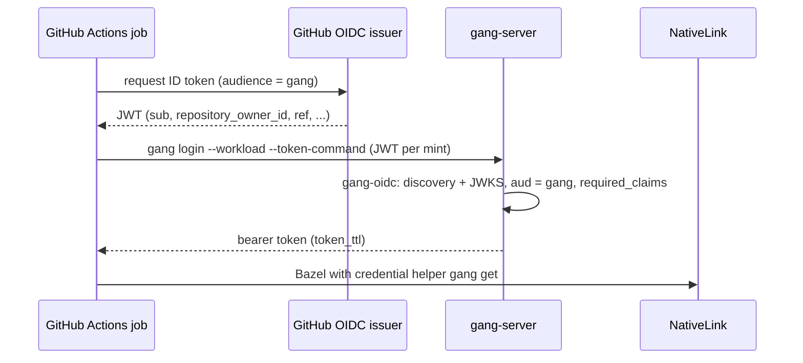

# Gang Technical Specification

---

## 1. Configuration (`gang.toml`, `crates/gang-config`)

One file, `gang.toml`, configures every `gang` command. Users never write `[selection]` or `[plugins.*]`: a backend is chosen by writing its section (`[provisioner.aws]`, `[sandbox.bwrap]`, `[identity.providers.google.oidc]`), and that section is the backend's strongly typed configuration. An unknown or missing backend is a parse error that names the accepted keys.

Durations are human-readable strings (`"500ms"`, `"10m"`, `"7d"`) parsed into `std::time::Duration`; sizes are strings (`"29GiB"`) parsed into `gang_types::Bytes`. A non-zero duration is a whole number of milliseconds; a value with finer precision is rejected rather than rounded, so every configured duration prints back exactly as written.

Every behavioural tunable (timeouts, intervals, budgets, headroom, retry and refetch limits, grace periods, size caps, feature toggles) is a typed field of the configuration section of the component that owns it, with a documented default. Toggles are enums, not bools. No tunable value is hard-coded; named constants exist only for the default itself and for protocol facts.

Every bound in the plugin tables is enforced when `gang.toml` is parsed, including the minimums, ranges and cross-field rules of their `client` and `tuning` tables (for example, `retry_max_backoff` at least `retry_initial_backoff`). A value that parses is valid: a bad value fails `gang server` and `gang worker` before any plugin is built.

### 1.1 Plugin Domains

| Domain | Section | Cardinality | Plugins | Ports provided |
|---|---|---|---|---|
| Provisioner | `[provisioner.<plugin>]` | exactly one | `aws` (`gang-aws`), `local` (`gang-local`) | `ProvisionerPort`, `NodeLifecyclePort`, `ScratchVolumePort`, `WorkloadCredentialPort` |
| Cache | `[cache.<plugin>]` | exactly one | `s3` (`gang-aws`), `filesystem` (`gang-local`) | `CacheStorePort` |
| Signer | `[signer.<plugin>]` | exactly one | `kms` (`gang-aws`), `file` (`gang-local`) | `CertificateSignerPort` |
| Scheduler | `[scheduler.<plugin>]` | exactly one | `nativelink` (`gang-nativelink`) | `SchedulerPort` |
| Database | `[database.<plugin>]` | exactly one | `sqlite` (`gang-sqlite`) | `StateRepositoryPort` |
| Sandbox | `[sandbox.<plugin>]` | one or more; each fleet's `sandbox` key picks one (typed: an unknown key is rejected with the accepted keys) | `noop` (`gang-noop`), `bwrap` (`gang-bwrap`) | `ActionIsolationPort` |
| Identity provider | `[identity.providers.<name>.<plugin>]` | one plugin per entry; any number of entries, operator-named (`none` is reserved) | `oidc` (`gang-oidc`) | `ProofVerifierPort`, `LoginPort` |
| Client authentication | `[authentication.clients.<plugin>]` | exactly one | `token` (`gang-authn`), `none` (`gang-authn`) | `AuthenticationPort`, `CredentialLifecyclePort` |
| Worker authentication | `[authentication.workers.<plugin>]` | exactly one | `mtls` (`gang-authn`), `none` (`gang-authn`) | `AuthenticationPort`, `CredentialLifecyclePort` |
| Action limits | `[limits.<plugin>]` | zero or one (optional) | `cgroup` (`gang-cgroup`) | `ActionLimitsPort` |

Compute, lifecycle, scratch, workload credentials, and worker lifetime (`ProvisionerPort::worker_lifetime`) always come from the same environment, so they are one provisioner choice. The cache and the signer are separate domains, so a deployment can mix them with any provisioner (an S3 cache with a `kubernetes` provisioner). The client and worker authentication domains are separate, so the public listener and the worker listener can use different plugins; the transport is set by `[server] transport`, not by a plugin (§3.9). A crate may provide plugins in several domains: `gang-aws` provides `aws`, `s3`, and `kms`; `gang-local` provides `local`, `filesystem`, and `file`; `gang-authn` provides `token`, `mtls`, and `none`. The certificate authority (§3.6) and the TLS transport (§3.9) are not plugins: they are fixed adapters.

### 1.2 `crates/gang-config/src`

`gang-config` owns the configuration that is the same for every plugin set. The plugin sections are typed by the enums `gang_spi::compose!` generates (§2.4), so `GangConfig` is generic over the composed `PluginSet`. `GangConfig<P>` implements `FromStr` (`ConfigError`); the TOML text is parsed strictly and validated in one step. A parsed configuration can also be edited and written back as a `Document` (§1.2).

The configuration types live in `crates/gang-config/src`, one module per concern; their doc comments own every field's meaning, unit and bound:

- `plugin_set.rs`: `PluginSet`, the trait `compose!` implements for the composed plugin set (one associated type per domain plus `FleetOptions`), and `SandboxSelection`.
- `gang_config.rs`: `GangConfig<P>` with `parse` (also `FromStr`), `pinned` and `insecure`, and `Document<P>` with `to_toml`.
- `fleets.rs` and `fleet_policy.rs`: `Fleets`, `FleetConfig` and `FleetPolicy`.
- `server_config.rs`, `endpoint.rs`, `ca_pin_setting.rs`, `rate_limit_config.rs` and `role_config.rs`: `[server]`, the endpoint, `ca_pin`, `endpoint_trust` (`ca` by default or `system`; §3.9), `[server.rate_limit]` and `[[server.roles]]`.
- `worker_config.rs`, `execution_config.rs`, `dashboard_config.rs`, `client_secret.rs`, `identity_config.rs` and `authentication_config.rs`: `[worker]`, `[execution]`, `[dashboard]`, the dashboard client secret, `[identity]` and `[authentication]`.
- `sandbox_file.rs`: `SandboxFile` (below).
- `errors.rs`: `ConfigError`, one variant per rejected configuration, each with its operator fix.

Callers that rewrite a configuration (`gang local up`, the end-to-end harness) parse a `Document`, change typed fields and call `to_toml`; they never edit a `toml::Table`. The TOML keys `min_instances` and `max_instances` become `InstanceBounds`, whose minimum is a `u32` and maximum a `NonZeroU32`; `max_instances = 0` is rejected while parsing.

`FromStr` rejects, beyond TOML and schema errors, every cross-section rule that a `ConfigError` variant (`crates/gang-config/src/errors.rs`) names: a `default_isa` that no fleet has, two fleets with one name, more fleets than `MAX_FLEETS`, fleet bounds that do not hold, a fleet whose `sandbox` has no section, a reserved provider name, an authentication plugin that names an unconfigured identity provider, a missing `endpoint` when `listen` is not loopback, an authentication plugin that needs TLS under `server.transport = "plaintext"`, an `endpoint` that does not match the transport, a missing scheduler worker endpoint when `worker_listen` is not loopback and the scheduler has a worker endpoint key (`ConfigError::WorkerEndpointRequired`), a scheduler worker endpoint without a host, without `grpcs` under TLS (`ConfigError::WorkerEndpointNotGrpcs`) or without `grpc` or `grpcs` under plaintext (`ConfigError::WorkerEndpointNotGrpc`), a `[[server.roles]]` principal whose provider names no `[identity.providers.<name>]` section (and is not the reserved `none`), two roles with one name, a role with no permissions or no principals, a permission name that is not in the table, and an `ipv6_prefix_length` outside 1 to 128. Zero durations, percentages outside 1 to 100, zero fleet memory or disk, and a TLS transport without a trust domain are rejected while the file is parsed (`ConfigError::Gang`, with the TOML line and column), because their types (`NonZeroDuration`, `Percent`, `NonZeroBytes`, `Transport`) cannot hold them.
`FromStr` also rejects `endpoint_trust = "system"` under `tls` with a `ca_pin` and a worker plugin that does not enroll (`ConfigError::PinnedWorkersNeedAdvertisedCa`).

For the dashboard, `FromStr` also rejects a `[dashboard]` `heartbeat`, `detail_interval` or `login_ttl` of zero (`ConfigError::Gang`), an explicit `actions_stale_after` that is not above `detail_interval` (`ConfigError::StaleThresholdNotAboveRefresh`), a `[dashboard.login]` `provider` that names no `[identity.providers.<name>]` section or is the reserved `none` (`ConfigError::DashboardLoginProviderNotConfigured`), and a blank `[dashboard.login]` `client_id` (`ConfigError::Gang`, with `client_id must not be blank`). A relative `client_secret_file` is also rejected while the table is parsed. Whether the provider has an interactive login is not checked at parse: the server mounts the login routes only when it has one (§4, Browser sessions).

`crates/gang-config/src/dashboard_config.rs` owns the `[dashboard]` keys; each field's doc comment states its default and meaning.

Worker lifetime is not a fleet setting. A provisioner plugin that offers both modes exposes it as its `worker_lifetime` setting (`long_lived` or `single_use`); `kubernetes` defaults to `single_use` and `slurm` to `long_lived`. `aws` and `local` have no setting and report `LongLived` from `ProvisionerPort::worker_lifetime`.

`SandboxFile` is the file `gang worker` writes beside the `gang-exec` entrypoint, under the fixed name `SANDBOX_FILE_NAME` (`sandbox.toml`); `SandboxFile::beside(entrypoint)` is `entrypoint.with_file_name("sandbox.toml")`. It holds `work_directory` (NativeLink's work directory root, from `WorkerSpec::work_directory`), `selected` (the sandbox key of the worker's fleet), the `[sandbox.<plugin>]` sections, `[execution]`, and the `[limits.<plugin>]` section when there is one, as TOML. The programs of the selected sandbox (`selected`) only are pinned in it as absolute canonical paths, resolved by `gang worker` against its `PATH`; the programs of configured sections that are not selected are written unchanged. `gang exec` finds it from its own argv0, the entrypoint path NativeLink executes, which an action cannot change; the entrypoint must be absolute, else `ExecError::EntrypointNotAbsolute`. `gang exec` reads only this file, never `gang.toml`; it builds `Sandbox::build(file.selected, file.sandbox, &PluginContext { config_path: <sandbox file> })` and, when `file.limits` is present, `Limits::build(..)` likewise, and runs the action (§3.7). No environment variable names it.

`SandboxFile`'s `FromStr` rejects a `selected` key with no `[sandbox.<plugin>]` section (`SandboxFileError::SelectedNotConfigured`).

Every plugin `Config` is `Serialize` and `Deserialize`. Identity provider sections are sent to clients as login parameters, so they hold no confidential data.

### 1.3 Production Example

`configs/gang.aws.toml` is the production example; every deployment value in it (regions, names, domains, identifiers) is a placeholder. The example Terraform root renders it and its test asserts that the render equals the file (§8.5); the rendered file is the SSM parameter the controller and workers read (§8.3). Like every checked-in configuration it holds only the values a deployment chooses: every other key takes the default the code owns: the serde default of its field, stated in the field's doc comment or in the section's `Default` impl that the doc points to. The owners: `crates/gang-config/src` for the top level, `[[fleets]]`, `[server]`, `[worker]`, `[execution]`, `[dashboard]`, `[identity]` and `[authentication]` (§1.2); `crates/gang-aws/src/config.rs` and `client_settings.rs` for `[provisioner.aws]`, `[cache.s3]` and `[signer.kms]`; `crates/gang-local/src/config.rs`, `filesystem_cache.rs` and `file_signer.rs` for `[provisioner.local]`, `[cache.filesystem]` and `[signer.file]`; `crates/gang-nativelink/src/config.rs` and `enforcement.rs` for `[scheduler.nativelink]`; the `config.rs` of `gang-sqlite`, `gang-bwrap`, `gang-noop` and `gang-cgroup` for their sections; `crates/gang-oidc/src/config.rs` for `[identity.providers.<name>.oidc]`; and `crates/gang-authn/src/token_plugin.rs` and `mtls_plugin.rs` for `[authentication.clients.token]` and `[authentication.workers.mtls]`. `crates/gang-main/src/checked_in_configs.rs` loads every `configs/*.toml` through the plugins the `gang` binary composes.
The production example shows the load-balanced, publicly trusted layout.

**Dashboard sign-in.** The dashboard signs viewers in with its own confidential OAuth client, not the native-app client of `oidc.login`, whose secret is not confidential and is sent to every CLI. Register a Web-application client at the identity provider with the redirect URI `{endpoint}/ui/callback` (here `https://gang.example.com/ui/callback`), put its id in `[dashboard.login]` as `client_id`, and list that id in `additional_audiences` of the provider so that its ID tokens are accepted. Put its secret in exactly one of two keys: `client_secret`, inline, or `client_secret_file`, an absolute path to a file that holds only the secret as UTF-8 text. Config with neither key, both keys, or a relative `client_secret_file` is rejected. An inline `client_secret` that is empty or only whitespace is rejected at parse time, like an empty file. Surrounding whitespace such as a trailing newline is trimmed; a file that is empty after trimming is an error that names the path, and so is one that cannot be read as UTF-8. `gang server` reads the file once, when it starts; `gang worker`, the CLI and every other reader of `gang.toml` see only the path and never open it, so the file is needed on the controller host only. On AWS the secret lives in a SecureString parameter, and the controller's boot writes it to that file with mode 0600; it is never in the String parameter that holds `gang.toml`. The secret's type is redacted in Debug output. The provider's `oidc.login` section still supplies the scopes and authorization parameters. A viewer sees data only when a `[[server.roles]]` role grants it `state.read` (the `administrator` role in `configs/gang.aws.toml` grants every permission). Browsers must trust the server certificate. With `endpoint_trust = "ca"` under TLS that is Gang's own CA; a publicly trusted terminator can instead re-encrypt to Gang with `endpoint_trust = "system"`, or forward plaintext with the worker surface set to `none`, because `mtls` requires `tls`. An `https` endpoint keeps the `__Host-` cookie names.

### 1.4 Local Mode (`configs/gang.local.toml`)

The file `configs/gang.local.toml` runs actions under `bwrap` on Linux; on macOS it runs with the fleet's `sandbox = "noop"`, because bubblewrap is Linux-only. `[limits.cgroup]` is Linux-only too: macOS leaves the section out and no limits apply. The file serves TLS on loopback with Gang's own CA. Clients authenticate with `token` (`clients.token`, the `local-workers` identity provider), and workers authenticate with `mtls`. `gang local up --insecure` runs the plaintext variant at the end of this section. `checked_in_configs` loads it through the composed plugins.

The plaintext variant is `configs/gang.local.plaintext.toml`: `[server] transport = "plaintext"`, an `http://` endpoint, a `grpc://` worker endpoint, and the `none` plugins on both surfaces, so no listener has TLS and both surfaces are anonymous. The checked-in file binds no role: a dashboard on it shows no data until a `[[server.roles]]` entry grants `state.read`. `gang local up --insecure` runs it and replaces any `[[server.roles]]` with one role, `administrator` with permissions `["*"]`, bound to the anonymous caller `none:anonymous`, so the dashboard shows its data. It writes that configuration to `<state_dir>/server/gang.toml` (§6.2), starts the server from it and prints the dashboard URL as the `ui` field (for example `http://127.0.0.1:8080/ui/`) unless `[dashboard] enabled = false`. The session cookies are the plain `gang_session` and `gang_login`, because the endpoint is `http`.

---

## 2. Compile-Time Plugins & Ports (`crates/gang-spi`, `crates/gang-macros`)

### 2.1 Pure-Facade `crates/gang-spi/src/lib.rs`

`crates/gang-spi/src/lib.rs` is a pure facade: it declares the private modules and re-exports the ports and their value types (§2.3), `Plugin`, `PluginContext`, `SandboxPrograms`, the error types, and the `port`, `compose!`, `FleetOptions` and `PortFailure` macros. Nothing else is public.

The lint policy (forbid unsafe code, deny missing docs and the clippy set) is declared once in `[workspace.lints]` of `Cargo.toml`; Bazel reads it from each crate's manifest through rules_rust's `extract_cargo_lints`, which the workspace Rust macros declare per package.

Values shared across crates live in `gang-types` and `gang-clock`, not here: `Principal`, `Proof`, `RefreshToken`, `CertSerial`, `InstanceId`, `WorkerId`, `Isa`, `Bytes`, `Resources`, `Fleet`, `FleetName`, `FleetCatalog`, `FleetProperties`, `FleetSet`, `WorkerLifetime`, `Permission`, `PermissionSet`, `ScalingCause`, `ClientSecret`, `Identity`, `MachineClass`, `AuthenticationSettings`, `SchedulerSettings`, the `gang_types::property` constants (`gang-types`); `Timestamp` (`gang-clock`). The `gang-spi` tests also depend on `gang-config` (below `gang-spi` in the crate graph, docs/PLAN.md §2.2) because `compose!` implements `gang_config::PluginSet`.

### 2.2 The `Plugin` Contract (`src/plugin.rs`)

`Plugin` and `PluginContext` (`crates/gang-spi/src/plugin.rs`) own the contract: a plugin names its `Config` section type and builds itself from it and the context. The crate-level doctest in `crates/gang-spi/src/lib.rs` implements a minimal plugin, so the contract is compiled on every test run.

`build` validates configuration only. Resources used by one role (controller or worker) are opened on first use by that role's ports, so a plugin builds on every node that runs `gang`. `gang worker` never builds `signer`; it builds `cache`, which does no I/O in `build`, and asks it for store specs only when `worker_access()` is `Direct`. A filesystem cache is only ever opened by the controller.

`SandboxPrograms` is implemented by a sandbox section that names programs; the host rewrites those paths to absolute paths before writing the sandbox file. `AuthenticationSettings` is implemented by each authentication section so the host can read `requires_tls()` and every identity provider the section names (`for_each_provider`) before it builds the plugin. The trait is defined in `gang_types` and reached from `gang_spi::__private` by generated code. Both settings traits carry `#[gang_macros::settings]`, which records their methods in a hidden delegate macro; `compose!` calls it, so the configuration enum forwards every method that borrows `self` to the selected plugin's settings, including one added later with a default body. `SchedulerSettings` plays the same role for the scheduler section (the worker endpoint).


Every port trait carries `#[gang_spi::port]`, is `Send + Sync`, and is implemented directly by the plugin type (`gang_aws::Aws` implements the four provisioner ports, and `gang_aws::S3Cache` and `gang_aws::KmsSigner` implement the cache and signer ports). Ports are written with native `async fn`; `#[port]` rewrites each `async fn` into `fn .. -> impl Future<Output = ..> + Send` (so implementations may keep writing `async fn` and callers may spawn the futures), and records the methods in a hidden `macro_rules!` that `compose!` expands into the delegating impls. The types in port signatures must be nameable from the `gang-spi` root or from `gang-types`/`gang-clock` (the macro resolves them through `gang_spi::__private`). A port method may carry a default body, and a method marked `#[optional]` has no body, returns `Result<_, PortError>` and defaults to `PortError::Unsupported { operation: "<method name>" }`; the declaring module has `PortError` in scope.

The two error derives complete the port contract. `#[derive(Fix)]` (`gang_types::Fix`) gives an error enum one operator-facing action per variant, written as `#[fix("...")]` on the variant (`#[fix(source)]` delegates to the source error, the field marked `#[source]` or `#[from]`, named `source`, or the transparent one), and `None` where a variant has none. `#[derive(PortFailure)]` implements `From<E> for PortError` for a plugin's error enum, classifying variants with `#[failure(config)]`, `#[failure(unavailable)]`, `#[failure(backend)]` (the default), `#[failure(rejected(<Rejection variant>))]`, `#[failure(not_found(<Subject variant>))]`, `#[failure(unsupported("<operation>"))]`, or `#[failure(transparent)]`. Config, unavailable, backend and rejected variants retain the whole error as their source. Not-found and transparent variants require one field; not-found wraps it in the named subject and transparent converts it into a `PortError`. `#[fix]` and `#[failure]` go on variants only; on the enum or a field they are compile errors.

`PortError` tells the caller what to do: `Config(BoxedError)`, `NotFound(Subject)`, `Rejected { reason: Rejection, source: Option<BoxedError> }`, `Unsupported { operation }`, `Unavailable(BoxedError)` (retry on the next pass), `Backend(BoxedError)` (retrying will not fix it). `Subject` and `Rejection` are typed; rejection sources are logged and never sent to clients. A `Subject` names an instance, a worker, a certificate, a provider or a principal; a `Rejection` is an invalid proof, a policy denial, a revoked principal or a malformed request (`crates/gang-spi/src/errors.rs`).

### 2.3 Ports

The ports and their value types are declared in `crates/gang-spi/src`, one module per port; each trait's doc comments own its methods' contracts, and `lib.rs` re-exports them:

| Module | Port and its main value types |
|---|---|
| `provisioner_port.rs` | `ProvisionerPort` (`FleetSupply`, `FleetInstance`, `ServerEndpoints`, `Sidecar`) |
| `lifecycle_port.rs` | `NodeLifecyclePort` (`InstanceIdentity`, `PreemptionNotice`) |
| `scratch_port.rs` | `ScratchVolumePort` (`MountedScratchVolume`) |
| `credential_port.rs` | `WorkloadCredentialPort` |
| `cache_port.rs` | `CacheStorePort` (`RenderedStoreSpec`) |
| `signer_port.rs` | `CertificateSignerPort` (`SignatureAlgorithm`) |
| `scheduler_port.rs` | `SchedulerPort` (`ControllerSpec`, `WorkerSpec`, `SchedulerSnapshot`, `ControllerConnections`, `ApiService`, `RequestGate`, `Slots`, `StoreAccess`) |
| `authentication_port.rs` | `AuthenticationPort`, `CredentialLifecyclePort`, `AuthenticationHost` |
| `repository_port.rs` | `StateRepositoryPort` (`PrincipalRecord`, `IssuedCertRecord`, `ScalingAuditEvent`) |
| `isolation_port.rs` | `ActionIsolationPort` (`ActionExecutionSpec`, `SandboxedAction`) |
| `limits_port.rs` | `ActionLimitsPort` (`ActionLimits`, `ActionScope`, `ActionUsage`) |
| `identity_port.rs` | `ProofVerifierPort`, `LoginPort` (`LoginSupport`, `LoginRequest`, `LoginGrant`) |
| `fleet_options.rs` | `FleetOptions`, `OptionSpec` |
| `errors.rs` | `PortError`, `BuildError`, `Rejection`, `Subject` |

### 2.4 `compose!` (`crates/gang-macros`)

The composition root lists the plugins per domain; adding a backend is a new crate plus one line here. The domains `provisioner`, `cache`, `signer`, `scheduler`, `database`, `sandbox`, `identity_provider`, `client_authentication`, and `worker_authentication` are required, each with at least one plugin. `limits` is optional: it lists its plugins like any domain, and at most one plugin is active. The invocation may omit the `limits` domain or write `limits: Limits {}`; either way `Limits` is uninhabited, `[limits.*]` is rejected, and `GangConfig::limits` is always `None`. The invocation is `crates/gang-main/src/plugins.rs`.

The key is the section name users write. For each exactly-one domain (`provisioner`, `cache`, `signer`, `scheduler`, `database`, `identity_provider`, `client_authentication`, `worker_authentication`) it generates a configuration enum, externally tagged by the plugin key and holding each plugin's `Plugin::Config` (`ProvisionerConfig` with `aws` and `local`), a dispatch enum of the plugins (`Provisioner`) with `build(config, context) -> Result<Self, PortError>`, the provisioner's `ProvisionerFleetOptions` dispatch enum, and one delegating impl per port of the domain, each method a `match` that forwards to the selected plugin.

Each provisioner's option struct is its `FleetOptions` type: `#[derive(FleetOptions)]` (`gang-macros`) on a `#[serde(deny_unknown_fields)]` struct whose fields are the option keys. The derive generates `OPTIONS: &[OptionSpec]` (`key`, `doc`, `required`, `launch`) and `properties()`. A field marked `#[option(launch)]` only shapes how instances are launched: it is listed in `OPTIONS` with `launch: true`, `properties()` skips it, so it registers no worker property, actions cannot request it, and its type needs `Deserialize` alone, no `Display`. A struct may name `#[fleet_options(validate = <path>)]`, a `fn(&Self) -> Result<(), String>` that the generated `FleetOptions::validate` calls to check the rules that span fields. The derive rejects, at compile time, a field named like a reserved property key (`gang_types::property::RESERVED`), an unknown `#[option(..)]` or `#[fleet_options(..)]` argument, and any container `serde` attribute other than `deny_unknown_fields`. `compose!` generates `ProvisionerFleetOptions` above, the dispatch enum of those types, selected by the one `[provisioner.<key>]` section.
`#[fleet_options(validate_fleets = <path>)]` names a function that checks rules spanning the provisioner's fleets.

A crate may appear in several domains, as `gang_aws` does here. The enum is externally tagged, so serde rejects an unknown key (listing the accepted ones) and zero or several sub-tables. `identity_provider` generates the same enum, which `IdentityConfig` (§1.2) holds once per `[identity.providers.<name>]` entry. The optional `limits` domain generates the same enum and dispatch type (`LimitsConfig`, `Limits`); `GangConfig::limits` is `None` when no `[limits.<plugin>]` section is written. The `sandbox` domain activates any selection of plugins instead.

`SandboxKey` is a `Copy` enum of the sandbox keys whose `Display` prints the section key (`noop`, `bwrap`); `SandboxConfig` has one optional field per sandbox plugin, rejects unknown keys and implements `gang_config::SandboxSelection`; `Sandbox::build` builds exactly the plugin a key selects, and an absent section is `PortError::Config`. The expansion also defines `Plugins`, which implements `gang_config::PluginSet` with one associated type per domain plus `FleetOptions`. `PluginSet::fleet_options` deserializes each fleet's `[fleets.options]` table strictly into `FleetOptions` (through `gang_config::validated_fleet_options`, which calls `FleetOptions::validate` on the parsed value; a rule that fails is a `FleetOptionsError` naming the rule), and `PluginSet::option_properties` returns the `FleetProperties` of the selected provisioner's option struct, so the option vocabulary has one source (§3.2). `Plugins::provisioner_options()` lists the `OptionSpec`s of every provisioner, or of the one named (`gang options [<provisioner>]`). The caller of `compose!` depends on `gang-spi` and `gang-config` only: the expansion reaches `serde` and the `gang-types` values through `gang_spi::__private`. The expansion is in `crates/gang-macros/src/compose.rs`; `crates/gang-spi/tests/compose.rs` and `compose_without_limits.rs` compile it against test plugins.

The result: typed configuration end to end, unknown backends rejected at parse time with the list of accepted keys, and static dispatch with no boxing or allocation on the reconcile path.

---

## 3. Plugins & Fixed Adapters (`crates/gang-*`)

### 3.1 Provisioners, Caches, and Signers (`gang-aws`, `gang-local`)
A crate may provide plugins in several domains: each plugin below is selected by its own section.
- **`gang-aws`**:
  - **`[provisioner.aws]`**:
    - `ProvisionerPort` (`type FleetOptions = AwsFleetOptions`) over `Fleet<'_, AwsFleetOptions>`: one EC2 Spot or On-demand Auto Scaling group per fleet, named by `Fleet::name`; there is no separate group-name setting. A spot fleet that opts into `fallback` (below) also owns an on-demand twin group named `<Fleet::name>-on-demand`, and both groups must protect new instances from scale-in. `supply` reads every group of the fleet in one `DescribeAutoScalingGroups` call, the instance launch times (`DescribeInstances`) and, for an opted-in fleet, whether a Spot launch failed within `retry_spot_after` (`DescribeScalingActivities`, only when the Spot group wants more instances than it has). The reported `desired` is, per group, `max(desired capacity, live members)`, where live members are `Pending` or `InService`; instances the group is removing, and instances in the warm pool, are not capacity. For an opted-in fleet the ADR-23 spot rule applies on top: an unmet Spot request counts as booting capacity unless Spot is down (a failed Spot launch within `retry_spot_after`), in which case only the live Spot members count, plus the twin's reported capacity. `set_desired_capacity` raises the reported capacity to `desired` (`SetDesiredCapacity`) and never lowers it. An opted-in fleet raises its Spot group first; while Spot is down it withdraws the unmet Spot request (desired := live Spot members) and then raises the on-demand twin. `terminate` is idempotent: an instance that no group lists, or that is already ending, returns `Ok` without a write. A `Pending` member, and any member of a group without warm-pool reuse, is terminated atomically with the group's desired capacity decremented (`TerminateInstanceInAutoScalingGroup`, in the instance's own group). An `InService` member of a group whose warm pool reuses instances on scale-in (`reuse_on_scale_in`) is released instead (ADR-22): its scale-in protection is lifted (`SetInstanceProtection`) and the group's desired capacity is lowered to the instances that stay (the `Pending` members, the protected `InService` members and the launches still in flight), so the group's own scale-in returns that instance to the pool. The target is computed first from the snapshot, so a repeat call writes nothing more. The release is refused with a configuration error when the group reuses instances without protecting new ones, and when another `InService` member is unprotected while the group is not already lowering (it launched before protection was enabled and must be replaced first). Every desired-capacity write (raise, Spot withdrawal, release) honours `set_capacity_cooldown`. For an opted-in fleet `supply` marks the on-demand twin's instances `release_first` when `drain_on_demand_first` is set. A group that does not exist is a configuration error. `worker_lifetime` is `long_lived`.
    - Fleet options (`[fleets.options]`, §3.2):

      | Key | Required | Values | Meaning |
      |---|---|---|---|
      | `capacity` | yes | `spot`, `on-demand` | purchase option of the group; selects the allocation strategy |
      | `machine_class` | no | a class name such as `gpu`: 1 to 40 characters of `a-z`, `0-9` and `-`, as a fleet name | names the class an action may request through the `machine_class` property; the instance types come from the launch template; absent declares no class |
      | `fallback` | no | a table: `retry_spot_after` (default `5m`, `1m` to `24h`) and `drain_on_demand_first` (default `true`); an empty table takes both defaults | opts a spot fleet into on-demand fallback (ADR-23); spot fleets only |

      `capacity` and `machine_class` are exact properties (`machine_class` only when set). `fallback` is launch-only (`#[option(launch)]`): it shapes how instances are launched, registers no worker property and cannot be requested by an action. A fleet without `capacity` is rejected at parse, and so is a `fallback` on a fleet whose `capacity` is not `spot` or whose `retry_spot_after` lies outside `1m` to `24h` (`ConfigError::FleetOptions`, §3.2). An on-demand fleet's `instance_types` list order is its launch priority (`prioritized`); spot fleets use `price-capacity-optimized`. After the latest failed Spot launch, new capacity is bought on-demand for `retry_spot_after`, then Spot is tried again; `drain_on_demand_first = false` reports every instance with `release_first = false`.

    - `NodeLifecyclePort`: IMDSv2 instance identity document (instance id; `architecture` mapped to the ISA), Spot interruption notice (`spot/instance-action`), and `parked`: the IMDS item `autoscaling/target-lifecycle-state`, where any `Warmed:*` state is parked and `InService`, any other value, or a missing item (404) is not.
    - `ScratchVolumePort`: adopts the instance-store NVMe volume (RAID0 when several devices, XFS with reflink, mounted at `scratch_mount_point`) that a root `gang-scratch.service` oneshot unit on the machine image prepares before the worker starts. Scratch is empty at every worker start: instance store is erased when an instance stops, and an EBS data volume is re-created at every boot, so a worker that returns from a warm pool starts with no warm cache. The plugin never formats or mounts, because the worker runs unprivileged. It checks that the mount point is a mount, that the filesystem is XFS, and that reflink works (probe), and it reports the capacity (`statvfs` through `rustix`, so the crate needs no `unsafe`). `gang worker` places the fast CAS and the work directories on this volume and derives `fast_cas_budget` from its capacity, so with `input_links = "break"` a hard-linked input is replaced by a reflink (§3.7) and the cache cannot fill the volume.
    - `WorkloadCredentialPort`: STS `GetWebIdentityToken` through the worker's instance role (audience `workload_token.audience`, signing algorithm `workload_token_algorithm`, lifetime `workload_token.ttl`), on the regional STS endpoint, fresh on every call, presented to the `aws-workers` identity provider.
  - **`[provisioner.aws]` tunables** (defaults: `crates/gang-aws/src/config.rs`, `client_settings.rs`): `[provisioner.aws.workload_token]` `audience` (1 to 1000 characters) and `ttl` (whole seconds from `1m` to `1h`); `workload_token_algorithm` (`rs256` or `es384`); `[provisioner.aws.client]` (all durations greater than zero, `retry_max_backoff` at least `retry_initial_backoff`); `imds_request_timeout` (greater than zero); and `fleet_tag_key`, a tag key of 1 to 128 characters from `a-z A-Z 0-9 _ . : = + - @ ,` that is not `.`, `..` or `_index` and does not start with `aws:` in any case. `[provisioner.local.workload_token]` takes the same `audience` and `ttl` bounds and defaults.
  - **`[cache.s3]`** (`region`, `bucket`): `CacheStorePort` renders NativeLink S3 store specs for `bucket`, with objects under `<key_prefix>cas/` and `<key_prefix>ac/`; workers open the stores themselves (`StoreAccess::Direct`) with their own instance role. In `[cache.s3.tuning]`, `retry_jitter_percent` is 1 to 100: jitter cannot be turned off.
  - **`[signer.kms]`** (`region`, `key_id`): `CertificateSignerPort` signs certificate bodies with ECDSA P-256 through KMS `Sign` (raw message, `ECDSA_SHA_256`; the DER signature is returned as is). The public key comes from `GetPublicKey`. The key ARN is resolved once on first use and pinned for every later signature; keys that are not `ECC_NIST_P256` signing keys are rejected. The CA private key never leaves KMS.
  - **HTTP client and credentials**: the AWS SDK uses one explicit rustls client with the `ring` crypto provider (no aws-lc). Credentials come from the SDK default chain (the instance role) and are never configured.
  - **Lazy clients**: all AWS clients are opened on first use, so building a plugin makes no AWS call.
  - **To be confirmed against real AWS at Gate 3** (pending, PLAN §3; named steps in the ADRs):
    - ADR-22 I1: a `SetDesiredCapacity` decrease returns the unprotected instance to the warm pool.
    - ADR-22 I2: `DescribeAutoScalingGroups` `Instances` excludes warm instances.
    - ADR-22 I3: IMDS `target-lifecycle-state` shows `Warmed:Stopped` before the stop and flips to `InService` promptly after a start.
    - ADR-22 I4: a `Pending` instance is not chosen as the scale-in victim.
    - ADR-22 I5: an instance entering service from the pool inherits the group's protection.
    - ADR-23 I6: a deterministic failed Spot launch (`SpotMaxPrice = 0.001`); measure the latency to the `Failed` activity and the retry cadence to set the `retry_spot_after` default.
    - ADR-23 I7: `DescribeScalingActivities` with the `Status` and `StartTimeLowerBound` filters and `MaxRecords = 1` returns the expected row.
    - ADR-23 I8: `SetDesiredCapacity` below the group size, with every `InService` instance protected, leaves them running and lowers the desired capacity.
    - ADR-23 I9: `TerminateInstanceInAutoScalingGroup` with decrement on a protected instance succeeds.
- **`gang-local`**:
  - **`[provisioner.local]`**:
    - `state_dir` (`[provisioner.local]`): the directory that holds the local provisioner's records and keys. A missing directory is created with mode `0700`; an existing one is refused when it is not private (mode other than `0700`), is a symbolic link, or is owned by another user. gang never changes the mode of a configured directory. Directories gang creates beneath it (`server/`, instance and fleet records, the log, and each worker's scratch directory) are created or tightened to `0700`.
    - `ProvisionerPort`: copies of the running `gang` binary started as detached `gang worker` processes with the same `gang.toml` (`PluginContext::config_path`), recorded under `state_dir` so they survive a `gang server` restart exactly as EC2 instances do. It has no `worker_lifetime` setting and reports `LongLived`. Its fleet options are none: `[fleets.options]` is absent or empty for every fleet, and `gang options local` prints no keys.
    - `worker_launcher` (optional argv prefix, default empty): prepended to the `gang worker` argv when `local` starts a worker. Otherwise every worker shares `gang server`'s cgroup, and cgroup v2's no-internal-processes rule stops per-action `[limits.cgroup]` from enabling controllers. Local Mode on Linux with `[limits.cgroup]` sets a launcher such as `["systemd-run", "--user", "--scope", "-p", "Delegate=yes", "--"]`. The launcher must `exec` the command in place, so the pid, the process group and the inherited standard input (the lifetime lock) survive; a launcher that forks the worker away is not supported. The launcher's user scope is delegated, but systemd's user manager sets no `user.delegate` marker on it (verified on systemd 262), so Local Mode with `[limits.cgroup]` sets `delegation = "trusted"`.
      A worker records the cgroup it runs in once the mock IMDS has served its identity document, before `prepare` (§3.8) moves it into its own leaf, so the record names the whole scope its launcher created; reading it at spawn would race the launcher, which joins its scope only after it starts. A dead worker's recorded cgroup is killed and removed before the worker is replaced, unless it is or contains the server's cgroup. A worker that recorded none died before it was identified: actions start only after registration, which follows the recording, so it ran none; it is logged and replaced without a reap. On a host without cgroup v2 the server has no cgroup and no worker records one, so a dead worker is replaced without a reap and without that log line.
      The server log records each early exit with the worker's own failure: the end of its log from its last `fail` record, or its last line. An early exit whose log has a `fail` record is also reported in the fleet's supply and recorded as an `exitedEarly` event.
    - `NodeLifecyclePort`: a mock instance metadata service on `mock_imds_listen`, which must be a loopback address (a config error at parse time, not at plugin build), that serves instance identity, with the fleet from the worker's process record, and simulated Spot interruptions. `parked` is always `false`: this provisioner has no warm pool. As identity federation it mints JWTs signed with a key generated under `state_dir`, and serves OIDC discovery and JWKS for them. Each worker authenticates with a per-instance secret generated when the fleet launches it, handed to the worker in `GANG_LOCAL_INSTANCE_SECRET` and stored only in its instance record; the service answers 401 to any request whose instance and secret do not match a record, so a local process cannot mint a workload token for another instance. The record is written before the worker starts, without a pid until the process has started, so the worker's first request is always authorized.
    - `ScratchVolumePort`: per-worker directories under `state_dir`.
    - `WorkloadCredentialPort`: returns such a JWT as the `Proof` for the `local-workers` identity provider, the same issuance path as `aws-workers`.
  - **`[cache.filesystem]`** (`path`, `content_store_percent` (`25`), `action_store_percent` (`2`)): `CacheStorePort` renders NativeLink filesystem CAS and AC stores under `path`; the two percentages are each 1 to 100 and sum to at most 100. A missing `path` is created with mode `0700`; an existing one that is not private (mode other than `0700`), is a symbolic link, or is owned by another user is refused, never tightened. The store subdirectories gang creates beneath `path` are created or tightened to `0700`. Only the controller opens them, so workers reach them through the worker listener (`StoreAccess::ViaController`).
  - **`[signer.file]`** (`key_file`): `CertificateSignerPort` signs with the CA key file at `key_file`, generated on first start (Local Mode only). `FileSigner` opens the key's directory and key on first use of the signer port (§2.2 build rule); the directory must be `0700` and owned by the running user. A missing directory is created with mode `0700`; an existing one that is not private (mode other than `0700`), is a symbolic link, or is owned by another user is refused, never tightened. A site without KMS has only this signer, which keeps the key on disk, until a `pkcs11` or `vault` signer exists.
  - Key files (the CA key and the IMDS JWT key) are written atomically (temp file, fsync, hard link) with mode `0600`.

### 3.2 Scheduler (`gang-nativelink`)
- **`[scheduler.nativelink]`**: `SchedulerPort::{snapshot, actions, set_draining, endpoints, run_controller, run_worker}`. NativeLink v1.8.3 is embedded: its crates (`nativelink-config`, `-scheduler`, `-store`, `-service`, `-worker`, `-util`, `-error`, `-proto`) are linked into the `gang` binary from Cargo git dependencies pinned to tag `v1.8.3`, and `gang-nativelink` reimplements only the glue of upstream `src/bin/nativelink.rs`. There is no `nativelink` binary, process, configuration file, or admin HTTP API. The scheduler bridge makes direct calls: `WorkerScheduler::worker_snapshot` and `nativelink_scheduler::admin::queued_demand` for `snapshot`, and `WorkerScheduler::set_drain_worker` for `set_draining` (an unknown worker is `PortError::NotFound(Subject::Worker)`). The snapshot's managed workers have unique ids and are sorted by `WorkerId` ascending. The section keeps only `worker_endpoint`, `scheduler_name`, `max_open_files`, and the tunables below; the listen addresses and the public `endpoint` are core configuration (`listen`, `endpoint`, `worker_listen`, §1.2).
- **Controller (`gang server`, `run_controller`)**: builds the content and action stores and the scheduler in process, and serves the gRPC services over each connection it is handed (`ControllerConnections`). Public connections speak HTTP/1.1 or HTTP/2, detected per connection; worker connections speak HTTP/2 only. It listens for nothing and does no TLS. The stores, scheduler, and services are built from typed `nativelink-config` values, deserialized in memory from `serde_json` documents so that NativeLink's own defaults apply. Gang never reads a value back from those documents, and builds a `nativelink-config` struct in Rust only where NativeLink owns no defaults to bypass: most of its structs have no `Default`, and a derived `Default` would not equal their serde defaults. Client connections are served `cas`, `ac`, `bytestream`, `capabilities`, and `execution`; worker connections are served `worker_api`, `cas`, `ac`, and `bytestream`. The controller is built from `ControllerSpec`, applies its `client_action_timeout`, and runs until both streams have ended or its future is dropped, which stops serving and closes every connection it serves. It checks the configuration (the cold start against the fleets, the services) before it builds any store, and signals `ControllerReady` once everything is built, before it serves.
- **Introspection.** `snapshot` also reports `SchedulerSnapshot.completed` and `WorkerState.paused` (`WorkerSummary.is_paused`). `completed` comes from a forwarding decorator around the `WorkerScheduler` that the worker API serves: it counts a successful `update_action` that carries a `Completed` stage; errors, keep-alives, declined dispatches, worker losses and cache hits do not count: NativeLink v1.8.3 keeps no readable completion counter, and the decorator's `WorkerScheduler` impl is lint-guarded (`clippy::missing_trait_methods`) so that a method added by an upgrade cannot go unforwarded. `actions` reads NativeLink's `ClientStateManager` with `filter_operations`: one `worker_id`-filtered listing of the `Executing` stage per worker that runs actions (each operation is attributed to the worker it was listed under, and an operation no worker claims is never seen), and one listing of the `Queued` stage in descending priority. Digest, start time and the Bazel `target_id` and `action_mnemonic` come from each operation's state and origin metadata, and the queued rows' `candidates` from `FleetCatalog::accepting`. Rows past `ListingLimits` are counted in the `truncated_*` fields. The cost is `1 + busy workers + 1` listings per call (§5.2).
- **Worker (`gang worker`, `run_worker`)**: names the worker with `InstanceId::worker_name`, registers its `Slots`, uses `work_directory`, and keeps its fast content cache under `fast_cas_directory` (a filesystem store bounded by `fast_cas_budget`, which `gang worker` derives from the mounted scratch volume's capacity and `[worker] fast_cas_percent`). It runs NativeLink's local worker in process against the worker listener. `WorkerSpec::store_access` sets how it reaches the stores: `Direct` opens them itself (shared stores such as S3); `ViaController` reaches the controller's `cas` and `ac` stores through `grpc` stores on the worker listener, over TLS for `WorkerTls::ServerOnly` (using its CA file, or system roots when none) and `WorkerTls::Mutual`. Actions still run through the `gang-exec` argv0 link to the `gang` binary (the worker `entrypoint`), which reads the sandbox file beside it (§1.2). `gang-nativelink` assembles the worker with its actions manager and connection: `stop` declines new actions, kills every running action's process group and removes its directory before `run_worker` returns. It attempts to make the process the child subreaper once and starts one zombie reaper for the process's lifetime. `Slots::SingleUse` runs NativeLink's worker with `single_use`: it advertises one slot and takes exactly one action, and `run_worker` returns `Ok` once that action has finished and its outputs are uploaded. `gang worker` keeps one `WorkerSpec` for all generations and passes the TLS files of the current generation to each `run_worker` call.
- **Scheduler properties.** The controller uses a `historical_resource` scheduler over `simple` (`learn_from_workers`). Each worker registers the `FleetProperties::worker_properties()` of its fleet. The scheduler declaration is `FleetCatalog::declared()`, which lists each key of `FleetProperties` once with its match kind: exact for `fleet`, `ISA`, `sandbox`, and every option key; minimum for `cpu_count`, `memory_kb`, and `disk_kb`; ignored for `network`. A worker's `disk_kb` is its fleet's `disk_per_instance`: the declared disk is what each worker registers, and the scheduler's ledger packs action reservations against it. An action that sets none of the fleet-owned keys is served by whichever accepting worker is free. Declaration order of `[[fleets]]` is the cost preference used for placement (§5.1). The worker enforces memory reservations softly (`[scheduler.nativelink.memory]`), and the scheduler requeues a killed action with a larger reservation (`memory_escalation`), not spending `max_job_retries`. The worker enforces disk reservations itself (`[scheduler.nativelink.disk]`: a guard refusal, or a soft kill that fails the action, not requeued), checking real free space rather than the declared `disk_per_instance`. Unmeasured actions reserve the `[scheduler.nativelink.cold_start]` cpu, memory, and disk values while that section is enabled (Disk limits below). An action whose platform properties no declared fleet accepts (`FleetCatalog::accepting`, the rule the cold start and the queue candidates use) is refused when it is submitted, with `INVALID_ARGUMENT` `no fleet accepts the platform properties of this action (<key=value, …>)`: NativeLink judges satisfiability only against connected workers, and a fleet that scales from zero has none. A queued action can still become unplaceable when the scheduler raises its reservation from history; `queue.unplaceable` counts those.
- **Match rule.** `FleetCatalog::accepting` in `gang-types` is the only matching function. A fleet accepts a request iff every key the request sets that some fleet declares holds: an exact key must equal the fleet's value, and a fleet lacking the key never accepts; a minimum key (`cpu_count`, `memory_kb`, `disk_kb`) must be at most the fleet's size; undeclared and ignored keys (`network`) impose nothing. An action whose `disk_kb` exceeds every fleet's accepts no fleet. `gang-nativelink` is its only caller, and a test there asserts that it agrees with NativeLink's `PlatformProperties::is_satisfied_by` for every request and fleet. Contradictory keys accept no fleet, so the action waits until `client_action_timeout`. Decision and rejected alternatives: ADR-14.
- **Property vocabulary.**

  | Key | Owner | Rule | Worker value |
  |---|---|---|---|
  | `fleet` | Gang | exact | fleet `name` (explicit pin) |
  | `ISA` | Gang | exact | `isa` |
  | `sandbox` | Gang | exact | `sandbox` (placement only; §3.4) |
  | `cpu_count`, `memory_kb`, `disk_kb` | Gang | minimum | instance size (`disk_kb`: `disk_per_instance`) |
  | `network` | Gang | ignored | `network` still sets `GANG_NETWORK` |
  | any other key | provisioner | exact | its `[fleets.options]` entry |

- **Fleet options.** A provisioner's `[fleets.options]` table is deserialized strictly and validated when the configuration loads (`gang_config::validated_fleet_options`, §2.3): an unknown key, a wrong type, or a rule that spans fields (`#[fleet_options(validate = ..)]`) is `ConfigError::FleetOptions` naming the fleet, before any server starts. `FleetOptions::validate_fleets` checks rules that span the provisioner's fleets. An option marked `#[option(launch)]` shapes only how instances are launched: `gang options` lists it as launch-only, it registers no worker property, so it adds no row to the vocabulary above, and an action cannot request it. The `aws` provisioner's `fallback` is such an option (§3.1); `fallback` on a fleet whose `capacity` is not `spot`, or a `retry_spot_after` outside `1m` to `24h`, fails the parse, and an empty `[fleets.options.fallback]` table opts in with both defaults.

- **Client default.** `gang bazelrc` writes `--remote_default_exec_properties=ISA=<default_isa>` into the Bazel rc it prints, from the client-only `default_isa` in `Server` (`defaultIsa`). The controller does not read `default_isa`; an action without an `ISA` property is matched on its other keys like any other.
- **Listeners are not here.** `gang-nativelink` never listens and has no TLS, no revocation, and no listener addresses: `run_controller` serves the connections it is handed. `gang-server` owns the listeners (`listen` for the public port, `worker_listen` for the private one), accepts through `gang-tls` (§3.9), and hands the accepted connections to the controller as `ControllerConnections` (§6.1). Revocation is live and closes established connections (§3.9, §4.4).
- **Endpoints.** `worker_endpoint` is the plugin's only dialable URL (`ControllerEndpoints::worker`): the host name workers dial and `gang-mtls` takes for the worker server certificate. The public URL is the top-level `endpoint` (§1.2), which `gang-server` returns as `Server.remoteExecutor` and `remoteCache`; it is not a scheduler key. The worker endpoint's scheme must equal `WorkerTls::scheme()` for the `tls` argument of `SchedulerPort::run_worker` (`grpc` for `Plain`, `grpcs` otherwise); a mismatch is `PortError::Config`.
- **Tunables.** All optional (defaults: `crates/gang-nativelink/src/config.rs` and `enforcement.rs`): `[scheduler.nativelink]` `max_open_files`; `[scheduler.nativelink.scheduler]` (`headroom_percent` is the extra reservation over measured usage); `[scheduler.nativelink.worker]`; `[scheduler.nativelink.http2]`, the connections the controller is handed (HTTP/2 keepalive and limits on every connection, the request-head limit on HTTP/1.1 connections; `shutdown_grace` is how long open connections may finish after both streams end); `[scheduler.nativelink.memory]` (`enforcement` `soft` or `none`; `escalation_percent` must exceed 100; `escalation_max_steps = 0` lets the largest worker's memory alone bound the escalation); `[scheduler.nativelink.disk]` (`enforcement` `soft`, `guard` or `none`); `[scheduler.nativelink.cold_start]` (a value no fleet accepts is rejected when the scheduler is built; memory and disk are whole KiB, at least 1 KiB, and `cpu_count` at least 1).
  At parse time, `max_open_files` must be between 8 and 1073741824 inclusive, `window_days` and `max_message_size` must be nonzero, and half of `connect_timeout` must be less than `worker_timeout`.
- **Disk limits.** `[scheduler.nativelink.disk]` is rendered into the worker's NativeLink disk settings. Both `guard` and `soft` refuse an action before its inputs are fetched when the free space under the work directory, less what admitted actions already reserved, is below its `disk_kb` reservation: `ResourceExhausted`, so the scheduler requeues the action without spending a retry and holds that worker off until its next keepalive. That is backpressure for a temporary shortage. A shortage that can never end is a configuration error found at worker start: a worker whose scratch volume leaves its actions less than its fleet's disk_per_instance (free space at mount plus its own fast CAS, less the fast CAS budget) exits with `FleetDiskUnavailable`, naming the fleet and both sizes, before it enrolls.
  - `soft` (the default) adds a kill. Every ten seconds the worker walks each action's own directory (inputs are hard links into the content store and are not counted) and SIGKILLs the process group once the files the action wrote exceed `disk_kb` plus `headroom_percent`, with no grace. The sampling interval is fixed in NativeLink. The walk exists only on Linux: on macOS `soft` acts as `guard` and nothing is measured.
  - A disk kill ends the action FAILED with `FailedPrecondition` (`Action exceeded its disk reservation: reserved N KiB (disk_kb), limit M KiB with 20% headroom, its own files came to K KiB. Raise the reservation or write less.`). It is not requeued; only memory kills are. The measured peak, at least the limit, is recorded, so the next run of that kind reserves at least 1.2x of it.
  - `disk_kb` comes from the client's `exec_properties`, or from the scheduler's learned p95 of the kind's peak disk plus `[scheduler.nativelink.scheduler] headroom_percent`; the scheduler never lowers it. With `cold_start` enabled (the default), an action nothing is known about reserves `cpu_count`, `memory`, and `disk` instead. The three are written together, because the scheduler keeps a learned dimension only when the cold start names it. Cold reservations lower concurrency until learned. A cold action above `cold_start.memory` is soft-killed and requeued with a doubled reservation, so a very heavy first build pays one or two reruns; raise `cold_start.memory` for such fleets. With `enabled = false`, unmeasured actions reserve nothing and so are not enforced: one cold hog can fill the scratch volume once. With `enabled = true`, a cold `cpu_count`, `memory` or `disk` that no fleet accepts is rejected when the scheduler is built, and `memory` and `disk` must be at least `1KiB`.
  - Fast-writer overshoot: NativeLink cannot stop a writer before the disk fills, so an action overshoots its limit by at most `write_rate × (10 s + the time of one directory walk)`. The reserve, the scratch volume's capacity less the fast CAS budget less `disk_per_instance`, must be at least `disk_per_instance × [scheduler.nativelink.disk] headroom_percent / 100 + write_rate × (10 s + one directory walk)`. NativeLink kills an action only above `reservation × (100 + headroom_percent) / 100`, so a worker packed to `disk_per_instance` may legitimately hold 120% of it with the default 20% headroom before any fast writer starts; the reserve absorbs that headroom and the writer's overshoot. Worked example: a `200GiB` declaration with the default headroom and one hog at about 1 GB/s (about 10 GB between samples) needs at least 40 GiB + 10 GB of reserve, so the volume must hold `200GiB` plus that reserve plus the fast CAS budget.
  - Residual risk: several hogs at once, or one writer faster than reserve / 10 s, can still exhaust the volume and then fail neighbours with ENOSPC; the worker hands such actions back for another worker (input fetch handling). This risk is accepted. Rejected: `RLIMIT_FSIZE` in `gang exec` (bounds one file, bypassed by many files) and XFS project quotas (need root per action).

### 3.3 Database (`gang-sqlite`)
- **`[database.sqlite]`**: `StateRepositoryPort` on embedded SQLite (`rusqlite`, bundled, driven through `tokio-rusqlite`) in WAL mode by default (`journal_mode`; `PRAGMA journal_mode = WAL; PRAGMA synchronous = NORMAL | FULL; PRAGMA foreign_keys = ON;`). `busy_timeout` defaults to `5s` (zero is rejected at parse); `synchronous` is `normal` (the default; safe against application crashes and fast under WAL) or `full` (also survives power loss, one fsync per commit). It stores the issued-certificate ledger and the scaling audit log; fleet state is never persisted (§5). Every statement runs on one dedicated database thread, so a write waiting for a competing writer never occupies an async worker; opening and migrating the database (one immediate transaction) is retried while another process is bringing the same file up, until `busy_timeout` has elapsed.
- **Audit log and registry queries.** `record_scaling_event` returns the sequence number of the row it appends (its autoincrement id, never reused). `scaling_events` reads the newest `limit + 1` rows with `since < seq < before` and returns them oldest first; the extra row only tells `more`. `principals` pages the registry by `(provider, principal)`. The audit log carries seven event kinds, including `exitedEarly` (§4.4), and an optional `cause`, which is `NULL` for worker joins and leaves, early exits, and rows written before causes existed. `exitedEarly` (`instance`, `failure`): a worker failed soon after its launch, before it could serve; `failure` is its own failure record. Local Mode reports it for a worker whose log has a `fail` record within `relaunch_backoff` of its launch.

### 3.4 Sandboxes (`gang-noop`, `gang-bwrap`)
- **Selection.** Each `[[fleets]]` entry names one sandbox with its `sandbox` key (a key of a `[sandbox.<plugin>]` section). That single sandbox is the fleet's for every action it runs; an action cannot choose another. The controller writes the choice into the sandbox file as `SandboxFile.selected` (§1.2), and `gang exec` runs that sandbox. A fleet that must serve two sandboxes is two fleets.
- **`gang-noop` (`[sandbox.noop]`)**: runs the action directly with an isolated `TMPDIR` and no other isolation, in its working directory (it ignores the action directory). It is for environments where the pod, job or host already isolates the worker (macOS Local Mode, Kubernetes pods, HPC jobs); `input_links = "break"` is pointless for single-use workers. `scratch_dir` (default: the system temporary directory) is the directory under which each action's `TMPDIR` is created.
  `scratch_dir`, when present, must be absolute; relative paths are rejected when the section is parsed.
- **`gang-bwrap` (`[sandbox.bwrap]`)**: runs `bwrap --unshare-all --die-with-parent --new-session --proc /proc --dev /dev --tmpfs <tmp_path> --clearenv` with `readonly_bind_paths` (each an absolute path, rejected when the section is parsed), the action directory (§3.7 Inputs) bound read-write at its own path and the command started in its working directory inside it, so inputs outside the working directory (`../input`, relative symlinks; Bazel's `--experimental_sibling_repository_layout` runs actions in a subdirectory of the input root) resolve, while the CAS directory and other actions' directories are not visible. NativeLink's per-action `TMPDIR` (`<action directory>/tmp`, its `set_tmpdir`, on by default) lies inside the bound action directory, so it resolves and is writable in the sandbox. It binds the gang executable read-only at `/gang-reset` and starts the action through that multicall link, which clears the inherited signal mask and execs the action. The `bwrap` process itself is started with an empty environment: the action's environment never reaches it, and everything the action needs inside the sandbox passes through `--setenv`. With the network namespace unshared, actions reach neither IMDS nor the controller. Its additional keys:
  - `program` (default `"bwrap"`): the `bwrap` executable. A name that is not absolute is resolved by `gang worker` through the worker's `PATH` when it renders the sandbox file, and only when `bwrap` is the selected sandbox: start fails when it is not found as an executable file, and the file records the absolute canonical path. The program is pinned by canonical path at worker start (on NixOS that is a store path), so workers are restarted after a system switch followed by a garbage collection. `gang exec` never consults `PATH`, because the action controls its environment. `Bwrap::build` rejects a relative program (`BwrapError::RelativeProgram`).
  - `tmp_path` (default `"/tmp"`): the absolute path mounted as an empty tmpfs; a relative path is rejected when the section is parsed.
- **Start and wait.** Both sandboxes spawn the action in `start` and wait for it in the returned `SandboxedAction`, so `gang exec` can leave the limits scope between the two (§3.7). Dropping the `SandboxedAction` kills the action: for `gang-noop`, a `SIGKILL` to the action's process (kill-on-drop); for `gang-bwrap`, kill-on-drop of `bwrap`, whose `--die-with-parent` takes the sandbox with it.
- **Termination.** NativeLink v1.8.3's `nativelink-worker/src/running_actions_manager.rs` `action_membership_live` and `signal_action` signal the action's original process group P and every group reached through its member processes, excluding the worker's own group: `SIGTERM`, then `SIGKILL` after `[scheduler.nativelink.worker] kill_grace` on Linux, and only `SIGKILL` on other platforms. Once the action's first process exists, `gang exec` moves into the worker's group when the action shares P (`gang-noop`), so the group kill at the end of the grace spares it; an action in its own process group (`gang-bwrap`) keeps `gang exec` in P, where it receives each termination and relays it, including one sent while the sandbox is still being set up. NativeLink's `hard_kill` also SIGKILLs `gang exec` by PID after the grace. When limits are configured, `gang exec` starts a `gang-guard` guardian in the worker's process group before entering the scope, with an empty environment and no standard streams, so it neither reads the action's environment nor holds the action's captured output open. The guardian is the child of `gang exec` and waits for its exit through a pidfd, which the kernel makes readable only once `gang exec` is a zombie or reaped, never while its descriptors are still being closed; it then calls `reap_abandoned` for its creator PID, killing remaining processes and removing its abandoned scopes. It installs no termination handlers, so it dies with the worker's group. A termination request that reaches `gang exec` before the action starts prevents it from starting; one that arrives later is passed on through `SandboxedAction::relay`, which for `gang-bwrap` signals the action's group once the action exists and kills `bwrap` before. `gang exec` handles `SIGTERM` and `SIGINT` with handlers, not ignored dispositions; exec resets handlers to default. The outer `bwrap` stays in P with `SIGTERM` and `SIGINT` blocked so it survives the grace; the `gang-reset` trampoline empties the mask before executing the sandboxed command. `--die-with-parent` and the PID namespace end the sandbox if `bwrap` dies.
- **Network.** An action's platform property `network` = `requested` is exported to the action by NativeLink's worker (`additional_environment`, property source) as `GANG_NETWORK`, and as an empty string when the action does not set the property. `gang exec` parses it with `NetworkRequest::from_str` (unset or empty means `not-requested`) into `ActionExecutionSpec.network`. `gang-bwrap` shares the network only when its own `permit_network_property` is true and the action requested it; `gang-noop` ignores it.

### 3.5 Identity Providers (`gang-oidc`)
- **`[identity.providers.<name>.oidc]`**: provider-agnostic OpenID Connect, used for developers, CI jobs, and build workers alike.
  - `ProofVerifierPort` (server): discovery document, and JWKS-verified ID tokens. Every proof is a JWT verified against the issuer's keys: `iss` against the discovery `issuer`, `aud` (equal to `audience` or to one of `additional_audiences`), `exp`, and `nonce` for logins. Then the configured `principal_claim` and exact-match `required_claims`. A renewal whose refresh grant returns no ID token fails, and the user runs `gang login`.
  - `additional_audiences` (`[]`, omitted when empty): further `aud` values an ID token may carry, accepted alongside `audience`; an empty entry is a configuration error. Parsing `gang.toml` validates the provider configuration: `issuer_url` (`IssuerUrl`) must use HTTPS or loopback HTTP and have no query or fragment; `audience` and each additional audience (`Audience`) and `principal_claim` must be non-empty; login scopes must contain `openid`, and authorization parameters must not use names reserved by the login flow. The login `client_secret` is an `Option<ClientSecret>`.
  - `LoginPort` (client, only for providers whose `login()` is `LoginSupport::Interactive`): `begin_login`, `complete_login`, and `renew` (refresh-token renewal), the browser login of §4.1. Login parameters are the serialized identity-provider plugin section.
  - Tunables: the optional `cache`, `http` and `tokens` tables under the `oidc` section; `crates/gang-oidc/src/config.rs` owns each key's default. A zero value is rejected when the configuration is parsed, except `tokens.clock_skew`, where `0s` is exact.
    - `cache`: `key_ttl` is how long a fetched key set is trusted; `key_refresh_interval` is the minimum time between key refetches triggered by an unknown key id, and the pause after a failed key fetch; `discovery_ttl` is how long the issuer's discovery document is trusted before it is refetched; `discovery_retry_interval`: after a failed discovery fetch the issuer is not asked again for this long. Calls meanwhile use the stale document when one is cached and otherwise fail as unavailable; while one caller refreshes a stale document, every caller is served that stale document, since the refresh runs off any lock, and only a provider with no cached document makes callers wait for the single fetch.
    - `http`: `timeout` bounds every request to the issuer and `max_response_size` caps any issuer response.
    - `tokens`: `clock_skew` is the allowance for `exp` and `nbf`.
  - **Issuer transport.** The issuer is contacted over TLS 1.3 only, through `gang_tls::HttpClient` with `ServerTrust::Bundled` (the bundled web roots, §3.9): an issuer that only speaks TLS 1.2 is not supported. Plain `http` is accepted only for a loopback issuer.
- A deferred `gang-saml` is a second identity provider plugin; nothing else changes.

### 3.6 Certificate Authority (`gang-mtls`, fixed)

The certificate authority is not a plugin; `gang-main` wires `gang-mtls` unconditionally. It issues the worker certificates that `mtls` workers present (§4.3): it verifies CSRs, builds X.509 certificates (SPIFFE ID `spiffe://{trust_domain}/{provider}/{principal}` in the SAN, lifetime from the `mtls` plugin's `certificate_ttl`), sets `notBefore` `certificate_backdate` before issuance for client and server certificates alike (a parameter of `CertificateAuthority::establish`), and issues the controller's and workers' server certificates at startup, naming them after the host names of `ControllerEndpoints` (the top-level `endpoint` and `worker_endpoint`). Every signature goes through the signer's `CertificateSignerPort`. `gang-mtls` is the certificate authority only: it keeps no revocation list (§3.9).

### 3.7 Action Execution (`gang-exec`, `gang exec`)

`gang exec` is the NativeLink worker's `entrypoint`, reached by argv0 multicall through the `gang-exec` link that `gang worker` creates to the `gang` binary. It lives in the Ring 4 library crate `gang-exec`; `gang-main` only maps the `gang-exec` argv0 to `gang_exec::run::<Plugins, _, _>(argv, Sandbox::build, Limits::build)`, so the crate stays generic over the composition (the two builders are the `build` functions `compose!` generates, §2.4). It runs on a current-thread tokio runtime with every driver enabled, which keeps per-action startup minimal.
- **Inputs.** The command line is the action's command and the environment is its complete environment. The working directory is `std::env::current_dir()`. The sandbox file (§1.2) is the only configuration `gang exec` reads. It sits beside the `gang-exec` entrypoint under the fixed name `SANDBOX_FILE_NAME`; `gang exec` finds it from its own argv0, which an action cannot change, and the directory is the worker's, never writable by actions. The action directory is not exported: `gang exec` derives it (`gang_exec::ActionDirectory`) as the canonical work directory recorded in the sandbox file (`work_directory`) plus the first component of the canonical working directory, with layout `<root>/<id>/work/<command working directory>`. The `work` subdirectory holds the hard-linked inputs. A working directory outside the work directory is `ExecError::OutsideWorkDirectory`, whatever `input_links` says. The sandbox receives the canonical action directory and the canonical working directory inside it (`ActionExecutionSpec::action_directory`, `working_directory`): one derived fact is both what `gang-bwrap` exposes and what `input_links = break` walks. The environment is the action's and untrusted for every fact the worker controls: NativeLink applies the action's own environment after the worker's `additional_environment`, so a client can override any variable the worker exports. Worker facts therefore never come from it.
- **Per-action properties.** `GANG_NETWORK`, `GANG_CPU_COUNT`, and `GANG_MEMORY_KB` (`NETWORK_ENV`, `CPU_COUNT_ENV`, `MEMORY_KB_ENV`) mirror the action's `network`, `cpu_count`, and `memory_kb` platform properties, which the worker exports through `additional_environment` (property source). Unset or empty means not requested; a `memory_kb` or `cpu_count` of `0` also means not requested. These values are client-declared on purpose: the scheduler already matched the action to the worker by them. What the client can do with them is bounded. Network still requires the worker's own opt-in (`permit_network_property` of `gang-bwrap`; `gang-noop` ignores it, §3.4). Limits are a backstop under NativeLink's property-based enforcement: an action that understates its `cpu_count` or `memory_kb` only loosens its own backstop, and the whole worker stays bounded by its own cgroup (§3.8).
- **Order.** Read the sandbox file and build the plugins; when limits are configured, start `gang-guard` in the worker's process group, passing the creator PID; derive the action directory; apply `input_links`; create and limit the scope (`enter`, §3.8) when a `[limits.<plugin>]` section is present; start the action through the scope's launcher (`ActionScope::launcher`, §3.8), or directly when there is none; move `gang exec` into the worker's process group when the action shares its group; wait for the action and relay its termination; leave the scope (also after a failed start, group move, or wait); exit. `leave` reports `ActionUsage`, which `gang exec` records as a `tracing` event. After `gang exec` exits, including by PID-targeted SIGKILL, the kernel reports the exit to `gang-guard`, which calls `reap_abandoned` for that creator; after a normal leave its scope is already gone. If the guardian dies with the worker, Local Mode's provisioner removes the dead worker's whole scope before it replaces the worker (§3.1), and a worker restarted in the same subtree removes it in `prepare` (§3.8).
- **Exit status.** `ActionExecutionOutcome::Exited(c)` exits `c` and `Signaled(n)` exits `128 + n`, so both sandboxes look identical to NativeLink (`bwrap` already reports the action's signal deaths as `Exited(128 + n)`, and `Signaled(9)` only when a termination before the action exists killed `bwrap`). The status is truncated to its low 8 bits, as the operating system does.
- **Input integrity.** NativeLink hard-links each input file from the worker's fast CAS into the action's writable work directory, so an action running as the worker's user could `chmod u+w` a linked input, rewrite the shared inode, and poison later actions on that worker. `[execution] input_links` (§1.2) chooses: `keep` (the default) leaves NativeLink's hard links; `break` closes the hole at the boundary Gang owns, before the sandbox runs: for every regular file under the action directory with a link count greater than one, `gang exec` replaces it by a private copy with the same mode. The action directory is derived from the work directory recorded in the sandbox file, not from the environment (§3.7 Inputs), so every hard-linked input is covered even when the command runs in a subdirectory, and the directory walked is exactly the one `gang-bwrap` exposes. Each directory is listed completely before any of its links are replaced. The copy is built as `.gang-exec-<pid>` (the process id) in the directory of the link and renamed over it: on Linux an unnamed `O_TMPFILE` file filled by `FICLONE` (a copy into the same file where the filesystem cannot reflink, through `copy_file_range`) and named with `linkat` through `/proc/self/fd`, or an exclusively created named file where the unnamed file cannot be linked in (no `O_TMPFILE`, or no `/proc`); on macOS `clonefile`, or an exclusively created copy. An entry already occupying the temporary name is never removed (the step fails instead); only entries this call created are removed on failure. The action then only sees private inodes. Names are processed one at a time, so once all but one name of a shared inode have been replaced the last name keeps the original inode; every name that shares an inode with a file outside the action directory (the fast CAS) is replaced. Directories are walked without following symbolic links. On the worker's XFS scratch volume with reflink (§3.1), where the fast CAS and the work directories live, the replacement is a reflink. The step is sandbox-agnostic (`gang-bwrap` and `gang-noop` alike), works on Linux and macOS, and needs no upstream change. The example production configuration (§1.3) sets `break`, and Gate 1 (§7) runs with `break` and asserts that an action cannot modify a cached input that a later action on the same worker sees. Rejected alternatives: running actions under a separate uid (needs privilege; later AWS hardening), read-only inputs through a bwrap overlay (Linux-only, version-dependent, merge-back cost), and detect-and-evict (detects only afterwards; concurrent actions can read the poisoned blob first).
- **Loader environment.** NativeLink starts `gang exec` with the action's environment, so a dynamic loader would run an action's `LD_PRELOAD`/`LD_LIBRARY_PATH`/`LD_AUDIT` library as the worker user (worker key, content store, instance metadata credentials) before `main`; scrubbing the environment inside `gang exec` would come too late. The Linux `gang` binary is therefore fully static (`x86_64`/`aarch64-unknown-linux-musl`: no ELF interpreter, no `DT_NEEDED`), so no loader exists to read those variables (§8.4). Two integration tests of the built binary guard it: it has no `PT_INTERP` and no `DT_NEEDED` entry, and `gang-exec` run with an `LD_PRELOAD` library that creates a marker file creates none, while a dynamic control process does. macOS cannot link statically, and `dyld` honours `DYLD_INSERT_LIBRARIES` for the unhardened `gang`; macOS runs only local mode, whose `noop` sandbox is no security boundary and whose actions already run as the developer's own user, so there is nothing to protect there.

### 3.8 Action Limits (`gang-cgroup`)
- **`[limits.cgroup]`** (the optional `limits` domain; Linux only, so macOS omits the section and no limits apply): `ActionLimitsPort` on cgroup v2, under the worker's delegated subtree (on AWS the worker's systemd unit sets `Delegate=yes`). `gang worker` calls `prepare`, which moves the worker into the leaf `worker/` (cgroup v2 allows processes only in leaves), enables the `cpu`, `memory`, and `pids` controllers for the subtree's children (the delegation must include them, else it fails), verifies that the subtree is delegated according to `delegation` (`systemd_marker`, the default, requires systemd's delegate marker, `user.delegate` or `trusted.delegate` set to `1`, on the cgroup directory; the system manager sets it on units with `Delegate=yes` (systemd 251 or later), but the user manager does not set it on transient scopes (verified on systemd 262), so `trusted` is the setting for a user-manager scope such as Local Mode's `worker_launcher`; `trusted` skips the check for supervisors that delegate without the marker) and that the kernel provides `cgroup.kill` (Linux 5.14) and `memory.peak` (5.19), failing with a typed error otherwise, makes `actions/` ready, and removes the scopes a previous worker left in `actions/`; the plugin finds the subtree from `/proc/self/cgroup`. Repeating `prepare` from the leaf is safe. `gang exec` calls `enter`, which creates `actions/<pid>-<starttime>-<serial>` (the scope id: the process id, the process's start time (field 22 of `/proc/<pid>/stat`), and a process-wide serial counter) and applies the limits; `gang exec` itself never enters the scope, so an out-of-memory kill of the scope (`memory.oom.group`) can never end it. The sandbox starts through the launcher `[<bin>/gang-join, <scope>]`, where `<scope>` is the scope's absolute directory under `cgroup_root`: `gang worker` creates a `gang-join` link to the `gang` binary beside the `gang-exec` link, and `gang-join <scope> <program> [args...]` writes its own pid to `<scope>/cgroup.procs` and then execs the program in place (same pid, environment, working directory, stdio, process group and open descriptors), so the program's first instruction runs under the limits and every descendant inherits them. A failed join exits non-zero before anything runs. Under `gang-bwrap` the launcher wraps `bwrap` itself, so the whole sandbox, not only the action, is in the scope. `enter` fails when the caller is not in the leaf `worker/` (`prepare` has not run). A scope is swept when its creator pid no longer exists or has a different start time: `enter` and `leave` kill and remove such sibling scopes (checked again right before acting, since a live creator may still be joining), even when processes remain in them. A scope that another reaper removed first counts as removed, so racing reapers both succeed. A pre-existing scope name is an error; `enter` does not replace it. An out-of-range `cpu_period`, a zero `removal_poll_interval` and a relative `cgroup_root` are rejected when the section is parsed.
- **Limits.** `memory.max` is the action's `memory_kb` plus `memory_headroom_percent`, a hard ceiling of twice the reservation by default. `gang-nativelink` renders the soft kill and requeue from `[scheduler.nativelink.memory]`: an action that stays above its reservation plus `headroom_percent` on two consecutive 250 ms samples, or reaches twice its reservation, is SIGKILLed and requeued with a larger reservation, so that requeue stays the primary path and the kernel limit is only the backstop. An action that outgrows twice its reservation faster than the 250 ms sampling window is ended by the kernel limit instead and fails with `(Killed)`/exit 137, not requeued (none without `memory_kb`; a `memory_kb` of 0 counts as not requested). `memory.swap.max` is `swap_max` (default `0`, no swap, so an action over `memory.max` is killed instead of swapped), written right after `memory.max` and only when `memory.max` is written; the write is skipped when the file is absent (the kernel has no swap accounting). `memory.oom.group` is always `1`, so the kernel kills the whole action on an out-of-memory event. `cpu.max` is `cpu_count` times `cpu_period` (default 100 ms; none without `cpu_count`). `pids.max` is `max_pids`.
- **Exit.** `leave` reads `memory.peak` and `cpu.stat` (returned as `ActionUsage`, which `gang exec` records), writes `cgroup.kill` to end any process left in the scope, and waits until `cgroup.events` reports `populated 0`, checking every `removal_poll_interval` for up to `removal_timeout` and failing (backend unavailable) if processes remain. Then it removes the cgroups the action made inside its scope and the scope. If `gang exec` dies before leaving, its guardian calls `reap_abandoned` for that creator once it is gone (including a zombie), killing remaining processes, waiting for emptiness, and removing its abandoned scopes.
- **Tunables.** Each a field of the `cgroup` section with the default shown: `delegation` (`systemd_marker`, or `trusted`), `memory_headroom_percent` (`100`), `swap_max` (`0B`, the `memory.swap.max` written with `memory.max`; `0` means no swap), `max_pids` (`4096`, at least 1), `cpu_period` (`100ms`, within 1 ms to 1 s, the kernel's range), `removal_timeout` (`10s`, how long `leave` waits for the killed scope to empty), `removal_poll_interval` (`10ms`, the pause between checks, above zero), and `cgroup_root` (`/sys/fs/cgroup`, an absolute path).

### 3.9 TLS Transport (`gang-tls`, fixed)

The TLS transport is not a plugin: `gang-server` and `gang-main` import `gang-tls` directly, as they do `gang-mtls`. It is the only place Gang does TLS and enforces revocation, so no scheduler, provisioner, or sandbox plugin sees a certificate.

Transport is a separate axis from authentication. `[server] transport` (§1.2) selects it: `tls`, the default, makes Gang terminate TLS with listener certificates from its own CA, and `plaintext` serves without TLS behind a tunnel or proxy that terminates it. Transport is never implied by an authentication plugin. `mtls` requires `tls`. `token` and `none` work over either transport. `none` over TLS gives server authentication only. `[server] endpoint_trust` says what clients see at `endpoint`: `ca` (default), Gang's own listener certificate, which `GET /v1/server` advertises the CA for; or `system`, a publicly trusted TLS terminator that re-encrypts to Gang (such as the deployment module's load balancer, §8.2), so `GET /v1/server` advertises no CA and clients use `ServerTrust::System`. Gang still terminates TLS on both listeners. Under `plaintext` no CA is advertised either way (ADR-36).

- **`RevocationSet`.** The live, in-memory set of revoked certificate serials. `gang-server` loads it from the certificate ledger (`StateRepositoryPort::revoked`) at start and adds the serial on every revocation. A serial is the CA-issued big-endian integer, rendered as lowercase hex without leading zero bytes (`CertSerial::from_be_bytes`); `gang-mtls` and `gang-tls` render it identically. Clones share one set.
- **Server acceptor.** TLS 1.3 only. ALPN is set per listener: the public listener offers `h2` then `http/1.1` and serves both protocols on one connection, detected automatically; the worker listener offers `h2` only and serves HTTP/2 only. Session resumption is disabled so that every connection runs the verifier again. The acceptor presents the chain `[leaf, CA]`. Each listener's client-certificate mode comes from its surface's plugin: `mtls` worker listeners use `ClientAuth::Required`, so a client certificate is mandatory and verified against the CA. Public listeners use `ClientAuth::None`: no certificate is requested, so none is verified or checked for revocation, and every client is accepted with no peer identity. Client authentication for those listeners is the request gate (§4.4), not the transport.
- **Worker admission.** `gang-tls` authenticates against the CA and the revocation set only. Which provider a certificate was issued through is decided by `gang-server`: it looks the connection's serial up in the certificate ledger, which records the provider of every certificate the server issued, and admits the connection only when that provider is the `provider` of the `mtls` worker plugin (§4.3). No SPIFFE parsing is involved.
- **Revocable connection.** An accepted connection carries its peer's serial and closes as soon as that serial is revoked, so established connections do not outlive a revocation. `gang-server` boxes it as a `BoxedConnection` for the controller (§6).
- **Client configurations.** `client_config` builds the rustls client configurations `gang` uses to dial servers. `ServerTrust::System` (the default) verifies the server against the operating system's roots, which is what a publicly trusted endpoint needs. The roots are read with `rustls-native-certs`: the macOS Keychain, or certificate files on Linux (including `SSL_CERT_FILE` and `SSL_CERT_DIR`); when no roots are available the configuration is refused with `NoSystemRoots`. `ServerTrust::Pin` (`--ca-pin` on `gang login`, §4.5) trusts the `sha256:<hex>` of the CA's `SubjectPublicKeyInfo`, so first contact needs no CA file: the server's chain must carry the pinned CA, and the leaf must chain to it. A certificate presented only as the leaf never satisfies a pin. `ServerTrust::Bundled` trusts the Mozilla root programme compiled into the binary through `webpki-roots`, for hosts with no platform trust store; it never reads the platform store. A build worker presents its worker certificate (§4.3); `gang` clients present none.
- **HTTP client.** `HttpClient` (`HttpSettings`) is the one HTTP client of the product crates: `gang-oidc` and `gang-client` reach servers through it. `transport` is `Plain` (no TLS) or `Tls { trust, clock }` (TLS 1.3 only, with a `ServerTrust` as above). Each transport serves one `HttpScheme` (`Plain` serves `http`, `Tls` serves `https`); a request to any other scheme fails with `UnsupportedScheme` before any I/O. `protocol` is `Http2` (HTTP/2 only: `h2` over TLS, or prior knowledge over plain TCP) or `Negotiated` (`h2` then `http/1.1` over TLS, HTTP/1.1 over plain TCP). `timeout` bounds a request and `max_body` bounds a response body in bytes. A body over `max_body` fails with `BodyTooLarge { status, limit }`. Redirects are not followed.
- **Dialer.** `Dialer` opens the client connections of the product crates: TCP, then TLS through `TlsConnector` when it has one; the caller, not the URI scheme, chooses the transport. `HttpClient` dials through it, and so does the embedded worker's channel to the controller. Every dialed TLS stream is watched: a read that fails with the server's `certificate_revoked` alert raises the dialer's `RevokedAlert`, whatever the protocol above does with that error (hyper reports it only on its connection task, so a request queued on that connection fails as `connection closed`).
- **No revocation list.** There is no CRL file and no restart: `gang-mtls` is the certificate authority only.
- **Listener stream.** `TlsAcceptor::incoming` turns a `Listener` (a `TcpListener`, or any source of `AsyncRead + AsyncWrite` connections) into a stream of established connections. A failed handshake (missing or untrusted certificate, revoked serial, timeout, protocol error) is reported to a callback and skipped; it never ends the stream. When the TLS engine refuses a handshake, the listener then lets the client read the alert the engine sent: it shuts its write side and reads and discards what the client still sends until the client closes or `refusal_linger` elapses, holding the connection's handshake slot meanwhile. The drain reads into a fixed buffer and discards what it reads, and the connection is dropped when `refusal_linger` elapses even if the client keeps sending, so a refused connection holds one handshake slot (counted against `max_pending_handshakes`) for at most `refusal_linger` and costs no memory beyond that buffer. Closing at once would leave the client's bytes unread, which the kernel answers with a reset, and a client that writes before it reads (an HTTP/2 client sends its preface right after its TLS 1.3 handshake) would fail on the reset without learning why it was refused. `TlsAcceptor::accept` runs the handshake alone and closes a refused connection at once. At most `max_pending_handshakes` handshakes run at once; further connections wait in the OS backlog. A failed `accept` is reported, the listener pauses for `accept_error_backoff`, and accepting continues. Dropping the stream closes the listener and aborts pending handshakes. Each established connection is `Send + Unpin` when its transport is, so `gang-server` boxes it. A `Listener` may report the peer's IP through `peer_ip`, and each established connection exposes it as `address()`.
- **Revocation closes connections.** A revoked serial makes every read, write and flush of its established connections fail with `ConnectionAborted`, including a read already pending. The read and write directions wait on independent revocation wakers, so each is woken on its own. The connection never reconnects.
- **Tunables.** `gang-tls` holds no defaults: callers pass every value explicitly, and the defaults live in `[server]` (§1.2) with the default shown. Each must be non-zero (zero is rejected at parse): `handshake_timeout` (`10s`, the longest a TLS handshake may take), `max_pending_handshakes` (`256`, how many handshakes the listener runs at once), `accept_error_backoff` (`100ms`, the pause after a failed `accept`), `refusal_linger` (`2s`, how long a refused connection stays open for its client to read the TLS alert).

---

## 4. Identity: Authentication and Credentials

NativeLink has no user accounts and checks no tokens, and it never reads a certificate subject. Authentication therefore runs in front of it, in a per-request gate that `gang-server` builds for each surface (§6.1). Each surface selects one plugin in `[authentication]` (§1.2): clients use `token`, build workers use `mtls`, and `none` serves trusted networks. Identity is `(provider, principal)` for every plugin. Transport is a separate switch, `[server] transport` (§3.9), so a tunnel may terminate TLS in front of Gang; `token` works over either transport.

Only the way a caller obtains its proof differs:

| Caller | Surface plugin | Proof | Credential | Where that code lives |
|---|---|---|---|---|
| Developer | `token` | Browser login, then refresh-token renewal | Bearer token (`POST /v1/session:authenticate`) | `gang-oidc` `LoginPort`, called by `gang login` and `gang get` |
| GitHub Actions job | `token` | GitHub mints a job token | Bearer token (`POST /v1/session:authenticate`) | The composite action `<owner>/gang/.github/actions/login`, piped to `gang login --workload --token-command` |
| Build worker | `mtls` | STS `GetWebIdentityToken` with the instance role | Client certificate (`POST /v1/certificates`) | `gang-aws` `WorkloadCredentialPort`, called by `gang worker` |

No client stores a long-lived secret: developers hold their own login, and CI jobs and workers use credentials their provisioner mints per job or per instance. The token signing key and the certificate authority key stay in the signer (`[signer.kms]` in AWS) and never exist on disk.

### Browser sessions

A browser session is a cookie that carries a `use: "session"` token. The `token` plugin issues it only when its capabilities include `sessions`. It is accepted only from the cookie, and no state-changing route accepts it.

- **Cookies.** Under an `https` endpoint the cookies are `__Host-gang_session` and `__Host-gang_login`, both `Secure`. Otherwise they are `gang_session` and `gang_login` without `Secure`, and the server logs a warning at startup when the login routes are mounted.
  - Session: `HttpOnly; SameSite=Strict; Path=/; Max-Age=<token_ttl>`.
  - Login attempt: `HttpOnly; SameSite=Lax; Path=/; Max-Age=<login_ttl>`. `Lax` is needed because the callback is a cross-site navigation. The `__Host-` prefix forbids any other `Path`.
- **Routes.** `GET /v1/session` always answers 200 with the caller's `Session` (anonymous when no credential is presented; [docs/API.md](API.md)). `GET /ui/login?next=` and `GET /ui/callback` are mounted only when `[dashboard.login]` is set, the client plugin has `sessions`, and the login's provider has an interactive login. `POST /ui/logout` clears the session cookie and answers 204 when `Sec-Fetch-Site` is `same-origin` or `Origin` equals the endpoint's origin; otherwise it answers 403.
- **Login.** `GET /ui/login?next=` stores a pending attempt in a bounded in-memory map (`max_pending_logins`). Expired attempts are dropped first, then the oldest is evicted. An attempt lasts `login_ttl`, is single use, and is never sent to the browser. The login cookie holds the attempt's `state`, and the login uses the web client as its `LoginRequest.client` (§2.3).
- **Callback.** `GET /ui/callback` requires its `state` query value to equal the login cookie. It rebuilds the callback URL from `endpoint`, never from `Host`, and completes the login with the web client. It then calls `issue_session`, sets the session cookie, clears the login cookie, and redirects to `next` (default `/ui`). A failure redirects to `/ui/error?reason=denied|failed|unavailable`.
- **`next`.** Must be `/ui` or below, with no `//`, backslash, control character, or `..` segment (including a percent-encoded `%2e` dot). Otherwise the redirect goes to `/ui`.
- **Credential scope.** The gate reads the session cookie only for `GET` and `HEAD` on the cookie paths of the route table (`gang_wire::routes::cookie_paths`: `/v1/session`, `/v1/state`, `/v1/state:watch`, `/v1/principals`, `/v1/roles`, `/v1/events`) on the public surface. It is never read for other methods or paths, or on the worker surface. When `Authorization: Bearer` and the cookie are both present, the bearer token wins. A non-Bearer `Authorization` header falls through to the cookie. On `/v1` and `/ui` paths the gate does not refuse the request itself: it records the refusal for the API to render. A cookie the plugin refuses as an invalid proof (tampered, expired, or used wrongly) is treated as no credential: `GET /v1/session` answers 200 with an anonymous session and data routes answer 401. A revoked principal is refused with 403 `PRINCIPAL_REVOKED`, and a bad `Authorization` header with 401 `CREDENTIALS_INVALID`.
- **CSRF.** `SameSite=Strict` keeps the session cookie off cross-site requests. The cookie is never read for non-GET/HEAD requests, so no state-changing route authenticates by cookie. `POST /ui/logout` is the one state-changing browser route; it is protected by the `Sec-Fetch-Site` and `Origin` rule under Routes.
- **Revocation.** The gate's per-request revoked-principal check covers cookie identities, so a revoked principal loses its session at its next request.

### 4.1 Developers and CI: Tokens (`token` plugin)

`POST /v1/session:authenticate` (`gang_wire::routes::AUTHENTICATE_SESSION`) takes `gang_wire::AuthenticateRequest { provider, proof }`, where `proof` is an identity-provider token, and answers `gang_wire::AuthenticateResponse { token, lifetime }`. `lifetime` is a duration string, relative so client clock skew cannot change it; [docs/API.md](API.md) holds the example.

- **Token.** An ES256 JWT with `iss` set to the public origin, `aud` set to the constant `gang`, `sub` set to `provider:principal`, `use`, and `iat`, `nbf`, and `exp`. `use` is `"client"` for a token from `POST /v1/session:authenticate` and `"session"` for a browser session token (see [Browser sessions](#browser-sessions)). A client token is accepted only from `Authorization: Bearer`, a session token only from the session cookie, and a token without `use` is refused. `exp` is `token_ttl` after issue (default `10m`, bounded to 1 minute through 1 hour). The token is signed through `CertificateSignerPort` with the authority key. Clients treat it as opaque.
- **Verification.** `gang-authn` verifies a token locally against the public key, which it reads from the signer on the first verification and caches, so later verifications never call the signer. A verified token is memoized until `exp` plus `clock_skew`, with at most `max_cached_tokens` entries; the memoized result keeps the token's `use`.
- **No server-side session.** The interactive session is the OIDC refresh token the client holds. The identity provider re-approves the user on every ID-token cycle, so a suspended or deleted account stops receiving tokens at its next refresh, and its last token stays usable at most until `exp`.
- **Revocation.** Principal revocation (§4.4) refuses the principal's tokens on the next request, and the gate refuses them from the in-memory `RevokedPrincipals` set. Per-token revocation is not offered: a stolen token is usable for at most `token_ttl`.

The sequence for an interactive developer login and a later token renewal:

```mermaid
sequenceDiagram
    participant C as gang
    participant IdP as OIDC provider
    participant S as gang-server
    participant NL as NativeLink
    Note over C,S: login (browser, once)
    C->>S: GET /v1/server
    S-->>C: authentication: scheme token, login parameters of interactive providers
    C->>IdP: authorization code + PKCE; redirect_uri = http://127.0.0.1:{port}/callback
    IdP-->>C: ID token + refresh token (refresh token stored 0600 under ~/.config/gang)
    Note over C,S: renewal (gang get, when the bearer token has expired)
    C->>IdP: refresh_token grant
    IdP-->>C: ID token
    C->>S: POST /v1/session:authenticate (proof = ID token)
    S->>S: gang-oidc verifies the token and claims; gang-authn signs the JWT
    S-->>C: AuthenticateResponse
    C->>NL: Bazel with the credential helper gang get
```

`Server.authentication` carries the scheme as a oneof: `token` or `none`. Under `token` it carries `login`, which lists only the providers whose `login()` is `LoginSupport::Interactive`; the server builds every provider plugin and asks each one. The client deserializes these into the generated `IdentityProviderConfig` and builds `IdentityProvider`.

- **Login.** `gang login` binds a one-shot HTTP server on `127.0.0.1` with an OS-assigned port, builds the authorization URL (`redirect_uri = http://127.0.0.1:{port}/callback`, a fresh `state`, `nonce`, and PKCE `S256` challenge), prints it even under `--quiet`, and tries to open the default browser; a detached thread reaps the browser opener. It then waits for whichever arrives first:
  - **Same machine.** The provider redirects the browser to the loopback server, which reads `code` and `state`, answers with a "you can close this tab" page, and shuts down.
  - **Remote machine** (SSH, no local browser). The redirect lands on the laptop's `127.0.0.1` and fails to load. The user copies that URL from the address bar and pastes it at the `gang login` prompt; `gang` parses `code` and `state` from it.

  Both paths reject a mismatched `state`. A pasted URL is safe to handle because the `code` is single-use and redeemable only with the PKCE verifier held by this `gang` process. Loopback redirects with any port follow RFC 8252 §7.3, which Google and other providers accept for native-app clients.
- **Renewal.** `gang get` is the Bazel credential helper. It prints the cached bearer token while it is valid. Otherwise it runs the refresh-token grant and exchanges the ID token at `POST /v1/session:authenticate`. A refresh grant that returns no ID token fails with an instruction to run `gang login`.
- **Offboarding.** A suspended or deleted account stops receiving tokens at its next refresh; its cached token expires within `token_ttl`.

### 4.2 Client Wiring & GitHub Actions

Every deployment value (server URL, NativeLink endpoints, CA, issuers, audiences, claims, lifetimes) lives in configuration; no domain, organization, or provider name appears in code.

**Consumer repository wiring** (developers and CI alike): the repository commits its `.bazelrc` with the output of `gang bazelrc`. That output holds the server's `--remote_executor` and `--remote_cache` (`grpcs://` when `[server] transport` is `tls`, `grpc://` when it is `plaintext`), `--remote_default_exec_properties=ISA=<default_isa>`, and `--credential_helper=<server host>=gang`. `gang bazelrc` also writes the server's CA certificate atomically as `gang-ca.pem` under `BUILD_WORKING_DIRECTORY` when set and non-empty, otherwise in the current directory, reports its absolute path unless quiet, and adds `--tls_certificate=gang-ca.pem` when the server information carries a CA certificate; behind a publicly trusted endpoint (`endpoint_trust = "system"`, or `plaintext` behind a terminator) neither is emitted. Bazel runs the helper with `get` appended: `gang get` prints the cached bearer token while it is valid and mints a new one otherwise (§4.5). No wrapper script or client certificate is involved; the committed flags come from `gang bazelrc`.
Bazel reads the system rc, the workspace `.bazelrc`, the user's `~/.bazelrc`, the `BAZELRC` files and then `--bazelrc=<file>`, and a more specific command (`test`, `run`) beats a less specific one (`build`), so an rc layer outside the repository can override the committed `--remote_cache` or `--remote_executor`. The build then uploads to the wrong cache and fails remotely with `Action ... is missing from CAS`; diagnose it with `gang doctor`.

**GitHub Actions job.** The job grants `permissions: id-token: write` (beside `contents: read`) so it can request its OIDC token, checks out the repository, runs the composite action `<owner>/gang/.github/actions/login@<sha>` with the inputs `server` (for example `${{ vars.GANG_SERVER_URL }}`) and `audience` (`gang`), then runs Bazel (for example `nix develop .#ci -c bazelisk test //...`). `.github/actions/login/action.yml` owns the action's inputs.



- **Token command.** A job token is short-lived, so CI supplies a command rather than a file: `gang login --workload --token-command <cmd>` runs `<cmd>` each time it needs a fresh proof and stores no proof. The composite action's command requests the job token for `audience` through the runner's `ACTIONS_ID_TOKEN_REQUEST_URL` / `ACTIONS_ID_TOKEN_REQUEST_TOKEN` (minted by GitHub for this job only, never stored).
- **Provider-agnostic binary.** `gang login --workload` accepts any workload JWT. The only GitHub-specific code is the composite action. The action does not install `gang`; the workflow provides it (for example from its development shell), and the action input `gang` names the executable. Its inputs are `server`, `audience`, `provider` (default `github-actions`), and `gang`. Another CI system needs only its own few-line equivalent and an identity provider entry.
- **Authorization.** `required_claims` decides which jobs receive tokens; tightening to specific repositories, branches (`ref`), or deployment `environment`s is a configuration change. The `sub` claim (`repo:example-org/example-repo:ref:refs/heads/main`) is the principal the token carries.
- **Network.** CI runners inside the deployment's network reach the public listener privately (for example over the VPC); that path is part of the network module (§8.2).

### 4.3 Build Workers

`gang worker` obtains a proof through `WorkloadCredentialPort`: an STS web identity token on AWS (outbound identity federation is enabled once per AWS account with `iam:EnableOutboundWebIdentityFederation`), or a JWT minted locally in Local Mode. It exchanges the proof for a worker certificate from the `aws-workers` / `local-workers` provider through `POST /v1/certificates` (§4.4). Workers are the only surface that uses `mtls`, because NativeLink's worker cannot add a header to each call; the worker listener requires a certificate whose ledger record names that provider (§3.9). Provisioners never issue certificates themselves. Each generation's certificate, key, and CA live in their own directory, `identity/<generation>/`; they are never rewritten while that generation's worker runs, and the previous generation's directory is removed after the switch, so a reconnect always pairs a certificate with its own key. `gang worker` restarts the embedded worker with fresh credentials once `[worker] certificate_refresh_percent` of the certificate lifetime has elapsed. The next certificate is obtained while the current generation keeps running: enrollment is retried after the `retry_after` a rate-limited refusal carries, or every `[worker] enrollment_retry_interval` (`10s` by default) otherwise, and is fatal only once the current certificate has expired. The switch stops the old worker, whose in-flight actions the scheduler requeues. There is no worker-side drain.

### 4.4 Control API (`gang-server`)

`gang server` serves the Gang API (`/v1/*`) on the public listener, next to the REAPI services, under one gate per surface (§6.1). Every request passes that gate, which authenticates the caller, refuses revoked principals, and applies the route's rule. Routes fail closed: a route is open only when the route table marks it open, and an unknown path needs an identity like any other route. [docs/API.md](API.md) is the reference for every route, body, example and error; `gang_wire::routes::ROUTES` owns the route table it is checked against. This section keeps only the rules the gate and the authorizer own:

- **Open routes** (anonymous): `GET /v1/server`, `POST /v1/session:authenticate`, and `POST /v1/certificates`; `GET /v1/session` is open too and answers an anonymous caller with an anonymous session. The proof in the body is the credential. `/v1/session:authenticate` is served only by the `token` plugin and `/v1/certificates` only by `mtls`; an unmounted route answers 404 `ROUTE_NOT_FOUND`.
- **Identity routes:** every other route, including the permission routes. An anonymous request answers 401 `CREDENTIALS_MISSING`, including on a path no route matches, so routes cannot be probed anonymously; an authenticated request to an unknown path or with the wrong method answers 404 `ROUTE_NOT_FOUND`.
- **Permission routes:** the routes whose permission column in the route table names a permission. The caller's `(provider, principal)` must be listed in the `principals` of a `[server.roles]` role whose `permissions` include that permission, and must not be revoked; a caller without the permission gets 403 `MISSING_PERMISSION` whose message and `permission` metadata name it, for example `events.read`. The caller is authenticated and authorized before the existence of any named resource is checked.
- **Permissions:** `state.read`, `principals.read`, `events.read` and `principals.revoke`. A role's `permissions` names these, or `"*"` for all of them. No role ships by default: with no `[[server.roles]]`, nobody is authorized for a permission route. `GET /v1/roles` is guarded by `principals.read` because roles are principal data, and certificate revocation by `principals.revoke`.
- **Gate refusals.** On `/v1/**` the gate never refuses a request itself: it admits the request and records any refusal in the `Caller`, and the API renders it first as the error envelope (`PRINCIPAL_REVOKED` for a revoked caller, `CREDENTIALS_INVALID` for any other authentication failure). Every 401 on `/v1/**` carries `WWW-Authenticate: Bearer`.
- **Bodies.** Requests and responses are JSON. Request bodies are capped at `[server] max_request_size` (a larger body answers 400 `REQUEST_TOO_LARGE`), and each request is bounded by `[server] request_timeout` (504 `REQUEST_TIMED_OUT`). Request bodies reject unknown fields; responses may gain fields, so clients ignore unknown ones.
- **Rate limit.** The routes open to anyone (`GET /v1/server`, `POST /v1/session:authenticate`, `GET /ui/login`, `GET /ui/callback`) are admitted by token buckets after the listener's authentication gate (which has already read the request's credentials, checked revocation and recorded the caller) and before the API or the browser routes answer, one per client address and one global; IPv6 clients are keyed by their first `ipv6_prefix_length` bits, default a /64. A refused request spends nothing and answers `429` with `Retry-After`: under `/v1` the error envelope with reason `RATE_LIMITED`, under `/ui` an empty body. Limits are set under `[server.rate_limit]`.
- **Errors.** Every non-2xx answer on `/v1/**` is the one error envelope documented in [docs/API.md](API.md#errors), with a stable `reason`. Messages never carry proofs, CSRs, or internal causes.
- **Lists.** The three list routes page with `pageSize` and `pageToken`; their orderings and the `filter` of principals are documented in [docs/API.md](API.md).
- **Cookie evidence.** `GET` of the cookie paths of the route table also accepts the session cookie (Browser sessions). Every other route, and every other method, needs `Authorization: Bearer` under `token`.
- **Dashboard.** `GET /v1/state` and `GET /v1/state:watch` answer an authenticated caller 404 `ROUTE_NOT_FOUND` when `[dashboard] enabled = false`.

### 4.5 Client (gang-client)

`gang-client` (`crates/gang-client`, Ring 4) implements the client side of §4.1 and §4.2. It dispatches on the closed `Authentication` wire tag (`token` or `none`). `gang-main` calls it for `gang login`, `gang get`, `gang bazelrc`, `gang doctor`, `gang revoke`, and `gang restore`.

Its files live in the client directory: `$RUNNER_TEMP/gang` when `RUNNER_TEMP` is set, otherwise `$HOME/.config/gang`. The directory is created with mode 0700. Its files are:

- `session.json`: the server URL, the chosen provider, the login kind, and the CA pin when one was given.
- `id-token`: the identity provider's latest proof.
- `refresh-token`: the refresh token of an interactive login.
- `token`: the cached bearer token and its expiry.
- `lock`: serializes the operations that rewrite the identity files and mint tokens, so concurrent Bazel commands mint once.

Requests use the system roots (`ServerTrust::System`), or, when `--ca-pin sha256:<hex>` is given, the pinned CA (`ServerTrust::Pin`). The pin is the sha256 of the CA's SubjectPublicKeyInfo, and the server's chain must contain a CA with that pin. `gang login` stores the pin in `session.json`, and every later request uses it.

Only `http` and `https` server URLs are accepted; any other scheme is refused with `UnsupportedServerUrl` before a request is sent.

- **Interactive login.** `gang login --server <url> [--ca-pin sha256:<hex>] [--provider <name>]` picks the single identity provider in `Server.authentication.token.login` that offers interactive login, and requires `--provider` when several do. It runs the loopback login (§4.1). While the login waits, it also reads a pasted redirect URL from stdin; the login fails once `login_timeout` passes.
- **Login storage.** Login writes the refresh token before the rest of the identity, and `session.json` stays the last write.
- **Workload login.** `gang login --workload --server <url> [--ca-pin sha256:<hex>] --provider <name> (--token <file> | --token-command <argv>...)` stores no refresh token. Each mint reads `<file>` or runs `<argv>` again for a fresh proof.
- **`gang get`.** The credential helper (§4.1). It takes `lock`, reuses the cached token while it is valid, and otherwise mints a new one. A rotated refresh token is stored before the bearer token is requested, so a failed exchange does not lose it.
- **`gang bazelrc`.** Prints the static flags for a committed `.bazelrc` (§4.2).
- **Revocation.** `gang revoke --serial <hex>` sends `POST /v1/certificates/{serial}:revoke` and returns the revoked `Certificate`; `gang revoke --principal <provider:principal>` sends `POST /v1/principals/{principal}:revoke` and returns the `RevokePrincipalResponse` (§4.4). Both are authenticated with the cached bearer token, and fail with `NotLoggedIn` when no login is stored. The server decides whether the caller holds `principals.revoke`.
- **Restore.** `gang restore --principal <provider:principal>` sends `POST /v1/principals/{principal}:restore` (§4.4), with the same authentication and the `principals.revoke` permission, and returns the restored `Principal`.
- **Doctor.** `gang doctor` (§6.2) asks Bazel what is in effect: it runs `bazel build --nobuild --build_event_json_file=<tmp>` and reads the canonical command line in the build events, which holds Bazel's effective flag values, and the original command line, which names the rc file and section that set each flag. It compares those values with the server information. `gang-client` provides `Doctor`, which takes two ports, `BazelProbe` (Bazel's options) and `ServerProbe` (reads `GET /v1/server`, runs the credential helper, and presents its token to the same route).

**Client options** (`ClientOptions`; every option has a default):

| Option | Default | Meaning |
|---|---|---|
| `http_timeout` | `10s` | One request to `gang-server`, and one credential-helper run of `gang doctor`. |
| `max_response_size` | `1 MiB` | Largest response body accepted from `gang-server`. |
| `login_timeout` | `5m` | How long an interactive login waits for the redirect. |
| `callback_read_timeout` | `5s` | How long the loopback server waits for one connection to deliver its request. |
| `callback_max_head_size` | `64 KiB` | Largest request head the loopback login server reads from one connection; a larger one is answered 431 (browsers send every cookie of `127.0.0.1` to every port). |
| `browser_command` | `open` on macOS, `xdg-open` elsewhere | Program run with the authorization URL as its only argument. |
| `token_refresh_margin` | `1m` | How long before a cached bearer token expires `gang get` mints a new one. |
| `token_refresh_cap` | `20` | Maximum bearer-token refresh margin as a percentage of the token lifetime, from 1 to 100. |
| `id_token_refresh_margin` | `1m` | A stored ID token is reused only while more than this much validity remains; zero is allowed. |
| `max_error_message_chars` | `200` | Longest server error message shown to the user; longer text is truncated. |
| `max_clock_skew` | `30s` | Largest difference between this machine's clock and the server's that `gang doctor` accepts before it warns. |
| `bazel_timeout` | `10m` | How long `gang doctor` waits for Bazel to report its options. |
| `proof_command_timeout` | `10s` | How long a workload proof command may run. |
| `proof_command_max_output` | `64 KiB` | Largest output accepted from a workload proof command. |

---

## 5. Autoscaler State & Restart

`gang server` persists no fleet state. Each reconcile pass reads the truth from its sources: queued demand and connected workers (with their running counts and drain flags) from the embedded NativeLink scheduler (`SchedulerPort::snapshot`), and instances from the provisioner (Auto Scaling group desired capacity and instance states, or the processes recorded under `state_dir`). A restart therefore resumes from the same view:
- In-progress drains are recovered from the workers' drain flags.
- Scale-out already requested is visible as desired capacity, so it is not repeated.
- Idle timers restart from zero, so an idle worker may live up to one extra `idle_timeout` after a restart; that is the only cost.
- Warm instances are never stored locally. An instance resting in an Auto Scaling warm pool is not in the supply and counts for nothing. An instance that returns from the pool is `Pending` with a fresh launch time (EC2 resets it on every start), so it counts as capacity and is never an orphan within `boot_grace`.
- An interrupted release converges. The release target is a pure function of the snapshot AWS reports, so a repeated `terminate` after a crash between the unprotect and the lowering, or after the lowering and before the group removed the instance, completes the release and lowers the desired capacity exactly once.
- The Spot / on-demand split of a fleet with `fallback` is recomputed from AWS every pass (both groups, the failed Spot launches inside `retry_spot_after`, the wall clock); nothing about it is stored.

### 5.1 The Pass (`gang-reconciler`)

One pass maps the fleet policies, the scheduler snapshot, the provisioner's supplies, and a `PassTime` to a `Plan` of ordered steps. After reading the snapshot and every supply, the caller (`gang-server`) reads the wall and monotonic clocks once into `PassTime`; the pass uses that instant for its decisions, worker events, applied-step audit events, and published frame. A skipped pass reads the clock at the skip. The caller applies the steps through the ports and records their audit events. The pass reads and writes caller-owned buffers and allocates nothing in steady state.

Per fleet. Attribution: an action's candidates are the fleets whose properties accept it (`FleetCatalog::accepting`, §3.2), in declaration order. The action's demand goes to the first candidate whose instances needed so far are below its `max_instances` (first fit); when none is below, it overflows to the last candidate. An action with no candidate counts nothing and scales nothing. Each fleet is then computed as follows.
- **Demand** (`gang-reconciler`): every queued action attributed to the fleet costs one action slot, plus its vCPUs and memory once the scheduler has measured it (`QueuedDemand::resources`), and its `disk_kb` once the scheduler has put a reservation on it; each action running on a worker of the fleet that is not draining costs one slot. The instances needed are the largest of slots / `target_actions_per_instance`, vCPUs / `vcpus_per_instance`, memory / `memory_per_instance`, and disk / `disk_per_instance` (each rounded up), raised to `min_instances` and capped at `max_instances`.
- **Capacity** is the provisioner's desired capacity minus the orphans this pass terminates and minus the draining workers, which are leaving. When capacity is below the instances needed, draining workers are resumed first (`CancelDrain`; the busiest first, then workers whose instance is not `release_first` before those whose instance is, then by worker id; audit `DrainCancelled`), and only the shortfall that remains is scaled out: `ScaleOut` to the instances needed (`Demand` already caps the need at `max_instances`) (audit `ScaledOut`).
- **Scale-in** only drains: a worker that has been idle (no running actions, not draining) for `idle_timeout` is eligible, and the surplus is the capacity beyond the instances needed. Release order has two tiers, set by `FleetInstance::release_first` (a provisioner marks the instances it prefers to give up first; the AWS provisioner marks the on-demand twin's instances of a `fallback` fleet when `drain_on_demand_first` is set, every other fleet has none). Eligible workers on `release_first` instances are drained first, up to the surplus; eligible workers on other instances are drained only for the surplus that the `release_first` capacity (its non-draining instances that count as capacity, busy and booting ones included) cannot absorb. Each tier gets `StartDrain` longest idle first, ties by worker id (audit `DrainStarted`). With no `release_first` instance the order is longest idle first.
- **Terminate** (audit `Terminated`): the instance of a draining worker that was not resumed, once the worker runs no actions or has drained for `max_drain_wait`; and an orphan, an `InService` instance with no connected worker that was launched at least `boot_grace` ago (`launched_at`) and has been seen in service without a worker for `boot_grace` in this process. A `Pending` instance is never an orphan, however long it waits; it counts as capacity, as does an instance still booting (or whose worker is briefly away, as after a controller restart). Instances the provisioner already reports as terminating are left alone. A worker hosts the instance its id names (`InstanceId::hosts`) only when it registered in that instance's fleet; one `HostedSnapshot`, indexed once per pass, answers this for the reconciler and for the live state, so an instance whose only worker belongs to another fleet is an orphan in both. For an `InService` instance of a fleet whose group keeps a warm pool for reuse, the AWS provisioner's `terminate` releases the instance into the pool instead of destroying it (§3.1); the reconciler plans the same `Terminate` step either way.
- **Orders are remembered** per fleet and instance: an instance the pass ordered terminated is neither repeated nor counted while the provisioner still lists it as not terminating; if `boot_grace` passes without effect the order counts as lost and is issued again. A caller whose termination failed reports the step's fleet index and instance with `Reconciler::forget_order`, so the next pass plans it again. Steps are idempotent: `StartDrain` and `CancelDrain` repeat until the scheduler reflects them, and the caller records audit events only after a step was applied.
- Idle, drain, and unserved durations are measured on the monotonic clock from the first pass that saw the worker in that state or the instance in service without a worker, so they restart from zero after a restart, and a worker or instance that disappears forgets its timers.
- **Single-use workers** (`WorkerLifetime::SingleUse`, §3.1): a worker takes one action and exits. The worker derives its `Slots::SingleUse` from `worker_lifetime` when it describes itself (below). Deriving the slot count in the demand module and reconciler, which would make `target_actions_per_instance` optional, is deferred until the first single-use provisioner lands: today the demand module and reconciler never read `worker_lifetime`, and `target_actions_per_instance` is required. `idle_timeout` still drains idle workers, reaping idle pods created for demand that has gone. A finished worker is `Terminating` and drops out of capacity by itself.
- **Causes and outlook.** Every step has a `ScalingCause` for its audit event (`ScaleOut` and `CancelDrain` are `demand`, `StartDrain` is `idle_timeout`). `Terminate` carries a `TerminationCause`: `orphan`, `drain_finished` (the worker holds no actions) or `max_drain_wait` (still busy at `max_drain_wait`; `drain_finished` wins when both hold); each step names its fleet by index into the pass's `FleetPass` list. Each `FleetPass` carries the fleet's `FleetOutlook { needed, demand, queued, candidates, workers }`, written by every pass: the instances needed, the `gang_reconciler::Demand` charged to the fleet, the queued actions attributed to it (exclusive), the queued actions that accept it (non-exclusive), and counts of connected workers by activity, in-service unconnected instances, and running actions including those on draining workers. The live state (§5.2) reads these; the pass computes nothing twice.

### 5.2 Live State and Dashboard (`gang-state`, `gang-server`, `gang-ui`, `gang-embed`)

The dashboard is a read-only view of what the control pass already holds. The state is rebuilt on every pass, owns no fact and is lost on restart (§5), and it never feeds back into a decision. Decision and rejected alternatives: ADR-25 and ADR-27.

**Schema** (`gang-wire`, modules `state` and `frame`; JSON in the conventions of [docs/API.md](API.md): lowerCamelCase keys, RFC 3339 `*Time` timestamps, Google `Duration` strings for durations, `UPPER_SNAKE` enums, absent optional parts rather than `null`). Sizes are bytes and counts are integers. Every embedded resource has a `name` (`fleets/{fleet}`, `workers/{worker}`, `instances/{instance}`, `actions/{op}`), and a reference to one is its full name. [docs/API.md](API.md#state) holds the examples.

`gang_wire::State` and its parts (`crates/gang-wire/src/state.rs`) own the fields; their doc comments state each field's meaning and unit.

A frame carries timestamps, never durations, so rows do not change on every pass. A worker's `phaseTime` is carried over from the previous frame while its phase is unchanged. `lastSeenTime` and free memory are not streamed. There is no server-side phase history.

**Frames.** `GET /v1/state:watch` is `text/event-stream`. Every frame is one `event:` line, an `id:` line carrying the `seq`, and one `data:` line of JSON. The event names are protocol identifiers and stay lowercase; `gang_wire::Frame` owns them and `gang_state::sse` owns the framing, encoder and decoder together.

| Event | Data | Sent |
|---|---|---|
| `snapshot` | `State` | first on every connect, and again when a viewer fell behind the broadcast |
| `delta` | `Delta` | when a pass changed something and a viewer is connected |
| `tick` | `{seq, time}` | every `[dashboard] heartbeat`, with the current `seq` |
| `closed` | `{reason, retryDelay?}` | last, when the server ends the stream deliberately |

`gang_wire::{Frame, Delta, Keyed, ActionsDelta}` (`crates/gang-wire/src/frame.rs`) own the frame fields. A delta moves the state from `base` to `seq`. `pass`, `queue`, `completed` and `principalsEpoch` replace the whole part; `fleets`, `workers`, `instances` and the running actions are keyed lists of `upsert` rows and `remove` names, a name is in at most one of the two, and empty parts are omitted; the queued actions replace the whole list; `events` are appended, newest last; `staleAfter` is sent only with the first actions sample.

- `seq` advances only when a delta is broadcast; the snapshot carries the current `seq` and every `tick` carries it without advancing it. An unchanged pass sends no delta, and with no viewer connected the hub only builds the state (no diff, no encode), so `seq` advances only while someone watches. There is no pass counter: clients derive pass history from `pass` changes and `interval`.
- When `actions` goes from absent to its first sample, the `ActionsDelta` carries every field and all rows in `running.upsert`.
- A client reconnects when a delta's `base` differs from its `seq`, or when a tick's `seq` is behind its own state. A tick whose `seq` equals the client's is normal. There is no replay and no `Last-Event-ID` logic: a reconnect starts with a snapshot.
- `closed` is sent in this form: `retry: <ms>` (only with `retryDelay`), `event: closed`, `data: {"reason":…,"retryDelay":…}`. The `retry:` line carries the same delay in milliseconds, because that is the SSE protocol; `retryDelay` is a Google `Duration` string.

| `reason` | When | `retryDelay` |
|---|---|---|
| `REVOKED` | the caller's principal was revoked | none |
| `EXPIRED` | the caller's credential reached its `valid_until` | none |
| `VIEWER_CAP` | `max_viewers` reached; the response is a 200 stream that sends `closed` at once | `[dashboard] retry_after` |
| `SHUTDOWN` | the server is stopping | `[dashboard] retry_after` |

Authentication and authorization failures at connect keep their HTTP status (401, 403) and are the API's error envelope. `EventSource` hides the status, so the browser classifies a failed connect by probing `GET /v1/session`.

**Other endpoints.** Status and permissions are in §4.4; [docs/API.md](API.md) owns the routes, bodies, paging, filters and orderings of `GET /v1/session`, `GET /v1/principals`, `GET /v1/roles` and `GET /v1/events`. Every `Event`, in a page and in the stream, is named `events/{seq}`, with `seq` strictly increasing in recording order. Live events come only from the stream and history only from the list, so there is no `since`, `before` or long poll.
- `Event.name` and the recent events of the state come from one mechanism: the control loop records the audit row, then appends the event to the hub. The hub's events are a suffix of the audit log; none is appended when the write fails, and the hub is loaded with the newest `recent_events` rows at start.

**Browser routes** (`/ui`, open at the gate; the flow and the cookie rules are in Browser sessions, §4).

The cookies and the `/ui/login`, `/ui/callback` and `/ui/logout` routes are specified in Browser sessions (§4); [docs/API.md](API.md) owns their requests and answers. `GET` and `HEAD` on `/ui/**` serve the embedded bundle (below).

Anything else under `/ui` that the browser routes do not handle is served by the bundle, so `/ui/login` is the single-page fallback when the login is not mounted. With the dashboard disabled, `/ui/**` is handled by the Gang API like any unknown path.

**Limits and cost.** The `[dashboard]` keys and their defaults are owned by `dashboard_config.rs` (§1.2). Per pass the state costs O(workers + instances + queued) once, shared by every viewer; there is no per-viewer scan and no per-event scan. A viewer costs one `Bytes` refcount and one receiver per frame; the hub's memory is bounded by `lag_frames` × the largest delta, independent of the viewer count. The actions refresher costs `1 + busy workers + 1` scheduler listings every `detail_interval`, whether or not anyone watches, and never runs on a request or on the control path.

**`gang-state`** (`crates/gang-state`, Ring 2). Pure: no I/O and no tasks.
- `Builder::new(BuilderConfig { events_limit, stale_after, interval, provisioner })` and `Builder::fill(&mut cur, &prev, seq, &Inputs)` fill a frame into a caller-owned `State`, keeping its vectors' capacity. `Inputs` is `{ wall, pass: PassStatus, fleets: &[FleetPass], catalog: &FleetCatalog, actions: Option<&ActionsSample>, events, principals_epoch }`; each `FleetPass { policy, supply, outlook, past_boot_grace }` is one fleet in declaration order, matching the catalog's properties (the reconciler writes its outlook and per-instance boot-grace verdicts); `PassStatus` is `Ok { applied, failed, hosted }` or `Skipped(SkipReason)`; `ActionsSample { at, view: ActionsView }`. A worker's phase is the autoscaler's `Activity` of it.
- A completed pass rebuilds every row; a skipped pass copies the previous rows and `completed` and reports the skip. The actions part is refreshed in both cases; rows whose worker is gone are dropped. Worker phases are a function of `WorkerState` (draining, else idle with no running actions, else busy). `queue.unplaceable` is the snapshot's queue length minus the queued actions the fleets were charged.
- `diff(&prev, &cur) -> Option<Delta>` is `None` when nothing but `seq` and `updateTime` differs; it walks the name-ordered lists with a sorted merge. `apply(&mut state, &delta) -> Result<(), ApplyError>` is its inverse: it removes the vanished keys, then replaces or inserts the upserted rows, and fails with `ApplyError::BaseMismatch` when `delta.base` is not `state.seq`.
- `sse::{encode, event, state_json}`: `encode` takes anything that converts to a gang-wire `FrameRef` and writes header, JSON and terminator into one buffer; `event` builds a frame around JSON the caller already holds; `state_json` is the `GET /v1/state` body. `sse::Decoder` is their inverse, ignoring comment lines and reading `event:`, `id:`, `data:` and `retry:` fields up to the blank line; a round-trip test pins the two together.

**`gang-server`** wires it: `StateHub` (the latest and scratch states, the recent events and the memoized state and snapshot frames under one mutex, plus a `broadcast` of `lag_frames` frames whose receiver count is the viewer count), `StatePublisher` (calls `Builder::fill` once per pass and hands the result to the hub), `ActionsRefresher` and `ActionsCache` (the background sample), `Authorizer`, `SessionRoutes` (`/ui/login|callback|logout`, with the bounded in-memory `LoginAttempts`), and `Gateway`, the `ApiService` of the public listener: `/ui` and `/ui/**` go to `SessionRoutes` when it handles the path and otherwise to the assets, and every other path to `Api`, which also serves `GET /v1/session`. The actions refresher and a task that forwards revocation epochs to the hub run beside the control loop for the life of the server. A stream ends with `closed: REVOKED` when its principal is revoked, with `closed: EXPIRED` at `valid_until` (the token's `exp` plus `clock_skew`), and with `closed: SHUTDOWN` when the server stops. A viewer that falls behind the broadcast, or whose next frame does not follow its `seq`, receives a fresh snapshot under the hub lock, never a close.

**`gang-ui`** (`crates/gang-ui`, Ring 3 fixed adapter) embeds and serves the dashboard bundle: `Asset { path, content_type, etag, identity, br, gz, immutable }`, `lookup(path) -> Option<&'static Asset>` (an exact, binary-searched path below `/ui`) and `respond(&Method, path, &HeaderMap) -> Response<Bytes>`.
- `GET` and `HEAD` only; any other method answers 405 with `Allow: GET, HEAD`.
- Paths without an extension (`/ui`, `/ui/`, `/ui/actions`) serve `index.html`. A missing path with an extension, and any path containing `..`, `\`, `%2e` or `%5c`, answers 404.
- `Accept-Encoding` picks `br`, then `gzip`, then identity, honoring q-values and only among the variants the asset carries; `Vary: Accept-Encoding` and `Content-Encoding` are set when a variant exists. Fonts have none. `ETag` is the strong sha256 of the identity bytes; `If-None-Match` (a list, weak validators and `*` accepted) answers 304 without a body. `HEAD` has the headers of `GET` and no body.
- Files under `assets/` are content-hashed and get `Cache-Control: public, max-age=31536000, immutable`; `index.html`, the fallback, 404 and 405 get `no-store`.
- Every response (200, 304, 404, 405) carries: `Content-Security-Policy: default-src 'none'; script-src 'self'; style-src 'self'; img-src 'self' data:; font-src 'self'; connect-src 'self'; base-uri 'none'; form-action 'self'; frame-ancestors 'none'`, `X-Content-Type-Options: nosniff`, `Referrer-Policy: no-referrer`, `Cross-Origin-Opener-Policy: same-origin`, `Cross-Origin-Resource-Policy: same-origin`, and `Permissions-Policy: camera=(), microphone=(), geolocation=(), payment=(), usb=()`. HSTS is left to the proxy.
- Nothing is compressed at runtime, and the bundle has no inline script or style, no CDN and no external font.

**`gang-embed`** (`crates/gang-embed`, Ring 3 fixed adapter, a build tool that is never linked into `gang`): `gang-embed <dist-dir> <out.rs>` walks the `//ui:dist` tree and writes the `assets` module of `gang-ui`. For each identity file it records the content type (by extension: `html`, `js`, `css`, `woff2`, `svg`, `json`; anything else `application/octet-stream`), the strong sha256 `ETag`, whichever `.br` and `.gz` siblings exist, and `immutable` for paths under `assets/`, as an `include_bytes!` literal relative to the generated file, sorted by path so that the output is deterministic. It has no compression dependency: `//ui:dist` precompresses.

**`ui/`** holds the TypeScript sources (Preact and `@preact/signals`, bundled by esbuild). `//ui:dist` writes `index.html` and `assets/*` named by the sha256 of their contents, each text file with its `.gz` and `.br` beside it (fonts, which are already compressed, ship as they are). Budgets: JavaScript at most 60 KB gzip and CSS at most 15 KB gzip, enforced by a test. `ui/README.md` describes the layout and the preview.

**Bazel only.** `gang-ui`'s `assets` module is generated at build time by `gang-embed` from `//ui:dist` and does not exist in the source tree, so Cargo cannot compile `gang-ui` or the crates that depend on it (`gang-server`, `gang-main`). The `gang` binary stays one artifact built hermetically. `bazel test //crates/gang-ui/...` checks that the embedded table equals `//ui:dist`.

---

## 6. Ring 4 Composition Root (`crates/gang-main`)

`gang-main` holds the `compose!` invocation (§2.4) and builds the single `gang` binary (Bazel target `//:gang`). Laptops, CI, the controller, and workers run the same artifact, so client and server versions cannot drift, and Local Mode starts further copies of itself.

| Command | Runs on | Role |
|---|---|---|
| `gang login`, `gang get`, `gang bazelrc` | laptops, CI | Sign-in, token issuance, the Bazel credential helper, and Bazel settings (§4) |
| `gang revoke`, `gang restore` | laptops, CI | Revoke a certificate or a principal, restore a principal, through the Gang API (§4.5) |
| `gang doctor` | laptops, CI | Diagnoses the Bazel and login setup against a server (§6.2). |
| `gang ca-pin --config <file>` | laptops, CI | Prints the CA pin of the configured `[signer]` key (§6.2). |
| `gang server` | controller | Reconciler control loop, the public and worker listeners and the Gang API (§6.1), and the NativeLink controller in process (`SchedulerPort::run_controller`; `gang-server`) |
| `gang worker` | worker nodes | Worker agent: reads `NodeLifecyclePort::identity`, and refuses to start unless the identity's `isa` equals `fleets[identity.fleet].isa`; worker certificate under `mtls` (§4.3), scratch, lifecycle, `ActionLimitsPort::prepare` when a `[limits.<plugin>]` section is configured, runs the embedded NativeLink worker (`SchedulerPort::run_worker`), and writes the sandbox file beside the `gang-exec` link (§1.2) |
| `gang exec` | worker nodes | NativeLink worker `entrypoint`, reached by argv0 multicall through the `gang-exec` link that `gang worker` creates to the `gang` binary; runs one action in the configured sandbox (contract in §3.7). Hidden from help. Reads only the sandbox file beside its own argv0 link (`SandboxFile`, section 1.2), never `gang.toml`, to keep per-action startup minimal |
| `gang local up` / `down` | macOS workstation (and Linux) | Local Mode: `up` starts a detached `gang server` from a local configuration (state under `[provisioner.local] state_dir`: `server/record.json`, `server/server.log`, `server/server.lock`), waits for its `ca-pin:` or `plaintext:` line and prints the endpoints and the pin, if any; `down` stops that server (SIGTERM, then waits for its lock to be released), sets the desired capacity of every fleet to 0, and terminates every worker instance the local provisioner still holds. The end-to-end harness is not part of the binary: it is the separate program `gang-e2e`, which runs the real `gang` binary from outside (§6.5) |
| `gang options [<provisioner>]` | laptops, CI, controller, workers | Prints each provisioner's `Plugins::provisioner_options()`: key, required, launch-only (for an option that only shapes how instances are launched, §3.2), doc; with `<provisioner>`, only that provisioner's keys (§3.1) |

### 6.1 `gang server` Listeners

`gang server` binds two listeners from the top-level `listen` and `worker_listen` keys of `gang.toml` (§1.2): `listen`, the public listener that serves the REAPI services Bazel and `gang login` use, the Gang API (`/v1/*`) and the dashboard (`/ui/*`) on one listener that speaks HTTP/2 and HTTP/1.1, and `worker_listen`, the private listener for NativeLink worker connections, which speaks HTTP/2 only. Under `[server] transport = "tls"` (§3.9) each listener is served through `gang-tls`; under `plaintext` both are served without TLS. `gang-server` boxes each accepted connection as a `BoxedConnection` inside an `Accepted` with its transport-verified `Peer`, and hands both streams to the embedded controller as `ControllerConnections<P, W, A>` through `SchedulerPort::run_controller` (§3.2). Each stream carries a `Listening<P>` or `Listening<W>` with the `RequestGate` of its surface, so the controller applies authentication before any service sees a request, and the `Gateway` is the `ApiService` that runs behind the public gate: it routes `/ui` to the dashboard (§5.2) and every other path to the Gang API. The scheduler plugin listens for nothing and does no TLS. Revocation is live: a revoked serial is refused on new connections and its established connections are closed, with no CRL file and no restart (§4.1). Local Mode is the `configs/gang.local.toml` configuration run by `gang local up`: TLS on loopback with `clients.token` and `workers.mtls`, the provisioner's mock IMDS as the workers' identity provider, and no interactive login.

### 6.2 Command line

`crates/gang-main/src/cli.rs` defines every command, flag and flag default once (clap); `gang help` and `gang <command> --help` print them. The table in §6 says what each command does; the rules below are the ones the synopsis cannot express.

- `gang server --config <file>` prints `ca-pin: sha256:<hex>` on standard output under TLS, or `plaintext: <endpoint>` under `plaintext`, flushed, once prepared and before serving; it stops on SIGINT or SIGTERM.
- `gang ca-pin --config <file>` prints `sha256:<hex>` on standard output: the pin of the configured `[signer]` key's public key, the value a worker derives for `ca_pin = "signer"`. Under AWS it calls `kms:GetPublicKey`, which operators hold (§8.3).
- `gang worker --config <file>` leaves standard input untouched; in Local Mode it carries the lifetime lock.
- `--endpoint` and `--worker-endpoint` override `endpoint` and `[scheduler.nativelink] worker_endpoint`; the local provisioner passes the server's resolved endpoints, so workers reach a server on ephemeral ports.
- `gang exec` is hidden. The `gang-exec` argv0 link is the real entry: when the file name of argv0 is exactly `gang-exec`, every argument after it belongs to the action and is never parsed as a flag. The `gang-join` argv0 link (§3.8) is dispatched the same way: its first argument is the scope directory and every argument after that is the command. The `gang-reset` link (§3.4) clears the inherited signal mask and execs its command. The `gang-guard` multicall name (§3.7) takes exactly one creator PID and reaps its abandoned scopes after stdin closes.
- `gang deploy <check>` is hidden: the decisions of the deploy workflow, each reading the JSON a tool printed on standard input (§8.5). `gang deploy policy` exits 3 for a plan that must not merge.
- `--config <file>` given as a relative path resolves against `BUILD_WORKING_DIRECTORY` when set and non-empty (Bazel `run`), otherwise against the current directory, for every command that takes it; the file is read from, and reported as, that absolute path. The default local configuration `configs/gang.local.toml` is looked up under `BUILD_WORKSPACE_DIRECTORY`, or else under the current directory.
- `GANG_LOG` selects the log filter (default `info`). Every failure prints a `fail` record `gang <command>: <message>` with its causes and at most one `fix` line, and exits 1; a `gang-exec` link failure uses `gang-exec` as its subject. Usage errors exit 2 (§6.2.1).
- `gang local up` creates a missing state directory with mode `0700`, then takes `<state_dir>/server/server.lock` exclusively before it reads or rewrites the configuration or starts a server; a second `up`, or an `up` while `down` holds the lock, fails with `AlreadyRunning`. An existing state directory that is not private (mode other than `0700`, a symbolic link, or owned by another user) is refused before anything is written; the error names the path and mode and suggests `chmod 700 <path>` or another `state_dir`. `gang local down` applies the same check. `up` starts `gang server` with that lock file as standard input, so the lock lives exactly as long as the server, using the lifetime-lock mechanism of the local workers (`gang_local::liveness`). Server liveness is that held lock, never a pid probe.
- `gang local up` loads the configuration, derives the CA pin from the signer's public key (the pin is the SHA-256 of the CA's SubjectPublicKeyInfo, which is the signer key's), writes a copy of the configuration with `server.ca_pin` set to the derived pin at `<state_dir>/server/gang.toml`, and starts `gang server` from that copy so the workers the local provisioner launches (which read the same file) can pin the server's CA; it fails with a pin mismatch if the pin the server announces differs.
- `gang local up` truncates `<state_dir>/server/server.log` at every launch and keeps the child. If the server exits before announcing its pin, `up` fails with a server-exited error. After any startup failure, `up` terminates the server (SIGTERM, a bounded wait, then kill) before it removes `record.json`.
- If the server announces nothing within `--startup-timeout` (default `30s`), `gang local up` fails naming the announcement it waited for (`ca-pin:`, or `plaintext:` under `--insecure`) and the log path `<state_dir>/server/server.log`.
- On success `gang local up` prints, on standard output, `ok  started the gang server in <elapsed> · pid <pid>`, then the fields `public` (the endpoint), `worker` (the worker endpoint), `ui` (the dashboard URL; only under `--insecure`, and not when `[dashboard] enabled = false`), `ca-pin` (`sha256:<hex>`; not under `--insecure`) and `log` (the server log path). On a terminal it also shows a banner and a `wait` line while the server starts, and ends with a `next` hint: the `gang bazelrc --server <endpoint> [--ca-pin <pin>] > .bazelrc` command. `--insecure` runs the server with `[server] transport = "plaintext"` and `none` on both surfaces, for loopback use only (`127.0.0.1`); it runs no TLS and no authentication, binds the `administrator` role to `none:anonymous` in the configuration copy it starts the server from (replacing any `[[server.roles]]`), and `up` prints a `warn` record, `no TLS and no authentication: anyone on this machine can use the farm`, before the `ok` record and no `ca-pin` field. Without `--insecure`, `gang local up` refuses a configuration whose `[server] transport` is `plaintext` before it writes or starts anything: the local server is either pinned TLS or, with `--insecure`, a loopback-only plaintext one.
- `gang local down` takes the lock. When a server holds it, `down` sends SIGTERM to the recorded pid and waits until the lock can be acquired; it then removes the record. With no server running, it removes any stale record. While still holding the lock, it sets the desired capacity of every fleet to 0 before listing and terminating each instance, so nothing is relaunched, prints `ok  stopped the gang server · pid <pid>` or `ok  no gang server was running`, then `ok  terminated 1 worker` for one terminated worker or `ok  terminated <n> workers` otherwise, and then releases the lock. A concurrent `up` is refused while `down` holds the lock.
- When the selected provisioner is `[provisioner.local]`, `gang server` also binds and serves the provisioner's mock metadata service for the lifetime of the server, through the sidecar that `ProvisionerPort::attach` returns; if it stops, the server fails.
- `gang doctor` diagnoses the setup of this machine or CI job against a server. `--server` defaults to the server of the stored login, and `--ca-pin` defaults to that login's pin when the server was taken from it; an explicit `--ca-pin` wins. With neither a `--server` nor a stored login it fails with `NoServer`. `--bazel` (default `bazel`) names the Bazel program. Bazel runs as `<program> build --nobuild --build_event_json_file=<tmp> <bazel-arg>...` in the current directory, which must be the workspace. Any exit status is accepted when the events parse, because Bazel exits 38 when the effective remote is unreachable.
- Bazel's own option precedence decides every value the checks read: a `common` line in a later rc file does not beat a `build` line in an earlier one.
- Output: one record per check, printed as the check completes. The status (`ok`, `warn`, `fail`, `skip`) sits in the margin, then the check name in a column as wide as the longest name plus two, then a short summary. A cause adds a `↳` line and a fix adds a `fix` record. On a terminal a `wait` line names the running check, and a summary follows: `all 9 checks ok · Bazel is set up for <host>`, or the count of each status that occurs. Bazel reports files and sections, not line numbers. There is no machine-readable output.
- Exit code 0 unless some check fails; `warn` and `skip` never fail. A check that needs the server prints `skip` when the `server` check failed.
- If Bazel runs past `bazel_timeout`, or `gang doctor` is interrupted (SIGINT or SIGTERM), Bazel's whole process group is killed. The build-event file lists the client environment, so it is deleted as soon as it is read. An interrupted run prints no report and exits 1.
- Checks, in order:

| Check | Verifies | Status rules |
|---|---|---|
| `server` | The server is reachable and answers with Gang server information. | `fail` when it is unreachable, answers a non-2xx status, or does not answer with Gang server information. |
| `tls` | The certificate is trusted over https, or the connection is plaintext on loopback. | `ok` when https and the handshake trusts the certificate; `fail` (with the pin or CA fix) when it does not; `ok` on loopback plaintext; `warn` for plaintext on a non-loopback host. |
| `bazel` | Bazel can be run and reports its effective options. | `fail` when Bazel cannot be run, times out (`bazel_timeout`), or reports no command line. |
| `remote_executor` | Bazel's effective `--remote_executor` is the server's executor. | `fail` when it differs or Bazel sets no such flag; a difference names the rc file and section that set it. |
| `remote_cache` | Bazel's effective `--remote_cache` is the server's cache. | `fail` when it differs, or when Bazel sets neither flag. When `--remote_cache` is unset or empty, Bazel caches through `--remote_executor`, so the executor value is compared with the server's cache and the line says `Bazel caches through --remote_executor`; that case never gets the `missing from CAS` explanation. Otherwise a difference names the rc file and section that set it, and with Gang's executor a cache override also gets the explanation that actions are `missing from CAS`. |
| `tls_certificate` | Bazel trusts the server's CA certificate when the server announces one. | `ok` when the server needs no CA certificate; `fail` when it announces one and Bazel has no `--tls_certificate`. The file content is not compared. |
| `credential_helper` | Bazel's `--credential_helper` covers the server's cache host. | `ok` when the server needs no login, or an entry covers the cache host: an entry without a scope, a scope equal to the host (a leading `scheme://` and a trailing `:port` are ignored), `*`, or `*.suffix` for the suffix itself and hosts below it. Any other scope containing `*` covers nothing. `fail` otherwise. |
| `credentials` | The helper the previous check found yields a token, and the server accepts it. The helper runs as Bazel runs it (`<helper> get` with `{"uri": <cache>}` on standard input), bounded by `http_timeout`; its output is never printed. The token is then presented to the server in one authenticated server-information request. | `fail` when the helper is missing, not executable, exits non-zero, times out, answers without a `Bearer` authorization header, or the server refuses the token; `skip` when no helper covers the host or Bazel failed; `ok` when the server needs no login. |
| `clock` | This machine's clock agrees with the server's `Date` header within `max_clock_skew`. | `warn` above `max_clock_skew` and when the server sends no `Date` header. |

### 6.2.1 Command output

- **Streams.** Standard output carries the result: data (the Bazel rc text, the credential JSON, the startup lines of `gang server`), or the field blocks and `ok` records of a command. Standard error carries steps, notes, warnings, errors, progress and decorations. Once a command has printed data, its records go to standard error, so `gang bazelrc > .bazelrc` stays clean.
- **Records.** Every line sits on one grid. A status word (`ok`, `warn`, `fail`, `skip`, `wait`), the label `fix` or `next`, or a field key (at most 6 characters: `public`, `worker`, `ca-pin`, `log`, `ui`) is right-aligned in a 6-column margin, so it ends at column 5; the message starts at column 8. Causes follow on their own `↳` lines, one per source; a failure prints at most one `fix` line. A command failure reads `fail  gang <command>: <message>`; a `gang-exec` link failure reads `fail  gang-exec: <message>`. An error message never interpolates its source, because the causes are chained from it; each error enum offers `fix()` for the action that helps. Piped output is the same lines without colour, progress and decorations (the banner, `next`), and never wrapped; on a terminal, wrapped text hangs at the column where it started.
- **`-q`, `--quiet`.** Drops `ok` and `skip` records, notes, progress and decorations. Data, `warn` and `fail` records and the login URL stay, and exit codes do not change.
- **Colour.** Decided for each stream. Colour is on for a terminal; off when `NO_COLOR` is non-empty or `CLICOLOR=0` (progress and decorations stay), when `TERM=dumb` (decorations and progress go too) and when the stream is not a terminal; `CLICOLOR_FORCE` non-zero turns colour on for a stream that is not a terminal, still without progress or decorations. Truecolor is used when `COLORTERM` is `truecolor` or `24bit`; otherwise the 16 standard colours.
- **Exit codes.** 0 on success and 1 on failure. A usage error exits 2: a flag or argument that clap rejects, including a missing `--serial` or `--principal` for `gang revoke` or `gang restore` (clap reports these). Every other failure exits 1.
- **Protocols.** The startup lines of `gang server` and the output of `gang get` are read by other programs and are never styled, wrapped or decorated. Log lines carry no escape codes unless standard error colours, so `server.log` holds none. `gang local up` starts its server without `CLICOLOR_FORCE`, so this holds under that variable too.

### 6.3 `gang server` Runtime

- **`Server::prepare`** (`crates/gang-server/src/server.rs`) prepares the server without listening:
  - checks the transport against the endpoint (§1.2): under `tls`, that `endpoint` is an https URL and that no `mtls` plugin is configured without it; under `plaintext`, that `endpoint` is an http or https URL;
  - establishes the certificate authority over the signer (`CertificateAuthority::establish`);
  - loads the revoked serials from the ledger into the `RevocationSet`;
  - loads the revoked principals from the principal registry into the in-memory `RevokedPrincipals` set before the server serves;
  - computes the CA pin.
- **Startup output.** `gang server` prints, on standard output once the embedded controller signals that it is ready (every startup check has passed, the cold start fitting a fleet included), one `listening: <role> <address>` line per bound listener (`public` and `worker`, plus `imds` when the mock IMDS is bound), then one startup line: `ca-pin: sha256:<hex>` under `tls`, or `plaintext: <endpoint>` under `plaintext`. A server that fails at startup prints none of these lines: it exits with status 1 and the error on standard error. Under `plaintext` it logs a warning that its listeners accept unauthenticated connections. For each surface whose plugin is `none`, it logs a warning that authentication is disabled on that surface.
- **Server certificates.** Under `tls`, one certificate per listener, named from the host of `endpoint` and of the worker endpoint (`ControllerEndpoints::worker`). Each is valid for `[server] certificate_ttl` and reissued once `[server] reissue_at_percent` (default 50) of that lifetime has elapsed, without rebinding or closing established connections. On rotation the previous acceptor stops accepting new connections at once and keeps only the handshakes it already holds, until they finish (at most `[server] handshake_timeout`), so no connection that was already handshaked or in progress is lost.
- **Worker admission.** The worker listener requests a client certificate under the `mtls` plugin (`ClientAuth::Required`). Its gate admits only a certificate that the ledger records as issued through the worker provider of `[authentication.workers.mtls]` (§3.9). Any other certificate completes the handshake and is refused by the gate. Under `none` the worker listener requests no certificate and its gate admits every connection. The public listener requests no client certificate (`ClientAuth::None`); its gate applies `[authentication.clients]`.
- **Listener failure.** A listener that stops accepting connections ends its connection stream; the controller then returns without being asked to stop, which is fatal: `ServerError::ControllerEnded`.
- **`run`** drives one task tree:
  - the embedded controller: `SchedulerPort::run_controller` over the accepted public and worker connections, with the `Gateway` as `ApiService`;
  - the two listeners, each owned by its endpoint and read by the controller directly as a stream of accepted connections that ends at shutdown;
  - the control loop, which publishes each pass to the dashboard hub when the dashboard is enabled;
  - with the dashboard enabled, the actions refresher and the forwarder of revocation epochs to the hub.
  - Any controller exit, success or failure, is fatal.
- **Control pass.** A pass reads the snapshot, then the supplies, then reconciles. A failed snapshot or supply read skips the pass; reconciling cannot fail. Each planned step is then applied independently: a failed step does not stop the others.
  - An audit event is recorded only after its step applies successfully. A failed audit write is logged and does not undo the step.
  - A drain of a worker that is gone is neither applied nor audited.
  - A failed `Terminate` is reported to `Reconciler::forget_order`, so the next pass plans it again.
- **Shutdown** stops the server's tasks and leaves the fleet alone: no instance is terminated or resized. The dashboard's streams first end with `closed: SHUTDOWN`.

### 6.4 `gang worker` Runtime (`crates/gang-worker`)

- **Parked.** Before it describes itself, the worker polls `NodeLifecyclePort::parked` every `[worker] lifecycle_poll_interval` and does nothing while the node is parked (an instance heading into, or resting in, a warm pool): it reads, mounts, fetches, enrolls and registers nothing (no server call and no signer key read), so no worker of that instance is ever visible to the scheduler. A failed check is logged and retried, never treated as serving. Every start is a fresh process and a fresh worker id; shutdown still ends the wait.
- **Describe.** Once per run, the worker reads its instance identity and instruction set from the provisioner and finds the fleet policy of that instruction set (`WorkerError::NoFleet` when there is none). Its `Slots` derive from `worker_lifetime` and the fleet policy: `Slots::SingleUse` for a single-use worker, else `Slots::LongLived` with `target_actions_per_instance`.
- **Prepare.** The worker mounts scratch, which is empty at every worker start, and lays out the volume:
  - `work`;
  - `fast-cas`, whose budget is `[worker] fast_cas_percent` of the volume's free space at mount plus what that directory already holds;
  - resolves the programs of the selected sandbox (`selected`) only against its `PATH`;
  - `bin`, holding the `gang-exec` and `gang-join` links and `sandbox.toml` beside them;
  - `identity` (mode `0700`), with one directory per generation, `identity/<generation>/`.
  - The limits plugin is prepared when configured.
  - The worker's declared `disk_per_instance` is the ledger value the scheduler packs against; the worker verifies at start that its scratch volume can hold it (see Disk limits), and the disk guard checks real free space per action.
- **Generations.** The worker runs in generations until it ends:
  - With identity providers configured, each generation obtains the proof from the provisioner's workload credential and enrolls through the `Enroller`. The real enroller calls `POST /v1/certificates`, pinned to `[server] ca_pin`; the answer carries the certificate and `caCertificate`, the certificate of its authority, which the worker trusts for the worker listener. `[worker] enrollment_request_timeout` (default `10s`) and `enrollment_max_response_size` (default `1MiB`) bound the worker's server requests and responses, including the server-only CA fetch. It writes the certificate, the key (mode `0600`), and the CA atomically into `identity/<generation>/`, then runs the embedded worker with those files. A rate-limit refusal (`429`) of the first enrollment is retried only while the retry can start by `[worker] enrollment_deadline`; any other enrollment failure ends the worker. A certificate issued already expired is refused (`WorkerError::ExpiredCertificate`).
  - Under `[authentication.workers.none]`, no enrollment takes place: a `grpc` worker endpoint uses plain gRPC, and `grpcs` uses server-only TLS. With `[server] ca_pin` set, the public `endpoint` is required and the worker verifies the server with the CA published by `GET /v1/server`; the server must advertise its CA (`ServerCaError::Missing` otherwise). Only an unpinned worker falls back to system roots. The CA is fetched, and a `ca_pin = "signer"` pin read from the signer's public key, only once the node serves (see Parked). Under `endpoint_trust = "system"` the server advertises no CA, so this combination is rejected at parse.
  - The worker is restarted with fresh credentials once `[worker] certificate_refresh_percent` of the certificate lifetime has elapsed. Enrollment of the next generation is retried in the background, after the server's `retry_after` when a rate-limit refusal carries one and otherwise every `[worker] enrollment_retry_interval`, while the current generation runs; retries are allowed only while they can start by the current certificate's expiry, otherwise the failure is fatal. Each generation is stopped through `stop`, ending and cleaning its actions before the next starts; the scheduler requeues the in-flight actions, and the worker then removes the old generation's identity directory. A drain in progress on the old generation is not carried over: the new worker registers as a new, non-draining worker, so scale-in of that instance can be delayed by up to one `idle_timeout`, at most once per certificate renewal; this is accepted.
  - A revoked certificate ends the worker. When the controller refuses the worker's certificate with the TLS `certificate_revoked` alert, the embedded worker stops reconnecting: the generation stops as on shutdown, its actions killed and cleaned, and `run_worker` fails with `PortError::Backend` caused by `NativeLinkEmbedError::CertificateRevoked`, so the worker exits with an error that names the alert (`CertificateRevoked`). The process exits 1, and its `fail` record on standard error carries the cause chain. The worker never reconnects with the revoked certificate, but its supervisor starts a new worker after a delay: `gang-worker.service` restarts it 5 s after it exits (`Restart=always`, `RestartSec=5`) on AWS nodes; in Local Mode the provisioner replaces a dead worker on its next pass, and waits `relaunch_backoff` (default `30s`) first when the worker died within that long of its launch, which it also records as an `exitedEarly` event. A refused enrollment is therefore retried at most every 5 s on a node and every `relaunch_backoff` locally, never in a tight loop. The new worker enrolls a new generation, so revoking a serial cuts off that certificate, not the node. To keep a node out, revoke its principal (§4.4): its enrollment is then refused, so its worker never registers, and the reconciler terminates the instance as an orphan once `boot_grace` has passed (§5). Other refusals of the handshake (an unknown CA, an expired certificate) are retried with NativeLink's backoff as before.
  - Shutdown and preemption stop the running generation through `stop` in the same way.
- **Preemption.** The preemption notice is polled every `[worker] lifecycle_poll_interval`, the same interval that paces the parked check. The worker ends `[worker] preemption_margin` before the deadline, without draining; the scheduler requeues its in-flight actions.
- **Single-use.** A single-use worker ends when its action does.
- **Shutdown.** A shutdown request ends the worker at once.

### 6.5 The end-to-end harness (`gang-e2e`)

The harness is the separate binary `//crates/gang-e2e:local` (Ring 4, `crates/gang-e2e`). It is never linked into `gang`, and it is not a `bazel test` target, because Bazel's test sandbox breaks user namespaces; it runs with `bazel run`. It drives the `gang` binary built beside it and the Bazel pinned in `MODULE.bazel` (8.7.0), both supplied through runfiles, unless `--gang` or `--bazel` overrides them. It is a consumer of that binary, not part of it: it starts `gang server --config <gang.toml>` as a child process (never wrapped by a launcher), reads the `ca-pin: sha256:<hex>` line the server prints at startup, and runs `gang login --server <api> --ca-pin <pin> --workload --provider <provider> --token <file>`, `gang get`, `gang bazelrc`, `gang revoke --principal <provider:principal>` and `gang restore --principal <provider:principal>` as commands, and Bazel against the sample workspace `e2e/sample`. Every secured scenario starts `gang server` with a public listener under `[server] transport = "tls"`, logs a developer in with `gang login --workload` through an in-process OpenID Connect issuer that vouches for the `developer` identity, and builds with the Bazel settings of `gang bazelrc`, whose credential helper is `gang get`. It observes the deployment from outside: workers are the `gang worker` processes that carry the scenario's configuration path, the scaling history is read from the server API (the `GET /v1/state:watch` stream and `GET /v1/events`, with the `state.read` and `events.read` permissions), and what an action saw is the report it wrote.

- **Invocation.** `bazel run //crates/gang-e2e:local -- --gate 1` runs Gate 1 (Linux under `bwrap`, macOS under `noop`); `--gate 2` runs Gate 2. Flags: `--gang <path>` and `--bazel <path>` override the runfile binaries; `--gate <1|2>` also accepts `one` or `two` (default `1`); `--scenario <name>` is repeatable (omit to run every scenario of the gate); `--additions` runs only the selected gate's additions and conflicts with `--scenario`; `--parallel <N>` overrides `parallel_scenarios`; and `--config`, `--sample`, `--configs`, and `--settings` select the base config, sample workspace, checked-in config directory and settings file. `--config` defaults to `configs/gang.local.toml`, `--sample` to `e2e/sample`, and `--configs` to `configs`, relative to the workspace; other relative paths are anchored to the directory `bazel run` was invoked from. Every Bazel build the harness runs carries `--keep_going`, so one failed action does not cancel the other actions of its invocation. Exit status: 0 when every check passes or is skipped, 1 when a check fails or the run reaches no checks, 2 when the invocation cannot run (bad arguments, unreadable files).

- **Sample workspace** (`e2e/sample`, a separate Bazel module): one rule, `probe`, runs a shell script as one action and writes a `key=value` report; `input_root_probe` does the same and also passes the action `E2E_SHARED`, the path of an input from the repository rule `shared_input`, and `E2E_LINK`, a relative symlink to it. Targets: `isolated` (net and mnt namespaces, whether the CAS can be reached through the action's parent, grandparent and great-grandparent directories (the probe reports `cwd_name`, `parent_name`, `parent_entries` from `ls -A ..`, `grandparent_name` and `grandparent_entries` from `ls -A ../..`, and `great_grandparent_entries` from `ls -A ../../..`; under `bwrap` the parent, which is the action directory, must hold exactly the working directory and NativeLink's per-action `tmp`, the grandparent only the parent's directory and the great-grandparent only the grandparent's directory, because the worker's CAS lives beside the grandparent; under `noop` the control must see the action's directory, the parent, the grandparent, and a sibling of the grandparent at the great-grandparent level), whether the working directory is writable; namespace ids must be well-formed `net:[<digits>]` and `mnt:[<digits>]`), `network_requested` (namespaces; `exec_properties` `network = requested`), `pinned` (explicit `ISA` property), `exit_three` (`sh -c 'exit 3'`), `poison` (tries to rewrite its cached input in place; the report says whether it modified it), `victim` (runs after `poison` and reports whether the shared input was modified), `hold` (runs until the harness releases it and leaves an orphan process behind), `memory_hog` (allocates a 1 GiB buffer at once against a 32 MiB reservation, beyond its hard memory ceiling), `memory_grower` (against a 32 MiB reservation, plateaus at 48 MiB and, on its first attempt, holds the plateau until it is killed; a requeued attempt completes at once; appends a line to `$E2E_ATTEMPTS` on each attempt), `disk_hog` (`disk_kb = 4096`, writes 64 MiB, then waits) and `disk_neighbour` (`disk_kb = 65536`, writes 7.5 MiB in 30 s). The limit probes request `memory_kb` and `cpu_count`; the disk probes request `disk_kb`. `config.bzl` carries a per-run salt so a run never hits an earlier run's cache; the harness stages a copy and overwrites it. `input_root` reports `shared_path`, `sibling` and `symlink` (what it read directly and through the symlink, empty when it could not) and `sibling_links` (the input's link count, or `unreadable`).
  The probe rule declares the action environment: `PATH`, `E2E_SIGNAL`, `E2E_ATTEMPTS`, `E2E_OUT`, `E2E_SALT` and `E2E_RUN`. A held build (one a scenario observes through the journal while it runs) is built as a fresh run, `--define=e2e_run=<run>`, which the rule passes as `E2E_RUN`: its actions are distinct from every other build's, so no earlier result or attempt stands in for them, and every journal line its probes write starts with the run, so the harness reads only that build's lines. The rule writes the report to `.partial` and renames it to the declared output only when the probe succeeds.
- **Scenarios.** Each runs on fresh deployments with a scratch directory, loopback ports reserved below the kernel's ephemeral range, and the base config with varied keys edited. `Scenario::run` dispatches each scenario; `Scenario::gate` defines its first default gate. Gate 2 includes Gate 1 and every scenario whose first gate is two. `plaintext` is included in Gate 1. Cgroup-dependent checks are skipped where cgroups are unavailable, and disk-sampler checks where the sampler is unavailable.
  In `lifecycle`, the cold build scales from zero to one worker; the idle fleet drains to zero, and a rebuild after `bazel clean` is a full remote cache hit without scale-out. `input-integrity` requires both builds to succeed on one worker and the poisoning action to modify its input. `input-root` builds the `input_root` probe with `--experimental_sibling_repository_layout` (`Probe::build_flags`: the only flag one probe adds to the suite's), under which Bazel runs the action in a working directory below its input root; the input must lie outside the working directory, the action must read it directly and through the relative symlink, and with `input_links = break` the input must have one link. `restart` kills the server after scale-out while the build is running; the build completes without a repeated scale-out. `limits` uses delegated cgroups and the `noop` sandbox, checks the action scope's memory, CPU and process limits, and verifies orphan and scope cleanup. `memory` holds a 48 MiB plateau against a 32 MiB reservation until NativeLink kills the first attempt; the requeued attempt succeeds and the attempts file holds two lines. `disk` runs both probes with `--keep_going`, checks the hog is killed, its neighbour finishes on the same worker, and a subsequent action succeeds. `revocation` proves the established HTTP/2 connection open before revocation and checks new connections and builds before and after restoration.
- **Fleets** (`fleets`, `Scenario::Fleets`): a deployment with three fleets in preference order, `local-small` (one instance), `local-large` (two instances), and `local-noop` (the `noop` sandbox). Five builds, each from a drained deployment, check that the scale-outs are exactly those of the fleets the exec properties select: an unconstrained action scales `local-small`; an action pinned by `fleet` to `local-large` scales it; an action requesting more `memory_kb` than the first fleet has scales `local-large`; an action requesting `sandbox=noop` scales `local-noop`; and a pair of concurrent unconstrained actions scales `local-small`, then overflows to `local-large`. The probes report the sandbox they ran under, and the noop fleet's probes run under `noop`. Where the variant's own sandbox is `noop`, the first two fleets run under it too, so a `sandbox=noop` request goes to the first fleet and only `local-small` scales out.
- **Bazel flags.** Every scenario, plaintext included, renders its Bazel flags with the real `gang bazelrc` and runs Bazel with `--nohome_rc --nosystem_rc --noworkspace_rc --bazelrc=<rendered file>`, so no rc file of the host or the developer reaches a build. A failed `the actions run remotely` or `a rebuild after clean is a full remote cache hit` verdict quotes the last `stderr_tail_lines` lines of Bazel's output. The anonymous-build check of the revocation scenario runs Bazel with a copy of that rc file that has no `--credential_helper` line, so Bazel sends no Authorization header and only a rejection by the server passes.
- **Memory-hog verdict.** The `limits` hard-ceiling check passes when Bazel's failed-build output shows the over-ceiling action as killed. Bazel 8.7 renders a SIGKILL'd action as `(Killed)`; the check accepts `(Killed)` or `(Exit 137)`. In that scenario NativeLink's memory enforcement is off, so the kernel's `memory.max` is the only thing that can end the hog. The `memory` soft-requeue check passes only when the grower's build succeeds and its attempts file holds exactly two lines, the first being NativeLink's soft kill.
- **Plaintext smoke** (`plaintext`, included in Gate 1): a server with `[server] transport = "plaintext"` and `none` on both surfaces, `grpc://` endpoints, no certificates and no login; a cold build through `grpc://` runs remotely, and an anonymous request to an admin route is answered 403.
- **Platforms.** `bwrap` on Linux, `noop` on macOS (`Sandbox::native`). Checks that need isolation or the host's namespaces are skipped, and reported as skipped, where the platform has none.
- **Configuration.** The harness's tunables are typed `Settings`, read from the `--settings <path>` TOML file; every setting the file omits takes its default. `shell` and `action_path` come from the devShell's `GANG_E2E_ACTION_SHELL` and `GANG_E2E_ACTION_PATH` unless set in the settings; the shell must exist inside the sandbox. Defaults: `bazel_startup_flags` and `bazel_flags` empty; `remote_retries` 10 (passed to Bazel as `--remote_retries`); `history_timeout` 3 minutes (a scaling-history wait that passes the deadline is a failed check); `hold_timeout` 3 minutes (a hold that does not signal fails `the hold action signals that its orphan runs`); `parallel_scenarios` 4 (overridden by `--parallel`); `scratch_root` unset; `cgroup_root` `/sys/fs/cgroup`; `worker_launcher` `systemd-run --user --scope --collect --property=Delegate=yes --`, the argv prefix that starts each Local Mode worker in its own delegated cgroup subtree; `handshake_timeout` 5s; `token_lifetime` 10 minutes; `stderr_tail_lines` 30; and `log_tail_bytes` 4096. The harness builds its TLS client from the authority and client certificate files itself; no setting controls it. The server's listeners bind loopback ports reserved below the kernel's ephemeral range, and before its startup line (`ca-pin:` or `plaintext:`) the server prints one `listening: <role> <address>` line per bound listener; the harness reads those lines and derives the public endpoint from them, and a server that exits before its startup line is a failed start. Waits are event-driven: the scaling log is read by a follower of the `GET /v1/state:watch` stream, which blocks on the frames the server pushes. The first frame must be a `snapshot`, whose `events` seed the follower; a `delta`'s `events` are appended and deduplicated by `name`; `tick` frames are ignored; a second `snapshot`, or a `delta` whose `base` is not the last `seq`, is merged by `name`; and any `closed` frame fails the check with its reason. When the snapshot's events fill `eventsLimit`, the follower backfills the older history with `GET /v1/events` pages (`nextPageToken`) until a page reaches an event it already holds. There is no polling and no long poll. The held-action probe signals the harness through the filesystem. A wait's deadline only turns a system that never reaches the awaited state into a failed check.
  The Linux devShell supplies `GANG_E2E_BWRAP`; the `bwrap` setting overrides it. Bwrap-sandboxed workers require this program. The harness action PATH contains pinned tools only, without the macOS host toolchain path.

---

## 7. Verification Gates

1. **BUILD files in sync with sources**: `bazel run //:gazelle.check`.
2. **Full workspace**: `bazel test //...`, which runs the unit tests (reconciler decisions, `gang.toml` parsing including unknown and duplicate backends, deploy decisions over checked-in `tofu show -json` plans), the SQLite compliance suite, the deploy workflow's install script (`//infra/scripts:install-gang_test`), the noop and bwrap tests, and every crate's Clippy and rustfmt tests.
3. **Local Mode end-to-end**: `bazel run //crates/gang-e2e:local -- --gate 1`; the scenarios are in §6.5.
4. **Nix and OpenTofu validation**: `alejandra --check .`; the `opentofu`-tagged tests under `//infra/...` (format check, `init -backend=false`, `validate` and `tofu test` of every module, the deployment module and the example root); `shellcheck` of `infra/scripts/*.sh`; `actionlint`; and evaluation of the four `nixosConfigurations` (`controller` and `worker` on `x86_64` and `aarch64`).

`.github/workflows/ci.yml` owns the exact invocations (§7.1).

### 7.1 Continuous Integration

`.github/workflows/ci.yml` runs on GitHub-hosted runners (the repository is public: no self-hosted or third-party runners, no secrets, `permissions: contents: read`) for pull requests and pushes to `main`. Actions are pinned by commit SHA.

- `validate` (`ubuntu-24.04`): lifts the AppArmor restriction on unprivileged user namespaces (`sysctl -w kernel.apparmor_restrict_unprivileged_userns=0`) so `bwrap` works, installs Nix, then runs `bazelisk run //:gazelle.check` and `bazelisk test //...` inside `nix develop`, then `alejandra --check .`, shellcheck of `infra/scripts/*.sh`, and `actionlint` on the workflows, so pull requests from forks are covered too. Required check.
- `macos` (`macos-15`): `bazel build //...` (Clippy included) and `bazel test //crates/gang-exec/... //crates/gang-noop/...`.
- `linux-arm64` (`ubuntu-24.04-arm`): `bazel test //...`.
- `e2e-gate-1` (`ubuntu-24.04`): enables lingering and delegates cgroup controllers to the runner's user manager, then runs the harness as a delegated transient user unit with `--gate 1`. Required check.
- `e2e-gate-2` (`ubuntu-24.04`): uses the same user-manager setup and runs the harness with `--gate 2 --additions`, covering the Gate 2 additions without repeating Gate 1. Required check.

Every job restores Bazel's disk cache from the GitHub Actions cache, and every Bazel command passes `--disk_cache` and `--config=ci`. The `ci` config (`.bazelrc`, which records the measurements) runs at most two local actions at a time (`--local_resources=cpu=2`): under `-c opt` the `aws-sdk-ec2` crate alone peaks at about 10 GiB, so more concurrent actions overrun the 16 GB runners. It also gives hermetic_cc_toolchain's zig one persistent cache directory, `/var/tmp/zig-cache`, writable inside the sandbox (`setup-ci` creates it): actions run without `HOME`, so zig's default `/tmp/zig-cache` lived in the sandbox's per-action `/tmp`, every Linux C compile and link rebuilt musl and compiler-rt, and a cold Linux build took about five times as long. `validate`, `linux-arm64` and `macos` save the cache at the end of every run of this repository, whether the job passed, failed, timed out or was cancelled; the e2e jobs reuse the Linux x86-64 entry of `validate` and save none, and a fork's pull request saves nothing, so forks cannot evict `main`'s entries. Keys form one line per platform and per toolchain and dependency set (`.bazelversion`, `MODULE.bazel`, `MODULE.bazel.lock`, `Cargo.lock`, `flake.lock`). A push saves a new entry per run attempt; a pull request has one key per line, saved by its first run and restored exactly by the next ones. A restore takes the exact key, else the newest entry of its line, else the newest of its platform. GitHub scopes an entry to the ref that saved it and searches the run's own ref first, then the base branch and `main`, so a pull request builds on its own progress, else on `main`'s, and its entries are never visible to `main` or to other pull requests. After a successful job the entries it did not use are dropped before the save, so an entry holds one working set; a failed or timed-out job saves without dropping, so a cold run's progress carries to the next run. A working set is about 1.44 GiB compressed for Linux x86-64, 1.07 GiB for Linux arm64 and 0.75 GiB for macOS (3.3 GiB a ref) against the repository's 10 GB cache quota, so `main` and two pull requests fit; beyond the quota GitHub evicts the least recently used entries, and it evicts any entry unused for 7 days. Timeouts are about twice the slowest measured cold run, since runner speed varies by up to 1.7 times between runs: `validate` 30 minutes (Test 18.5, Cross-build 8), `linux-arm64` 17 (Test 17), `macos` 25 (Build 24), `e2e-gate-1` and `e2e-gate-2` 12.

The reusable deploy workflow (§8.5) is not run by Gang's CI.

### 7.2 Releases

`.github/workflows/release.yml` runs when a tag `v*` is pushed and publishes the GitHub release of that tag.

- Job `build` (one per target, timeout 120 minutes) runs `bazel build --config=ci -c opt //:gang` inside `nix develop`, restoring the disk cache that `main` saved and never saving one (a cache saved from a tag is visible to that tag only). Targets and asset names: `gang-x86_64-unknown-linux-musl` (`ubuntu-24.04`), `gang-aarch64-unknown-linux-musl` (`ubuntu-24.04`, cross-built with `--platforms=@zig_sdk//libc_aware/platform:linux_arm64_musl`, §8.4) and `gang-aarch64-apple-darwin` (`macos-15`).
- Job `publish` (`permissions: contents: write`, the only job with write access) writes `SHA256SUMS` (`sha256sum gang-*`) and runs `gh release create <tag> --verify-tag --generate-notes` with the three binaries and `SHA256SUMS`; a tag with a pre-release suffix (`v1.2.3-rc.1`) becomes a pre-release. A release is created once: re-running `publish` for a tag that has a release fails rather than replacing its assets; to republish, delete the release first.
- A release's assets stay replaceable by anyone with write access to the repository unless the repository enables immutable releases. Consumers therefore pin a binary by its SHA-256 (the deploy workflow does, §8.5) rather than trusting `SHA256SUMS` fetched from the same release.

---

## 8. Infrastructure (`infra/`)

### 8.1 Topology

- One controller EC2 instance (`gang server`) in a public subnet with an Elastic IP, a persistent encrypted EBS state volume mounted at `/var/lib/gang` (SQLite ledger and audit log), and an EC2 auto-recovery alarm.
- The public listener (`listen`, 443) is gated by `[authentication.clients]`. Without `load_balancer`, it is reachable from the client CIDRs and from the worker security group. The worker listener (`worker_listen`, 9090) is reachable only from the worker security group and is gated by `[authentication.workers]` (`mtls`).
- With `load_balancer` set, the public endpoint is a Network Load Balancer in the controller's public subnet: TLS listener on 443 with an ACM certificate for `hostname` (DNS validation), ALPN `HTTP2Preferred`, a `ELBSecurityPolicy-TLS13-*` policy (any other policy reaches targets with TLS 1.2 at most, which Gang refuses), forwarding over TLS to an instance target group on the public port with client addresses preserved and a TCP health check. `client_ingress_cidrs` then applies to the load balancer's security group, and the controller's public port accepts only that security group and the workers'; the Elastic IP stays the controller's egress address. A Route 53 private hosted zone named `hostname` resolves it to the controller inside the VPC, so workers enroll against the controller's own listener and its Gang CA certificate. The TLS listener's idle timeout is a fixed 350 s: `[scheduler.nativelink.http2] keepalive_interval` and `[dashboard] heartbeat` must stay below it (defaults 30 s and 10 s).
- Workers are Spot or On-demand Auto Scaling groups, one per `[[fleets]]` entry, in private subnets (egress through NAT, S3 gateway endpoint). Each fleet maps to one ASG named exactly its `name`, with minimum 0. Its `[fleets.options]` `capacity` selects the purchase option. Desired capacity is owned by the controller (`ignore_changes`).
- Instance types either have NVMe instance store (`d` families, 16 vCPU / 32 GiB for the default `vcpus_per_instance = 15` / `memory_per_instance = "29GiB"`) or get an EBS data volume sized by `scratch_volume_gib`. `disk_per_instance` must be at most the smallest scratch capacity among the fleet's instance types, less the fast CAS budget and the reserve (at least `disk_per_instance × [scheduler.nativelink.disk] headroom_percent / 100 + write_rate × (10 s + one directory walk)`; for `200GiB` at the default headroom and a 1 GB/s hog, 40 GiB + 10 GB).
- Public DNS is not managed. The `deployment` module takes an optional `hostname` (the public endpoint host); otherwise it uses the Elastic IP's public DNS name. The worker endpoint host is the controller's deterministic private DNS name (fixed private IP). With `load_balancer`, publish `certificate_validation_records` (the first apply waits up to `certificate_validation_timeout` for them) and point `hostname` at `load_balancer_dns_name`.

### 8.2 Modules

| Module | Provides |
|---|---|
| `network` | VPC, subnets, NAT (`nat_mode` `single` or `per_az`), S3 endpoint, security groups (controller ingress on 443 from the client CIDRs when not load-balanced, and from the worker security group; on 9090 from the worker security group), controller Elastic IP. The module outputs the listener ports (`public_port` 443, `worker_port` 9090), from which listeners, security groups and endpoints derive |
| `storage` | Private S3 cache bucket with expiry lifecycle; non-exportable KMS key (`ECC_NIST_P256`, `SIGN_VERIFY`) with alias and an explicit key policy: the controller role (`ca_signer_role_arn`) alone may use `kms:Sign`, plus `GetPublicKey`/`DescribeKey`. The account root delegates administration and public-key reads to IAM but not `kms:Sign`, `kms:Verify` or grants, so an IAM policy cannot grant signing; an account administrator can still rewrite the key policy (`kms:Put*`), by design; `ca_signer_role_arn` output |
| `instance-role` | Instance role shared by `controller` and `worker-fleet`: one `ReadParameters` statement granting `ssm:GetParameter` on the config parameter (and, for the controller, on its secret parameters), `DenyOtherParameters` denying the same reads on every other parameter, and `SsmCore` carrying the SSM agent permissions |
| `controller` | Controller instance, state volume, and role (`instance-role`): KMS `Sign`/`GetPublicKey`/`DescribeKey` on the CA key only; S3 on the cache bucket; `ssm:GetParameter` on the config parameter and on the secret parameters it is given only (statement `ReadParameters`), with `kms:Decrypt` on their KMS key when one is given (`DecryptSecrets`); Auto Scaling `SetDesiredCapacity`/`TerminateInstanceInAutoScalingGroup`/`SetInstanceProtection` on the fleet ASGs (every group, the on-demand twins included); `DescribeAutoScalingGroups` and `DescribeScalingActivities`; `ec2:DescribeInstances` |
| `worker-fleet` | Launch templates and ASGs for the fleets, and the worker role (`instance-role`): S3 on the cache bucket; `ssm:GetParameter` on the config parameter only (statement `ReadParameters`); `kms:GetPublicKey` on the CA key only (`ca_key_arn`, statement `ReadCaPublicKey`); `sts:GetWebIdentityToken` conditioned on the audience and a maximum token lifetime; account-wide outbound identity federation, whose issuer URL is output as `issuer_url` for `[identity.providers.aws-workers.oidc]`. Each fleet has one ASG named after it; a fleet with `fallback` (spot fleets only) also has an on-demand twin ASG `<name>-on-demand`, and `asg_names` lists every group. `protect_from_scale_in` is on for the twin and the spot group of a fallback fleet, and for a group with a warm pool. `warm_pool_size` (default `0`, no pool) keeps that many stopped instances on the fleet's on-demand group (its own group for an on-demand fleet, the twin for a fallback fleet; a spot fleet without `fallback` cannot have one): `warm_pool { pool_state = "Stopped", min_size = max_group_prepared_capacity = N, instance_reuse_policy { reuse_on_scale_in = true } }` with `force_delete_warm_pool`, which is the regime the provisioner reads from AWS (§3.1). Each launch template sets `instance_metadata_tags = "enabled"` and the `gang-fleet` instance tag, so IMDS serves the fleet name that `NodeLifecyclePort` reports; the module takes the fleets as a list in preference order |
| `load-balancer` | ACM certificate (DNS validation), internet-facing Network Load Balancer, TLS listener and target group to the controller's public listener, its security group and the controller ingress rule from it, and the private hosted zone that resolves `hostname` to the controller. Outputs `dns_name`, `zone_id`, `certificate_arn`, `certificate_validation_records` |
| `deployment` | Composes the modules above into one deployment: its generic inputs (below), optional `load_balancer` input, the rendered `gang.toml` and its SSM parameter (§8.3), the `load_balancer_dns_name` and `certificate_validation_records` outputs, and the `gang` output object (`region`, `controller_instance_id`, …) |

No credentials are stored anywhere: no key pairs, no SSH (access through the SSM agent, whose permissions both roles carry inline; the agent is also required for the controller restart in §8.5), and IMDSv2 required with hop limit 1.

Both instance roles attach no AWS-managed policy: an empty `aws_iam_role_policy_attachments_exclusive` per role enforces it and detaches any policy attached out of band. Both take their IAM statements from the `instance-role` module: `ReadParameters` grants `ssm:GetParameter` on the config parameter and, for the controller, on its secret parameters; `DenyOtherParameters` denies `ssm:GetParameter`, `ssm:GetParameters`, `ssm:GetParametersByPath` and `ssm:GetParameterHistory` on every other parameter; `SsmCore` carries the SSM agent permissions inline (the `ssm`, `ssmmessages` and `ec2messages` actions of `AmazonSSMManagedInstanceCore`, without parameter reads).

The `deployment` module exposes generic inputs whose defaults are neutral, so a deployment that needs organisation-specific names, boundaries or paths sets them in its own variables. `infra/terraform/modules/deployment/variables.tf` owns every input, its default, its description and its validation (for example the `fleet_tag_key` rule repeated from `gang-aws` for plan-time feedback, and the `/<name>/gang.toml` default of `config_parameter_name`); the `controller` and `worker-fleet` modules take `iam_name_prefix` and `iam_permissions_boundary_arn` under the same names (`infra/terraform/modules/instance-role/variables.tf` validates the characters `iam_name_prefix` accepts), the CA key's alias is `alias/<name>-ca`, and `controller_secret_parameters` are written to `/etc/gang/secrets/<file>` on the controller (§8.3).

### 8.3 Configuration Delivery and Trust Anchor

- The `deployment` module renders one `gang.toml` from `infra/terraform/modules/deployment/gang.toml.tftpl` (no secrets). `extra_config_toml` appends developer and CI identity providers, `[[server.roles]]` entries, and tunables. `[identity.providers.aws-workers.oidc] required_claims` pins `sub` to the worker role ARN (`module.worker_fleet.role_arn`), the form AWS documents for the `sub` of a role principal.
- The module creates one `aws_ssm_parameter` (type `String`, tier `Intelligent-Tiering`) whose value is the rendered file, and owns it. Its name is `config_parameter_name` (default `/<name>/gang.toml`), and the module outputs it as `config_parameter_name`. The parameter holds no secrets.
- Workers get only the parameter name as EC2 user-data. The controller additionally gets one `<file>=<parameter name>` line per entry of `controller_secret_parameters`. Its user-data therefore names the secret parameters: changing which secrets exist changes the controller user-data and replaces the controller, while changing a secret's value or the configuration changes no user-data and replaces no instance.
- `gang-config.service` reads the parameter name from user-data and the region from IMDS (`/latest/meta-data/placement/region`), fetches the parameter, and writes it atomically to `/etc/gang/gang.toml` (mode 0644) at boot, before the gang units start. The images are therefore generic. The unit runs with `Restart=on-failure`, so a slow IAM or SSM response at boot does not leave a node unconfigured.
- `gang-config.service` writes each secret to `/etc/gang/secrets/<file>` (directory 0700, files 0600, owned by `gang`) before it installs `gang.toml`, and `gang.toml` refers to the file by path (for example `[dashboard.login] client_secret_file`). Secret parameters are created outside OpenTofu, so their values never enter state. After changing a secret value, restart `gang-config.service` (which restarts `gang-server`) through SSM.
- New instances read the current parameter at boot. Running workers keep the configuration they booted with until replaced. The controller is never replaced for a configuration change: the apply workflow restarts `gang-config.service` through SSM Run Command (§8.5), which restarts `gang-server` because the server unit `Requires` it.
- `[server] ca_pin` is `"signer"` in the rendered `gang.toml`: the worker pins the SHA-256 of the SubjectPublicKeyInfo DER of the `[signer.kms]` key, which it derives at start by calling `kms:GetPublicKey` under its instance role (granted on the CA key only, statement `ReadCaPublicKey`; never `kms:Sign`). The controller signs with that key and derives its own pin from its CA certificate, printing `ca-pin: sha256:<hex>` at start. A worker therefore trusts AWS IAM and KMS, the same anchor that delivered its configuration over SSM. When clients reach Gang's own listener, people and CI get the pin from an operator, who holds `kms:GetPublicKey` (the key policy delegates `kms:Get*` to IAM) and runs `gang ca-pin --config gang.toml` on the fetched configuration, or reads the controller's `ca-pin:` line; the pin then goes to `gang login --ca-pin` or the `ca-pin` input of the login action. Clients of a publicly trusted endpoint use system roots instead. No deploy tool computes the pin.
- With `load_balancer` the rendered `[server]` also sets `endpoint_trust = "system"`.

### 8.4 NixOS Images

- `common.nix`: generic EC2 image, no SSH, chrony on the Amazon time source, `gang` user, `gang-config.service` (retried with `Restart=on-failure`, so slow IAM or SSM at boot does not leave a node unconfigured).
- `controller.nix`: `gang-server.service`, hardened, state volume `/dev/sdf` formatted ext4 when blank.
- `worker.nix`: root oneshot `gang-scratch.service` assembles the instance-store NVMe devices, or the EBS data volume at `/dev/sdf`, into an XFS filesystem with reflink mounted at `[provisioner.aws] scratch_mount_point` (read from `gang.toml`), owned by `gang`. It runs at every boot, so scratch is empty at every worker start: instance store is erased when an instance stops, and EBS scratch is re-created every boot. `gang-worker.service` runs unprivileged as `gang` with `Delegate=yes`, so `gang-cgroup` creates `worker/` and `actions/<id>` under the delegated subtree; a worker whose node is parked in a warm pool waits and does nothing (§6.4).
- `common.nix` imports `gang-config.nix` (the `gang` user, `/etc/gang`, and the `gang-config` unit); `worker.nix` imports `gang-scratch.nix` (option `gang.scratch.instanceStoreGlob`, default the EC2 instance-store NVMe by-id glob). Both modules are importable without the EC2 image module and are exercised by NixOS VM tests exposed as flake checks: `checks.x86_64-linux.gang-scratch` (two-disk RAID0 XFS reflink volume, single disk, no disk) and `checks.x86_64-linux.gang-config` (fake metadata and SSM endpoints: `gang.toml` mode 0644 before dependents start, secrets mode 0600 owned by `gang`, stale secret removal, invalid secret file name rejected). Run one with `nix build .#checks.x86_64-linux.<name>` (needs KVM).
- `worker.nix` imports `glibc-loader.nix`: nix-ld (`programs.nix-ld.enable`) serves the standard ELF interpreter path (`/lib64/ld-linux-x86-64.so.2`, `/lib/ld-linux-aarch64.so.1`), so the dynamically linked glibc programs Bazel downloads (rules_rust's `rustc` and `cargo`, the toolchains of other rules, prebuilt tools) start inside the sandbox. The loader takes NixOS's glibc and the libraries of `programs.nix-ld.libraries` (default: the NixOS module's list) from `/run/current-system/sw/share/nix-ld/lib` without `NIX_LD` variables, so the sandbox passes none: nothing comes from the worker's environment, and an action's own environment affects only that action. `/lib` and `/lib64` exist on every architecture (root-owned, mode 0755; the other architecture's stays empty), so the one `gang.toml` binds `readonly_bind_paths = ["/nix/store", "/run/current-system/sw", "/lib", "/lib64"]` on every worker, each read-only inside the sandbox. A deployment that needs other libraries builds its worker image with a module of its own that sets `programs.nix-ld.libraries` (for example through `nixosConfigurations.worker-x86_64.extendModules`). The flake check `checks.x86_64-linux.glibc-loader` (NixOS VM) runs a dynamically linked glibc program with the standard interpreter and no RUNPATH under bwrap with the binds of `configs/gang.aws.toml`, and shows it cannot start without `/lib` and `/lib64`.
- The flake exposes `nixosConfigurations.{controller,worker}-{x86_64,aarch64}` and `packages.<system>.{controller,worker}-image` (AMI disk images; publishing and registering them as AMIs is outside the repository, and the `deployment` module takes AMI ids as variables), and `packages.<system>.gang`, the Bazel-built static `gang` binary packaged unchanged: it is `<system>/gang` of the `gang-binaries` flake input (default: the placeholder directory `infra/nixos/gang-binaries`, which holds no binary), installed without strip or patchelf, and an install check fails the build if it has an ELF interpreter or a needed shared library. Bazel is the only builder of `gang`; the flake never compiles it. Building the images is described in `infra/nixos/gang-binaries/README.md`.
- **Static Linux binary.** Every Linux build target is `*-unknown-linux-musl`. Bazel selects `//bazel/platforms:linux_musl` (`.bazelrc` `build:linux`): the host OS and CPU with the musl libc, rustc's musl standard library, and zig's musl C toolchain as linker and C compiler (`-Clink-self-contained=no`, so zig supplies the C runtime). Build tools (proc macros, build scripts) still build for the glibc exec platform. Cross-building: `--platforms=@zig_sdk//libc_aware/platform:linux_arm64_musl` (or `linux_amd64_musl`). A one-line `rules_rust` patch (`patches/rules_rust-rustdoc-test-source-roots.patch`, upstream rules_rust#4271) keeps doc tests working under the musl platform: the test runner stripped every `/` from its command line because the musl linking context carries zig source files with an empty file root; rules_rust 0.75.0 fixes that but rejects doc tests built for a target that differs from the exec triple. The binary installs mimalloc as its global allocator (NativeLink's own choice), because musl's allocator serializes threads under contention. musl rather than glibc because zig cannot link a static glibc, and glibc's `crt-static` would still load NSS libraries with `dlopen`.

  On Apple Silicon macOS, the Rust repository set also supplies both Linux musl targets. `patches/rules_rust-repository-set-triple-flags.patch` exposes rules_rust's existing per-target-triple flags through its module extension, so the musl linker flag is not passed to native macOS builds.

### 8.5 Deployment Pipeline

- Gang ships the deployment mechanics, not a deployment: the modules under `infra/terraform/modules` (`deployment` composes the others), an example root `infra/terraform/environments/example` with neutral values (contract-tested against mock providers and never applied to an account; its rendered `gang.toml` must equal the checked-in `configs/gang.aws.toml`, which gang-main's checked-in-configs test loads through the composed plugins, so a renamed or unknown key fails CI), and the reusable workflow `.github/workflows/deploy.yml` (`on: workflow_call`).
- CI (`.github/workflows/ci.yml`) evaluates the four `nixosConfigurations` (`controller` and `worker` on `x86_64` and `aarch64`), so a broken NixOS module fails the build.
- A deployment repository holds its own root: a `module` call to `git::https://github.com/<owner>/gang//infra/terraform/modules/deployment?ref=<tag>`, a partial S3 backend, the provider, and the values as code. The root must output `gang` (the `deployment` module object: `region`, `controller_instance_id`, …).
- The same repository holds a workflow that calls `<owner>/gang/.github/workflows/deploy.yml@<tag>`. One release tag pins both; bump them together, with the workflow's `gang_sha256` input.
- The reusable workflow checks out Gang at `job.workflow_sha` into `.gang` and runs the glue script and the `deploy` dev shell from there (`nix develop ./.gang#deploy -c .gang/infra/scripts/reviewed-plan.sh <command>`).
- The decisions live in Rust, in `crates/gang-deploy`, kept out of the product crates: the plan policy over `tofu show -json`, the manifest schema and its comment line, the plan object key and age, the checks of the plan run and of the plan object, and the plan comment. The single binary exposes them as hidden `gang deploy <check>` commands. `policy`, `restart-needed`, `store-request` and `comment` read plan JSON on stdin (`comment` also accepts empty input when the plan did not complete); `manifest` reads a store request; `comment-id` and `plan-comment` read pull request comments; `merged-pr` reads pull requests; `resolve` reads merge evidence; `check-versions` reads object versions; and `check-object` reads object metadata. These commands also take their documented flags and files; `check-plan` reads `--manifest` and `--plan-file` instead of stdin, and `workflow-file --ref <GITHUB_WORKFLOW_REF>` prints the workflow file name without reading stdin. `check-versions`, `check-object` and `check-plan` print nothing on success; `comment-id` prints nothing when no plan comment exists. A refused check exits 1 with its reason on stderr; `policy` prints `has_changes=`/`blocked=` and exits 3 with the protected changes on stderr for a blocked plan. A malformed flag value is a usage error (exit 2).
- `infra/scripts/reviewed-plan.sh` is glue: it makes the `tofu`, `aws`, `gh`, `git` and `date` calls, pipes their JSON to `gang deploy`, and owns only control flow (the state-lock retry of apply, the convergence plan, the SSM restart). Only shellcheck and actionlint check it; the decisions are tested by gang-deploy's unit tests over checked-in `tofu show -json` plans.
- Nothing compiles in a deploy. The plan and apply jobs install `gang` with `infra/scripts/install-gang.sh`: it takes the tag from `job.workflow_ref` (a workflow pinned to anything but a tag `refs/tags/<tag>` fails), downloads the asset `gang-<uname -m>-unknown-linux-musl` of that Gang release (§7.2) with `gh release download`, accepts it only if its SHA-256 equals the input `gang_sha256`, and names it in `GANG`, which the glue runs (default `gang`, the same convention as the login action's `gang` input). The caller's pin decides, not the release's `SHA256SUMS`: the release's assets can be replaced, and a checksum published beside them would be replaced with them. `//infra/scripts:install-gang_test` covers the script against a fake `gh`.
- Inputs: `root`, `plan_role_arn`, `apply_role_arn`, `state_bucket`, `state_key`, `state_region`, `kms_key_arn`, `plan_bucket`, `plan_prefix`, `gang_sha256` (the SHA-256 of the release asset for the runner's architecture, from the release's `SHA256SUMS`), `apply_environment` (default `production`), `plan_max_age_seconds` (default `86400`), `runner` (default `ubuntu-24.04`). No variables or secrets are read from the repository settings.
- Job `validate` (no AWS): `tofu fmt -check`, `init -backend=false`, `validate`.
- Job `plan` runs for pull requests from the same repository, under the plan role. Every pull request plans; a plan without changes applies nothing.
- Job `apply` runs for pushes to `main`, in the GitHub environment named by `apply_environment`, under the apply role. `main` never creates a new plan to apply.
- `plan` runs `init`, then `plan -lock=false`, then the destructive-change policy, which blocks replacing or deleting the CA key, the cache bucket, the state volume, the Elastic IP, or the identity federation.
- A plan that passes is stored as an immutable object in the plan store: bucket `plan_bucket`, SSE-KMS with `kms_key_arn`, key `<plan_prefix>/<repository id>/<pr>/<head>/<tree>/<run>-<attempt>.tfplan` (a trailing `/` of `plan_prefix` is trimmed), user metadata mirroring the manifest. The upload is `put-object --if-none-match '*'`, so a key is written once. The plan prefix's bucket policy denies `s3:PutObject` without that condition, and denies deletes (`s3:DeleteObject`, `s3:DeleteObjectVersion`) and overwrites. Bucket versioning supplies the immutable version id. The plan role writes plans and never reads them.
- The manifest (`schema_version` 1: `repository`, `repository_id`, `pr_number`, `head_sha`, `base_sha`, `merge_sha`, `tree_sha`, `workflow_run_id`, `workflow_run_attempt`, `plan_key`, `plan_version`, `plan_sha256`, `has_changes`, `created_at`, `expires_at`) is embedded as a hidden base64 line in the single bot-authored plan comment, which every run rewrites. A failed or blocked plan leaves no manifest.
- `apply` requires a one-parent commit (squash) and resolves the merged pull request: same repository, merge commit equal to the pushed SHA. It reads the manifest from the one bot comment and compares it with its own facts: repository id, PR number, PR head, first-parent base, and the tree of the pushed commit. The plan was made on the pull request merge commit, so a branch that was not up to date fails here.
- `apply` verifies the plan run through the API: the run the manifest names, `pull_request` event, completed, success, same head, the manifest's attempt, the caller's workflow path from `GITHUB_WORKFLOW_REF` (the file may end in `.yml` or `.yaml`), the repository id, and no newer run for that head. The run id and attempt of this latest plan run feed the derived plan key (`gang_deploy::PlanKey::new` over the plan prefix, repository id, PR, PR head, tree, run id and run attempt). It must equal the manifest's `plan_key`; the comment carries only the version id and digest, and is display and locator, not authority.
- Only then, under the apply role, it lists the versions of the derived key (`aws s3api list-object-versions --bucket <plan_bucket> --prefix <key> --output json`): exactly one version whose `Key` equals the key, no delete marker for it, and that version must equal the manifest's `plan_version`. Then it runs head-object by version id (metadata equals the manifest, age within `plan_max_age_seconds`, before `expires_at`), get-object by version id, and compares the SHA-256 with the manifest and the metadata digest. The policy re-runs on `tofu show -json` of the downloaded bytes.
- `apply` applies exactly that file, retrying on state lock. `converge` always requires a zero-change plan, including when the reviewed plan has no changes.
- `restart` runs only when the applied plan changes the config parameter (`module.<name>.aws_ssm_parameter.config`) and neither creates nor replaces the controller instance (`module.<name>.module.controller.aws_instance.this`); the match is by address in the root's `gang` module, not by type alone. It runs `systemctl restart gang-config.service` through SSM Run Command (`AWS-RunShellScript`), with the region and instance id from the root output `gang`.
- Plans never leave the plan store: no GitHub artifact is used, and no provenance signing is used, since provenance is not available for private repositories on every plan.
- The plan role's trust policy pins `sub` to `repo:<owner>/<repo>:pull_request` and should also pin `job_workflow_ref` to the reusable workflow at release tags.
- Plan store IAM: the plan role has `s3:PutObject` on the prefix and `kms:GenerateDataKey` on `kms_key_arn`; the apply role has `s3:GetObject`, `s3:GetObjectVersion` and `s3:ListBucketVersions` on the prefix and `kms:Decrypt` on `kms_key_arn`; neither role deletes. A lifecycle rule expires objects under the prefix.
- Residual trust: anyone who can open a pull request in the repository obtains plan-role credentials, and OpenTofu code in that pull request runs with them (providers, external data sources). The plan role must therefore be able to do no more than write new plan objects and read state. Protect `.github/` and the OpenTofu root with code owners.
- One deployment per repository: call the workflow once per repository. The comment marker, concurrency group and plan key do not name a root.
- Re-running only some jobs of the pull-request workflow creates a new attempt without a new plan, so apply refuses (the manifest names an older attempt). Re-run all jobs and merge again.
- The apply role's trust policy pins `sub` to `repo:<owner>/<repo>:environment:<apply_environment>` and `aud` to `sts.amazonaws.com`. The applying role additionally needs `ssm:SendCommand` on the controller instance and the `AWS-RunShellScript` document, and `ssm:GetCommandInvocation`.
- The IAM inputs (§8.2) need IAM permissions beyond the resources' own create/update/delete: the empty exclusive attachment set needs `iam:ListAttachedRolePolicies` (plan role, read) and `iam:DetachRolePolicy` (apply role), and the permissions boundary needs `iam:PutRolePermissionsBoundary` (apply role) with `iam:GetRole` to read it back.
- Authentication is GitHub OIDC only.
- Protect `.github/` with code owners. The GitHub environment limits its deployment branches to `main`. Required reviewers may be added.
- Recommended repository ruleset for `main`: squash-only merges, required status checks for the workflow's `validate` and `plan` jobs, and branches must be up to date before merging, since the plan key includes the tree sha and apply compares the base.

External prerequisites (repository settings, not testable in this repository):

- The `apply` job's environment (`apply_environment`) has required reviewers.
- `main` is protected by a ruleset that requires the `validate` check and the plan check, and allows squash merges only.
- The plan role and the apply role are separate IAM roles, trusted only by the repository's OIDC subject: plan for `pull_request` events of the repository, apply for the environment.
- The state bucket, the plan bucket and the KMS key exist before the first run.
- The repository cannot prove these. A deployment repository must configure them.

